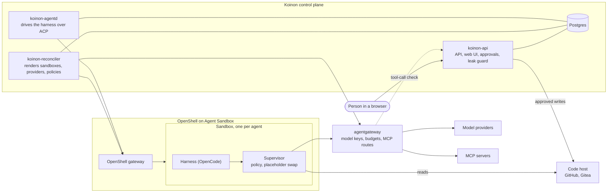

# Koinon

Run AI agents for your teams on Kubernetes, with approvals, budgets and no credentials in the sandbox.

Pronounced **KOY-non**, after the leagues of independent Greek city-states.

> [!WARNING]
> **Koinon is pre-alpha.** It is liable to change in major ways at any release, including its API,
> database schema and Helm values. There is no schema or upgrade promise before v0.3 (ADR 0085,
> ADR 0099): an update may need a reinstall. Do not use it for production or for data you cannot lose.
> Released images are public and signed; see [Releasing](docs/dev/releasing.md#verify-with-no-login).

## What Koinon is

Koinon is an open source org-and-work layer for AI agents on Kubernetes. Teams and people get their
own orgs. An org owns its agents, connections, model providers, budgets and members. Agents take
work as tasks. A person, a trigger or another agent creates a task. The inbox shows what needs a
person.

Koinon does not build its own sandbox. It reuses [NVIDIA OpenShell](https://github.com/NVIDIA/OpenShell)
on [Kubernetes Agent Sandbox](https://agent-sandbox.sigs.k8s.io) for sandbox lifecycle, isolation,
network policy and credential placeholders. Model and tool traffic goes through one gateway,
[agentgateway](https://agentgateway.dev), which holds the real keys.

What you get:

- **Orgs and roles.** Team orgs and personal orgs, each with its own members and settings
  ([ADR 0019](docs/adr/0019-personal-agents-and-teams.md)).
- **Agents from templates.** Each agent has its own instructions, model, budget, home volume and
  sandbox. The harness that runs inside the sandbox is [OpenCode](harnesses/opencode/README.md).
- **Tasks, triggers and the inbox.** Work arrives from people, schedules and events; the inbox lists
  what waits on you ([tasks and inbox](https://koinon.stateracloud.com/docs/use/tasks-and-inbox/),
  [triggers](https://koinon.stateracloud.com/docs/use/triggers/)).
- **Approvals.** A risky action parks the run. The approval card shows the exact call. Koinon runs the
  call only after a person approves it
  ([scoped approvals](https://koinon.stateracloud.com/docs/use/scoped-approvals/)).
- **Questions.** An agent can ask a person a question and wait for the answer
  ([ask a user](https://koinon.stateracloud.com/docs/use/ask-user/)).
- **Budgets and run limits.** Every model call is priced and charged to a spend ledger. A budget stop
  halts the run ([budgets](https://koinon.stateracloud.com/docs/operate/budgets/)).
- **Code hosts and MCP servers.** GitHub, GitHub Enterprise Server and Gitea, plus MCP servers that
  the org adds ([GitHub App](https://koinon.stateracloud.com/docs/operate/github-app/),
  [MCP servers](https://koinon.stateracloud.com/docs/operate/mcp-servers/)).
- **Audit and run traces.** An audit log of who did what, and a trace of each run
  ([audit](https://koinon.stateracloud.com/docs/operate/audit/)).

## How it works

Postgres is the source of truth ([ADR 0003](docs/adr/0003-postgres-source-of-truth.md)). The reconciler turns that state into
OpenShell sandboxes, provider records and policies, and into gateway configuration. `koinon-agentd`
runs in the control plane and talks to the harness through the OpenShell gateway
([ADR 0049](docs/adr/0049-v01-scope-decisions.md)). The supervisor in each sandbox is the only way
out of it. Approved writes to a code host come from `koinon-api`, never from the sandbox
([ADR 0062](docs/adr/0062-code-host-connectors.md)).

For more: [`docs/design.md`](docs/design.md), the [ADR index](docs/adr/README.md) and the
[glossary](GLOSSARY.md).

## Security model

- **Credentials stay out of the sandbox.** The sandbox holds only placeholders. The OpenShell
  supervisor swaps a placeholder for the real secret only on requests to allowed endpoints. Model
  provider keys stay at the gateway; the sandbox's gateway key is worthless anywhere else
  ([ADR 0040](docs/adr/0040-agentgateway-model-and-mcp-gateway.md),
  [ADR 0045](docs/adr/0045-openshell-hardening-defaults.md)). One narrow, opt-in exception for
  credentials that cannot be held outside the sandbox is in
  [ADR 0044](docs/adr/0044-in-sandbox-credential-exception.md).
- **Policy is enforced in every tier.** Koinon renders OpenShell network policy with
  `enforcement: enforce` and a ValidatingAdmissionPolicy on the sandbox namespaces
  ([ADR 0045](docs/adr/0045-openshell-hardening-defaults.md)).
- **One isolation tier per install.** The default is `vm`: a VM per sandbox, for example with Kata
  ([ADR 0075](docs/adr/0075-isolation-tiers.md)).
- **Risky actions need a person.** Each connector scope has a risk tier, and the grant's preset says
  allow, ask or deny ([ADR 0008](docs/adr/0008-approvals-and-risk-tiers.md),
  [ADR 0042](docs/adr/0042-ask-tier-park-and-execute.md)).
- **A leak guard checks tool calls** by where they send data
  ([ADR 0084](docs/adr/0084-leak-guard.md), [ADR 0091](docs/adr/0091-leak-guard-by-destination.md)).
- **CI runs a sandbox escape suite** ([`test/escape/`](test/escape/)).

Report a vulnerability as described in [SECURITY.md](SECURITY.md). Do not open a public issue.

## Quickstart

You need:

- a Kubernetes cluster that enforces NetworkPolicy (kind works on a laptop);
- Kubernetes Agent Sandbox and the OpenShell gateway, installed;
- a sandbox RuntimeClass (Kata; `runc` on kind);
- the CloudNativePG operator, or an existing Postgres;
- `helm`, `kubectl` and `jq`;
- a GitHub account that can create a GitHub App;
- an API key for a model provider.

The [prerequisites page](https://koinon.stateracloud.com/docs/start/prerequisites/) gives the
supported versions. Then follow the
[quickstart](https://koinon.stateracloud.com/docs/start/quickstart/). At the end, an agent proposes
a GitHub action and you approve it.

To work on Koinon itself, see [CONTRIBUTING.md](CONTRIBUTING.md) and the
[development loop](docs/dev/loop.md).

## Documentation

| Where | What |
| --- | --- |
| [Start](https://koinon.stateracloud.com/docs/start/quickstart/) | Prerequisites and the quickstart |
| [Use](https://koinon.stateracloud.com/docs/use/tasks-and-inbox/) | Tasks, triggers, approvals, questions, home checkpoints |
| [Operate](https://koinon.stateracloud.com/docs/operate/upgrading/) | Models, budgets, code hosts, backup, upgrades, metrics |
| [Contribute](https://koinon.stateracloud.com/docs/contribute/) | How to contribute |
| [GLOSSARY.md](GLOSSARY.md) | The words Koinon uses, and the words it avoids |
| [docs/design.md](docs/design.md) | Design overview |
| [docs/adr/](docs/adr/README.md) | Architecture decision records |
| [docs/dev/](docs/dev/) | Developer documents: CI, releases, the dev loop |

The documentation site lives in [stateracloud/koinon-docs](https://github.com/stateracloud/koinon-docs).

## Working with coding agents

- Working on this repository? Your agent reads [`AGENTS.md`](AGENTS.md). The rules for AI-assisted
  pull requests are in [CONTRIBUTING.md](CONTRIBUTING.md#ai-assisted-contributions).
- Installing or using Koinon with an agent? Point it at <https://koinon.stateracloud.com/llms.txt>.

## Status and roadmap

- Releases: [tags](https://github.com/stateracloud/koinon/tags) and
  [release notes](docs/releases/).
- Planned work: [milestones](https://github.com/stateracloud/koinon/milestones) and the
  [roadmap ADR](docs/adr/0024-roadmap.md).

## Repository layout

| Path | Contents |
| --- | --- |
| `api/` | Protobuf API definitions (connect-rpc) |
| `cmd/` | Binaries: `koinon-api`, `koinon-reconciler`, `koinon-agentd` and test fakes |
| `internal/` | Go packages, database migrations and generated code |
| `web/` | React and Vite single-page app |
| `harnesses/` | Harness images and contracts (OpenCode) |
| `flavors/` | Old name of `harnesses/`, kept as a link during the rename |
| `connectors/` | Connector types: GitHub and Gitea |
| `templates/` | Agent templates |
| `pricing/` | The default model price list and its tooling |
| `charts/koinon/` | Helm chart |
| `test/` | End-to-end, sandbox escape and chart smoke tests |
| `hack/` | Scripts for development, CI, claims and releases |
| `third_party/` | Vendored protobuf definitions of OpenShell and agentgateway |
| `docs/` | Design, ADRs, research, spikes and developer documents |

## Contributing

See [CONTRIBUTING.md](CONTRIBUTING.md). Contributions need a DCO sign-off; there is no CLA. Read the
[Code of Conduct](CODE_OF_CONDUCT.md) and [MAINTAINERS.md](MAINTAINERS.md). Pick an issue with the
[`start-here`](https://github.com/stateracloud/koinon/labels/start-here) label.

## License

Koinon is licensed under [Apache-2.0](LICENSE).
