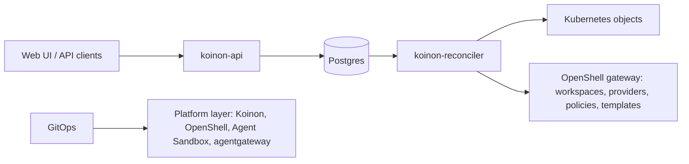

# 0003. Postgres via a Go API is the source of truth

- Status: Accepted
- Date: 2026-10-21
- Decision: [design.md#3](../design.md)

## Context

Koinon has two kinds of state:
- product state: orgs, memberships, grants, tickets, runs, approvals, audit and spend;
- rendered infrastructure state: namespaces, OpenShell workspaces, providers, policies and sandbox
  templates.

A Kubernetes-native design (everything as CRDs) is attractive, but three problems rule it out:
- Self-service authorization ("an org admin may grant this agent a subset of this connection's
  scopes") cannot be expressed in Kubernetes RBAC.
- Tickets and audit grow without bound and need queries, joins and retention, which etcd is not
  built for.
- Sensitive product data needs encryption at rest, TLS, least-privilege database roles and
  point-in-time recovery.

## Decision

- Postgres is the source of truth, accessed only through a Go API (`koinon-api`).
- Postgres runs with encryption at rest, TLS, least-privilege roles (separate roles for the API,
  the reconciler and migrations) and PITR.
- A reconciler (`koinon-reconciler`) renders Kubernetes and OpenShell objects from Postgres state.
  Those objects are derived output, never edited by hand.
- GitOps is used only for the platform layer: Koinon itself, OpenShell, Agent Sandbox, agentgateway
  and their configuration. It is not used for tenant objects.

## Alternatives considered

- **CRDs as source of truth (kagent / Kagenti style)** _(reconstructed from prior art)_. Native
  kubectl and GitOps for everything, but no self-service authorization model, and tickets and audit
  in etcd.
- **Hybrid: CRDs for agents, Postgres for tickets** _(reconstructed)_. Two sources of truth for
  related state and a dual-write problem between them.
- **GitOps for tenant objects** _(reconstructed)_. Self-service from the UI would need to write to
  Git, which is slow and hard to authorize per org.

## Consequences

- Positive: one place for authorization decisions, queries and audit.
- Positive: the reconciler can always re-render Kubernetes state from Postgres, so drift is
  repairable.
- Negative: tenant objects cannot be managed with kubectl or GitOps (a Koinon CLI or Terraform
  provider may be wanted later) _(inferred)_.
- Negative: Postgres becomes a critical dependency that needs backups, HA and an upgrade path
  ([0027](0027-repo-and-versioning.md), forward-only migrations).
- Follow-ups: an outbox table for reconciler triggers and UI streaming
  ([0010](0010-eventing.md), [0022](0022-frontend-architecture.md)) _(inferred)_.

## Open questions

- Which Postgres does the Helm chart offer: bring-your-own only, or an optional bundled operator
  such as CloudNativePG? _(inferred)_
- Does the reconciler watch Postgres (outbox polling, LISTEN/NOTIFY as a wake-up) or get called by
  the API? See [0010](0010-eventing.md).

## Upstream verification

- 2026-10-21: Postgres `NOTIFY` is delivered only on commit, payloads must be under 8000 bytes, and
  missed notifications are not replayed. So an outbox table must be the source of truth, with NOTIFY
  only as a wake-up hint. https://www.postgresql.org/docs/current/sql-notify.html

## Links

- [0010](0010-eventing.md), [0022](0022-frontend-architecture.md), [0027](0027-repo-and-versioning.md),
  [0030](0030-run-state-machine.md)
