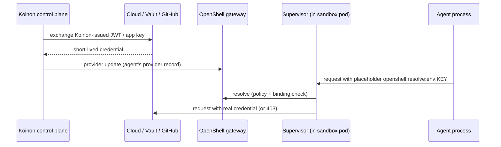

# 0006. Identity layers: per-agent ServiceAccount, no usable token in the sandbox

- Status: Accepted; amended by [0043](0043-workload-identity-adapters-and-koinon-issuer.md), [0044](0044-in-sandbox-credential-exception.md), [0063](0063-forge-credential-classes.md), [0065](0065-work-model-tasks-inbox.md) and [0073](0073-agent-passport.md)
- Date: 2026-10-21
- Decision: [design.md#6](../design.md)
- Verification: Pending: OpenShell spike (old issue 3)

## Context

Agents act as themselves ([0005](0005-agent-identity.md)), so each agent needs an identity that
external systems can trust. The core promise of Koinon is that **no usable credential lives inside
the sandbox**: a compromised or misled agent cannot take a credential with it.

External systems trust different things:
- Cloud providers (AWS, Entra/Azure, Azure DevOps, GCP, Vault) can trust an OIDC issuer through
  workload identity federation.
- Slack and GitHub need app credentials (a bot token, or a GitHub App private key that mints
  installation tokens).
- Some connectors may need a user's own delegated token.

OpenShell keeps credentials in gateway provider records. The supervisor proxy replaces an opaque
placeholder (`openshell:resolve:env:KEY`) with the real value only when the network policy allows
the binary and destination, and the credential binding covers the host, port and path. Otherwise it
answers 403.

## Decision

- Each agent has its own Kubernetes ServiceAccount, used as its stable workload identity.
- The sandbox gets **no usable token**. The ServiceAccount token is not mounted (Agent Sandbox
  templates default `automountServiceAccountToken` to false), and nothing else is mounted that
  could authenticate directly.
- Federated credentials (AWS, Entra, Azure DevOps, Vault) are minted **outside** the sandbox and
  held as OpenShell provider records, which are injected only for allowed endpoints.
- Names follow SPIFFE style now (for example `spiffe://<trust-domain>/org/<org>/agent/<agent>`),
  with SPIRE as a later option.
- Connector auth types: `federated`, `app-credential`, `delegated-user`.
- A2A calls authenticate with OpenShell-issued sandbox tokens or ServiceAccount JWTs, plus link
  policy ([0011](0011-agent-to-agent.md), [0012](0012-cross-org-sharing.md)).

**Amendments:**
- [0043](0043-workload-identity-adapters-and-koinon-issuer.md) defines *how* federated
  credentials are minted. A per-cloud `IdentityProviderAdapter` exchanges a token from a
  Koinon-owned OIDC issuer (`sub=koinon:<org>:<agent>`), not from the cluster ServiceAccount
  issuer, and pushes the result to OpenShell provider records before it expires. This replaces the
  design doc's "Pod Identity" wording, because EKS Pod Identity only exists on EKS.
- [0044](0044-in-sandbox-credential-exception.md) adds one gated exception: for auth types the
  platform admin allows, a credential may live inside the sandbox (for example a Copilot
  device-flow login), obtained through human takeover.

## Alternatives considered

- **Mount the ServiceAccount token and let SDKs federate directly (IRSA style)**
  _(reconstructed)_. Standard, but the token itself is a usable credential inside the sandbox.
- **EKS Pod Identity / AKS / GKE native workload identity in the sandbox** _(reconstructed)_. Ties
  Koinon to one managed cluster type and still exposes credentials to the agent process. Kept only
  as optional adapters on the control-plane side ([0043](0043-workload-identity-adapters-and-koinon-issuer.md)).
- **SPIRE from day one** _(reconstructed)_. Strong attestation, but more to operate. Deferred.

## Consequences

- Positive: a sandbox escape to the agent process yields placeholders, not credentials.
- Positive: one identity model across clouds and SaaS.
- Negative: anything the supervisor cannot rewrite falls outside this model:
  - cookies;
  - non-HTTP protocols;
  - `tls: skip` connections;
  - the request signing some CLIs do (OpenShell re-signs AWS SigV4, but chunked streaming SigV4 is
    not supported).

  Those tools go through MCP servers outside the sandbox.
- Negative: credential refresh is Koinon's job (push before expiry) _(inferred)_.
- Follow-ups: hardening defaults so no secret reaches `SandboxSpec.environment`
  ([0045](0045-openshell-hardening-defaults.md)); escape-suite checks for tokens and secrets on disk
  ([0025](0025-testing-strategy.md)).

## Open questions

- The spike must confirm that the agent process sees only placeholders. OpenShell's docs say so, but
  `crates/openshell-providers/README.md` says resolved provider environment is injected into agent
  child processes.
- Trust-domain naming for SPIFFE-style IDs (`koinon.dev`? the install's domain?). See
  [0097](0097-koinon-owned-gateway.md) decision 11: an agents trust domain run by Koinon's issuer.
- A2A authentication: OpenShell sandbox tokens or ServiceAccount JWTs, and their audience and
  lifetime ([0011](0011-agent-to-agent.md)).

## Upstream verification

- 2026-10-21: OpenShell docs (docs/how-it-works/providers/overview.mdx) say "The agent process
  inside the sandbox never sees real credential values". Placeholders are rewritten in headers,
  query, path, opt-in body and WebSocket text, and AWS SigV4 is re-signed. Not rewritten: cookies,
  `tls: skip` and non-HTTP traffic. Exceptions where real values can appear:
  - `SandboxSpec.environment` and template `--env`;
  - the `allow_uninspected_credentials` setting;
  - non-secret settings of the Google provider.
  https://github.com/NVIDIA/OpenShell
- 2026-10-21: EKS Pod Identity is available only on EKS.
  https://docs.aws.amazon.com/eks/latest/userguide/pod-identities.html
- 2026-10-21: Agent Sandbox templates default `automountServiceAccountToken` to false.
  https://github.com/kubernetes-sigs/agent-sandbox

## Amendment (2026-10-26): no traffic between sandboxes; static code-host tokens

- **Agent to agent.** Sandboxes never talk to each other over the network. Inside an install one
  agent asks another through the MCP tools `ask_agent` and `reply`, carried by Postgres
  ([0065](0065-work-model-tasks-inbox.md)), so the A2A authentication bullet above applies only to
  the later external A2A gateway.
- **Auth types.** [0063](0063-forge-credential-classes.md) adds a credential class beyond
  `federated`, `app-credential` and `delegated-user`: static code-host tokens (Gitea), held by
  Koinon and delivered only through OpenShell placeholders.

## Amendment (2026-10-28): the agent passport

[0073](0073-agent-passport.md) adds an identity that systems outside Koinon can verify.

- **The passport.** Calls to MCP servers and org APIs carry a short-lived, Koinon-signed JWT. It names
  the org, agent, version, run, task, requester and approval, with an RFC 8693 `act` chain for
  delegation, and is bound to one audience.
- **Outside the sandbox.** The gateway attaches the passport after the supervisor has resolved the
  placeholder. The sandbox never sees it, and it is never logged. The rule of this ADR, "no usable
  token in the sandbox", is unchanged.
- **Per-run keys.** Each run gets its own short-lived gateway key, so the gateway knows the exact run.
- **The agent header.** The unsigned `x-koinon-agent` header stays only as a hint for Koinon's own
  tool servers, which verify the passport as well.
- **A2A tokens.** The open question on A2A authentication tokens is answered for the later external A2A
  gateway: passports with an `act` chain.

## Links

- [0005](0005-agent-identity.md), [0007](0007-connector-model.md),
  [0043](0043-workload-identity-adapters-and-koinon-issuer.md),
  [0044](0044-in-sandbox-credential-exception.md), [0045](0045-openshell-hardening-defaults.md)
