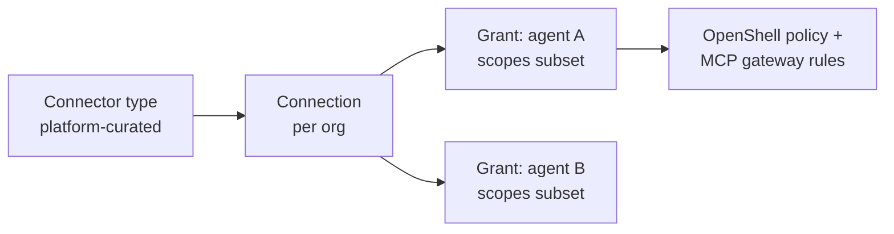

# 0007. Connector model: type, connection, grant

- Status: Accepted
- Amended by: [0049](0049-v01-scope-decisions.md), [0056](0056-model-providers-pricing-and-budgets-per-org.md)
- Date: 2026-10-21
- Decision: [design.md#7](../design.md)

## Context

Agents need access to external systems such as GitHub, Slack and clouds. Two forces pull against
each other:
- The platform team should not be a bottleneck for every new connection an org wants.
- Scopes must stay enforceable at the boundary (OpenShell policy and the MCP gateway), so they have
  to be machine-readable, not free text.

## Decision

There are three levels:

1. **Connector type**: curated by the platform and shipped as data
   ([0027](0027-repo-and-versioning.md)). It defines:
   - the auth type (`federated`, `app-credential` or `delegated-user`, see
     [0006](0006-identity-layers.md));
   - the hosts;
   - the scopes, each with a risk tier ([0008](0008-approvals-and-risk-tiers.md));
   - a machine-readable setup guide ([0021](0021-connector-setup-guides.md)).
2. **Connection**: a per-org card that configures one instance of a type (for example "our GitHub
   App installation on org X"), with its secrets in Vault/OpenBao.
3. **Grant**: per agent, a subset of the connection's scopes plus an approval preset.

Built-in types: Slack, Teams, GitHub, Azure DevOps, AWS, Azure and a generic HTTP API.

**Amendment ([0049](0049-v01-scope-decisions.md)).** Koinon has no hard dependency on a secret
store. Connection secrets are Kubernetes Secrets; organisations that keep them in OpenBao, Vault,
AWS Secrets Manager or Azure Key Vault sync them in with the External Secrets Operator. Secrets
entered in the UI are written by Koinon as Kubernetes Secrets.

## Alternatives considered

- **Free-form connections (URL plus secret)** _(reconstructed)_. Flexible, but scopes cannot be
  enforced or tiered. The generic HTTP API type covers this need, with explicit hosts and paths.
- **Platform-managed connections only** _(reconstructed)_. Safe, but makes the platform team a
  bottleneck.
- **Plugins as code** _(reconstructed)_. Powerful, but it increases the attack surface and the
  review burden. Types stay data.

## Consequences

- Positive: orgs connect systems themselves within platform-defined types.
- Positive: grants compile to enforceable rules ([0008](0008-approvals-and-risk-tiers.md)).
- Negative: every new system needs a curated type, so the generic HTTP API type must be good enough
  for long-tail use _(inferred)_.
- Negative: the type schema (scopes to hosts, methods, paths and MCP tools) is a public contract
  that must be versioned _(inferred)_.
- Follow-ups: the GitHub connector type in v0.1 ([0036](0036-v01-demo.md)); the full framework in
  v0.2.

## Open questions

- The schema format for connector types (YAML with a JSON Schema? protobuf?) and where types live
  (`connectors/<name>/`).
- The GitHub connector's v0.1 scopes and their risk tiers (one of the open items in BOOTSTRAP.md).

## Upstream verification

- 2026-10-21: OpenShell policy matches binary, host, port, REST method, path and query, GraphQL
  operation type, name and fields, and MCP method and tool, so scopes can compile to policy
  entries. https://github.com/NVIDIA/OpenShell (docs/how-it-works/policies/schema.mdx)
- 2026-10-21: GitHub App installation tokens can be narrowed by repositories and permissions
  (contents, pull_requests, issues and so on).
  https://docs.github.com/en/apps/creating-github-apps/authenticating-with-a-github-app/generating-an-installation-access-token-for-a-github-app

## Links

- [0006](0006-identity-layers.md), [0008](0008-approvals-and-risk-tiers.md),
  [0021](0021-connector-setup-guides.md), [0040](0040-agentgateway-model-and-mcp-gateway.md)
