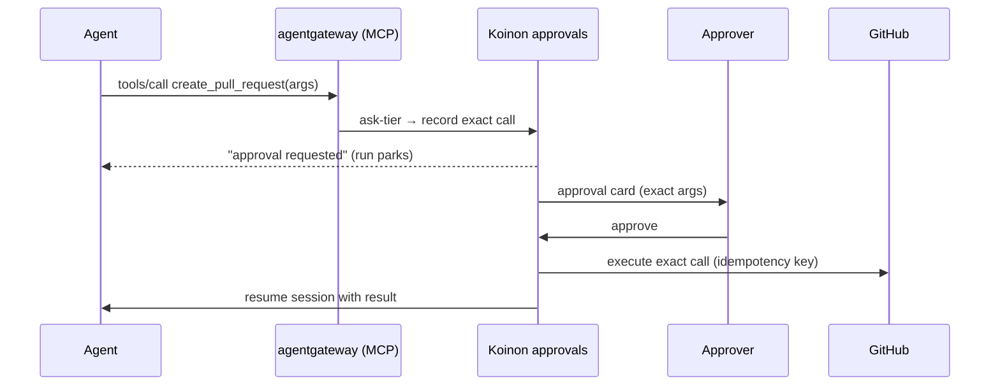

# 0008. Approvals: risk tiers per scope, enforced at the boundary

- Status: Accepted; amended by [0042](0042-ask-tier-park-and-execute.md)
- Date: 2026-10-21
- Area: work-model
- Tags: approvals, mcp, openshell
- Amended by: [0048](0048-openshell-spike-results.md) (resolves the spike verification)
- Decision: [design.md#8](../design.md)
- Verification: done by the OpenShell spike, see [0048](0048-openshell-spike-results.md) (was: Pending: OpenShell spike, old issue 3)

## Context

Agents should be useful without a human approving every step, but some actions (merging, deleting,
paying, messaging customers) must never happen unchecked. The boundary (the OpenShell supervisor
and the MCP gateway) should do most of the work, so humans only see the actions that are truly
risky.

## Decision

- Each connector scope carries a platform-defined **risk tier**:
  - `read`;
  - `reversible-write`;
  - `external-or-irreversible`;
  - `forbidden`.
- Each grant picks a **preset** that maps tiers to allow, ask or deny: `Read only`, `Standard` or
  `Trusted`.
- An optional intent classifier can triage requests in the ask tier.
- Learned rule suggestions propose narrower rules from observed behaviour, aligned with OpenShell
  RFC 0002 (agent-driven policy proposals; agents never approve their own rules).
- Each grant compiles to OpenShell network policy entries (binary, host, method, path) plus MCP
  gateway tool rules.
- An approval is bound to the exact request. The run parks while waiting.
- Approver policy is set per grant, with an optional two-person rule.

**Amendment ([0042](0042-ask-tier-park-and-execute.md)).** OpenShell has no ask tier: a request
the supervisor denies stays denied, and OpenShell approvals apply to proposed *rules*, not to single
requests. So:
- The ask tier lives in the MCP gateway (agentgateway, [0040](0040-agentgateway-model-and-mcp-gateway.md)).
- Ask-tier scopes are exposed to the agent only as MCP tools. OpenShell network policy denies the
  direct write APIs.
- An ask-tier call returns "approval requested" at once, and the run parks.
- After approval, Koinon itself executes the exact approved call, with an idempotency key, and
  resumes the session with the result.
- OpenShell network policy enforces only `allow` and `deny`.

## Alternatives considered

- **Approve every write** _(reconstructed)_. Safe, but humans rubber-stamp after the first few.
- **Approve by rule (OpenShell draft rules)**. Recorded during grilling: this binds approval to
  method and path, not to the request body, so it does not meet "bound to the exact request". It is
  still used for learned rule suggestions.
- **Hold the HTTP or MCP call open until approval**. Recorded during grilling: fragile across
  minutes or hours and gateway restarts. Rejected in [0042](0042-ask-tier-park-and-execute.md).

## Consequences

- Positive: most work flows without humans, and risky actions get a precise approval card.
- Positive: approvals are auditable down to the exact arguments.
- Negative: ask-tier actions must be available as MCP tools. A connector type that has an ask-tier
  scope needs an MCP tool implementation, not just HTTP policy _(inferred)_.
- Negative: OpenShell L7 rules default to `enforcement: audit` (log and allow). Koinon must always
  render `enforce` ([0045](0045-openshell-hardening-defaults.md)).
- Follow-ups: v0.1 needs agentgateway, a GitHub MCP tool and the approval service for the demo's
  "approve one GitHub action" ([0036](0036-v01-demo.md)).

## Open questions

- The intent classifier: which model, run where, and with what budget? Not before v0.2.
- The two-person rule: how it is expressed in the approver policy, and how it applies to A2A
  approvals in provider orgs ([0012](0012-cross-org-sharing.md)).
- How learned suggestions map to OpenShell's policy advisor and `rule approve` flow (RFC 0002 sits
  behind the `agent_policy_proposals_enabled` flag, which defaults to false).

## Upstream verification

- 2026-10-21: OpenShell has no request-level ask tier. Its policy advisor creates rule proposals
  scoped to binary, host, port, method and path, which humans approve with `rule approve`. RFC 0002
  (accepted) adds agent-drafted proposals through `policy.local`, with no self-approval. L7
  endpoints default to `enforcement: audit`. https://github.com/NVIDIA/OpenShell
  (docs/how-it-works/policies/schema.mdx, rfcs/0002)
- 2026-10-21: agentgateway authorizes MCP calls with CEL on `mcp.tool.name`, `mcp.tool.arguments`
  and JWT claims, and filters hidden tools out of `tools/list`.
  https://agentgateway.dev/docs/standalone/main/configuration/security/mcp-authz/

## Links

- [0007](0007-connector-model.md), [0029](0029-run-level-resume.md),
  [0040](0040-agentgateway-model-and-mcp-gateway.md), [0042](0042-ask-tier-park-and-execute.md),
  [0045](0045-openshell-hardening-defaults.md)
