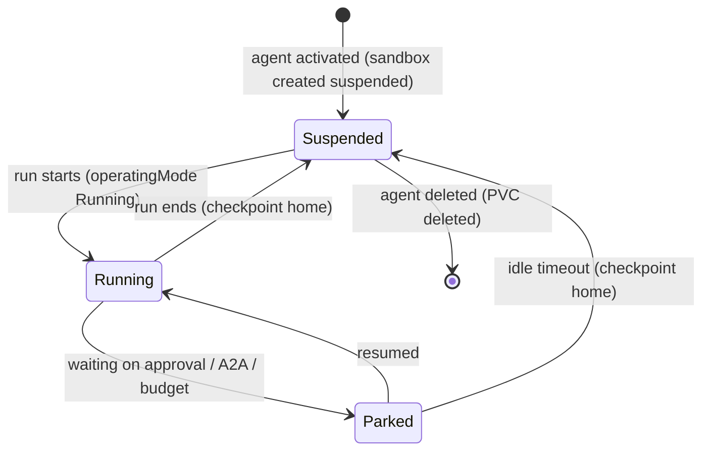

# 0009. Agent runtime: persistent agent, ephemeral compute

- Status: Accepted
- Date: 2026-10-21
- Decision: [design.md#9](../design.md)

## Context

Agents should feel like colleagues who remember past work. That points to a long-lived home with
memory, sessions and tools. Most agents are idle most of the time, though, and keeping a Kata VM
running for each one is expensive. Kubernetes Agent Sandbox and OpenShell's Kubernetes driver
provide suspend and resume, keeping the volumes.

## Decision

- **Persistent agent, ephemeral compute:**
  - Each agent has a durable home volume ([0032](0032-agent-home-checkpoints.md)).
  - Each agent has exactly one OpenShell sandbox, suspended between runs
    (`spec.operatingMode: Suspended`).
- `alwaysOn` is an optional Koinon agent setting that keeps the sandbox running. It is a Koinon
  field, not an OpenShell or Agent Sandbox field.
- One run per agent at a time, enforced by the ownership epoch ([0030](0030-run-state-machine.md)).
- The flavor only selects the harness image ([0015](0015-agent-environment-and-browser.md),
  [0035](0035-v01-flavors.md)).

## Alternatives considered

- **Ephemeral agents, a fresh sandbox per run** _(reconstructed; LiteLLM Agent Platform's OpenCode
  runtime uses a fresh sandbox per session)_. Clean, but memory and installed tools must be rebuilt
  every time.
- **Always-on agents** _(reconstructed)_. Fastest response, but idle cost grows with the number of
  agents. Kept as the `alwaysOn` option.
- **Warm pools with claims for every run** _(reconstructed)_. Agent Sandbox offers
  `SandboxWarmPool` and `SandboxClaim`, but a pooled sandbox has no agent-specific home. They may
  help later for brand-new agents.

## Consequences

- Positive: near-zero idle cost (only the PVC) and agents that remember.
- Negative: cold-start latency on every run (pod scheduling plus Kata VM boot, with Kata pod
  overhead of about 130Mi and 250m on Talos) _(inferred)_.
- Negative: zone-bound PVCs. Handled by S3 checkpoints ([0032](0032-agent-home-checkpoints.md)).
- Negative: the volume claim templates of an Agent Sandbox `Sandbox` are immutable, so changing
  the home volume layout means migrating to a new sandbox _(inferred)_.
- Follow-ups: measure cold start on the home lab during the spike.

## Open questions

- Idle timeout for parked runs before the sandbox is suspended.
- Whether one run per agent at a time is too strict for heavily used team agents (clones? queueing
  is the default).

## Upstream verification

- 2026-10-21: Agent Sandbox `spec.operatingMode: Running | Suspended`. Suspending terminates the
  pod but keeps the Sandbox object and its volumes; resuming reattaches them. PVCs come from
  `volumeClaimTemplates`, are kept while suspended, and are deleted with the Sandbox. The API is
  v1beta1 at release v1.0.7. https://github.com/kubernetes-sigs/agent-sandbox (api/v1beta1/sandbox_types.go,
  KEP-0694)
- 2026-10-21: the OpenShell Kubernetes driver stops a sandbox by setting
  `operatingMode: Suspended`, keeping the workspace PVC. Only delete removes storage. New sandboxes
  are created suspended. https://github.com/NVIDIA/OpenShell (crates/openshell-driver-kubernetes/README.md)
- 2026-10-21: `alwaysOn` appears nowhere in OpenShell, so it is a Koinon concept.

## Links

- [0016](0016-harness-and-deployment.md), [0029](0029-run-level-resume.md), [0030](0030-run-state-machine.md),
  [0032](0032-agent-home-checkpoints.md)
