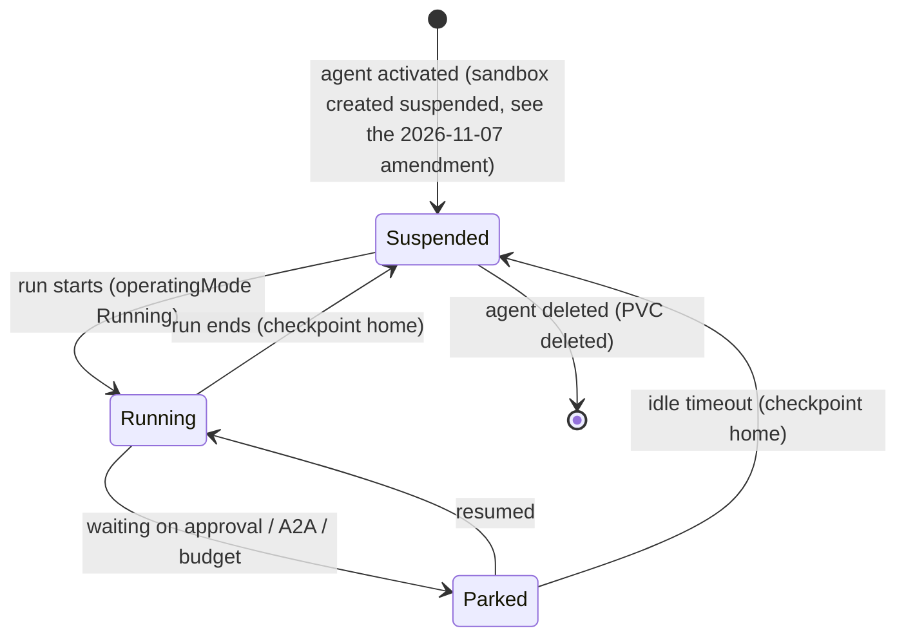

# 0009. Agent runtime: persistent agent, ephemeral compute

- Status: Accepted; amended 2026-10-30 and 2026-11-07 (below)
- Date: 2026-10-21
- Decision: [design.md#9](../design.md)

## Context

Agents should feel like colleagues who remember past work. That points to a long-lived home with
memory, sessions and tools. Most agents are idle most of the time, though, and keeping a Kata VM
running for each one is expensive. Kubernetes Agent Sandbox and OpenShell's Kubernetes driver
provide suspend and resume, keeping the volumes.

## Decision

- **Persistent agent, ephemeral compute:**
  - Each agent has a durable home volume ([0032](0032-agent-home-checkpoints.md)).
  - Each agent has exactly one OpenShell sandbox, suspended between runs
    (`spec.operatingMode: Suspended`).
- `alwaysOn` is an optional Koinon agent setting that keeps the sandbox running. It is a Koinon
  field, not an OpenShell or Agent Sandbox field. _(Replaced by `agents.keep_warm`; see the
  amendment of 2026-11-07.)_
- One run per agent at a time, enforced by the ownership epoch ([0030](0030-run-state-machine.md)).
- The flavor only selects the harness image ([0015](0015-agent-environment-and-browser.md),
  [0035](0035-v01-flavors.md)).

## Alternatives considered

- **Ephemeral agents, a fresh sandbox per run** _(reconstructed; LiteLLM Agent Platform's OpenCode
  runtime uses a fresh sandbox per session)_. Clean, but memory and installed tools must be rebuilt
  every time.
- **Always-on agents** _(reconstructed)_. Fastest response, but idle cost grows with the number of
  agents. Kept as the `alwaysOn` option.
- **Warm pools with claims for every run** _(reconstructed)_. Agent Sandbox offers
  `SandboxWarmPool` and `SandboxClaim`, but a pooled sandbox has no agent-specific home. They may
  help later for brand-new agents.

## Consequences

- Positive: near-zero idle cost (only the PVC) and agents that remember.
- Negative: cold-start latency on every run (pod scheduling plus Kata VM boot, with Kata pod
  overhead of about 130Mi and 250m on Talos) _(inferred)_.
- Negative: zone-bound PVCs. Handled by S3 checkpoints ([0032](0032-agent-home-checkpoints.md)).
- Negative: the volume claim templates of an Agent Sandbox `Sandbox` are immutable, so changing
  the home volume layout means migrating to a new sandbox _(inferred)_.
- Follow-ups: measure cold start on the home lab during the spike.

## Open questions

- Idle timeout for parked runs before the sandbox is suspended.
- Whether one run per agent at a time is too strict for heavily used team agents (clones? queueing
  is the default).

## Upstream verification

- 2026-10-21: Agent Sandbox `spec.operatingMode: Running | Suspended`. Suspending terminates the
  pod but keeps the Sandbox object and its volumes; resuming reattaches them. PVCs come from
  `volumeClaimTemplates`, are kept while suspended, and are deleted with the Sandbox. The API is
  v1beta1 at release v1.0.7. https://github.com/kubernetes-sigs/agent-sandbox (api/v1beta1/sandbox_types.go,
  KEP-0694)
- 2026-10-21: the OpenShell Kubernetes driver stops a sandbox by setting
  `operatingMode: Suspended`, keeping the workspace PVC. Only delete removes storage. New sandboxes
  are created suspended. https://github.com/NVIDIA/OpenShell (crates/openshell-driver-kubernetes/README.md)
- 2026-10-21: `alwaysOn` appears nowhere in OpenShell, so it is a Koinon concept.

## Links

- [0016](0016-harness-and-deployment.md), [0029](0029-run-level-resume.md), [0030](0030-run-state-machine.md),
  [0032](0032-agent-home-checkpoints.md)

## Amendment (2026-10-30): a spent budget stops the run

A spent budget **stops** the run: it is canceled with failure class `budget` (and reason
`spend_limit`, or `run_spend_cap` for a run's own limit). It does not park. The later decisions win
over the "Parked: waiting on ... budget" state in the diagram above: ADR 0041's "Stop before the key goes" (cancel, not park), ADR 0050
and ADR 0081; the code cancels (`ledger.Stop`, agentd's `budgetStop`). The park reason `budget`
(`PARK_REASON_BUDGET`) is reserved and unused; proto values are never removed. Wording only (GLOSSARY.md), no decision change.

## Amendment (2026-11-07): the sandbox starts on demand; `keep_warm` replaces `alwaysOn`

Wording only for the diagram and the setting name; the persistent-agent, ephemeral-compute decision
stands. The decision of 2026-10-31 (old issue 315) is recorded in the
[ADR 0049 amendment of 2026-11-01](0049-v01-scope-decisions.md); this amendment makes ADR 0009 agree
with it and with the code (`internal/reconciler`).

- **Activation creates no sandbox.** The state `[*] --> Suspended: agent activated` above no longer
  holds. The reconciler creates (and starts) an agent's sandbox only when something wants it: an
  active run, a claimable run (`has_demand`), a pre-wake signal (package wake) or a keep-warm
  request. Until then the agent's sandbox row records state `deleting` and phase `Idle` ("no sandbox
  yet, it starts with the first run"), or `Archived` when its sandbox was archived (ADR 0032 amendment; it restores on the next run). The agent still has
  exactly one sandbox and one home volume ([0032](0032-agent-home-checkpoints.md)) once the first
  run has created them.
- **Stopped, not only suspended.** The reconciler stops a sandbox after `IdleTimeout` without an
  active run (parked runs included), after the home backup gate, and starts it again when work
  arrives. A stopped sandbox keeps its home volume, as the `Suspended` state above did. A sandbox
  stopped for the archive period is deleted together with its volume and restored from the latest
  home checkpoint on the next run (ADR 0032 amendment).
- **`alwaysOn` is replaced by `agents.keep_warm`.** It is a per-agent setting set by an org admin
  (migration 00044). A keep-warm agent's sandbox is created while the agent is active, is never
  idle-stopped and is started when found stopped. The name `alwaysOn` was never built as a field.
  The operator caps keep-warm per org (`reconciler.keepWarmPerOrg` in the chart, default 2, negative
  for none): each pass grants it to the org's oldest active agents that set it (`created_at`, `id`), up to the cap, and the others
  start on demand. The "Always-on agents" alternative above is therefore bounded, not a free
  option, so idle cost no longer grows with the number of agents.
- **Cost.** The first run of an agent waits for its sandbox to start (image pull, home volume). The
  isolation tier ([0075](0075-isolation-tiers.md)) and the hardening defaults
  ([0045](0045-openshell-hardening-defaults.md)) apply to the sandbox when it is created, so
  start-on-demand and `keep_warm` change when a sandbox exists, not what it may do. The latency
  follow-up above applies to every first run, not only those after a suspend.
- Open (tracked, not decided here): the API and UI for the setting with the org-admin check (#100);
  preparing the image and volume at activation (#101); a per-org rate limit on sandbox starts (#27).
