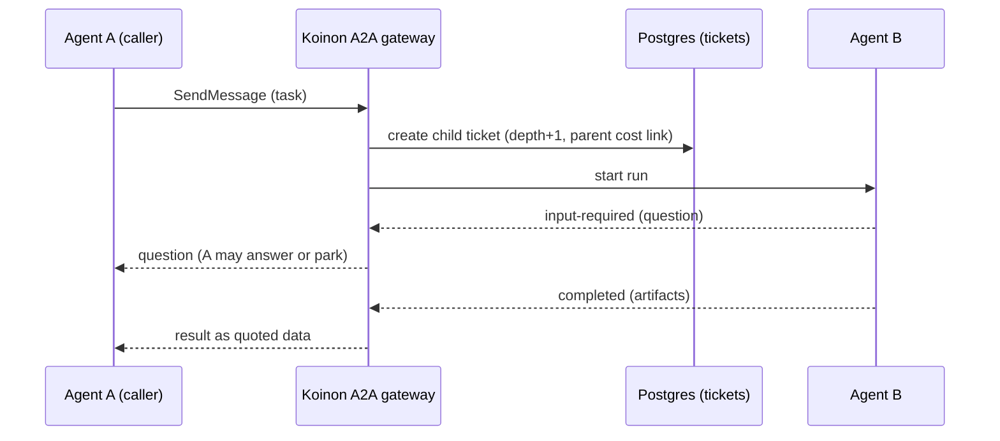

# 0011. Agent-to-agent: A2A, persisted as tickets

- Status: Accepted; amended by [0055](0055-chat-as-its-own-object.md), [0065](0065-work-model-tasks-inbox.md)
- Note: inside one install, the transport, the ticket persistence and the gateway in the diagram are
  replaced by [0065](0065-work-model-tasks-inbox.md) (`ask_agent` and `reply` over Postgres). A2A
  stays the protocol at the edge (external agents, v1.0).
- Date: 2026-10-21
- Decision: [design.md#11](../design.md)

## Context

Agents should ask expert agents for help (a personal agent asking the platform team's Kubernetes
agent), with back-and-forth, without losing the record. A2A is the emerging open protocol for this.
Agent calls can loop, nest deeply or run up costs.

## Decision

- A2A is the protocol for agent-to-agent calls.
- Every A2A task is persisted as a ticket, so it is visible on the board and in audit.
- The caller waits a short time, then parks ([0030](0030-run-state-machine.md)).
- The A2A `input-required` state is used for clarification questions.
- Agent cards are used for discovery.
- Guards:
  - a maximum call depth;
  - cycle detection;
  - each agent's spend counts against its own budget ([0065](0065-work-model-tasks-inbox.md);
    this replaces "cost inherited by the parent ticket", [0041](0041-koinon-spend-ledger-and-budget-stops.md));
  - results returned to the caller as quoted data, never as instructions, to blunt prompt injection.

## Alternatives considered

- **Direct MCP tool calls between agents** _(reconstructed)_. MCP does not model long-running,
  multi-turn tasks with states such as `input-required`.
- **Shared ticket comments only, with no protocol** _(reconstructed)_. Durable, but not
  interoperable with external A2A agents.
- **A2A without persisting tickets** _(reconstructed)_. Interoperable, but invisible to humans, and
  lost if a run dies.

## Consequences

- Positive: a dynamic back-and-forth with a durable, visible record.
- Positive: interoperable with external A2A agents later.
- Negative: Koinon builds an A2A gateway that maps A2A tasks to tickets and runs, and handles
  streaming (SSE) and push notifications _(inferred)_.
- Negative: depth and cycle limits must be enforced in the gateway, not trusted to agents.
- Follow-ups: `ask_agent` inside an install lands in v0.2; the external A2A gateway in v1.0
  ([0024](0024-roadmap.md) amendment, [0065](0065-work-model-tasks-inbox.md)).

## Amendment (2026-10-23): read-only delegation from a chat

[0055](0055-chat-as-its-own-object.md) makes chat its own object. A read-only delegation from a
chat to a specialist agent is **ephemeral**: it is not persisted as a ticket (this narrows "every
A2A task is persisted as a ticket" above). The caller pays for it, and only metadata is audited.
Delegations that write, and delegations from tickets, are persisted as tickets as before.

## Amendment (2026-10-26): tasks, and Postgres inside an install

[0065](0065-work-model-tasks-inbox.md) changes this decision:

- "Persisted as a ticket" now reads "is a task": a request to another agent is a **child task**.
- **Inside one install the transport is Postgres plus the MCP tools `ask_agent` and `reply`**, not
  the A2A wire protocol. The asking run parks with reason `a2a` and resumes on the reply. The
  expert's sandbox starts as soon as the child task exists. Each agent uses only its own grants and
  budget, membership and role caps apply ([0019](0019-personal-agents-and-teams.md)), and sandboxes
  never talk to each other over the network.
- **The external A2A gateway comes in v1.0** and maps onto the same tasks. The agent card path
  `/.well-known/agent-card.json` was verified on 2026-10-26 (A2A v1.0.0 §8.2).
- `ask_agent` ships in v0.2 (old issue 146), not v0.3.
- Not decided: whether a read-only delegation from a chat (amendment of 2026-10-23) stays
  ephemeral now that a request is a child task.
- **Guards** (old issue 146 A3) are decided in [0065](0065-work-model-tasks-inbox.md): refused when the asked
  agent is already in the chain, at most 3 deep, at most 5 open questions per agent, and the same
  question to the same agent in the same task returns the existing child. This answers the open
  question on depth and cycle key below.

## Open questions

- ~~Maximum default depth and the cycle-detection key~~ Answered 2026-10-26 in
  [0065](0065-work-model-tasks-inbox.md): the agent chain, at most 3 deep.
- Should agentgateway (which also speaks A2A, [0040](0040-agentgateway-model-and-mcp-gateway.md))
  carry the A2A transport, with Koinon owning the ticket mapping? To be evaluated in v0.3.
- Agent card discovery path and how private, shared and public visibility filters it
  ([0012](0012-cross-org-sharing.md)).

## Upstream verification

- 2026-10-21: A2A spec v1.0.0. Task states: submitted, working, input-required, auth-required,
  completed, failed, canceled, rejected. Bindings: JSON-RPC, gRPC, HTTP+JSON. SSE streaming and
  webhook push notifications. https://a2a-protocol.org/latest/specification/
- 2026-10-21: the official Go SDK is a2aproject/a2a-go (Apache-2.0, v2.6.0, targets v1.0). The
  agent card path `/.well-known/agent-card.json` is unverified.

## Links

- [0012](0012-cross-org-sharing.md), [0019](0019-personal-agents-and-teams.md),
  [0030](0030-run-state-machine.md), [0031](0031-artifacts-in-object-storage.md)
