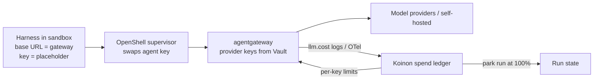

# 0013. Model access through one gateway with hierarchical budgets

- Status: Accepted; amended by [0040](0040-agentgateway-model-and-mcp-gateway.md), [0041](0041-koinon-spend-ledger-and-budget-stops.md), [0044](0044-in-sandbox-credential-exception.md), [0114](0114-model-credentials-by-type.md) and 2026-10-30 (below)
- Date: 2026-10-21
- Decision: [design.md#13](../design.md)

## Context

Agents need models from many providers (OpenAI, Anthropic, Bedrock, Azure, Vertex, self-hosted
OpenAI-compatible servers). Operators need to:
- keep provider keys out of sandboxes;
- control spend at every level;
- see cost per ticket.

## Decision (as written in design.md)

- Sandboxes call OpenShell `inference.local`, which forwards to LiteLLM. LiteLLM handles API keys,
  OpenAI-compatible self-hosted models and provider presets.
- Virtual keys carry budgets in a hierarchy platform → org → agent → ticket, with a soft limit at
  80% and a hard limit at 100%; at the hard limit the run parks.
- v1 covers popular providers, API keys, and GitHub Copilot via OpenCode. Subscriptions are
  personal-only and come later.
- Vendor terms of service are reviewed first.

## Decision (as amended)

Three things changed during grilling on 2026-10-21:

1. **`inference.local` no longer exists.** OpenShell 0.1.0 removed it (PR #3195). Each agent instead
   gets an OpenShell provider record that points at the model gateway. The harness's base URL is the
   gateway, and the agent's gateway API key is the placeholder-swapped credential.
2. **LiteLLM is replaced by agentgateway** ([0040](0040-agentgateway-model-and-mcp-gateway.md)).
   procoduck decided to remove the LiteLLM dependency entirely. The reasons:
   - LiteLLM's Organizations level, team admin roles, audit logs, soft-budget alerts and spend
     reports are Enterprise-only;
   - its tag budgets have conflicting license signals.
3. **Budgets are owned by Koinon** ([0041](0041-koinon-spend-ledger-and-budget-stops.md)):
   - Koinon keeps the authoritative spend ledger and applies soft 80% and hard 100% (park) at the
     platform, org, agent and ticket/run levels.
   - It pushes per-key limits into agentgateway as the in-path stop.
   - Overshoot of at most one response is documented.
4. **GitHub Copilot** ([0044](0044-in-sandbox-credential-exception.md)) is supported in two ways:
   - as a static org token held by agentgateway;
   - as an in-sandbox credential (personal-org agents by default, gated, human takeover).

   Both ship in v0.2, not v1.0. Subscriptions remain personal-only by default, and the
   terms-of-service review still comes first.

   ADR 0044's amendment of 2026-11-11 narrows the second way: it holds only if Koinon's gateway
   cannot hold the login, and no release is assigned.

   [0114](0114-model-credentials-by-type.md) (2026-11-11) removes the second way: a Copilot token is a gateway
   credential, personal or organisation-level. Model credentials are handled by type, and model traffic
   always goes through the gateway.

## Alternatives considered

- **LiteLLM** (the original decision). Replaced: open-core gating, and procoduck's decision to drop the
  dependency.
- **Agent Router (formerly Envoy AI Gateway)**. Recorded during grilling: token windows only, no USD
  or never-reset budgets.
- **Bifrost**. Recorded during grilling: OSS budgets live on a single node; HA is Enterprise-only.
- **Portkey or Kong**. Recorded during grilling: budget features are paid.
- **Our own Go proxy**. Recorded during grilling: about 4–8 engineer-weeks, rebuilding what
  agentgateway provides.
- **Direct to provider through OpenShell, with no gateway**. Recorded during grilling: no single
  endpoint, routing or fallbacks. OpenShell supervisor middleware stays a possible fail-closed
  budget backstop.

## Consequences

- Positive: one path for budgets and observability, with no open-core dependency.
- Positive: the same gateway serves MCP ([0014](0014-mcp-and-tools.md)).
- Negative: budget enforcement in the gateway is after the fact, so a single response can overshoot.
- Negative: Koinon owns more of the budget logic (the ledger, alerts, reports).
- Follow-ups:
  - the `ModelGateway` interface (keys, limits, spend ingestion);
  - the provider profile for agentgateway in OpenShell;
  - a fake model server behind agentgateway in CI ([0025](0025-testing-strategy.md)).

## Open questions

- Whether harnesses can use a gateway that speaks only the OpenAI and Anthropic formats for all
  providers. agentgateway 1.6 converts formats, and Anthropic Messages now prefers conversion to
  the Responses API. Verify per flavor.
- Price catalog coverage: agentgateway charges $0 for models missing from its catalog. Koinon must
  flag unknown models.

## Upstream verification

- 2026-10-21: OpenShell 0.1.0 removed `inference.local` and the route APIs.
  https://github.com/NVIDIA/OpenShell/blob/main/docs/upgrade/0-1-0.mdx
- 2026-10-21: LiteLLM Organizations are an Enterprise feature.
  https://docs.litellm.ai/docs/proxy/multi_tenant_architecture
- 2026-10-21: agentgateway v1.6.0 (Apache-2.0, Linux Foundation) has a model price catalog,
  `llm.cost` and per-key budgets. https://agentgateway.dev

## Links

- [0040](0040-agentgateway-model-and-mcp-gateway.md),
  [0041](0041-koinon-spend-ledger-and-budget-stops.md),
  [0044](0044-in-sandbox-credential-exception.md), [0006](0006-identity-layers.md)

## Amendment (2026-10-30): a spent budget stops the run

A spent budget **stops** the run: it is canceled with failure class `budget` (and reason
`spend_limit`, or `run_spend_cap` for a run's own limit). It does not park. The later decisions win
over the "hard 100% (run parks)" above: ADR 0041's "Stop before the key goes" (cancel, not park), ADR 0050
and ADR 0081; the code cancels (`ledger.Stop`, agentd's `budgetStop`). The park reason `budget`
(`PARK_REASON_BUDGET`) is reserved and unused; proto values are never removed. Wording only (GLOSSARY.md), no decision change.
