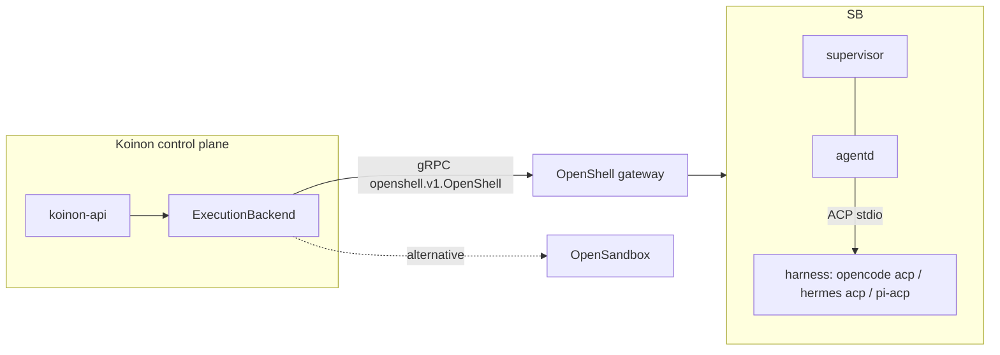
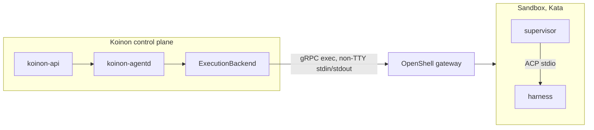

# 0016. Harness and deployment: ExecutionBackend, agentd over ACP, dedicated agents cluster

- Status: Accepted
- Amended by: [0040](0040-agentgateway-model-and-mcp-gateway.md), [0048](0048-openshell-spike-results.md), [0049](0049-v01-scope-decisions.md) (agentd placement)
- Date: 2026-10-21
- Area: runtime-sandbox
- Tags: harness, openshell, kubernetes
- Decision: [design.md#16](../design.md)
- Verification: done by the OpenShell spike, see [0048](0048-openshell-spike-results.md) (was: Pending: OpenShell spike, old issue 3)

> Note (2026-10-26): v0.1 ships OpenCode only ([0059](0059-v01-opencode-only.md)); mentions of Hermes and pi below are history.

## Context

Koinon reuses an execution layer (OpenShell on Agent Sandbox) instead of building one. It needs:
- a stable contract with that layer, so a fallback (OpenSandbox) stays possible;
- a uniform way to drive different harnesses (OpenCode, Hermes, pi; later Claude Code and Codex).

The Agent Client Protocol (ACP) is a JSON-RPC-over-stdio protocol that all v0.1 harnesses speak,
pi through an adapter.

## Decision

- The control plane talks to the OpenShell gateway (gRPC) through an **`ExecutionBackend`**
  interface. OpenSandbox is the alternative implementation.
- A thin **`agentd`** inside the sandbox drives the harness over ACP
  _(Changed by [0049](0049-v01-scope-decisions.md), see the amendment below: `agentd` runs in the control plane and nothing of Koinon's runs inside the sandbox)_:
  - it starts sessions;
  - it sends prompts;
  - it streams updates;
  - it relays permission requests;
  - it loads sessions on resume ([0029](0029-run-level-resume.md)).
- The OpenShell supervisor does all enforcement. `agentd` holds no credentials and is not trusted
  for security.
- One contract per flavor: a flavor image plus the ACP launch command.
- The reference deployment is a dedicated agents cluster. Co-location with other workloads is
  supported, with a small cluster-scoped footprint and an install-time check of the isolation
  level (for example: is a Kata RuntimeClass present? is the VAP installed?).

**Amendment ([0049](0049-v01-scope-decisions.md)).** `agentd` runs in the control plane, not in
the sandbox. The OpenShell spike (step 7) drove all three harnesses over ACP through the gateway's
non-TTY exec stream with no relay inside the sandbox. `koinon-agentd` is a Deployment that holds one
exec stream per active run and resumes with `session/load` when a stream drops. Nothing of
Koinon's runs inside the sandbox, and flavor images carry no Koinon binary.

## Alternatives considered

- **Talk to Agent Sandbox directly and build our own supervisor** _(reconstructed)_. This is the
  work OpenShell already does (egress proxy, credential placeholders, Landlock and seccomp).
- **Drive harnesses through their own CLIs or HTTP APIs** _(reconstructed)_. One integration per
  harness. ACP gives one contract.
- **A Kubernetes operator with CRDs between Koinon and OpenShell** _(reconstructed)_. OpenShell
  issue #1719 discusses an operator, and lensapp/openshell-k8s-operator exists. Koinon keeps
  Postgres as the source of truth ([0003](0003-postgres-source-of-truth.md)) and calls the gateway
  directly.

## Consequences

- Positive: reuses a maintained execution layer, with one contract per flavor.
- Positive: the fallback backend is possible without touching the product layer.
- Negative: OpenShell is pre-1.0 (v0.1.5, weekly releases, "experimental" interfaces may change
  within a patch release). The `ExecutionBackend` must absorb that churn.
- Negative: there is no official ACP Go SDK. `agentd` uses the community `coder/acp-go-sdk`
  (Apache-2.0, v0.13.5, pre-1.0) ([0037](0037-tooling.md)).
- Negative: the OpenShell Helm chart README labels the Kubernetes path **Experimental**, while the
  support matrix lists it as Supported.
- Follow-ups:
  - the spike (old issue 3) verifies that the gateway API covers what the reconciler needs;
  - a contract test suite per flavor ([0025](0025-testing-strategy.md)).

## Open questions

- Is `agentd` the sandbox's entrypoint process, started by the supervisor, or a sidecar? How does
  it receive work (exec, a gateway channel, a socket)? This is the agentd deep-dive item (old issue 8).
- Policy updates after creation: OpenShell lets only `network_policies` change on a running
  sandbox. Grant changes that touch other policy sections need a sandbox restart.
- Use OpenShell's Go SDK (`github.com/NVIDIA/OpenShell/sdk/go`) or generate from the proto?

## Upstream verification

- 2026-10-21: the OpenShell gateway is the gRPC service `openshell.v1.OpenShell`. It supports:
  - sandbox create, stop, start, delete, exec, watch and logs;
  - `CreateSandboxTemplate`;
  - providers and provider profiles;
  - per-sandbox and global policy through `UpdateConfig`;
  - workspaces and members.

  Auth is mTLS by default, plus OIDC roles. Go SDK at `sdk/go`. Release v0.1.5 (2026-10-20),
  Apache-2.0. https://github.com/NVIDIA/OpenShell
- 2026-10-21: ACP protocol version 1 (schema v1.26.0), JSON-RPC over stdio; `session/load`
  optional. https://agentclientprotocol.com/protocol/session-setup
- 2026-10-21: there is no official ACP Go SDK; coder/acp-go-sdk is community.
  https://agentclientprotocol.com/libraries/community
- 2026-10-21: OpenShell operator discussion. https://github.com/NVIDIA/OpenShell/issues/1719

## Links

- [0009](0009-agent-runtime.md), [0029](0029-run-level-resume.md), [0035](0035-v01-flavors.md),
  [0037](0037-tooling.md), [0045](0045-openshell-hardening-defaults.md)
