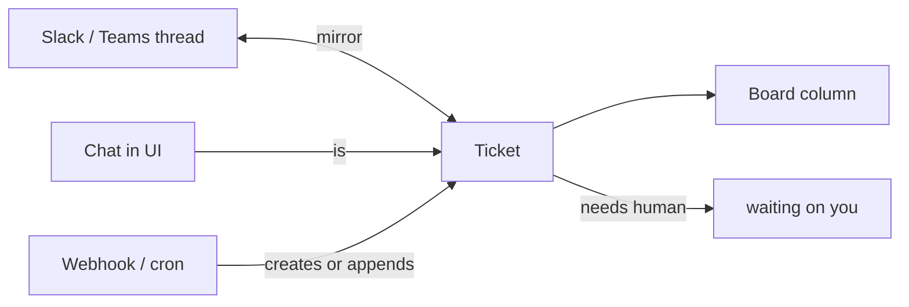

# 0017. Board and chat are two views of one ticket

- Status: Superseded by [0055](0055-chat-as-its-own-object.md) and [0065](0065-work-model-tasks-inbox.md)
- Date: 2026-10-21
- Area: work-model
- Tags: chat, tasks, ui
- Decision: [design.md#17](../design.md)

## Context

Koinon users interact with agents in two ways: they hand them work (a queue) and they talk to them
(a conversation). Products that model these separately end up with chat history that never becomes
tracked work, and tracked work whose discussion lives somewhere else.

The ticket board is already the work queue (ADR [0010](0010-eventing.md)), and
every A2A task is persisted as a ticket (ADR [0011](0011-agent-to-agent.md)). Approvals park a
run until a human decides (ADR [0008](0008-approvals-and-risk-tiers.md),
[0042](0042-ask-tier-park-and-execute.md)), so humans need one place that shows "what is waiting on
me". Teams also live in Slack and Teams and will not open a web UI for every question.

## Decision

- The board is the home screen. Chat is not a separate object: every conversation is a ticket, and
  the ticket view shows the conversation, runs, approvals and artifacts in one timeline.
- `waiting on you` is a first-class board column. It collects approvals, `input-required`
  clarifications and parked runs that need a human, scoped to the viewer.
- Slack and Teams threads mirror tickets in both directions: a message in a mirrored thread is
  appended to the ticket, and agent replies on the ticket are posted to the thread.
- Configuration (agents, connections, MCP servers, settings) is secondary navigation, not the
  landing experience.

## Alternatives considered

- Separate chat sessions and tickets, with "promote chat to ticket" _(reconstructed)_. Rejected:
  two data models, two permission paths, and work silently lost in chats that were never promoted.
- Chat-first UI with the board as a secondary view _(reconstructed)_. Rejected: the board is the
  queue (ADR 0010); a chat-first home hides the backlog and the `waiting on you` work.
- Slack or Teams as the only interface _(reconstructed)_. Rejected: approvals, live run view and
  configuration need richer UI than chat apps offer, and not every org uses either tool.

## Consequences

- Positive: one data model for work and conversation; every exchange has an owner, status, cost and
  audit trail.
- Positive: agents feel like colleagues you message, while managers still see a queue.
- Negative: small talk creates tickets. The board needs filters and auto-close for trivial
  conversations _(inferred)_.
- Negative: two-way mirroring needs dedupe and loop prevention between Slack/Teams and the ticket
  _(inferred)_.
- Follow-ups: ticket schema must support a conversation timeline from v0.1; Slack/Teams mirroring
  lands with connectors in v0.2 (ADR [0024](0024-roadmap.md)).

## Open questions

- Auto-close and archiving policy for conversational tickets with no follow-up work.
- How a ticket is mirrored into several channels at once (allowed, or one primary thread).
- Exact definition of the `waiting on you` filter for group approvers (two-person rule, ADR 0008).

## Upstream verification

None needed: this decision does not depend on upstream behaviour. Checked 2026-10-21.

## Amendment (2026-10-26)

Beyond [0055](0055-chat-as-its-own-object.md), [0065](0065-work-model-tasks-inbox.md) replaces
tickets with A2A-shaped tasks and makes the inbox ("Waiting on you") the home screen; the board is
a secondary view. Slack and Teams carry notifications, approval buttons and answers
([0065](0065-work-model-tasks-inbox.md)), and their messages are a trigger type
([0066](0066-triggers-and-scheduling.md)). Two-way thread mirroring as described above was not
decided again.

## Links

- [design.md](../design.md), decision 17
- ADR [0010](0010-eventing.md), [0011](0011-agent-to-agent.md),
  [0018](0018-v1-screens.md), [0042](0042-ask-tier-park-and-execute.md)
