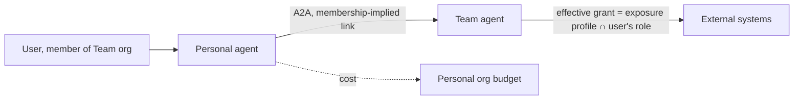

# 0019. Personal agents call team agents through membership

- Status: Accepted
- Amended by: [0065](0065-work-model-tasks-inbox.md)
- Date: 2026-10-21
- Decision: [design.md#19](../design.md)

## Context

Every user has a personal org (ADR [0018](0018-v1-screens.md)). Personal agents are most useful when
they can ask the expert agents a team runs, the way an employee asks a colleague. Cross-org use is
opt-in and goes through links with exposure profiles, rate limits and budgets
(ADR [0012](0012-cross-org-sharing.md)). Setting up an explicit link for every user's personal org
would be unmanageable, but implicit access must not let a personal agent exceed what its user may
do, or turn a team agent into a confused deputy.

## Decision

- A team agent can opt in to accept calls from "org members' personal agents".
- Access is implied by membership: a personal agent may call such a team agent when its owner is a
  member of the team's org.
- The call is capped by both the team agent's exposure profile and the calling user's role in the
  team org; the effective grant is the intersection.
- The personal org pays for the call (consumer pays, as in ADR 0012).
- Default is on for read-tier work only. Writes above the read tier need the team org to enable
  them explicitly, and approvals go to the team org's approvers.
- Membership is evaluated at call time; removing a member revokes access immediately.

## Alternatives considered

- Explicit links per personal org _(reconstructed)_. Rejected: O(members × agents) configuration.
- Personal agents inherit the user's full role in the team org _(reconstructed)_. Rejected: agents
  would exceed the exposure profile the team designed for its agent.
- No personal-to-team calls; users ask team agents directly _(reconstructed)_. Rejected: loses the
  "personal agent asks the experts" pattern that makes personal agents useful.

## Consequences

- Positive: personal agents act like employees asking experts, with no link administration.
- Positive: the intersection rule keeps both the team's and the user's limits in force.
- Negative: authorization must evaluate membership and role on every A2A call; this needs caching
  with fast revocation _(inferred)_.
- Negative: team agents see traffic from many small callers; per-caller rate limits matter
  _(inferred)_.
- Follow-ups: implemented with A2A in v0.3 and multi-tenancy in v0.4 (ADR [0024](0024-roadmap.md)). _(Changed: `ask_agent` ships in v0.2, see [0011](0011-agent-to-agent.md) and [0065](0065-work-model-tasks-inbox.md).)_

## Open questions

- How group-synced membership (ADR [0004](0004-human-identity.md), `idp` mode) interacts with
  revocation latency between group changes and the next login.
- Default rate limit per personal caller on a team agent.

## Upstream verification

None needed: Koinon-owned authorization logic. Checked 2026-10-21.

## Amendment (2026-10-26): each agent pays from its own budget

[0065](0065-work-model-tasks-inbox.md) decides that each agent uses only its own grants and budget
when one agent asks another (`ask_agent`). The team agent's spend on a call therefore counts against
the team agent's own budget, not the personal org's: this replaces "the personal org pays for the
call". Membership and the role cap above still apply. Inside an install the call is `ask_agent`
over Postgres, not an A2A link ([0065](0065-work-model-tasks-inbox.md)).

## Links

- [design.md](../design.md), decisions 12 and 19
- ADR [0004](0004-human-identity.md), [0011](0011-agent-to-agent.md),
  [0012](0012-cross-org-sharing.md)
