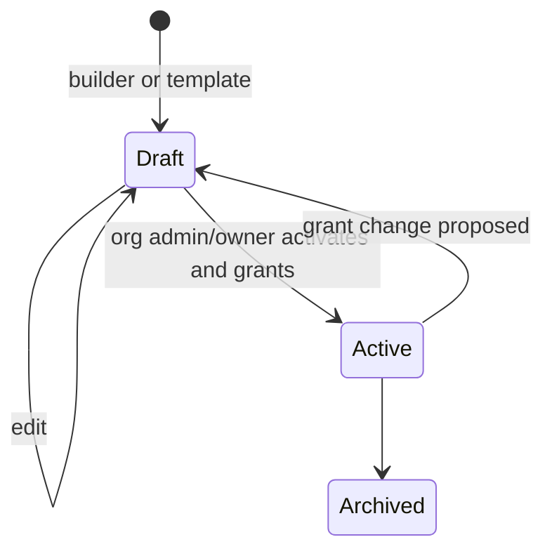

# 0020. Agent builder proposes, admins activate

- Status: Accepted
- Date: 2026-10-21
- Area: tenancy-identity
- Tags: approvals, identity, ui
- Decision: [design.md#20](../design.md)

## Context

Creating a useful agent means choosing a flavor, instructions, memory, connectors, scopes, risk
presets and a budget. Forms with all of that are hard to fill in correctly, while an agent that sets
itself up would be granting itself access. Koinon's security model is that access is designed per
agent and granted by humans who own it (ADR [0005](0005-agent-identity.md),
[0007](0007-connector-model.md), [0008](0008-approvals-and-risk-tiers.md)).

## Decision

- The main way to create an agent is the agent builder: a platform-provided agent that interviews
  the user and produces an agent definition.
- Templates are building blocks the builder (or a user) starts from: flavor, instructions, suggested
  grants and presets. Templates are data in `templates/` (ADR [0027](0027-repo-and-versioning.md)).
- The result is always a draft. The builder proposes grants; it never grants them.
- Only an org admin or owner activates a draft and approves its grants.
- Users can also create an agent directly from a template without the builder; the result is still
  a draft.

## Alternatives considered

- Form-only agent editor _(reconstructed)_. Kept as the editor for drafts, but not the main path:
  too many coupled choices for a first-time user.
- Builder that can activate agents it creates for the requesting admin _(reconstructed)_. Rejected:
  makes the builder a privileged actor; a prompt-injected builder could grant access.
- Agents defined only as YAML/CRDs in Git _(reconstructed)_. Rejected for orgs (ADR
  [0003](0003-postgres-source-of-truth.md)); GitOps stays for the platform layer.

## Consequences

- Positive: the builder can be helpful without being trusted; the human activation step is the
  control point and is audited.
- Positive: templates double as the v0.1 path (agent from template) before the builder ships.
- Negative: an extra activation step for org admins; personal org owners activate their own drafts
  _(inferred)_.
- Negative: the builder is itself an agent with grants (read connector types, write drafts) that
  must be designed and tested _(inferred)_.
- Follow-ups: template format and the v0.1 demo template (ADR [0036](0036-v01-demo.md)); builder in
  v0.3 (ADR [0024](0024-roadmap.md)).

## Open questions

- Template schema and versioning (how an active agent tracks template updates).
- What the v0.1 demo template agent does (listed as still open in BOOTSTRAP.md).
- Whether changing grants on an active agent returns it to draft or creates a pending change.

## Amendment 2026-10-27 (TR1)

- `ActivateAgent` also moves an active agent to its newer proposed version ([0066](0066-triggers-and-scheduling.md)); re-activating the version it already runs is refused, so a concurrent duplicate activation gets `Aborted`.

## Upstream verification

None needed. Checked 2026-10-21.

## Links

- [design.md](../design.md), decision 20
- ADR [0007](0007-connector-model.md), [0021](0021-connector-setup-guides.md),
  [0036](0036-v01-demo.md)
