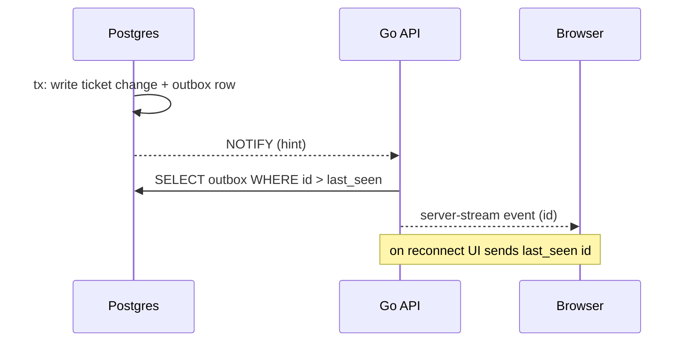

# 0022. React SPA served by the Go API over connect-rpc

- Status: Accepted
- Date: 2026-10-21
- Area: frontend-ux
- Tags: ui, api, auth, eventing
- Decision: [design.md#22](../design.md)

## Context

The UI is a live board: runs stream output, approvals appear, tickets move. It must feel fast with
thousands of tickets, and it should not need a second backend (no Node server) to operate. The API
is defined in protobuf (ADR [0027](0027-repo-and-versioning.md)), so a generated client keeps the UI
and API in step. Authentication is generic OIDC (ADR [0004](0004-human-identity.md)); tokens in
browser storage are an XSS liability. Run live view includes a desktop for the in-sandbox browser
(ADR [0015](0015-agent-environment-and-browser.md)).

## Decision

- A React single-page app built with Vite, served as static assets by the Go API binary.
- API calls use connect-rpc with a generated TypeScript client (connect-es v2).
  - Unary calls go through `@connectrpc/connect-query` with TanStack Query.
  - Streaming updates use the plain connect-web client with server-streaming RPCs, because
    connect-query supports unary methods only.
- Streaming updates come from a Postgres transactional outbox: the outbox table is the source of
  truth, `LISTEN/NOTIFY` is only a wake-up hint, and clients resume from the last outbox ID they saw. _Amended 2026-10-26: no outbox was built; see the amendment in [0010](0010-eventing.md)._
- Authentication is backend-for-frontend OIDC: the Go API runs the OIDC code flow and holds tokens;
  the browser gets an httpOnly, Secure, SameSite cookie. No tokens in JavaScript.
- noVNC live view is proxied through the API, which checks permissions per ticket.
- UI kit: shadcn/ui; data: TanStack Router, Query, Table and Virtual; virtualized lists and
  optimistic updates by default.

## Alternatives considered

- Next.js or another SSR framework _(reconstructed)_. Rejected: adds a Node runtime and a second
  backend to operate; the app is behind login, so SEO does not matter.
- REST + OpenAPI with a generated client _(reconstructed)_. Rejected in favour of one protobuf
  contract with `buf breaking` checks for both API and UI.
- WebSockets for live updates _(reconstructed)_. Rejected: server streaming over HTTP/1.1 is enough
  and works through ordinary proxies; browsers cannot do bidirectional connect streaming anyway.
- Tokens in browser storage with a public OIDC client _(reconstructed)_. Rejected: XSS exposure.

## Consequences

- Positive: one deployable; typed client; live UI without polling.
- Positive: replay from outbox IDs makes reconnects lossless. _(Changed: no outbox was built; clients resume from the run event sequence number, see the amendment in [0010](0010-eventing.md).)_
- Negative: NOTIFY payloads are limited to under 8000 bytes and are not replayed; the design must
  never carry data in NOTIFY, only keys. _Amended 2026-11-04 (old issue 344): the one exception is the live
  text an agent is typing, which is best effort and never stored; see [0074](0074-run-traces-trace-router.md) item 8 of its 2026-10-31 amendment._
- Negative: two client patterns (connect-query for unary, plain client for streams) to keep
  consistent in the UI code _(inferred)_.
- Negative: outbox needs retention and pruning _(inferred)_. _(Void: no outbox was built, see [0010](0010-eventing.md).)_
- Follow-ups: outbox table in the first migrations; CSRF protection for cookie auth _(inferred)_.

## Open questions

- Outbox retention window and pruning job.
- Fan-out design when the API runs several replicas (each replica listens; clients may reconnect to
  another replica).

## Upstream verification

Checked 2026-10-21:
- connect-go is at v2 (`connectrpc.com/connect/v2`, v2.0.1); v1 is supported indefinitely.
  https://github.com/connectrpc/connect-go
- Browsers support server streaming but not bidirectional streaming; non-bidi RPCs work over
  HTTP/1.1. https://connectrpc.com/docs/web/getting-started/, https://connectrpc.com/docs/protocol/
- connect-es v2.2.0; `@connectrpc/connect-query` v2.3.1 "currently only supports Unary RPC methods".
  https://github.com/connectrpc/connect-query-es
- Vite 8.x; TanStack Router 1.x, Query 5.x, Table **v9**, Virtual 3.x; shadcn CLI 4.x (all MIT).
- NOTIFY: delivered on commit, payload under 8000 bytes, no replay.
  https://www.postgresql.org/docs/current/sql-notify.html
- Transactional outbox: https://microservices.io/patterns/data/transactional-outbox.html

## Links

- [design.md](../design.md), decision 22
- ADR [0004](0004-human-identity.md), [0015](0015-agent-environment-and-browser.md),
  [0027](0027-repo-and-versioning.md)
