# 0030. Postgres run state machine with an ownership epoch

- Status: Accepted
- Amended by: [0065](0065-work-model-tasks-inbox.md), [0066](0066-triggers-and-scheduling.md)
- Date: 2026-10-21
- Decision: [design.md#30](../design.md)

## Context

A run moves through a short, fixed lifecycle: queued, starting, running, parked (waiting on
approval, budget, A2A or input), and finished. Several writers can act on the same agent:

- API replicas
- reconciler replicas
- the `agentd` instance in the sandbox

A stale writer (for example an `agentd` whose sandbox was replaced, or a reconciler that lost its
lease) must not overwrite newer state. Each agent has at most one run at a time
([0009](0009-agent-runtime.md)).

Timed events are also needed:

- approval and park timeouts
- A2A wait-then-park ([0011](0011-agent-to-agent.md))
- crons ([0010](0010-eventing.md))
- periodic home checkpoints ([0032](0032-agent-home-checkpoints.md))

The Durable Objects pattern fits: one logical owner per key, a single-threaded state machine and
alarms. A full workflow engine is not needed for a fixed process this short.

## Decision

- **State lives in Postgres.** Each run has a state machine in Postgres; there is no workflow
  engine in v0.x.
- **Ownership epoch.** Each agent row has an `epoch` integer:
  - A component that takes ownership of an agent's execution increments it inside a transaction.
  - Every later state write includes the epoch it holds, as a compare-and-set:
    `UPDATE … WHERE agent_id = $1 AND epoch = $2`.
  - A write with an old epoch matches zero rows and is rejected.
  - The epoch is also stamped on home checkpoints ([0032](0032-agent-home-checkpoints.md)).
- **Alarms table.** An `alarms` table holds `(agent_id, run_id, fire_at, kind, payload, epoch)`.
  Workers claim due alarms with `SELECT … FOR UPDATE SKIP LOCKED` and act only if the epoch still
  matches.
- **`AgentStateStore` interface.** All access goes through this interface, so a different backend
  (Restate, celld) can replace Postgres later without touching callers.
- **Watch list.** Restate is re-evaluated when step-level workflows arrive; celld stays on the
  watch list.

```mermaid
stateDiagram-v2
    [*] --> queued
    queued --> starting: owner takes epoch N
    starting --> running: harness ready (ACP session)
    running --> parked: approval / budget / A2A / input-required
    parked --> starting: resolved (alarm or event), resume session
    running --> succeeded
    running --> failed
    parked --> canceled: timeout alarm or user cancel
    starting --> failed
    starting --> queued: sandbox not ready in time (ADR 0066)
    succeeded --> [*]
    failed --> [*]
    canceled --> [*]
    note right of parked: sandbox suspended; alarm row holds timeout
```



## Alternatives considered

- **Restate** _(reconstructed)_: durable execution with virtual objects that map well to agents.
  Rejected for v0.x:
  - It is another stateful system to operate.
  - The server is under BSL 1.1, converting to Apache-2.0 four years after each release, so no
    current version is open source. The BSL bans only a public "Restate Platform Service", so
    internal use is allowed.
- **Temporal** _(reconstructed)_: mature, but heavy to operate, and its model (workflow code
  replay) does not fit an opaque harness loop.
- **celld** (denoland/celld, Apache-2.0, v0.6.2) _(reconstructed)_: self-hosted Durable Objects with
  per-cell SQLite replicated to S3. Promising but young, and built around Workers-style JavaScript.
- **Kubernetes objects as state** _(reconstructed)_: the design already rules out etcd for run and
  audit data ([0003](0003-postgres-source-of-truth.md)).

## Consequences

- Positive:
  - One database to operate.
  - Transactional writes together with tickets and the outbox ([0010](0010-eventing.md),
    [0022](0022-frontend-architecture.md)).
  - Stale writers are rejected by construction.
- Negative:
  - Koinon owns the state machine code and the alarm worker.
  - Alarm precision depends on the polling interval _(inferred)_.
  - Hot agents could contend on the agent row _(inferred)_; one run per agent keeps this small.
- Follow-ups:
  - Schema: `agents.epoch`, `runs`, `run_events`, `alarms` (scaffold migration and the v0.1 data
    model).
  - Property or fuzz tests of the transitions, and a stale-epoch test with two concurrent owners.
  - Rule for `agentd`: it receives the epoch at start and includes it in every report; a rejected
    report makes `agentd` stop.

## Open questions

- Alarm polling interval versus `LISTEN/NOTIFY` wake-ups (NOTIFY is a hint only, with no replay).
- Whether the reconciler or the API owns transitions, or both through the store with the epoch
  only.

## Upstream verification

Checked 2026-10-21:

- **Restate:** BSL 1.1, with a four-year change date to Apache-2.0; bans only a public Restate
  Platform Service. https://github.com/restatedev/restate/blob/main/LICENSE. SDK licenses
  unverified. Design open item "Verify Restate's server license" is answered here
  (old issue 11).
- **celld:** Apache-2.0, v0.6.2, a V8 daemon that runs Workers apps with Durable Objects, SQLite
  per cell and LTX replication to S3/GCS/Azure, with no consensus service.
  https://github.com/denoland/celld
- **Postgres NOTIFY:** delivered on commit only, must be under 8000 bytes, and not replayed to
  sessions that weren't listening. https://www.postgresql.org/docs/current/sql-notify.html

## Amendment (2026-10-26): timeouts are columns, not an alarms table

There is no `alarms` table. The ownership epoch and the compare-and-set writes are built as
decided: `agents.epoch` (`internal/db/migrations/00002_agents.sql:50`) and `runs.epoch`
(`00003_tickets_and_runs.sql:58`). Timed events are columns that a worker reads when due:

- `runs.lease_expires_at` (`00003_tickets_and_runs.sql:61`) is the lease of the owner of a starting or
  running run. `TakeOverExpiredRun` finds a stale one with `FOR UPDATE SKIP LOCKED`, increments the
  agent's epoch and takes the run over (`internal/db/queries/runs.sql:92-122`).
- `runs.park_expires_at` (`00003_tickets_and_runs.sql:68`) is the timeout of a parked run.
  `ListExpiredParkedRuns` (`internal/db/queries/runs.sql:279-283`) is read by the approvals code
  (`internal/approvals/approvals.go:495`).
- `approval_requests.expires_at` (`00008_connections_and_approvals.sql:83`) is the approval timeout.
- `runs.max_wall_clock_seconds` caps a run (`00003_tickets_and_runs.sql:72`).

Cron, A2A wait-then-park and periodic home checkpoint alarms are not built. If they arrive, they
need their own columns or table. There is also no `AgentStateStore` interface: callers use the
generated sqlc store (`internal/db/store`) directly. A different backend would need that interface
introduced first.

## Amendment (2026-10-26): park reasons in use, timers on DBOS

- **Park reasons.** `ask_user` writes `input_required` and `ask_agent` writes `a2a`
  ([0065](0065-work-model-tasks-inbox.md)). `budget` stays unused.
- **Expiry of a question** gives the agent one short "no answer" run instead of cancelling the run
  ([0065](0065-work-model-tasks-inbox.md)).
- **Tasks have their own states** (submitted, working, input-required, completed, canceled,
  failed). The run state machine stays as built.
- **Schedules, durable timers, webhook processing and per-org limits run on DBOS Go**, a library on
  the same Postgres ([0066](0066-triggers-and-scheduling.md)). "No workflow engine in v0.x" now
  holds for the run state machine: runs, claims, leases, the epoch and park and resume stay
  Koinon's.
- **Sandbox wait.** A run whose sandbox is not ready after 5 minutes waits in the queue instead of
  failing, and interactive work is claimed before scheduled work ([0066](0066-triggers-and-scheduling.md)).

## Amendment (2026-10-26, old issue 146 A1): failure classes

Each failed run gets a `failure_class`, set where the error is first understood (the gateway or
ledger response, the ACP stop reason, the harness exit code). Retries and inbox messages follow
from the class:

| Class | What happens |
| --- | --- |
| `transient` | retry with backoff |
| `throttled` | wait for Retry-After, then retry |
| `context_overflow` | shrink the largest input once, then `ask_user` ([0065](0065-work-model-tasks-inbox.md)) |
| `budget` | stop and tell the owner |
| `policy` | no retry |
| `fatal` | anything unknown; no retry |

Status (FC1): `runs.failure_class` (migration 00021) and `Run.failure_class` on the API carry the
class. agentd classifies an answered `session/prompt` error from the HTTP status, `Retry-After` and
error text the harness reports (`internal/agentd/classify.go`). Exactly one layer retries a failed
model request (ADR 0056 amendment 2026-10-31, point 3; old issue 341). For a flavor whose harness retries model
requests itself (`RetriesModelRequests` in `internal/flavor`, OpenCode today) that layer is the
harness, on Koinon's policy, which agentd passes as launch switches; agentd then repeats no turn, and
a `transient` or `throttled` failure that reaches it ends the run. For every other flavor agentd
repeats the turn in the same session for `transient` (backoff from `RetryBackoff`) and `throttled`
(the provider's `Retry-After`, at most `MaxRetryAfter`), up to `ModelRetries` times, recording a
`run.retry` event each time. Token
and spend limits cancel the run with class `budget`. `context_overflow` fails the run with a clear
message; shrinking the largest input and `ask_user` wait for the inbox work (ADR 0065). Every other
failure is `fatal`.

Before FC1 a failure was free text (`internal/agentd/run.go:42`, `:603-611`, `:663-692`); exit codes
64, 126 and 127 are already treated as permanent (`run.go:67`).

## Links

- [0003 Source of truth](0003-postgres-source-of-truth.md), [0009 Agent runtime](0009-agent-runtime.md)
- [0029 Run-level resume](0029-run-level-resume.md), [0032 Agent home](0032-agent-home-checkpoints.md)
- Restate Virtual Objects: https://docs.restate.dev/concepts/services
- Design adapted from [hydro-project/infinity](https://github.com/hydro-project/infinity) (Apache-2.0, commit 341f6c2): the failure classes (`infinity-provider-protocol/src/completion.rs:57-76`; unknown errors default to fatal, `remote.rs:44-60`). Research notes: `infinity-code-ideas.md`.

## Amendment (2026-10-28, rc.6): `sandbox_unavailable` and two run columns

The failure class `sandbox_unavailable` joins the list of old issue 146 A1: the run's sandbox never became ready
within the org's cap (ADR 0066 amendment 2026-10-28). It is never retried. Two columns record the
timers the amendment adds: `runs.sandbox_wait_started_at` (when the current wait for the sandbox
began; kept across requeues, cleared when any run of the agent finds the sandbox ready or the agent is
resumed) and `runs.wrap_up_notice_at` (set when the wrap-up notice is no longer armed: it was sent, or it was suppressed because the harness ignored the cancel; the `run.wrap_up_notice` event is the record that the agent was told). There are no new
states or transitions.

## Amendment (2026-10-29, old issue 246): who refused the model request

OpenCode 2.2.0 reports a provider's 401 and 403 alike as `-32000 "Authentication required: provider
authentication required"`, with no status. The text heuristic (`classify.go`) read it as the gateway
rejecting the agent's key, class `fatal`, and the run's failure sent people to debug a key that was
fine. In the rc.7 re-run the cause was OpenRouter's moderation `403` on pasted HTML.

The gateway knows better, and its record already reaches the spend ledger (ADR 0056 amendment
2026-10-29: `spend_entries.upstream_status`). When the harness words a failure as an authentication
error (`failure.authLike`), agentd asks the ledger for the run's last provider `401` or `403` since the
turn began, polling for up to `GatewayRecordWait` (default 20 s, because the access log is exported in
batches), and decides:

| The gateway's record | Class | Reason shown |
| --- | --- | --- |
| provider `403` | `policy` | "The model provider (openrouter) refused the request (HTTP 403) [as reported by the harness: ...]" |
| provider `401` | `fatal` | "The model provider ... rejected the API key Koinon holds for it (HTTP 401); check the provider's key in the catalog [as reported by the harness: ...]" |
| none | `fatal`, gateway fault | the error text as before |

- **No record means the gateway refused the key itself.** A bad or revoked key is answered before any
  provider is called, and has no agent to attribute a record to, so the absence of a provider record
  is the evidence. This costs the full wait before such a run fails; it is a failing run either way.
- **A spent budget is checked first.** The budget stop (ADR 0050) reads the ledger's limits before this
  lookup, so a revoked key of a spent limit still ends as a budget stop at once. A provider refusal
  is no longer a gateway refusal for that check (`failure.gateway` is cleared).
- **A cancel wins.** If the run is fenced or canceled while the record is awaited, that decides.
- **The gateway's record has the status, not the provider's words.** The gateway logs no response
  body (ADR 0056 amendment 2026-10-29, point 6: agentgateway would buffer every response). The
  harness's own error text is appended, labelled "as reported by the harness", redacted and capped
  at 512 characters (`errbody.Excerpt`), so the reason may be shown to the person and written to the
  run's events.
- **Not retried.** `policy` and `fatal` are not retried (the table above).
- **Upstream.** OpenCode should put the status code and error body in the ACP error `data`; the
  structured `statusCode` is already read first (`structured`). The ledger lookup is the fallback
  that stays correct whatever the harness reports, and for any harness that words errors vaguely.
- **Limits.** Only a `401` or `403` is looked up; other statuses already arrive with a code or a
  recognisable text. The lookup needs the run to be attributed (the key's agent, the record's time
  inside the run, `ledger.RunGrace`), which holds for every request an agent's key makes.

## Amendment 2026-11-11 (#21)

A run superseded before its first turn goes `starting -> succeeded` as a composite step: `MarkRunRunning`
then `FinishRun`, in one transaction in `Owner.Supersede` (ADR 0089 amendment 2026-11-11). The diagram
edge is added with that label:

```
starting --> succeeded: composite (Supersede: MarkRunRunning then FinishRun, one transaction)
```

`FinishRun` itself still accepts `succeeded` only from `running`. The composite is the only path from
`starting` to `succeeded`.
