# 0030. Postgres run state machine with an ownership epoch

- Status: Accepted
- Date: 2026-10-21
- Decision: [design.md#30](../design.md)

## Context

A run moves through a short, fixed lifecycle: queued, starting, running, parked (waiting on
approval, budget, A2A or input), and finished. Several writers can act on the same agent:

- API replicas
- reconciler replicas
- the `agentd` instance in the sandbox

A stale writer (for example an `agentd` whose sandbox was replaced, or a reconciler that lost its
lease) must not overwrite newer state. Each agent has at most one run at a time
([0009](0009-agent-runtime.md)).

Timed events are also needed:

- approval and park timeouts
- A2A wait-then-park ([0011](0011-agent-to-agent.md))
- crons ([0010](0010-eventing.md))
- periodic home checkpoints ([0032](0032-agent-home-checkpoints.md))

The Durable Objects pattern fits: one logical owner per key, a single-threaded state machine and
alarms. A full workflow engine is not needed for a fixed process this short.

## Decision

- **State lives in Postgres.** Each run has a state machine in Postgres; there is no workflow
  engine in v0.x.
- **Ownership epoch.** Each agent row has an `epoch` integer:
  - A component that takes ownership of an agent's execution increments it inside a transaction.
  - Every later state write includes the epoch it holds, as a compare-and-set:
    `UPDATE … WHERE agent_id = $1 AND epoch = $2`.
  - A write with an old epoch matches zero rows and is rejected.
  - The epoch is also stamped on home checkpoints ([0032](0032-agent-home-checkpoints.md)).
- **Alarms table.** An `alarms` table holds `(agent_id, run_id, fire_at, kind, payload, epoch)`.
  Workers claim due alarms with `SELECT … FOR UPDATE SKIP LOCKED` and act only if the epoch still
  matches.
- **`AgentStateStore` interface.** All access goes through this interface, so a different backend
  (Restate, celld) can replace Postgres later without touching callers.
- **Watch list.** Restate is re-evaluated when step-level workflows arrive; celld stays on the
  watch list.

```mermaid
stateDiagram-v2
    [*] --> queued
    queued --> starting: owner takes epoch N
    starting --> running: harness ready (ACP session)
    running --> parked: approval / budget / A2A / input-required
    parked --> starting: resolved (alarm or event), resume session
    running --> succeeded
    running --> failed
    parked --> canceled: timeout alarm or user cancel
    starting --> failed
    succeeded --> [*]
    failed --> [*]
    canceled --> [*]
    note right of parked: sandbox suspended; alarm row holds timeout
```

## Alternatives considered

- **Restate** _(reconstructed)_: durable execution with virtual objects that map well to agents.
  Rejected for v0.x:
  - It is another stateful system to operate.
  - The server is under BSL 1.1, converting to Apache-2.0 four years after each release, so no
    current version is open source. The BSL bans only a public "Restate Platform Service", so
    internal use is allowed.
- **Temporal** _(reconstructed)_: mature, but heavy to operate, and its model (workflow code
  replay) does not fit an opaque harness loop.
- **celld** (denoland/celld, Apache-2.0, v0.6.2) _(reconstructed)_: self-hosted Durable Objects with
  per-cell SQLite replicated to S3. Promising but young, and built around Workers-style JavaScript.
- **Kubernetes objects as state** _(reconstructed)_: the design already rules out etcd for run and
  audit data ([0003](0003-postgres-source-of-truth.md)).

## Consequences

- Positive:
  - One database to operate.
  - Transactional writes together with tickets and the outbox ([0010](0010-eventing.md),
    [0022](0022-frontend-architecture.md)).
  - Stale writers are rejected by construction.
- Negative:
  - Koinon owns the state machine code and the alarm worker.
  - Alarm precision depends on the polling interval _(inferred)_.
  - Hot agents could contend on the agent row _(inferred)_; one run per agent keeps this small.
- Follow-ups:
  - Schema: `agents.epoch`, `runs`, `run_events`, `alarms` (scaffold migration and the v0.1 data
    model).
  - Property or fuzz tests of the transitions, and a stale-epoch test with two concurrent owners.
  - Rule for `agentd`: it receives the epoch at start and includes it in every report; a rejected
    report makes `agentd` stop.

## Open questions

- Alarm polling interval versus `LISTEN/NOTIFY` wake-ups (NOTIFY is a hint only, with no replay).
- Whether the reconciler or the API owns transitions, or both through the store with the epoch
  only.

## Upstream verification

Checked 2026-10-21:

- **Restate:** BSL 1.1, with a four-year change date to Apache-2.0; bans only a public Restate
  Platform Service. https://github.com/restatedev/restate/blob/main/LICENSE. SDK licenses
  unverified. Design open item "Verify Restate's server license" is answered here
  ([#11](https://github.com/procoduck/koinon/issues/11)).
- **celld:** Apache-2.0, v0.6.2, a V8 daemon that runs Workers apps with Durable Objects, SQLite
  per cell and LTX replication to S3/GCS/Azure, with no consensus service.
  https://github.com/denoland/celld
- **Postgres NOTIFY:** delivered on commit only, must be under 8000 bytes, and not replayed to
  sessions that weren't listening. https://www.postgresql.org/docs/current/sql-notify.html

## Links

- [0003 Source of truth](0003-postgres-source-of-truth.md), [0009 Agent runtime](0009-agent-runtime.md)
- [0029 Run-level resume](0029-run-level-resume.md), [0032 Agent home](0032-agent-home-checkpoints.md)
- Restate Virtual Objects: https://docs.restate.dev/concepts/services
