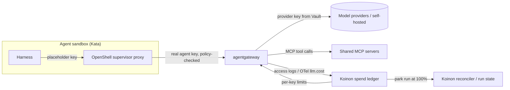

# 0040. agentgateway as the model gateway and MCP gateway

- Status: Accepted; amended by [0048](0048-openshell-spike-results.md) and 2026-10-26 and 2026-11-12 (below)
- Date: 2026-10-21
- Area: models-spend
- Tags: agentgateway, models, mcp
- Amended by: [0097](0097-koinon-owned-gateway.md) (supersedes in part decisions 1, 2 and 6; agentgateway becomes the first driver, not the destination)
- Amends: ADR 0013 (model access), ADR 0014 (MCP and tools), ADR 0016 (harness and deployment)
- Verification: the OpenShell spike is done, see [0048](0048-openshell-spike-results.md); the agentgateway spike (deployment mode, ExtMCP routing) was Pending (old issue 3)

## Context

Decision 13 in `docs/design.md` routed every model call from a sandbox to OpenShell's
`inference.local`, which forwarded to LiteLLM. LiteLLM held provider keys, issued virtual keys and
enforced the budget hierarchy platform → org → agent → ticket. Decision 14 put shared MCP servers
behind one progressive (search + call) endpoint per agent, with ToolHive to evaluate.

Upstream research on 2026-10-21 invalidated that path:

- **`inference.local` is gone.** OpenShell 0.1.0 removed the `openshell inference` commands, route
  APIs and the `inference.local` endpoint (upgrade note `docs/upgrade/0-1-0.mdx`, PR #3195). A
  provider is now attached per sandbox and the harness calls the provider's native endpoint; an
  OpenAI-compatible endpoint needs a custom provider profile listing its host and allowed binaries.
- **LiteLLM's tenancy features are open core.** Organizations, team admin roles, audit logs,
  soft-budget alerts, spend reports and per-model budgets are LiteLLM Enterprise. Tag budgets carry
  conflicting license signals. The free tier could approximate our hierarchy (org = team, agent =
  key, ticket = tag), but procoduck decided Koinon should not depend on LiteLLM at all.
- **OpenShell has no ask tier** (see ADR 0042), so the MCP gateway carries more weight than planned:
  it is where risky actions are intercepted.

Requirements for the replacement: one OpenAI- and Anthropic-compatible endpoint in front of many
providers; real provider keys held outside sandboxes; per-request token and cost accounting,
including streaming; a hook for budget enforcement; rate limits and fallbacks; Apache-2.0 or
similar with no enterprise gating of these features; Kubernetes-native; no CNI-specific features.

## Decision

1. **agentgateway** (Linux Foundation, Apache-2.0) is Koinon's model gateway. LiteLLM is removed
   from the architecture. _(Changed by [0097](0097-koinon-owned-gateway.md): agentgateway is the first driver behind Koinon's own gateway, not the destination.)_
2. agentgateway is also Koinon's **MCP gateway**: the per-agent progressive endpoint from decision
   14, tool-level authorization (CEL on `mcp.tool.name`, `mcp.tool.arguments` and JWT claims) and
   the interception point for ask-tier tools (ADR 0042). _(Changed by [0097](0097-koinon-owned-gateway.md), step 2: MCP targets, credential injection and the ask target move into Koinon's MCP path.)_
3. **Model path.** For each agent the reconciler renders an OpenShell provider record pointing at
   the in-cluster agentgateway host, using a custom provider profile. The agent's agentgateway API
   key is the provider credential: the sandbox only sees an OpenShell placeholder, which the
   supervisor swaps for the real key on requests to agentgateway. The harness's base URL
   (`OPENAI_BASE_URL`, `baseURL`, `base_url`, depending on flavor) points at agentgateway.
4. **Provider keys** live in Vault/OpenBao and are loaded by agentgateway; they never reach the
   sandbox or the OpenShell provider records. _(Changed by [0056](0056-model-providers-pricing-and-budgets-per-org.md): provider keys are envelope-encrypted in Postgres. They still never reach the sandbox or the provider records.)_
5. **Cost data**: agentgateway's built-in price catalog yields `llm.cost` per request; access logs or
   OTel spans carry org, agent, ticket and run attribution and feed Koinon's spend ledger
   (ADR 0041).
6. Koinon talks to agentgateway only through a `ModelGateway` interface (keys, limits, spend
   ingestion) and an `MCPGateway` interface (per-agent endpoints, tool rules), so another gateway can
   replace it. _(Changed: only `ModelGateway` exists and it carries MCP; see the amendment of 2026-10-26 below and [0097](0097-koinon-owned-gateway.md).)_

## Alternatives considered

| Option | Why not |
| --- | --- |
| LiteLLM free tier (org = team, agent = key, ticket = tag) | procoduck decided to drop the dependency; tenancy features we would grow into are Enterprise-only, and tag budgets' licensing is unclear. |
| LiteLLM Enterprise | Makes an open source install depend on a paid tier. |
| Agent Router (formerly Envoy AI Gateway, v1.2.0, Apache-2.0) | Strong upstream auth and Gateway API conformance, but budgets are token windows only (≤ day), no USD or never-reset budgets, quota fails open by default, and it needs Envoy Gateway. Remains the fallback if agentgateway fails its spike. |
| Bifrost (Apache-2.0, Go) | Budgets are held in memory on one node; multi-node HA, Projects and its MCP gateway are Enterprise-only. |
| Portkey gateway OSS (MIT) | Budget limits are paid; release cadence has stalled. |
| Kong AI Gateway / Apache APISIX | Kong's token and cost limiting is Enterprise; APISIX has token limits but no USD budgets or Copilot support. |
| Our own Go proxy | Viable (about 3–5k lines, 4–8 engineer-weeks without format translation), but rebuilds what agentgateway provides and adds per-provider streaming usage parsing to maintain. _(estimate)_ |
| No gateway: OpenShell supervisor middleware only | The middleware API is "still evolving", has a 4 MiB payload limit, and gives no unified endpoint, routing or fallbacks. Kept as a possible budget backstop (ADR 0041). |
| Separate MCP gateway (ToolHive vMCP) | One component for both roles is less to operate; ToolHive is still evaluated for *deploying* MCP servers. |

## Consequences

- Positive: one Apache-2.0, foundation-governed component covers model routing, cost data and MCP
  authorization, with no enterprise gating.
- Positive: provider keys sit two layers away from the agent (agentgateway, then an OpenShell
  placeholder for the agent key).
- Negative: agentgateway is written in Rust; Koinon contributors will not patch it as easily as Go.
- Negative: spend is charged after a response completes, so hard stops overshoot by up to one
  response (handled in ADR 0041).
- Negative: models missing from agentgateway's price catalog are charged zero without error; Koinon
  must detect and flag unpriced models. _(inferred)_
- Negative: agentgateway 1.6 converts Anthropic Messages requests to the Responses format by
  preference; flavor contract tests must cover each harness's API format. _(inferred)_
- Follow-ups: agentgateway spike; Helm dependency in `charts/koinon`; `ModelGateway` and
  `MCPGateway` interfaces in `internal/`; flavor images configure base URLs; fake model server
  (decision 25) sits behind agentgateway in CI.

## Open questions

- Kubernetes mode or standalone mode? Budgets differ (rate-limit windows vs per-key USD budgets);
  the spike decides which mode the reconciler configures.
- How ask-tier tools are routed from agentgateway to Koinon's approval service: CEL rules, ExtMCP
  callout, or a Koinon MCP server behind agentgateway (ADR 0042).
- Can agentgateway carry A2A traffic for Koinon's A2A gateway (decision 11), or does Koinon keep its
  own? Tickets stay in Koinon either way.
- ToolHive's role narrows to deploying MCP servers (MCPServer CRD, registry); evaluate against
  plain Deployments rendered by the reconciler.
- Copilot as a gateway-held credential: see ADR 0044.

## Upstream verification

Checked 2026-10-21:

- OpenShell v0.1.5 (2026-10-20): `inference.local` removed in 0.1.0; per-sandbox providers with
  custom profiles; placeholder swap only for authorised endpoints.
- agentgateway v1.6.0 (2026-10-02), Apache-2.0, Linux Foundation: LLM, MCP and A2A; price catalog
  with `llm.cost`; per-key USD/token budgets in standalone mode; rate-limit budgets in Kubernetes
  mode; CEL MCP authorization; ExtMCP gRPC callout; native `copilot` provider with a static token.
- LiteLLM: Organizations enterprise-only (docs and code return 403 without Enterprise).

## Amendment (2026-10-26): one gateway interface carries MCP

Decision 6 and the follow-up promise a `ModelGateway` and an `MCPGateway` interface. Only
`ModelGateway` exists (`internal/gateway/gateway.go:34`). There is no `MCPGateway` anywhere in
`internal/`. MCP is part of the desired state that `ModelGateway.Apply` converges: `gateway.State`
(`internal/gateway/gateway.go:380`) holds `MCP []MCPTarget` (the upstream servers, `:351`) and
`Tools map[AgentRef][]ToolGrant` (the per-agent allowlists, `:370`), and each driver
(standalone, kubernetes) renders them. [0058](0058-gateway-modes.md) also speaks of one interface.
The goal of decision 6, replacing agentgateway with another gateway, is met by implementing
`ModelGateway`. A separate `MCPGateway` is deferred until a gateway needs to be driven for MCP
separately from models.

## Amendment (2026-11-12): the fallback is re-checked at each release

The maintainer decided on 2026-10-28 to stay on agentgateway behind `ModelGateway` and to keep Agent
Router as the documented fallback (see the alternatives table). The table says only that it "remains
the fallback if agentgateway fails its spike". The spike is done, so the fallback needs its own
trigger: at each release candidate and final release, check Agent Router's upstream pull request
theagentrouter/agent-router#2834 (https://github.com/theagentrouter/agent-router/pull/2834) and its
release notes against the three gaps in the table (token-window budgets only, quota that fails
open, Envoy Gateway needed). The steps and the criteria for reconsidering are in
[docs/dev/releasing.md](../dev/releasing.md#cut-a-release-candidate). A change of gateway still needs
a new ADR.

[0097](0097-koinon-owned-gateway.md) amends decisions 1, 2 and 6: agentgateway is only the first
driver behind Koinon's own gateway. The fallback therefore applies to the model path while
agentgateway is the driver. Reasons from ADR 0097 for not making Agent Router the data plane, which
the check must weigh: it charges after the response and accepts overshoot, it needs Redis for its
limits, and it brings several components plus vendor coupling.

Exit condition: the change that ships ADR 0097 step 3 (agentgateway removed) deletes the release step
in `docs/dev/releasing.md` and closes this amendment.

## Amendment (2026-11-12): MCPGateway arrives in ADR 0097 step 2

[0097](0097-koinon-owned-gateway.md) decision 2.1 introduces the `MCPGateway` interface in step 2, the point the
2026-10-26 amendment waited for: Koinon's own gateway is driven for the MCP path apart from models.
`ApplyMCP(ctx, MCPConfig)` is its own method, not a second `Apply`, so a driver that serves both
paths can be applied and acknowledged for each path apart. The agentgateway drivers keep
`ModelGateway.Apply` for both halves. The text above stays as written.

Correction (2026-11-12, #279 slice 2): the note in decision 6, "only `ModelGateway` exists and it
carries MCP", is out of date. `MCPGateway` exists since #279 slice 1 (`internal/gateway/gateway.go`),
next to `ModelGateway`, and `gateway.State` is split into the keys, a model half and an MCP half. The
2026-10-26 amendment above describes the state before that; decision 6's two interfaces now both exist.

## Links

- https://github.com/NVIDIA/OpenShell/blob/main/docs/upgrade/0-1-0.mdx
- https://github.com/agentgateway/agentgateway
- https://agentgateway.dev/docs/standalone/latest/llm/cost-controls/budget-limits/per-key/
- https://agentgateway.dev/docs/kubernetes/main/llm/cost-controls/budget-limits/
- https://agentgateway.dev/docs/standalone/main/configuration/security/mcp-authz/
- https://agentgateway.dev/docs/standalone/main/mcp/guardrails/about/
- https://docs.litellm.ai/docs/proxy/multi_tenant_architecture
- https://github.com/theagentrouter/agent-router
- https://github.com/theagentrouter/agent-router/pull/2834
- https://github.com/maximhq/bifrost/blob/main/docs/features/governance/budget-and-limits.mdx
- https://portkey.ai/docs/product/ai-gateway/virtual-keys/budget-limits
- ADR 0013, ADR 0014, ADR 0041, ADR 0042, ADR 0044
