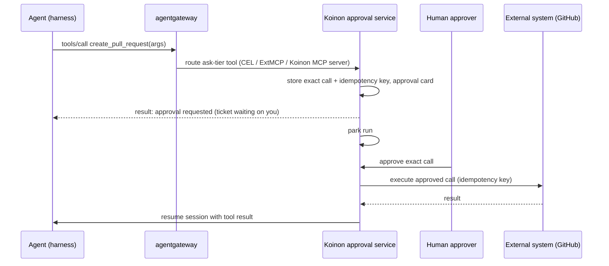

# 0042. Ask tier: park the run, Koinon executes the approved call

- Status: Accepted; amended by [0048](0048-openshell-spike-results.md), [0065](0065-work-model-tasks-inbox.md) and [0084](0084-leak-guard.md)
- Date: 2026-10-21
- Amends: ADR 0008 (approvals)
- Verification: Pending: agentgateway spike (routing ask-tier tools) and OpenShell spike (old issue 3)

## Context

Decision 8 compiles each grant to OpenShell network policy plus MCP gateway tool rules, and requires
approvals to be bound to the exact request with the run parked while waiting. Research on
2026-10-21 found:

- **OpenShell has no ask tier.** A denied request stays denied. Approval in OpenShell applies to a
  *proposed rule* (policy advisor, `rule approve`, RFC 0002 agent-driven proposals), scoped to
  binary, host, port and, for HTTP, method and path. It cannot hold one request while a human decides
  or bind approval to a request body.
- OpenShell L7 endpoints default to `enforcement: audit`, which logs and allows (ADR 0045 fixes the
  default).
- agentgateway (ADR 0040) can authorize MCP calls with CEL on tool name and arguments, and its
  ExtMCP gRPC callout can allow, modify or deny a call. Holding a call open for human approval is not
  documented; gRPC ext_authz defaults to a 2 s timeout.

The v0.1 demo (decision 36) ends with "approve one GitHub action", so this path is in v0.1.

## Decision

1. Scopes in the **ask tier** (external or irreversible) are exposed to agents **only as MCP tools**
   through agentgateway. OpenShell network policy denies the corresponding direct write APIs from the
   sandbox (for example GitHub `POST /repos/*/pulls`).
2. When an agent calls an ask-tier tool, the call is routed to Koinon's **approval service**, which
   records the exact tool name, arguments and target, creates an approval card on the ticket, and
   **returns immediately** with a structured "approval requested" result.
3. The run **parks** (decision 30). No connection is held open.
4. After approval (per-grant approver policy, optional two-person rule), **Koinon executes exactly
   the approved call** itself, outside the sandbox, with an idempotency key (decision 29), using the
   connector's credentials.
5. Koinon then **resumes the harness session** (ACP `session/load` or `session/resume`) with the
   call's result injected as the tool outcome. On rejection, it resumes with a rejection result.
6. The approval is therefore bound to the exact request by construction: what runs is what was
   approved.

## Alternatives considered

- **Hold the call in ExtMCP until a human decides**: simplest for the harness, but approvals take
  minutes to days; the call would need long timeouts and would break on gateway restarts or sandbox
  suspension.
- **Deny, then a one-shot OpenShell rule**: the supervisor denies, Koinon turns the denial into an
  approval card, approval adds a temporary narrow rule and the agent retries. No new component, but
  approval binds only to method and path, not the request body, and the retry may differ from what
  was approved.
- **Contribute a hold-for-approval feature to OpenShell**: worth raising upstream (RFC 0002 defers
  its inbox), but not something to block v0.1 on. _(reconstructed)_

## Consequences

- Positive: approvals bind to the exact request; no long-lived connections; works across sandbox
  suspension.
- Positive: real connector credentials for ask-tier actions never enter the sandbox at all.
- Negative: v0.1 needs agentgateway, a GitHub MCP tool set, the approval service and session resume
  with an injected tool result. This grows v0.1 scope.
- Negative: each ask-tier action needs a Koinon-side executor per connector (for v0.1: GitHub).
- Negative: harnesses must cope with a tool result that arrives in a later turn; flavor contract
  tests must cover it. _(inferred)_
- Follow-ups: approval service; GitHub ask-tier executors; tool-result injection on resume in
  `agentd`; deny rules for direct write APIs in rendered policies.

## Open questions

- Routing mechanism in agentgateway: CEL rule to a Koinon MCP server, ExtMCP callout, or both.
- How each harness represents "approval requested" and the later result (ACP `session/load` replays
  history; pi-acp has no `session/resume`).
- Approval expiry and what happens to a parked run when an approval expires.

## Upstream verification

Checked 2026-10-21: OpenShell policy docs (`docs/how-it-works/policies/schema.mdx`, default
`enforcement: audit`), RFC 0002 (accepted; agent proposals behind
`agent_policy_proposals_enabled`, default false); agentgateway MCP authorization and ExtMCP docs.

## Amendment (2026-10-26, old issue 146 A4): safe defaults and scoped approvals

[0065](0065-work-model-tasks-inbox.md) changes two things:

- **Every question names a safe default** (`ask_user`, and approvals), used when it is dismissed
  or expires; the agent is told which default applied.
- **Approvals can be scoped:** once (this ADR's exact-request approval), this task, or this agent
  and this kind of action until a date. A scope wider than once needs an admin, shows in the
  agent's grants, and is audited.

## Amendment (2026-10-27, AP1): how scoped approvals work

Plan item AP1 builds the scopes above (migration `00028_approval_scopes.sql`):

- **Who and what.** The approver of a request (an org admin or owner, as for every approval) may
  choose "this call only" (the default and the behaviour of this ADR), "this task", or "this agent
  until a date" when approving. A scope records agent, connector, tool and target of the approved
  call, its kind, the task (task scope), the end date, the admin who granted it and the approval it
  came from.
- **Matching is exact** on agent, connector, tool and target (a task scope also on the task); there
  are no wildcards in v0.1. The arguments are not part of a scope, so a later call with other
  arguments is covered, and it still passes argument validation, the executor's checks and the
  executor's re-check of the grant. A call that matches runs without parking: it is recorded as
  approved with `decision = allow` and `scope_id` set, and executed like a Trusted-preset call. The
  `approval.requested` task event carries `scope_id`, `scope_kind` and `scope_expires_at`, so the
  run's timeline shows which scope allowed it; the commit trailer names the admin who granted the
  scope ("scoped approval").
- **Limits (the conservative choices).** An agent scope needs an end date, at most one year ahead;
  a task scope ends at the latest 30 days after it was granted (its default). A scope is never
  granted for a request that needs two approvers or one Koinon made itself (saved work), and a tool
  that needs two approvers is never covered by a scope: the second person cannot be waived. A
  `create_pull_request` call whose push-and-run risk is flagged (CI or automation files, scripts,
  dependency manifests, binary or executable files) is never covered, so a person still reads it.
- **Lifecycle.** A scope shows in the agent's page next to its grants (`ListApprovalScopes`), can be
  revoked by an admin (`RevokeApprovalScope`; calls already approved keep running), and ends at its
  date. Creating and revoking a scope are audited (`approval_scope.create`, `approval_scope.revoke`).

## Amendment (2026-10-31, old issue 347): the leak guard is a second source of approvals

[0084](0084-leak-guard.md) adds a source of approval requests besides the ask tier:

- **A leak becomes an approval.** agentgateway calls koinon-api's leak guard (ExtMcp
  `mcpGuardrails`, failClosed) on every MCP tool call, auto tier included. A call whose arguments
  contain private data from the agent's home generation (24 normalised characters by default) is
  blocked and becomes an approval request for that exact call; the card shows what would leave. A
  call that does not match adds no approval.
- **The ask tier is not forced on outbound tools.** Forcing ask on every outbound call of an agent
  with untrusted input, private data and an outbound tool was rejected (approval fatigue).
- **Routing.** The guard uses the ExtMcp callout; the ask tier keeps the `<target>-ask` route of
  ADR 0057. For v0.1 that settles the routing open question above: both mechanisms, each for its
  own job.
- Open in 0084: the agent-facing result of a blocked call (a block, or "approval requested" with
  park and execute), and whether an approval scope may cover a leak approval.

## Links

- https://github.com/NVIDIA/OpenShell/blob/main/docs/how-it-works/policies/schema.mdx
- https://agentgateway.dev/docs/standalone/main/configuration/security/mcp-authz/
- https://agentgateway.dev/docs/standalone/main/mcp/guardrails/about/
- https://agentclientprotocol.com/protocol/session-setup
- ADR 0008, ADR 0029, ADR 0030, ADR 0036, ADR 0040, ADR 0045
- Design adapted from [hydro-project/infinity](https://github.com/hydro-project/infinity) (Apache-2.0, commit 341f6c2): the safe default choice and approval scopes (`rap-protocol/src/lib.rs:152-163`; `sandbox-core/src/server.rs:864-945`). Research notes: `infinity-code-ideas.md`.

Amendment (2026-10-27, AP1 review): an MCP scope is pinned to the server, URL and tool version the
approver saw (the source approval's `call_binding`, copied to `approval_scopes.call_binding`); a call
matches only while all three are unchanged, so a republished tool or a new server URL parks again
(ADR 0057). Coverage by risk type is decided explicitly for `create_pull_request` and
`comment_on_issue`; an unknown risk type is never covered. Replaying an approval with a wider scope
returns `ErrNotPending` instead of silently creating none. The agent scope's date picker allows
tomorrow to 364 days ahead, and the task option reads "for this task (at most 30 days)".

2026-10-27 (wave-3 integration): a code-host approval request records its connection ID and the
connection's base URL as its `call_binding`; a scope copies it, and `FindActiveApprovalScope` requires
it to equal the call's binding. A scope granted on github.com therefore does not cover the same
owner/repo on another connection or host. Scopes created before this change carry an empty binding
and no longer match (the next call asks again).
