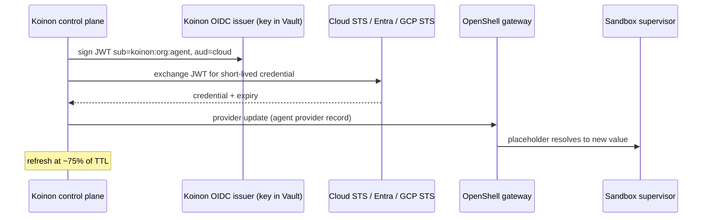

# 0043. Workload identity adapters and a Koinon OIDC issuer

- Status: Accepted
- Date: 2026-10-21
- Amends: ADR 0006 (identity layers); replaces the "Pod Identity" wording in `docs/design.md`
  ("Execution layer details")

## Context

Decision 6 says federated credentials (AWS, Entra, ADO, Vault) are minted outside the sandbox and
held as OpenShell provider records injected only for allowed endpoints. The execution-layer section
of `docs/design.md` adds "AWS SigV4 and CLI-only tools go through MCP servers with Pod Identity".

Research on 2026-10-21:

- **EKS Pod Identity is EKS-only** (EKS Linux EC2 nodes; not EKS Anywhere, Fargate or self-run
  clusters). It does not work on the Talos home lab or AKS/GKE.
- **AWS** IRSA-style federation (`AssumeRoleWithWebIdentity`) works anywhere, but IAM fetches the
  issuer's discovery document and JWKS from a public HTTPS URL (no upload). Per-agent session tags
  must be JWT claims, which Kubernetes ServiceAccount tokens cannot carry. `RoleSessionName`
  (≤ 64 chars) gives per-agent CloudTrail attribution. IAM Roles Anywhere (X.509) needs no public
  endpoint.
- **Azure/Entra** federated identity credentials work on any cluster; exact issuer/subject/audience
  match; 20 per identity; propagation takes minutes; identity creation is throttled; issuer must be
  reachable. Flexible FICs do not support Kubernetes issuers.
- **Azure DevOps** accepts Entra tokens for a service principal, but each identity needs a paid
  Basic license per ADO org for Repos.
- **GCP** workload identity federation accepts an uploaded JWKS, so no public issuer is needed; GKE
  supports direct `principal://` grants to a Kubernetes ServiceAccount.
- **Vault/OpenBao** JWT auth validates with static keys; Vault's AWS engine can add session tags.
- **OpenShell** provider refresh supports OAuth2 refresh, client credentials, Google SA JWT and AWS
  STS `AssumeRole`, but not Kubernetes-token federation; external systems can push values with
  `provider update`.

Andre asked for a general workload-identity and federation model that works on any conformant
cluster.

## Decision

1. Credentials for cloud and SaaS APIs are minted by the **Koinon control plane**, never inside the
   sandbox, through an **`IdentityProviderAdapter`** per target:
   `Mint(agentRef, scope) → {values, expiry}` and `Revoke(agentRef)`.
2. Built-in adapters: **AWS** (`AssumeRoleWithWebIdentity`, `RoleSessionName` = agent ID, session
   tags for org and agent), **Entra** (client-assertion exchange to the agent's identity), **Azure
   DevOps** (Entra token, scope `https://app.vssps.visualstudio.com/.default`), **GCP** (STS
   exchange, direct principal access or impersonation), and optional **Vault/OpenBao** secrets
   engines. Native mechanisms (EKS Pod Identity, AKS and GKE workload identity) are optional
   adapters where available.
3. The subject token comes from a **Koinon-owned OIDC issuer**: a dedicated signing key, static
   discovery document and JWKS published to object storage (S3, GCS, Blob or similar), and JWTs with
   `sub=koinon:<org>:<agent>` plus provider-specific claims (for example AWS session tags). The
   Kubernetes API server's issuer stays private.
4. The control plane **pushes** minted values into the agent's OpenShell provider records with
   `provider update` and refreshes them at about 75% of their TTL. The supervisor injects them only
   for allowed endpoints (decision 6).
5. MCP servers that need cloud credentials (CLI-only tools, SigV4 streaming) get them from the same
   adapters.

## Alternatives considered

- **EKS Pod Identity** (original wording): EKS-only.
- **Cluster ServiceAccount issuer** (TokenRequest with a cloud audience): simplest, but requires
  publishing the cluster issuer, ties trust to cluster key rotation, and cannot carry AWS session
  tags.
- **SPIRE as issuer from day one**: JWT-SVIDs and X.509-SVIDs (for IAM Roles Anywhere) are a good
  fit, but SPIRE is more to operate; it stays a drop-in alternative issuer behind the same interface.
- **Vault/OpenBao as the only mint path**: no public issuer needed, but Vault's plugin workload
  identity federation is Enterprise-only and OpenBao parity is unverified. Kept as an optional
  adapter.
- **Static long-lived keys in provider records**: contradicts decision 6. _(reconstructed)_

## Consequences

- Positive: the same model on Talos, EKS, AKS and GKE; the API server stays private; per-agent
  attribution in cloud audit logs.
- Positive: Koinon controls issuer key rotation independently of the cluster.
- Negative: the issuer signing key is a high-value secret; it must live in Vault/OpenBao and rotate.
- Negative: the JWKS must be published somewhere public (object storage) for AWS and Azure.
- Negative: Azure identity creation lag and throttling mean identities should be pre-provisioned
  and pooled; ADO licenses make one identity per agent expensive.
- Follow-ups: issuer component and key rotation; adapter interface in `internal/`; refresh scheduler;
  setup guides per cloud (decision 21). Cloud connectors land in v0.2; v0.1 only needs the GitHub
  App connector.

## Open questions

- Azure: pooled identities per org or per grant, and how to recycle them.
- ADO: one identity per role or per org to limit license cost.
- AWS role chaining limit (1 h, unverified) if a second `AssumeRole` with tags is used.
- Where the JWKS is published by default in the Helm chart (operator-supplied bucket vs a Koinon
  endpoint behind Ingress).

## Upstream verification

Checked 2026-10-21: AWS IAM OIDC provider and STS docs, EKS Pod Identity limits, IAM Roles Anywhere;
Entra workload identity federation considerations and flexible FIC; AKS workload identity; GCP
workload identity federation with Kubernetes and GKE; Azure DevOps service principals; Vault JWT
auth and AWS engine; OpenShell provider refresh docs.

## Links

- https://docs.aws.amazon.com/eks/latest/userguide/pod-identities.html
- https://docs.aws.amazon.com/IAM/latest/UserGuide/id_roles_providers_create_oidc.html
- https://docs.aws.amazon.com/STS/latest/APIReference/API_AssumeRoleWithWebIdentity.html
- https://docs.aws.amazon.com/IAM/latest/UserGuide/id_session-tags.html
- https://docs.aws.amazon.com/rolesanywhere/latest/userguide/authentication.html
- https://learn.microsoft.com/en-us/entra/workload-id/workload-identity-federation-considerations
- https://learn.microsoft.com/en-us/azure/devops/integrate/get-started/authentication/service-principal-managed-identity
- https://docs.cloud.google.com/iam/docs/workload-identity-federation-with-kubernetes
- https://openbao.org/docs/auth/jwt/oidc-providers/kubernetes/
- https://github.com/NVIDIA/OpenShell/blob/main/docs/how-it-works/providers/overview.mdx
- ADR 0006, ADR 0007, ADR 0021
