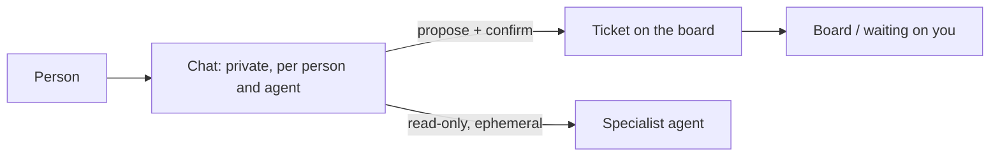

# 0055. Chat is its own object

- Status: Accepted
- Amended by: [0065](0065-work-model-tasks-inbox.md)
- Date: 2026-10-23
- Supersedes: [0017](0017-board-and-chat-interaction-model.md) (the "chat is a ticket" rule)
- Amends: [0011](0011-agent-to-agent.md) (read-only delegation from chat), [0018](0018-v1-screens.md) (the chat screen)
- Delivery: the ADR lands now; the feature lands in v0.2.

## Context

ADR 0017 made every conversation a ticket. The UI research (`docs/research/ui-foundations.md`,
decision 4) found that small talk then floods the board, that a private conversation with a
personal agent has no place in a shared work queue, and that auto-closing "conversational tickets"
was an open question that never closed. procoduck decided on 2026-10-23 to give chat its own object.

## Decision

1. **Chat is a separate object** from tickets, with its own timeline, cost and audit. It replaces
   the "chat is a ticket" rule of ADR 0017. The board stays the work queue and `waiting on you`
   stays a board column.
2. **Everyone gets chat.** A personal org opens on chat; a team org opens on the board.
3. **Private by default.** A chat is visible to the person who owns it and is kept out of shared
   memory ([0033](0033-file-based-memory.md)). Admins see only metadata (who, which agent, when,
   cost), never content.
4. **A chat becomes a ticket** when the person or the agent proposes it and the person confirms.
5. **Cost and audit.** Each chat records its cost and audit events. Retention is set per org; the
   default is 90 days.
6. **Reads in a chat** use the intersection of the agent's grants and the person's own access.
7. **Writes in a chat.** The personal agent may write to the person's own connections. It asks for
   approval only for external or irreversible actions ([0008](0008-approvals-and-risk-tiers.md)).
   All other writes need a ticket.
8. **Delegation** from a chat to a specialist agent is ephemeral and read-only, as amended in
   [0011](0011-agent-to-agent.md).

## Alternatives considered

- **Keep chat as a ticket kind** (ADR 0017, with a hidden "Chat" kind) _(reconstructed)_. One data
  model, but chats show up in work queues, and privacy needs an exception on every query.
- **Chat only for personal orgs** _(reconstructed)_. Team members would still have private
  questions for agents.

## Consequences

- Positive: private conversations have a proper home, and the board holds only work.
- Positive: cost and audit are per conversation.
- Negative: two objects to build and permission-check, and a promotion path from chat to ticket.
- Negative: the "intersection of grants and access" rule needs the person's access resolved per
  read _(inferred)_.
- Follow-ups: the chat schema, the chat screen, the retention job, the promotion flow (v0.2).
  `docs/design.md` decision 17 and the screens in ADR 0018 change when chat lands.

## Open questions

- How an agent's proposal to make a ticket is shown to the person.
- What a promoted ticket carries over from the chat (the whole chat, a summary, or both).
- Which metadata fields admins see.
- Whether chat retention can be set to "keep forever" or has a ceiling.
- Whether the personal agent's chat shares a sandbox and home with its ticket runs.

## Upstream verification

None needed.

## Amendment (2026-10-26): chat next to tasks and the inbox

- **Tickets become tasks** ([0065](0065-work-model-tasks-inbox.md)); read "ticket" above as "task".
  The inbox ("Waiting on you") is the home screen and chat sits next to it; the board is a
  secondary view. This changes items 1 and 2: a team org no longer opens on the board.
- **Direct messages** to an agent in the inbox chat are a trigger type
  ([0066](0066-triggers-and-scheduling.md)). How that relates to item 4 (a chat becomes a ticket
  when the person confirms) is not decided ([0065](0065-work-model-tasks-inbox.md) open questions).
- **Delegation** (item 8): `ask_agent` creates a child task. Whether a read-only delegation from a
  chat stays ephemeral is not decided.
- **Release.** Chat stays in v0.2 ([0024](0024-roadmap.md) amendment). old issue 146 puts the inbox and
  direct-message triggers in v0.1; how the v0.1 inbox chat relates to this ADR's chat is not
  decided.

## Links

- [`docs/research/ui-foundations.md`](../research/ui-foundations.md)
- ADRs [0008](0008-approvals-and-risk-tiers.md), [0011](0011-agent-to-agent.md),
  [0017](0017-board-and-chat-interaction-model.md)
