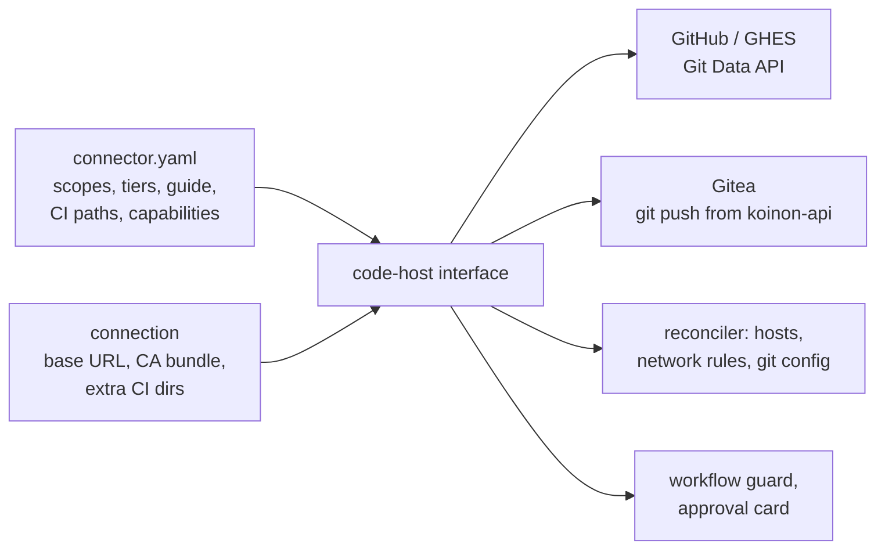

# 0062. Code-host connectors: one interface per provider, capabilities as data

- Status: Accepted
- Date: 2026-10-26
- Relates to: old issue 144 (decided there and in
  conversation on 2026-10-26)
- Amends: [0007](0007-connector-model.md) (hosts per connection, provider data in the type),
  [0049](0049-v01-scope-decisions.md) (v0.1 is no longer GitHub-only; the workflow guard),
  [0036](0036-v01-demo.md) (the demo's code host)
- Credentials: [0063](0063-forge-credential-classes.md). Work trackers: [0064](0064-work-tracker-connectors.md).

## Context

Koinon supports one code host, GitHub, and the support is GitHub-specific in many places:

- **Type data.** `connectors/github/connector.yaml` fixes the hosts to `github.com` and
  `api.github.com` (`:28-32`) and the target pattern to `owner/name` (`:34-36`). Hosts are per
  connector type, not per connection: `Type.Network` (`connectors/network.go:54`) renders them from
  the type's `hosts`. The schema allows only the auth
  types `federated`, `app-credential` and `delegated-user` (`connectors/schema/connector.schema.json:107`).
- **Go.** `connectors.GitHubID` (`connectors/connectors.go:483`) is used in 10 other non-test Go
  files. The approval executor makes 29 direct `s.gh.*` calls (`internal/approvals/*.go`).
- **The sandbox side.** The git credential helper answers only for `https://github.com`
  (`flavors/common/koinon-git-credential:26-36`), the git config scopes it there
  (`flavors/common/etc/koinon/git/config:7-11`), and saved work recognises only github.com origins
  (`internal/agentd/savework.sh:45-47`).
- **The workflow guard.** `create_pull_request` refuses only `.github/workflows/`
  (`internal/githubtools/validate.go:105`, `:135-137`). Old issue 144 cites this as
  `internal/approvals/validate.go:105`; the file is in `internal/githubtools`.

procoduck decided on 2026-10-26 that there are no GitHub-only special cases. Koinon gets a proper
integration for GitHub and Gitea now, and GitLab and Azure DevOps later. The home-lab test (old issue 47)
waits for this.

Research (2026-10-26) on how the providers differ:

- **Git transport is the same everywhere.** Smart HTTP with the token as the Basic password works
  on GitHub, GHES and Gitea. Gitea treats a non-empty password as the token
  (`gitea@v28.2.0:services/auth/basic.go`). The OpenShell spike cloned from the home-lab Gitea
  through a placeholder (`hack/spike/profiles/gitea-spike.yaml:26-33`).
- **Writes differ.** Koinon builds every commit with GitHub's Git Data API (blobs, trees, commits,
  refs) and sets exact file modes (`internal/approvals/execute.go:205-334`). Gitea 28.2 has no write
  endpoints under `git/`. Its `POST /repos/{o}/{r}/contents` (ChangeFiles) makes one commit but has
  no mode field, so a new file is always `100644`
  (`gitea@v28.2.0:services/repository/files/update.go:377, 508`). The Azure DevOps Pushes API
  has no mode field either (https://learn.microsoft.com/en-us/rest/api/azure/devops/git/pushes/create?view=azure-devops-rest-7.1).
- **CI paths differ.** Gitea Actions runs `.gitea/workflows` and `.github/workflows` by default,
  `.gitea/scoped_workflows`, and whatever `WORKFLOW_DIRS` the server sets
  (`gitea@v28.2.0:modules/setting/actions.go:52-53`). GitLab uses `.gitlab-ci.yml` or a per-project
  path (https://docs.gitlab.com/ci/pipelines/settings/). An Azure DevOps YAML pipeline can live at
  any path. Only GitHub lets a credential refuse workflow edits (the App's `workflows` permission).
- **Hosts differ.** GHES and Gitea live at an address the org chooses. GHES serves REST under
  `https://HOST/api/v3`; Gitea under `https://HOST[/sub]/api/v1`.

## Decision

1. **Two seams** (old issue 144). A **code host** covers the repository list, read and write credentials,
   git transport, commits and branches with exact file modes, pull requests and comments, the CI
   paths that approvals must refuse, and the hosts the sandbox may reach. A **work tracker** is a
   separate seam ([0064](0064-work-tracker-connectors.md)).
2. **Shape: a Go code-host interface, one implementation per provider, plus connector data.** Each
   provider's `connector.yaml` carries its scopes and tiers, its setup guide
   ([0021](0021-connector-setup-guides.md)), its CI paths and its **capability descriptor**. The
   descriptor says what the provider's credentials and write API can and cannot narrow, so that
   risk tiers, approvals and the UI can compensate ([0063](0063-forge-credential-classes.md)). The
   existing GitHub path moves behind the interface.
3. **Hosts per connection.** A connection has a base URL and an optional CA bundle. The network
   rules, the git credential helper and the git config are rendered from the connection's host
   instead of fixed type hosts.
4. **Write path.** Writes go through the provider's API where the API can make the commit exactly.
   GitHub (github.com and GHES) keeps its Git Data API. Where it cannot, koinon-api builds the
   commit and pushes it over git: Gitea always, Azure DevOps when it lands. The sandbox never
   pushes, on any provider ([0049](0049-v01-scope-decisions.md)).
5. **The workflow guard reads the provider's CI paths from data.** For Gitea that is
   `.gitea/workflows/`, `.gitea/scoped_workflows/` and `.github/workflows/`, plus directories
   configured on the connection (a server's `WORKFLOW_DIRS`). This replaces the fixed
   `.github/workflows/` rule in `internal/githubtools/validate.go:105`.
6. **Providers.** v0.1: GitHub, GitHub Enterprise Server and Gitea. GitLab and Azure DevOps later.
7. **Credentials** follow [0063](0063-forge-credential-classes.md): GitHub keeps App installation
   tokens; Gitea uses one bot per connection under a narrow exception to
   [0043](0043-workload-identity-adapters-and-koinon-issuer.md).

## Alternatives considered

- **Keep v0.1 GitHub-only and add Gitea after v0.1.** The research recommended this
  (`gitea-overlap.md` §5a) to avoid designing a seam with one implementation under deadline.
  procoduck chose a proper integration now: no GitHub-only special cases, and the home-lab test runs
  on Gitea.
- **Gitea's ChangeFiles API for writes.** One atomic call, close to what Koinon needs, but it
  cannot set the executable bit on a new file, so an approved change would not land as approved.
- **One API writer per provider for every provider.** Exact on GitHub, and with an executable bit
  only on GitLab and Bitbucket. Gitea and Azure DevOps cannot set modes through their APIs. The git
  push fallback covers both.
- **Let the agent push.** What comparable products do (`forge-and-trackers.md` §4). Rejected as in
  [0049](0049-v01-scope-decisions.md): code and CI would run before anyone approves.
- **A read-oriented interface like OpenHands' `GitService`** (`openhands/integrations/service_types.py`,
  tag 0.59.0), with writes through the agent's own push. Same reason: Koinon writes, after approval.
- **Gitea's GitHub-compatible API.** It does not exist: the v28 spec marks one route as a
  GitHub-compatible alias, and there is no `/api/v3` and no App surface (`gitea-overlap.md` §2). The
  `--github-api-url` flag (`cmd/koinon-api/main.go:201`) cannot point at Gitea.

## Consequences

- Positive: a second provider is an implementation plus a data file, not edits in 10 files.
- Positive: the approval guarantee ("the agent never pushes, Koinon commits exactly what was
  approved") holds on every provider.
- Positive: GHES and self-hosted Gitea work on private networks with their own CA.
- Negative: koinon-api needs a git client to build and push commits, and a fetch of the base tree
  for every Gitea write. Large repositories make that slower _(inferred)_.
- Negative: on Gitea a pushed branch runs Actions and nothing on the credential can refuse workflow
  files. The guard and the approval card are the only defence ([0063](0063-forge-credential-classes.md)).
- Negative: the connector schema becomes a larger public contract: capability descriptor, CI
  paths, per-connection hosts ([0007](0007-connector-model.md) noted the contract) _(inferred)_.
- Follow-ups _(inferred)_:
  - extract the interface from the executor (`internal/approvals/execute.go`, `diff.go`,
    `savedwork.go`), the reconciler's read path (`internal/reconciler/github.go`), connection checks
    and the repo picker;
  - make the credential helper, the git config and `savework.sh` host-aware;
  - saved work (`internal/approvals/savedwork.go`) also uses the Git Data API today, so on Gitea it
    takes the git push path too;
  - the `Koinon-Approval` trailer (`internal/approvals/execute.go:29`) stays the idempotency handle
    on both write paths;
  - the approval card's `.github/` warning (`web/src/components/approval-card.tsx:200-202`) reads
    the provider's CI paths;
  - a Gitea fake for CI, as `koinon-fakegithub` is for GitHub (AGENTS.md: CI never calls real
    services);
  - the GitHub setup guide's "turn Webhook off" (`connectors/github/connector.yaml:136-139`) changes
    when code-host events arrive ([0066](0066-triggers-and-scheduling.md)).

## Open questions

- The capability descriptor's exact fields. The research sketch (`forge-and-trackers.md` §5a:
  credential class, lifetime, repository and permission narrowing, whether CI can be denied, write
  modes, CI paths, hosts) is a starting point, not a decision.
- The Go interface's method set. The research sketch (§5a) and the 13 GitHub methods the
  executor uses (`gitea-overlap.md` §1.3) are inputs.
- Is GHES its own connector type, or the GitHub type with a base URL on the connection?
- How koinon-api pushes: go-git or the `git` binary in the image, and shallow or partial fetch of
  the base tree.
- CI paths that can only be discovered per repository (Azure DevOps pipeline definitions, a GitLab
  project's `ci_config_path`), and what the guard does when discovery fails.
- Target grammar beyond `owner/name`: GitLab's nested groups and Azure DevOps'
  `{org}/{project}/_git/{repo}` need provider-defined patterns.
- When GitLab and Azure DevOps code hosts land.

## Upstream verification

Checked 2026-10-26 (research notes `gitea-overlap.md`, `forge-and-trackers.md`):

- Gitea v28.2.0 API spec (https://raw.githubusercontent.com/go-gitea/gitea/v28.2.0/templates/swagger/v1-swagger.generated.json):
  no POST under `git/`; ChangeFiles has no mode field; `GET pulls/{base}/{head}` finds a PR.
- Gitea v28.2.0 source: Basic auth accepts the token as password (`services/auth/basic.go`);
  workflow directories (`modules/setting/actions.go:52-53`).
- GitHub Git Data API sets exact modes (https://docs.github.com/en/rest/git/trees); an App without
  `workflows` cannot change `.github/workflows`
  (https://docs.github.com/en/apps/creating-github-apps/registering-a-github-app/choosing-permissions-for-a-github-app).
- GHES 3.22 REST base `https://HOST/api/v3`
  (https://docs.github.com/en/enterprise-server@latest/rest/using-the-rest-api/getting-started-with-the-rest-api).
  Unverified: GHES 3.22 support for API version `2026-03-10`.

## Amendments

- 2026-10-27 (CH2): the capability descriptor is data. `connector.yaml` carries
  `spec.capabilities` (display name, credential class, repository and permission narrowing,
  `maxRepositories`, `canDenyCI`, `exactModes`), `spec.ciPaths` and `spec.site` (default web and
  API URLs, and `apiPath` where a connection's own host serves the REST API); the token lifetime
  stays `auth.tokenLifetime`. `codehost.CapabilitiesOf` builds `Capabilities` from them.
- 2026-10-27 (CH2): a connection's `baseUrl` and `caBundle` live in `connections.config`
  (non-secret JSON, no migration); the CA bundle is public. A base URL is an `https` host with an
  optional port and no path. On another host the REST API is the same host under
  `spec.site.apiPath`, so GHES stays the GitHub type with a base URL (answers the open question
  for CH3; a path prefix such as a Gitea sub-path is not supported yet). `Provider.BranchURL`
  takes the connection.
- 2026-10-27 (CH2): network rules are rendered at the connection's host (`Type.NetworkAt`).
  koinon-agentd writes `/sandbox/.koinon/git/config` (credential helper scoped to the host,
  `http.sslCAInfo`) and `/sandbox/.koinon/git/ca.pem` (system roots plus the bundle, so the
  OpenShell proxy certificate keeps verifying) before every harness start; `/etc/gitconfig`
  includes the file after the image's own. `koinon-git-credential` takes `--host`; `savework.sh`
  takes the host.
- 2026-10-27 (CH2 review): the CA file is built from `${SSL_CERT_FILE:-/etc/ssl/certs/ca-certificates.crt}`
  and the write fails (non-zero exit, so the run fails with the reason) when no system roots are
  found, instead of writing a bundle-only file that would drop any other trust OpenShell
  delivers. OpenShell terminates TLS in the sandbox, so git there trusts OpenShell's CA, not the
  host's certificate; the bundle matters to OpenShell's upstream connection, which Koinon does
  not configure yet. Not verified against the home lab (no cluster access in this item): if
  OpenShell's CA is delivered through neither path, drop `http.sslCAInfo` in the sandbox.
- 2026-10-27 (CH2 review): a declared connection Secret takes optional `baseUrl` and `caBundle`
  keys, validated as the API does.
- Amendment 2026-10-27 (CH6, commit by git push): `Capabilities.Writes` is `api` (default) or
  `push`. `internal/codehost/gitpush` wraps a provider's `Access` for `push`: `WriteCommit` shallow-fetches
  the base into memory and builds the commit with exact modes (the approval message, trailers included, is
  used verbatim, as on the API path); `CreateBranch` pushes it as exactly one new branch, never the default
  branch, `refs/...`, `HEAD` or an existing branch (`ErrBranchExists`). Pure Go with go-git v5.19.2
  (Apache-2.0), because koinon-api's image has no git CLI; the token is only the HTTP basic password,
  scrubbed from errors, nothing on disk. If the host does not serve commits by SHA (git http-backend
  default), the base is fetched through the branch whose tip it is. Commits are authored "Koinon
  <noreply@koinon.dev>".
- Amendment 2026-10-27 (CH6 review): `CreateBranch` opens the receive-pack session itself and sends a
  single create command with the old value the zero hash, so the host refuses it under the ref lock when
  the branch exists at any value (go-git's `PushContext` would fill in the advertised value and
  fast-forward a branch that is an ancestor of the commit). A rejection is mapped to `ErrBranchExists`
  when the ref is then found on the host. A commit that deletes every file uses the empty tree.

## Links

- Old issue 144; home-lab test
  old issue 47
- ADRs [0007](0007-connector-model.md), [0021](0021-connector-setup-guides.md),
  [0042](0042-ask-tier-park-and-execute.md), [0049](0049-v01-scope-decisions.md),
  [0063](0063-forge-credential-classes.md), [0064](0064-work-tracker-connectors.md),
  [0066](0066-triggers-and-scheduling.md)
- Research (session notes, 2026-10-26): `gitea-overlap.md`, `forge-and-trackers.md`

- Amendment 2026-10-27 (wave-2 integration): `spec.capabilities.writes` (`api|push`) is connector
  data and `CapabilitiesOf` copies it. The push writer takes the connection's CA bundle for the
  fetch, the ref listing and the push (`gitpush.ForSite` builds the options from the connection's
  base URL and bundle). A connection's base URL passes the platform's egress URL policy
  (`egress.allowedInternalHosts`) in the API, in declarative import and, with a fresh lookup, in the
  reconciler: private and internal hosts only when allow-listed.

- Amendment 2026-10-27 (CH3, GitHub Enterprise Server): GHES stays the `github` connector type with
  a base URL. Every GitHub call (the App JWT and installation token, the Git Data API commit, the
  pull request, comments, connection checks) already goes through `Host.clientFor`, which derives a
  client from the connection's API base (`https://HOST/api/v3`) and CA bundle; the chart-wide
  `github.apiUrl` and `--github-api-url` only set the client for connections without a base URL
  (github.com). No other place uses them. The new-connection form takes the optional base URL and
  CA bundle, validated as the API does, and the connection page shows them. The GitHub fake serves
  in GHES mode (`githubtest.NewGHES`; `koinon-fakegithub -api-prefix /api/v3 -tls -ca-file`).

- Amendment 2026-10-27 (CH4, workflow guard from provider data): `codehost.Guard`
  (`internal/codehost/guard.go`) replaces the fixed `.github/workflows/` rule. It is built from
  `spec.ciPaths` plus the connection's `ciDirs` (additive list in the connection config JSON, next
  to `baseUrl`; `ci_dirs` on `GitHubConnection` and `CreateGitHubConnectionRequest`, the `ciDirs`
  key of a declarative connection Secret, a field on the connection page; at most 20, cleaned,
  relative, no `..`). An entry guards itself and everything under it. Matching is exact unless
  the connector data sets `spec.ciPathsFoldCase: true` (GitHub does, which keeps the earlier
  case-insensitive rule; the Gitea data will not). Paths are cleaned (`./`, `..`, backslashes)
  before matching. A commit has no rename, so a move is a delete plus a write and both sides are
  checked. `Guard.CheckFiles` also refuses a symbolic link (mode 120000) whose target is a guarded
  path or a directory that holds one, or is absolute or outside the repository; the pull request
  arguments cannot express a link today, so this covers a future writer. The tool server applies
  the guard when it records `create_pull_request`, the executor again before it writes (the
  connection's directories may have changed since). Saved work (a Koinon-made request after a
  stuck sandbox) is not refused, as before: the approval card warns. `Approval.ci_paths` and
  `ci_fold_case` (additive, set by `GetApproval`) give the card the same paths; it no longer
  hard-codes `.github/`. The Gitea paths are connector data for CH5 (there is no Gitea connector
  yet); the guard test uses them directly.

- Amendment 2026-10-27 (CH5, Gitea connector): `connectors/gitea/connector.yaml` is the Gitea type
  (`auth.type: static-token`, `capabilities.writes: push`, `credentialClass: static-token`, the three
  CI paths of decision 5, `.gitea/*` matched exactly). Gitea has no default host, so `spec.site.selfHosted:
  true` makes the base URL required and lets it carry a **sub-path**: `https://host[:port][/path]`,
  segments of letters, digits, `.`, `_`, `~` and `-` only (the path becomes part of OpenShell globs, so no
  glob, brace, escape, `.`/`..` segment or empty segment; at most 100 characters; no query, fragment or
  credentials). GitHub's rule is unchanged: a host and a port, no path. `connectors.Location` gains
  `WebPath`; `BaseURL()` includes it and `APIBaseURL()` is `https://host/sub/api/v1`. The type's rules are
  written for the root of the placeholder host `gitea.invalid` (the first host in `spec.hosts`) and the
  network renderer prefixes every rule with the sub-path, so the git rules, the REST rules and the deny
  rules all sit under it. The deny rule on the REST API is `/api/v1/**` for POST, PUT, PATCH and
  DELETE, not `/**` as for GitHub, because git's `git-upload-pack` POST shares the host. The git config
  (`codehost.GitConfig`) still scopes the credential helper to the host's authority; `savework.sh` takes
  `host/sub-path` as its origin prefix.
- Amendment 2026-10-27 (CH5): the Gitea provider (`internal/connectors/gitea`) reads through Gitea's v1 REST
  API (`token` authorization) and leaves commits and branches to `gitpush`, whose writer
  `gitpush.Open(ctx, provider, connection, scope)` now wraps the provider's Access for every provider whose
  data says `writes: push`; the approval executor and saved work open their Access through it. `Open` picks
  the credential by the scope: the WRITE token when any permission is `write`, the READ token otherwise (a
  Gitea token cannot be narrowed per use, 0063). A duplicate pull request answers 409 on Gitea (422 on
  GitHub); the executor treats both as "look for the one that exists". `codehost.Token` gains `Revision`, a
  non-secret name that changes with the token, because a static token has no expiry to name it by; the
  reconciler uses it as the provider record's credential revision, so a replaced token is pushed into the
  same record and a token that did not change is never pushed again.
- Amendment 2026-10-30 (old issue 268, branch namespace): Koinon, not the agent, owns the name of the branch
  `create_pull_request` creates. The agent suggests a short name; the tool server files it as
  `koinon/<agent>/<suggestion>`, where `<agent>` is the agent's display name slugified (at most 24
  characters, for reading) plus the last eight hex digits of its ID (for uniqueness: agent IDs are UUIDv7,
  whose leading digits are a timestamp agents created together share; Koinon has no agent slug and display
  names are neither unique nor stable). A leading `koinon/` the agent already added is
  dropped, so `koinon/upgrade-x` becomes `koinon/<agent>/upgrade-x`, and the result must be a valid git ref.
  The recorded arguments, their hash and the approval card carry the FINAL name, and the tool description
  tells the model the format. Several agents of one template that all suggest `upgrade-<date>` therefore
  never collide. The tool server also asks the code host (read-only, through the connection) whether the
  final branch exists when it records the call, and refuses an existing one with a recoverable tool error
  that names the branch and asks for another, so no human approves a call that cannot run; a host that
  cannot be asked does not block the call. The executor's check (the branch must carry this approval's
  trailer) stays as defence in depth for a branch that appears after the request. Saved work keeps its
  own `koinon/wip/` namespace; an agent's namespace always ends in an ID fragment, so the two cannot meet.
  The same call made again in its run (a retry, or a repeat after the approval created the branch) is not
  refused: it is answered with the request already recorded. Branch protection rules or rulesets an org
  wrote for `koinon/*` must now match `koinon/**`, because the branch is two levels below `koinon/`. The
  agent's display name is visible in the branch name to everyone who can read the repository, as the
  requesting and approving people already are in the commit trailers.
