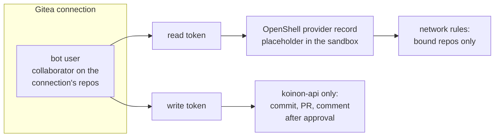

# 0063. Code-host credential classes: allow weaker credentials, with compensation

- Status: Accepted
- Date: 2026-10-26
- Relates to: old issue 144 (decided in conversation on
  2026-10-26), [0062](0062-code-host-connectors.md)
- Amends: [0043](0043-workload-identity-adapters-and-koinon-issuer.md) (a narrow exception for
  static code-host tokens), [0007](0007-connector-model.md) (a static-token auth type),
  [0049](0049-v01-scope-decisions.md) (Gitea credentials in v0.1), [0006](0006-identity-layers.md)
  (auth types)

## Context

Koinon's credential model assumes the control plane mints a short-lived credential, narrowed to
each use, and pushes it into an OpenShell provider record
([0043](0043-workload-identity-adapters-and-koinon-issuer.md) decisions 1 and 4). ADR 0043 rejected
"static long-lived keys in provider records" (`0043-…:85`).

GitHub fits that model. Koinon signs an App JWT (`internal/connectors/github/github.go:201-225`),
mints an installation token narrowed to repositories and permissions (`:403-444`), checks the
minted token against the request (`:424-442`) and caches it until 10 minutes before its one-hour
expiry. The sandbox gets a read-only token behind a stable placeholder in `GITHUB_TOKEN` and
`GH_TOKEN` (`internal/reconciler/github.go:21-47`).

The other providers do not fit (research, 2026-10-26):

| Provider | Machine credential | Lifetime | Narrowed per repository | Can refuse CI edits |
| --- | --- | --- | --- | --- |
| GitHub, GHES | App installation token | 1 h, minted per call | per mint, up to 500 | yes (`workflows` permission) |
| Gitea 28.2 | personal access token of a user or bot | no expiry | no; only through the user's collaborator set | no |
| GitLab | project, group or service-account token | ≥ 1 day (expiry is a date) | project or group | no |
| Azure DevOps | Entra token for a service principal | about 1 h | static per identity | no |

Gitea's token row has `UID, Name, TokenHash, Scope` and no repository list
(`gitea@v28.2.0:models/auth/access_token.go:19-33`). Its scopes are categories such as
`read:repository` and `write:repository` (`models/auth/access_token_scope.go`). Gitea 28 added bot
accounts that sign in only with tokens (v28.0.0, #38966). Its deploy tokens are per repository but
cover git and LFS only, not the REST API (#37306).

Old issue 144 listed three credential policies to choose from: short-lived and narrowable (GitHub
App), static bot tokens (an exception to ADR 0043, with rotation), and delegated-user OAuth.

## Decision

procoduck decided on 2026-10-26: **allow weaker credentials, with compensation.**

1. **A capability descriptor per provider** ([0062](0062-code-host-connectors.md)) states the
   credential's lifetime and what it can narrow: repositories, permissions, CI files. Koinon reads
   it to show and compensate for what the credential cannot do.
2. **GitHub and GHES** keep App installation tokens, minted per use and narrowed per mint, as
   today. Nothing changes for them.
3. **Gitea: one bot per connection.**
   - The bot is a collaborator on exactly the connection's repositories.
     _(Changed: a v0.1 connection declares no repositories and agents bind them; the check reports the repositories the bot can see and fails only when it sees or can push to none. See the CH5 amendment of 2026-10-27 below.)_
   - It has two tokens. The **read token** goes to sandboxes, through an OpenShell provider record
     and a placeholder, as GitHub's read token does. The **write token** is held only by
     koinon-api, which makes the commits, pull requests and comments after approval.
4. **Compensation:**
   - OpenShell network rules stay limited to the agent's bound repositories. They are the boundary
     for the sandbox, since the token itself is not narrowed per repository.
   - **All presets stay available** (Read only, Standard, Trusted; [0049](0049-v01-scope-decisions.md)).
     The agent builder shows a warning that this connection's credential is weaker. There is no
     stricter preset for weaker providers.
   - **Token age:** Koinon shows how old a static token is and warns when it is old. It never
     blocks on age and never rotates the token itself.
5. **A narrow exception to ADR 0043.** Static tokens are allowed for code hosts that cannot mint,
   under three conditions: Koinon holds them (encrypted, as other connection secrets
   [0056](0056-model-providers-pricing-and-budgets-per-org.md)); they reach a sandbox only through
   OpenShell placeholders; their age is shown. ADR 0043's rejection still holds for everything
   else.
6. **ADR 0044 is not needed.** No real token enters a sandbox: the sandbox sees only placeholders
   ([0044](0044-in-sandbox-credential-exception.md) stays a separate, gated exception).

## Alternatives considered

- **Short-lived, narrowable credentials only.** Keeps ADR 0043 as written, but rules out Gitea,
  which has no such credential (`gitea-overlap.md` §3). procoduck wanted Gitea in v0.1.
- **Koinon-driven rotation of static tokens** (regenerate, then `provider update`; spike 2.7 showed
  rotation works with `stable_placeholder`). The research option for an ADR 0043 exception
  (`gitea-overlap.md` §3). procoduck chose an age warning only. Creating a token over Gitea's API needs
  Basic auth with the user's password (`POST /users/{username}/tokens`), and doing it for a
  password-less bot is unverified (`gitea-overlap.md` §3).
- **Blocking tokens older than N days.** In the research's class D (`forge-and-trackers.md` §5c).
  Rejected: a warning, never a block.
- **A stricter preset for weaker providers,** for example `pull_request.create` pinned to ask even
  in Trusted (`forge-and-trackers.md` §5a). Rejected: all presets stay, with a warning.
- **One Gitea bot per agent,** for per-grant narrowing. Needs admin rights to create users, or an
  admin who pre-creates them (`gitea-overlap.md` §3). One bot per connection was chosen.
- **Gitea deploy tokens** for the sandbox. Per repository, but git and LFS only, so they do not
  cover `repo.read`'s REST reads.
- **Gitea OAuth2 apps** (delegated user). Authorization code grant only, so a person must consent,
  and the token is not narrowed per repository (docs `oauth2-provider`; `custom/conf/app.example.ini:625-628`).
- **An admin token with Gitea's `Sudo` header.** Koinon would hold an admin credential. Rejected as
  against least privilege (`gitea-overlap.md` §3).
- **Put the token in the sandbox under ADR 0044.** Not needed: placeholders work for Gitea (spike
  2.5, `hack/spike/results/2-credentials.md`).

## Consequences

- Positive: Gitea works in v0.1 without weakening the sandbox rule "no real secrets inside".
- Positive: the weaker guarantees are visible to the person building the agent, not hidden.
- Negative: on Gitea, a leaked read token reaches every repository of the bot until someone
  revokes it. OpenShell rules are the only per-repository boundary.
- Negative: on Gitea, no credential stops a workflow change. The CI-path guard
  ([0062](0062-code-host-connectors.md)) and the approval card carry that alone.
- Negative: tokens live until a person rotates them. Koinon only warns.
- Follow-ups _(inferred)_:
  - a new auth type in the connector schema (`connectors/schema/connector.schema.json:107`
    allows `federated`, `app-credential`, `delegated-user`);
  - the Gitea setup guide: create the bot, add it to exactly the connection's repositories, create
    the two tokens with their scopes, and a connection check that the bot sees no more repositories
    than the connection declares;
  - the agent builder's warning text, driven by the descriptor;
  - escape-suite cases for the Gitea read token (push and other repositories denied).

## Open questions

- The age at which Koinon starts warning, and whether age means "since entered in Koinon" or the
  provider's creation date (Gitea's token API may not expose one).
- The exact token scopes for the Gitea read and write tokens (for example `read:repository` for
  the sandbox; `write:repository` and `write:issue` for koinon-api).
- What the connection check does when the bot sees more repositories than the connection declares:
  warn or fail.
- Credential classes for GitLab (rotatable, ≥ 1 day) and Azure DevOps (Entra, identity-narrowed;
  [0043](0043-workload-identity-adapters-and-koinon-issuer.md) open questions on pooling and
  licences) when those providers land.
- Whether delegated-user OAuth is ever used for code hosts, for example for personal agents
  ([0055](0055-chat-as-its-own-object.md) item 7).

## Upstream verification

Checked 2026-10-26 (research notes `gitea-overlap.md` §3, `forge-and-trackers.md` §1.1):

- Gitea v28.2.0: PATs have no expiry field and no repository list
  (`models/auth/access_token.go:19-33`); scope categories (`models/auth/access_token_scope.go:57, 80-81`);
  bot accounts (v28.0.0 #38966); deploy tokens for git and LFS only (#37306); OAuth2 provider
  supports only the authorization code grant (https://docs.gitea.com/development/oauth2-provider).
- GitHub installation tokens: one hour, up to 500 repositories, never more than the App's
  permissions (https://docs.github.com/en/rest/apps/apps?apiVersion=2022-11-28#create-an-installation-access-token-for-an-app).
- GitLab access tokens and Azure DevOps service principals: as in `forge-and-trackers.md` §1.1.

## Links

- Old issue 144
- ADRs [0006](0006-identity-layers.md), [0008](0008-approvals-and-risk-tiers.md),
  [0043](0043-workload-identity-adapters-and-koinon-issuer.md),
  [0044](0044-in-sandbox-credential-exception.md), [0045](0045-openshell-hardening-defaults.md),
  [0049](0049-v01-scope-decisions.md), [0062](0062-code-host-connectors.md)
- Spike: `hack/spike/results/2-credentials.md`, `hack/spike/gitea-setup.sh:44-57`

## Amendments

- Amendment 2026-10-27 (CH5, Gitea connector). Decisions that answer the open questions above or that
  the plan item left to the implementation:
  - **Token scopes.** Read token: `read:repository`, `read:issue`, `read:user`. Write token:
    `write:repository`, `write:issue`, `read:user` (`read:user` lets the connection check name the bot;
    unverified for Gitea 28.2 whether `GET /user` needs it). The sandbox's network rules and the tools'
    scopes name two permissions, `repository` and `issue`, for the two tokens' categories.
  - **Token age** means the time since the token was entered in Koinon (UI, API or declarative Secret):
    Gitea's token API needs the user's password to list tokens, so the provider's creation date is not
    available. It is kept in the non-secret connection config (`readTokenSetAt`, `writeTokenSetAt`) with a
    short SHA-256 fingerprint of each token, so declaring the same Secret again keeps the date and a
    replaced token restarts it. The warning threshold is connector data, `auth.tokenWarnAfter`, **90 days**
    (`2160h`). The connection page shows each token's age and, from the threshold on, a warning; nothing
    blocks on age and nothing rotates.
  - **Placeholders.** The sandbox sees the read token as OpenShell's placeholder in `GITHUB_TOKEN` and
    `GH_TOKEN`, the same names as GitHub's: the provider record, profile, credential helper and
    `koinon-git-credential` are the same code, and a profile's endpoints bind the value to the connection's
    host. The write token is never given to OpenShell: only koinon-api (the push writer and the REST calls
    after an approval) reads it from the secret store. Both are sealed in the connection's envelope.
  - **The connection check** has four steps and writes nothing: `gitea.server` (the server answers, and its
    version), `gitea.tokens` (both tokens authenticate as the same bot), `gitea.repositories` (lists what the
    bot can see with its permission per repository and how many it can push to) and `gitea.read-token`
    (a write that Gitea must refuse before it reads the request, `POST issues` with an empty body, is
    refused with 403 for the read token; a 422 means the token has a write scope and the check fails).
    The open question "more repositories than the connection declares" is settled this way: a v0.1
    connection declares no repositories (agents bind them), so the check does not fail on the count. It
    reports the list, notes administrator permission on any, and fails only when the bot sees none or can
    push to none. Whether Gitea refuses the probe with 403 for a read-scoped token before validation is
    from Gitea's source reading (scope middleware runs first), not run against a real server.
  - **Weaker-credential warning.** It is driven by the descriptor (`credentialClass: static-token`), shown in
    the agent builder's access step and review, on the new-connection page and on the connection page. All
    presets stay. A second template, `repo-helper-gitea`, is the repo-helper on a Gitea grant (a template
    names one connector).
  - **Permission model in the tests.** `internal/testing/fakegitea` enforces, as Gitea does in two layers: a
    token's scope (a read-scoped token is refused with 403 on every write, API or git push, before the body
    is read) and the login's permission on the repository (none: 404; read only: writes 403). Gitea's real
    categories are finer (`write:repository`, `write:issue`), and its git-over-HTTP push check of the
    token scope is not confirmed against a real server in this item; the escape suite's Gitea cases
    (`test/escape/gitea_read_test.go`) assert the OpenShell policy, which is independent of the server, and
    the home-lab test confirms the server side.
- 2026-10-27 (CH5 review): the code-host MCP tool server is registered for every code-host connector, so a
  Gitea grant gets its tools under the target `gitea` (`gitea_create_pull_request`). A declared connection's
  connector cannot change by editing its Secret (delete it and declare a new one). The read-token check
  probes a repository with issues enabled when there is one. Static tokens log their revision, not an expiry.
