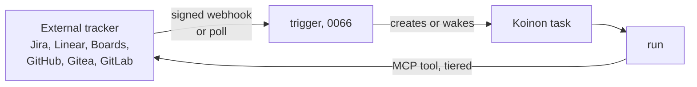

# 0064. Work-tracker connectors: tools and triggers, no sync

- Status: Accepted
- Delivery: v0.3 (design accepted 2026-10-26)
- Date: 2026-10-26
- Area: connectors-tools
- Tags: work-tracker, connectors, triggers, tasks
- Relates to: old issue 144 (decided in conversation
  and in the issue comment of 2026-10-26), old issue 146
  (releases)
- Amends: [0007](0007-connector-model.md) (work trackers as connector types)
- Builds on: [0062](0062-code-host-connectors.md) (the second seam),
  [0065](0065-work-model-tasks-inbox.md) (tasks), [0066](0066-triggers-and-scheduling.md) (triggers)

## Context

Old issue 144 names two seams: a code host ([0062](0062-code-host-connectors.md)) and a work tracker
(issues and work items with their fields, states and columns; comments; links to PRs). It asked
how Koinon's own work records relate to external boards: Koinon-only, link, import, mirror out,
or two-way sync.

Today Koinon has no tracker integration. A ticket has no external reference
(`internal/db/migrations/00003_tickets_and_runs.sql:11-39`). GitHub issues appear only as a target
of the ask-tier tool `comment_on_issue` (`connectors/github/connector.yaml:87-92`), and the sandbox
can read issues of its repository through `repo.read` (`:43-47`).

Scope (procoduck, old issue 144 comment, 2026-10-26): Jira (Cloud, and Data Center briefly) and Linear,
alongside the boards of GitHub, Gitea, GitLab and Azure DevOps.

Research (2026-10-26, `forge-and-trackers.md` §2, §4) found:

| Tracker | State change | Board or column move event | Webhook signature |
| --- | --- | --- | --- |
| GitHub Issues and Projects v2 | issue `state`; column = single-select field | `projects_v2_item`, organization-only, public preview | HMAC |
| Gitea 28.2 | issue `state`; column move by API | none, card moves must be polled | (not checked) |
| GitLab | `state_event`; boards are label- or status-driven views | none; arrives as an issue update | (not checked) |
| Azure Boards | direct write of `System.State` (JSON Patch) | a state change is a work item update | service hooks |
| Jira Cloud | only through workflow transitions | a transition is an issue update | optional HMAC `X-Hub-Signature` |
| Linear | direct `stateId` | status is an issue update | HMAC `Linear-Signature` |

- Every product the research checked (Copilot, Devin, Cursor, Codex, Factory, OpenHands) treats
  the external tracker as a trigger and a status mirror, keeps its own session or task as the run
  record, and avoids two-way field sync (§4).
- Jira Cloud enforces points-based quotas from 2026-03-02 for Forge, Connect and 3LO apps; API-token
  traffic has burst limits only (https://developer.atlassian.com/cloud/jira/platform/rate-limiting/).
  Linear allows 2,500 requests per hour for an API key and 5,000 for an OAuth app
  (https://linear.app/developers/rate-limiting).
- Linear alone has a first-class agent identity (`actor=app`, delegation, agent sessions;
  https://linear.app/developers/agents).

## Decision

1. **Koinon tasks never sync, link or import with external trackers.** A Koinon task
   ([0065](0065-work-model-tasks-inbox.md)) is Koinon's own record. Koinon does not copy items in,
   mirror state out, or keep a link table between the two.
2. **A tracker is reached in two ways:**
   - **Connector tools.** Agents act on tracker items through MCP tools of a tracker connector,
     under the agent's grants and the usual risk tiers ([0008](0008-approvals-and-risk-tiers.md),
     [0042](0042-ask-tier-park-and-execute.md)).
   - **Inbound triggers.** Tracker events start or wake agent work as a trigger type
     ([0066](0066-triggers-and-scheduling.md)): signed webhooks, with polling as the fallback where
     a tracker has no event or cannot reach Koinon.
3. **A tracker is its own seam,** separate from the code-host interface (old issue 144), with its data in
   `connector.yaml` like other connector types ([0007](0007-connector-model.md)).
4. **Providers:** Jira (Cloud, and Data Center briefly), Linear, Azure Boards, and the issues of GitHub,
   Gitea and GitLab, each with its triggers.
5. **Timing:** designed now; built in v0.3 (old issue 146). Until then the only tracker action is the
   existing `comment_on_issue` tool on GitHub.

## Alternatives considered

From the options old issue 144 listed and the research (`forge-and-trackers.md` §5b):

- **Link-only** (a task has external references with a cached title and state). Rejected: no links.
- **Import** (create a Koinon record from an external item by a rule). Rejected as an import; the
  same need is met by a trigger that creates a task, without copying the item.
- **Mirror out** (Koinon writes run status and state moves back to the item). Rejected as an
  automatic mirror. An agent can still comment or change state through tools, with approvals.
- **Two-way sync.** Rejected: conflict resolution, loop prevention and per-provider state mapping;
  every product checked avoids it (§4).
- **The external tracker as the source of truth** (no Koinon record). Rejected: the Koinon task
  carries runs, sessions, cost and audit ([0065](0065-work-model-tasks-inbox.md)); only GitLab Duo
  works this way, because it is the tracker.
- **Polling only.** Simpler, no public endpoint, but slower and costly against Jira's points and
  Linear's complexity budgets. Kept as the fallback, not the default.

## Consequences

- Positive: no sync engine, no state mapping per provider, no echo loops.
- Positive: people keep their tracker; agents react to it and act on it like a colleague would.
- Negative: Koinon's UI does not show which external item a task came from beyond what the
  trigger event and the agent's messages contain _(inferred)_.
- Negative: providers without move events (Gitea, GitLab boards) need polling for column-move
  triggers _(inferred from the table above)_.
- Negative: Jira changes state only through transitions, so a "set state" tool needs transition
  IDs per project workflow _(inferred)_.
- Follow-ups _(inferred)_: tracker connector types with setup guides; tool sets per provider;
  webhook verifiers per provider on the ingress of [0066](0066-triggers-and-scheduling.md); a fake
  tracker for CI.

## Open questions

- The tool set and its risk tiers per tracker (read, comment, change state, create item; deletes
  presumably forbidden).
- Credentials per tracker: whether GitHub, Gitea and GitLab issues reuse the code-host connection's
  credential, and which identity Jira (API token, OAuth 3LO, Forge or Connect app, service account)
  and Linear (`actor=app`, `client_credentials`) use. Credential classes follow
  [0063](0063-forge-credential-classes.md).
- The correlation key for tracker events (for example provider plus item key), so an event wakes
  the open task for that item ([0066](0066-triggers-and-scheduling.md)): whether storing an
  external item key on a task for correlation is allowed under "never sync, link or import".
- Whether to use Linear's agent sessions (an agent must post a `thought` within 10 s).
- How much of Jira Data Center is covered ("briefly" in old issue 144): PATs, webhooks and the dev panel
  differ from Cloud.
- Polling intervals per provider within their rate limits.

## Upstream verification

Checked 2026-10-26 (`forge-and-trackers.md` §2 and `notes-trackers.md`): Jira transitions and
rate limits; Linear webhooks, rate limits and agent API; Gitea v28.2.0 issue webhook events and
the absence of project-move events (`gitea@v28.2.0:modules/webhook/type.go`); GitHub Projects v2
webhooks (organization-only, preview); Azure Boards JSON Patch state writes. Unverified there:
Jira transition body and ADF on the v3 reference; Linear status types; exact Azure Boards
service-hook IDs.

## Links

- Old issues 144, 146
- ADRs [0007](0007-connector-model.md), [0008](0008-approvals-and-risk-tiers.md),
  [0042](0042-ask-tier-park-and-execute.md), [0062](0062-code-host-connectors.md),
  [0063](0063-forge-credential-classes.md), [0065](0065-work-model-tasks-inbox.md),
  [0066](0066-triggers-and-scheduling.md)
- Research (session notes, 2026-10-26): `forge-and-trackers.md`, `notes-trackers.md`
