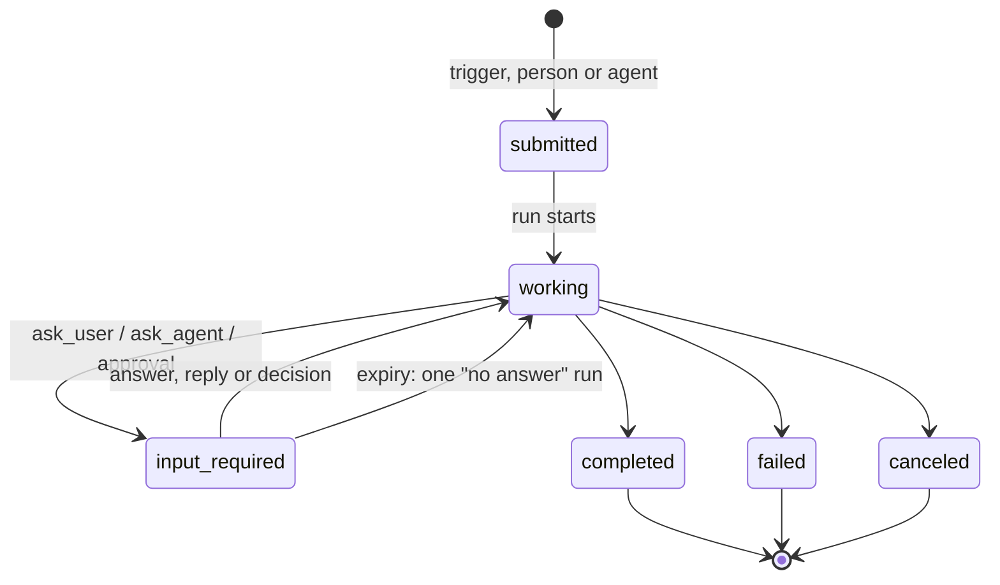

# 0065. Work model: A2A-shaped tasks, the inbox, and asking people and agents

- Status: Accepted
- Date: 2026-10-26
- Area: work-model
- Tags: tasks, approvals, runs, agent-home, chat
- Relates to: old issue 146 (rounds 1 and 2, and the
  releases)
- Amends: [0010](0010-eventing.md) (tasks, not the board, are the queue),
  [0011](0011-agent-to-agent.md) (transport inside an install), [0030](0030-run-state-machine.md)
  (park reasons in use), [0032](0032-agent-home-checkpoints.md) (checkpoints in v0.1),
  [0049](0049-v01-scope-decisions.md) (board columns, sandbox idle), [0055](0055-chat-as-its-own-object.md)
  (chat next to tasks), [0051](0051-session-home-generations.md) (restored homes resume the session),
  [0006](0006-identity-layers.md), [0012](0012-cross-org-sharing.md) (the called agent spends its own budget),
  [0018](0018-v1-screens.md), [0019](0019-personal-agents-and-teams.md),
  [0036](0036-v01-demo.md), [0042](0042-ask-tier-park-and-execute.md) (safe defaults, scoped
  approvals); supersedes the rest of [0017](0017-board-and-chat-interaction-model.md)
- Triggers and latency: [0066](0066-triggers-and-scheduling.md)

## Context

procoduck's user stories (old issue 146, 2026-10-26), in the order the issue gives them: PR review on a new
PR; a FinOps agent asking a lead-engineer agent; daily stand-ups to Slack or Teams; a personal
agent asking experts; @mentions in a channel; long-running research; a support-channel ops agent;
weekly LCM upgrades; a personal agent with mail and reminders. "A person should never have to
administer tickets."

What Koinon has (research `ticketing-review.md`, `triggers-lifecycle.md`, `main` at c05b1d9):

- **A ticket is a human's request to one agent, plus its conversation.** Columns are the enum
  `todo | in_progress | waiting_on_you | done` (`internal/db/migrations/00003_tickets_and_runs.sql:9`).
  `created_by` references users only (`:18`). Only `CreateTicket` and `AppendMessage` start work;
  both call `scheduler.Enqueue` (`internal/services/tickets.go:119`, `:240`). An agent cannot create
  a ticket. The status does not follow the run: a new ticket shows To do while its agent works.
- **Every run belongs to a ticket** (`runs.ticket_id NOT NULL`, `00003…sql:54`). Approvals, spend
  and saved work are keyed by ticket and run.
- **The only human wait is the approval park.** Park reasons are
  `('approval','budget','a2a','input_required')` (`00003…sql:46`), and only `approval` is ever
  written; the others appear only in the proto mapping (`internal/services/convert.go:159-161`).
  An agent that asks a question just ends its turn: the run succeeds and the ticket does not move
  to Waiting on you (`internal/agentd/park.go:162` is the only such move).
- **Expiry cancels.** The approvals sweeper cancels runs parked past `park_expires_at` and moves
  the ticket back to To do (`internal/approvals/approvals.go:492-560`, `:594-620`). Approvals expire
  after 7 days (`internal/githubtools/server.go:68`).
- **A parked run does not keep its sandbox.** The sandbox stops 10 minutes after the last
  activity, parked runs included (`internal/reconciler/reconciler.go:76`; ADR 0049 "Sandbox
  lifecycle"). Resuming from a stopped sandbox takes about 30–45 s _(inferred from spike 1.6 and
  7)_.
- **A recreated sandbox loses its home.** OpenShell 0.1.5 deletes the volume with the sandbox; the
  run continues with `session/new` and a handoff (ADR 0051). Checkpoints (ADR 0032) are not built.

A2A v1.0 task states are submitted, working, input-required, auth-required, completed, failed,
canceled and rejected (https://a2a-protocol.org/latest/specification/ §4.1.3). A follow-up message
with the same `taskId` answers an `input-required` task (§6.3).

## Decision

### Tasks replace tickets

1. **The work record is an A2A-shaped task.** States: submitted, working, input-required,
   completed, canceled, failed.
2. **Triggers, people or agents create tasks** ([0066](0066-triggers-and-scheduling.md)). Each task
   is **owned by one agent**. A task holds its runs, approvals and conversation.
3. **People don't manage tasks.** Nobody moves cards or closes tasks to keep the system working;
   the inbox shows what needs a person.
4. **Today's tickets migrate to tasks.** The board stays as a **secondary view** over tasks.
5. **Koinon tasks never sync, link or import with external trackers** ([0064](0064-work-tracker-connectors.md)).

### The inbox is the front door

6. **"Waiting on you" is the home screen**: notifications with actions, such as approve a PR,
   validate a reply, answer a question, read a report. Chat with agents and with the personal agent
   sits next to it ([0055](0055-chat-as-its-own-object.md)).
7. **Notifications** go in-app, and to Slack and Teams through their connectors, including
   approvals with buttons. Email comes later.

### Asking a person: `ask_user`

8. An MCP tool `ask_user(to, question, draft?, choices?)`:
   - the task moves to input-required;
   - an inbox item appears, plus a Slack or Teams message with buttons;
   - the run parks with reason `input_required`;
   - the sandbox stays warm for 15 minutes ([0066](0066-triggers-and-scheduling.md));
   - the answer resumes the run.

   The same mechanism covers "create the PR?" (the LCM story) and "may I post this reply?" (the
   support story).
9. **Who answers, from where.** In Koinon's UI, or in Slack or Teams by a user whose chat account is
   linked to their Koinon user, through the OIDC email or a one-time link. Their Koinon role
   applies. A tap from an unlinked account is refused. Free-text answers in the thread count too.
10. **No answer.** A reminder after 24 hours (inbox and chat), expiry after 7 days. On expiry the
    agent gets one short "no answer" run, so it can close the task as canceled or ask someone else.
    Both times are set per agent or template.
10a. **Safe defaults and scoped approvals** (old issue 146 A4; amends [0042](0042-ask-tier-park-and-execute.md)):
    - every question names a safe default, used when it is dismissed or expires; the agent is told;
    - approvals can be scoped: once, this task, or this agent and this kind of action until a date;
    - a scope wider than once needs an admin, shows in the agent's grants, and is audited.

### Asking an agent: `ask_agent` and `reply`

11. **Inside an install, agents talk through Postgres and two MCP tools,** `ask_agent` and `reply`:
    - the request is a **child task**, and the expert's sandbox starts as soon as the task exists;
    - the asking run parks with reason `a2a` and resumes on the reply;
    - each agent uses only its own grants and budget, and membership and role caps apply
      ([0019](0019-personal-agents-and-teams.md));
    - sandboxes never talk to each other over the network.
12. **An external A2A gateway comes later** (v1.0, `/.well-known/agent-card.json`) and maps onto the
    same tasks. procoduck: build `ask_agent` first, then judge whether it works in practice.
12a. **`ask_agent` guards** (old issue 146 A3), all tunable per org:
    - refused when the asked agent is already in the chain;
    - the chain is at most 3 deep;
    - an agent has at most 5 open questions to other agents;
    - the same question to the same agent in the same task returns the existing child.
12b. **Interruption** (old issue 146 A2): only a person's chat message on the task can interrupt a running
    turn. Events, replies from other agents and answers wait until the turn ends, then arrive
    together ([0066](0066-triggers-and-scheduling.md)).

### Long waits survive restarts

13. **Home checkpoints ([0032](0032-agent-home-checkpoints.md)) are built now.** The home (session,
    notes, scratch work) is saved when a sandbox stops or before it is recreated, and restored
    afterwards, so long waits and long tasks survive drains and image bumps.
13a. **Checkpoint lineage** (old issue 146 A6): a sandbox restored from a checkpoint keeps its home
    generation and reloads the same session; only a sandbox created without a checkpoint gets a
    new generation ([0051](0051-session-home-generations.md) amendment).
13b. **Archive tier** (old issue 146 A7, v0.1): after N days stopped (default 7), once a checkpoint is
    complete, Koinon deletes the sandbox and its volume and restores into a fresh one on the next
    run ([0032](0032-agent-home-checkpoints.md) amendment).
13c. **Ephemeral agents** (old issue 146 A8): an agent or template can be marked ephemeral. Each task gets a
    fresh sandbox without a home volume, deleted when the task ends; memory lives in task notes and
    the [0033](0033-file-based-memory.md) stores. The default stays persistent.
    **Amendment (EP1, 2026-10-27):** the flag is `ephemeral` in a template's `spec` and in the agent
    version's config (no migration), set at agent creation from the template and overridable there.
    The predicate is `agentconfig.IsEphemeral`; checkpoints (HC1) and the archive tier call it and
    skip ephemeral agents. The agent keeps its one `agent_sandboxes` row, which points at the
    sandbox of one task, `execution.TaskSandboxName` (`kt-` and 16 hex characters of a hash of org,
    agent and task). The reconciler picks the task from the run that holds the agent, else the run
    claimed next, else a parked run (`GetEphemeralFocusTask`); when it changes, or when no run needs
    a sandbox, it deletes the previous sandbox, and with it OpenShell's workspace volume, and moves
    the row once the sandbox is gone. A running run is never cut off. agentd waits until the row
    names its task's sandbox. Only the task's end deletes the sandbox: a task
    between runs (for example input-required with no parked run) keeps it, so a follow-up message
    reuses the same home and files; the idle stop still applies. The reconciler falls back to the
    latest run of a task that is not completed, canceled or failed. If another task's run needs the
    agent's single row, the open task's sandbox is deleted (one sandbox per agent at a time). An ephemeral agent is not pre-woken, since no
    sandbox exists before its task does.
    **Amendment (EP1 review, 2026-10-27):** ephemeral is decided from the agent's active version (the
    reconciler); agentd also accepts the agent's own sandbox name, so a run pinned to an ephemeral
    version does not wait forever after a persistent version is activated. Deleting a task sandbox
    is audited as `sandbox.delete` (no phase, so ADR 0054's recreation loop guard does not count it);
    the event names the sandbox, whose name is a hash of org, agent and task, not the task ID.
13d. **Failure classes** (old issue 146 A1): a failed run carries a `failure_class` (`transient`,
    `throttled`, `context_overflow`, `budget`, `policy`, `fatal`) that drives retries and inbox
    messages; `context_overflow` shrinks the largest input once, then asks the user
    ([0030](0030-run-state-machine.md) amendment).

The diagram is a reading aid. The mapping from today's columns and parks is recorded under Open questions (answered by TK1).

### Releases (old issue 146)

- v0.1: tasks, the inbox, `ask_user` (with safe defaults and scoped approvals), home checkpoints with
  lineage and the archive tier, ephemeral agents, failure classes (procoduck placed scoped approvals and
  ephemeral agents in v0.1 on 2026-10-26).
- v0.2: `ask_agent` with its guards; Slack and Teams with approval buttons and account linking;
  the interruption rule lands with events.

## Alternatives considered

- **Keep tickets as the work record** (ADR 0010, 0017, 0049). Rejected: tickets are human-to-agent
  requests that people move between columns, agents cannot create them, and the status does not
  follow the run (`ticketing-review.md` §3.1).
- **A lighter inter-agent object next to tickets,** as chat became one (`ticketing-review.md`
  §3.2, question 9). Rejected: one task model for people, triggers and agents.
- **A2A over the network between sandboxes.** Rejected: sandboxes deny east-west traffic by
  default ([0045](0045-openshell-hardening-defaults.md)), the callee is usually asleep, and the
  guards live in Koinon anyway (`messaging-and-workflows.md` §3.3).
- **Wait for input with the sandbox kept running until the answer** (option A in
  `triggers-lifecycle.md` Part 3). Rejected: one Kata VM per waiting agent for up to 7 days; old issue 99 was
  filed for that cost. Chosen: a 15-minute warm window, then stop and resume.
- **Memory snapshots instead of home checkpoints** (option D there). Not available on Kata, Agent
  Sandbox v1.0.7 or OpenShell 0.1.5.
- **Expiry cancels the run** (today's approval behaviour). Rejected for questions: the agent gets
  one "no answer" run instead.

## Consequences

- Positive: one record for every kind of work: a person's request, a trigger, an agent's question.
- Positive: questions park and resume like approvals, so an agent never sits idle on a question in
  a running VM for long.
- Positive: long tasks and long waits survive drains, image bumps and recreation.
- Negative: a data migration from tickets to tasks, and renames through the API, UI and docs
  (`TicketService`, `ticket.proto:15-39`, the board page) _(inferred)_.
- Negative: `created_by` must allow agents and triggers, and the prompt builder, which sends only
  user messages (`ListTicketMessagesAfter`), must deliver answers, replies and events _(inferred)_.
- Negative: the 15-minute warm window costs VM time for every parked question _(inferred)_.
- Follow-ups _(inferred)_: `ask_user` and `reply` resolve the park (`ResolveRunPark`) instead of
  queueing a new run; reminders and expiry on DBOS timers ([0066](0066-triggers-and-scheduling.md));
  depth and cycle guards and cost roll-up for child tasks ([0011](0011-agent-to-agent.md)); the inbox
  screen; audit of task actions, which tickets lack today (ADR 0023 amendment).

## Open questions

- ~~The mapping of today's ticket columns and run parks to task states.~~ **Answered by TK1
  (2026-10-26):** the candidate holds. The migration (`00020_tasks.sql`) maps To do → submitted,
  In progress → working, Waiting on you → input-required and Done → completed; no old ticket
  becomes canceled or failed, because a ticket could only be Done. A run parked on an approval that
  a person has not decided moves its task from submitted or working to input-required, and the
  decision moves it back to working; an approval that expires moves it back to submitted, as it
  moved the ticket to To do. Every park the code makes today is an approval park, so no other
  park reason has a mapping yet: `ask_user` (TK3) parks to input-required, and `a2a` stays
  working. Task events keep their rows: `ticket.created` becomes `task.created`, and the `from`
  and `to` of `status.changed` become states. `TicketService` stays as a deprecated layer over
  tasks until TK2: the column is derived from the state (completed, canceled and failed show as
  Done) and a move to Done completes the task.
  TK1 keeps today's behaviour otherwise: a run starting does not move a task to working and runs
  do not end tasks, so a task stays submitted while its agent works, as a ticket stayed in To do;
  that comes with TK2/TK3/LT1, and the diagram above is the target.
- How a direct message in the inbox chat (a trigger, [0066](0066-triggers-and-scheduling.md)) relates
  to [0055](0055-chat-as-its-own-object.md)'s private chat that "becomes a ticket when the person
  confirms".
- What the `to` argument of `ask_user` accepts (a user, a role, a group) and who may answer a
  question sent to a group.
- Whether a free-text answer in a thread is always an answer, or only when the task is
  input-required.
- Which home paths a checkpoint includes. old issue 146 says "session, notes, scratch work"; ADR 0032
  excludes repository checkouts and caches. restic or kopia, and sidecar or Job, stay open there.
- Whether the park, run-end and periodic checkpoint points of ADR 0032 also ship in v0.1.
- Task retention and deletion.
- The default N for archive is 7 days; whether it is tunable per org or per agent.

## Upstream verification

- 2026-10-26: A2A v1.0 task states, `returnImmediately`, push notifications, continuation by
  `taskId` and the agent card path `/.well-known/agent-card.json` (§3.2.2, §4.1.3, §6.3, §8.2 of
  https://a2a-protocol.org/latest/specification/; a2a-go v2.7.0, Apache-2.0). This answers ADR
  0011's unverified card path.
- 2026-10-26: Agent Sandbox v1.0.7 has suspend but no snapshot in core (KEP-0694); OpenShell 0.1.5
  keeps the PVC on stop and deletes it on delete (`crates/openshell-driver-kubernetes/README.md`).

## Links

- Old issue 146; personal agent
  [#11](https://github.com/stateracloud/koinon/issues/11); idle-cost fix
  old issue 99
- ADRs [0010](0010-eventing.md), [0011](0011-agent-to-agent.md), [0019](0019-personal-agents-and-teams.md),
  [0030](0030-run-state-machine.md), [0032](0032-agent-home-checkpoints.md),
  [0042](0042-ask-tier-park-and-execute.md), [0051](0051-session-home-generations.md),
  [0055](0055-chat-as-its-own-object.md), [0064](0064-work-tracker-connectors.md),
  [0066](0066-triggers-and-scheduling.md)
- Research (session notes, 2026-10-26): `ticketing-review.md`, `triggers-lifecycle.md`,
  `messaging-and-workflows.md`
- Design adapted from [hydro-project/infinity](https://github.com/hydro-project/infinity) (Apache-2.0, commit 341f6c2): the interruption rule (`system/thread.rs:240-291`, `system/defer.rs`), the `ask_agent` guards (`tools/thread.rs:72-89`) and the failure classes. Research notes: `infinity-code-ideas.md`.
- Prior art (ideas only, no code; its servers are AGPL-3.0): [daytonaio/daytona](https://github.com/daytonaio/daytona) v0.190.0, for the archive tier and checkpoint lineage. Research notes: `daytona.md`.

## Amendment (2026-10-27, plan item TK2): the inbox as built

- **Routes.** `/` is the inbox; `/board` is the board (secondary view); `/tasks/{id}` is a task. A
  task keeps its ticket's id, so `/tickets/{id}` redirects to `/tasks/{id}` and old links work. The
  web UI reads and writes only `TaskService` (`koinon.task.v1alpha1`); `TicketService` stays on the
  server, deprecated.
- **Inbox items.** An item is a `kind` in a union (`web/src/lib/inbox.ts`) with one renderer per
  kind (`web/src/components/inbox.tsx`); a new kind (TK3's question, a reply to validate, a
  report) is one more member and one more renderer. Today: `approval` (a pending approval the
  viewer may decide, only for admins and owners as before) and `task-input` (a task in
  input-required that no listed approval explains, for example a question the agent asked, and
  that the viewer created). Newest first.
- **Inline actions.** Approve and Deny sit on the item. Approve sends the `args_sha256` of the
  listed approval, so a request that changed since the list was read is refused (Aborted) and the
  item says to open it and review the new version; the full card (diff, risk, note, two-approver
  state) stays on `/approvals/{id}` and in the task timeline.
- **Chat.** Next to the inbox, a list of the open tasks (not completed, canceled or failed; the
  eight most recently updated) is the list of conversations; the chosen one shows the task's
  timeline and composer, the same components as the task page, and new tasks are started from a
  form under it. Chat with the personal agent ([0055](0055-chat-as-its-own-object.md)) is not
  separate yet: every conversation is a task.
- **Board.** Six groups, one per task state, read-only. "Move to Done" is gone, because nobody moves
  tasks by hand (decision 3); the task page has "Cancel task" (`CancelTask`) instead.
- **Notifications.** The navigation shows a badge with the number of waiting items and the tab
  title carries it, "(2) ...". There is no task stream yet, so the inbox, the board and the badge
  share one poll of `ListTasks` and `ListApprovals` every 15 seconds (and on window focus). A
  task event stream would replace the poll.
- **Review fixes (2026-10-27).** `ListApprovals` is fetched for every role (the proto says viewers
  and above). Every pending approval explains its task, so a member or viewer never sees an
  approval-parked task as "needs your reply"; only `canDecide` approvals become items.
  `task-input` items are limited to tasks the viewer created (`Task.created_by.user_id`), a
  deliberate conservative choice until TK3 adds targeted asks; before this they listed every
  input-required task in the org. The inbox and board show an `ListAgents` error too. The e2e spec
  and the quickstart follow the inbox: Inbox heading, "Hand it a task from the inbox", "Create
  task", "Open task", `/tasks/{id}`.

## Amendment (2026-10-27, plan item TK3): `ask_user` as built

- **The tool.** `ask_user(to?, question, draft?, choices?, default)` is on koinon-api's tools listener at
  `/mcp-koinon` (package `askuser`), the gateway target `koinon`, so an agent sees `koinon_ask_user`.
  The reconciler grants it to every active agent when `koinonTools.url` is set (chart `config.yaml`);
  it needs no grant, since it costs nothing and only waits for a person. `to` names a member of the
  org by email or user ID; left out it is the task's creator, and a task not created by a person
  (trigger, agent) must name `to`. A role or a group is not accepted yet (open question above: kept
  to the conservative reading). Only the addressee can answer or dismiss; admins cannot answer for
  someone else (reassigning is TK4 or later).
- **`default` is a required argument** (no documented fallback): free text, and when `choices` are
  given it must be one of them. It is stored with the question and shown in the inbox next to
  Dismiss.
- **The tool answers at once** ("question recorded ... end your turn") and records the question
  as `asked`, invisible. The park is agentd's turn-end transaction (ADR 0029, the approval pattern),
  and in that one transaction it opens the run's asked questions (`open`, so they show in the inbox),
  parks the run with reason `input_required`, moves the task to input-required and appends
  `question.asked` and `run.parked`. Nothing is visible before the park and nothing is parked
  without the item. A run with both pending approvals and a question parks as `input_required`
  (the longer warm window); `approvals.ResolveRun` resolves a park of either reason only when no
  approval request and no question of the run is open.
- **The answer is the next prompt, not the tool result.** The tool result ended the turn before the
  person could answer, and the resumed run is a new prompt on the loaded session (`session/load`).
  agentd adds one line per resolved question to the resume prompt: `the person answered: "..."`, or
  `the person dismissed the question, so your default was applied: "..."` / `nobody answered in
  time, so your default was applied: "..."` (decision 10a: the agent is told). Delivery is marked in
  the turn-end transaction (`questions.delivered_at`), like approvals.
- **State and API.** Migration `00026_questions.sql`: `questions` (`asked`, `open`, `answered`,
  `dismissed`, `expired`; `answer_kind` choice, draft, text or default; `expires_at` 7 days after the
  ask; `call_sha256` makes the same question in one run one question). `QuestionService`
  (`ListQuestions`: the caller's open questions, or with `task_id` the caller's questions of a task;
  `AnswerQuestion`: a choice, the draft as offered or edited, or text; `DismissQuestion`). A second
  answer to a resolved question is `Aborted`, so an answer resumes a run exactly once: it is a
  state-guarded update under the run's row lock, in the transaction that calls `ResolveRunPark`.
  Answer, dismissal and expiry are audited (`question.answer`, `question.dismiss`,
  `question.expire`) and written to the task timeline.
- **For TK4.** `questions.Expire(ctx, q, org, id)` applies the default as an expiry (no actor), and
  `ListDueQuestions` finds open questions past `expires_at`; TK4 adds the 24-hour reminder column and
  the sweep, and the "no answer" run of decision 10 (today the default is delivered in the resumed
  run's prompt, which is that run). `park_expires_at` of a question park is the earliest open
  `expires_at`, and the approvals sweeper cancels only parks with reason `approval`.
- **Inbox.** The web inbox gets the item kind `question` (choices as buttons, the draft in a text area
  with "Use draft" or "Use edited draft", free text, Dismiss with the default shown). A question
  explains its task, so no `task-input` item repeats it. The page polls `ListQuestions` with the
  tasks and approvals; a server without `QuestionService` (`Unimplemented`) counts as no questions.
- **Notifications (B2).** The park commits in koinon-agentd, which has no DBOS runtime, so
  koinon-api notifies from the committed state: a sweeper (`questions.Sweeper`, every sweep interval)
  sends `question.asked:<id>` for each opened question with no `notified_at`, as a DBOS step with
  `api.durable.enabled` and inline without it. The handler writes the in-app notification row
  (`notifications`, dedupe key `question:<id>`) and sets `notified_at`; chat messages join it in
  v0.2. A resolution sends the sandbox pre-wake (`wake.agent`) after its commit, so a late answer
  does not wait for the reconciler's next pass.
- **Warm window.** No new code: the reconciler already keeps a sandbox of a run parked with reason
  `input_required` up for `parkWarm` (15 minutes). Tests: an answer 14 minutes after the park
  creates and stops nothing; an answer after 16 minutes starts the stopped sandbox without recreating
  it, and agentd resumes through `session/load` (`internal/reconciler/latency_test.go`,
  `internal/agentd/askuser_test.go`).
- **Questions end with their run (2026-10-27).** A question outlives no run. `question_state` has
  `canceled`; the question sweeper (`questions.CancelOfFinishedRuns`, with the notification sweep)
  cancels the asked and open questions of every succeeded, failed or canceled run and appends a
  `question.canceled` task event. Until the sweep runs, `ListOpenQuestionsForUser` lists only the
  questions of parked runs, and `resolve` refuses (ErrNotOpen) a question whose run has ended.
- **Addressee role (2026-10-27).** `to` must hold the member role or higher: `ask_user` answers
  "X cannot answer questions (viewer)" otherwise, and `can_answer` needs the member role, like
  AnswerQuestion and DismissQuestion.
- **Notification failures (2026-10-27).** `NotifyPending` logs each failing question, continues and
  returns the failures joined. A failed delivery adds to `notify_failures`; at 8 the question counts
  as notified (logged at error level) so a workflow that failed for good is not re-sent every sweep.
- **Pre-wake only on resume (2026-10-27).** A resolution sends `wake.agent` only when the run is
  parked and ready after it; other open questions or approvals keep it parked and need no wake.
- **Waiting on someone else (2026-10-27).** `Task.waiting_on_user_id` and `waiting_on_name` (ListTasks,
  GetTask) name the addressee of the task's open question; the inbox shows no `task-input` item to a
  creator who is not that person.
- **Reminders and expiry (TK4, 2026-10-27).** Decision 10 is built as follows.
  - **Settings.** `spec.questions` in a template and `questions` in an agent version's config hold
    `reminderAfter` (default 24h) and `expireAfter` (default 7 days), as Go durations between 1m and
    720h, the reminder before the expiry. `ask_user` reads the agent's active version when the
    question is asked and stores `remind_at` and `expires_at` on the question (migration 00027), so a
    later version does not move the deadlines of questions already open. A reminder that would not
    come before the expiry is dropped. Changing the settings of one agent without a new template
    version is a new agent version; the agent editor does not expose them yet.
  - **Timers are a sweep, not a DBOS sleep per question.** The deadlines are columns, and the
    question sweeper in koinon-api (`questions.Sweeper`, every sweep interval) runs `RunTimers`; that
    works the same with and without `api.durable.enabled`, and after a restart or on a second
    replica the next sweep finds the same due questions. Cost: a reminder or expiry is late by up to
    one sweep interval.
  - **Once.** The reminder is the notification `question.reminder:<id>` (one DBOS workflow with
    durable on; the handler writes the in-app notification, dedupe key `question-reminder:<id>`, then
    sets `reminded_at`; eight failures abandon it, like `question.asked`). The expiry is the state
    change open to expired under the run's row lock (`questions.Expire`), so a repeated sweep, a
    second replica or a late answer finds it made (`ErrNotOpen`). No dedupe record is needed.
  - **The reminder** is an in-app notification for the person asked (kind `question.reminder`, with
    a message naming the question, the expiry and the default). The question stays in the inbox.
    Chat reminders join with the chat connectors (v0.2).
  - **The "no answer" run** is the resume of the parked run: expiry applies the safe default and
    resolves the park, and the next prompt carries the outcome plus a system instruction (`[Koinon
    system] This is a short "no answer" run ...`): carry on with the default, cancel the task with
    `cancel_task`, or ask someone else with `ask_user`. No second run is created; the run is not
    given a smaller cap.
  - **Amendment 2026-10-27 (TK4 review).** Canceling is a tool, not a convention: Koinon's tool
    server has a second tool, `cancel_task(reason)` (target `koinon`, offered to every agent like
    `ask_user`), which closes the caller's task as canceled in one transaction, with the reason in
    the `status.changed` event on the task timeline, and cancels its queued runs. Called on an
    already ended task it changes nothing. The system instruction no longer says the agent "will not
    be reminded again": a question it asks someone else gets its own reminder and its own no-answer
    run. A tool-server `Reminder` override is applied only when it is before the expiry, like the
    expiry override. `SweepResult.Sent` counts reminders handed to the sender: with durable on, a
    resend of the same workflow ID until the handler sets `reminded_at` is a no-op but is counted
    again. The template picker (`TemplateService`) does not show `spec.questions` yet; the reminder
    and expiry are set in the template file only, like the agent editor, and a UI for them is a
    follow-up.
- 2026-10-27 (wave-3 integration): an approval's expiry never cancels a run parked with reason
  `input_required`: `cancelExpiredRun` resolves the park instead, so the run resumes with "approval
  expired" once its questions are answered or expire. `ask_user` without `to` in a direct-message
  thread asks the author of the thread's latest user message. The `ask_user` text points to the
  expiry in the tool result instead of a fixed 7 days. When `cancel_task` and `ask_user` run in
  one turn, `endTurn` cancels the asked questions and finishes the run instead of parking it. The chat
  shows "waiting on ..." instead of the composer while the task is `input_required`.

## Amendment (2026-10-27, plan item QA1): restart tests and hygiene

- **Restart tests.** `internal/agentd/restart_test.go` runs two process sets on one Postgres, each a
  tool server plus an agentd pool on its own connection pool, with one fake gateway. The harness uses
  the tool server of the set that owns each turn. Both sets stay alive through the decision, so both
  pools race to claim the resume: one executed pull request or one answered question, two prompts,
  epoch 2. A second variant blocks the harness inside the resume prompt, kills the set that claimed it
  while its lease is held (`KeepLeaseOnShutdown`), and asserts that the survivor takes over after the
  lease expires: epoch 3, one takeover, one executed pull request or answered question, and a final
  prompt carrying the interruption note.
- **`nolintlint`** is on with `require-explanation`, `require-specific` and `allow-unused: false`.
  Unused directives (gosec is off in tests; several gosec findings no longer fire) were removed rather
  than kept.
- **`internal/safego`**: `Go`, `GoOrStop` and `Do` recover a panic and log it with the stack. `Go` is for
  listeners and shutdown goroutines in `cmd/*` and the reconciler's prober; `GoOrStop` is for the loops
  the process must not run without (sweepers, schedule triggers, the importer, the run hub, key
  watchers, the OTLP, tools and saved-work listeners): a panic cancels the process context so the pod
  restarts. `Do` wraps one iteration of a loop: a worker iteration, a checkpoint tick, one checkpoint
  backup, one MCP probe round, one `reconcileAgent` (a panic there becomes an error of the pass, so it
  is retried). In `drive`, a panic in `execute` becomes a failure (`internal error: the run panicked`):
  the heartbeat is stopped and the run concludes as failed on its own path. Recovering without stopping
  the heartbeat would have kept the lease alive forever; a spec with a panicking backend covers it.
- **Clock, IDs and golden prompts.** The park expiry uses `Config.Now`. The outcome text is the pure
  `renderOutcomes(questions, requests)`: no clock and no generated IDs, IDs are row inputs. Golden files
  in `internal/agentd/testdata/*.golden` (`go test ./internal/agentd -update`) cover answered, dismissed
  and expired questions (with the no-answer instruction), every approval outcome, and the prompt shapes
  built by the pure `assemblePrompt` (new task, scheduled task with the title from `schedule.TaskTitle`,
  follow-up, takeover and park resumes, reset with outcomes, the empty fallback), the retry note and
  the fresh-session handoff (`handoff.build` adds the park note itself).
- **Typed IDs** were not introduced at TK1; they stay `pgtype.UUID` from sqlc. A wrapper for task and run
  IDs touches every sqlc call and was left out of this item.

- 2026-10-27 (DOC2, E1 on tasks): the docs site gained guides for tasks and the inbox, `ask_user`
  with its reminder and expiry, schedule and direct-message triggers, scoped approvals, Gitea, GHES and
  home checkpoints. The quickstart's e2e driver (`test/e2e`) moved from `TicketService` to
  `TaskService` and keeps its step labels except the words "Ticket" and "ticket", now "Task" and
  "task"; the real-cluster Playwright spec is `web/e2e-real/task-stream.spec.ts` (renamed, same flow:
  it already drove the inbox and `/tasks/{id}`). Approval requests still carry the field `ticket_id`
  (the task's ID) in `ApprovalService`, so the driver sets `TicketId` there. AR1 landed in the
  same wave, so the archive tier section of the home checkpoints guide describes the built behaviour.

## Amendment (2026-10-28, rc.6): ask_user targets and recipients, inbox ageing, unhealthy agents

1. *ask_user targets and recipients.* This supersedes the TK3 sentence "a task not created by a person
   must name `to`; a role or a group is not accepted yet".
   - `to` left out on a task with no human creator goes to the task's notify target, by default the
     org's admins.
   - A question has a target (`questions.target_*`) and recipients (`question_recipients`), resolved when
     it is asked. A person who later gains the role is not added.
   - Every recipient sees the item and can answer or dismiss it. The first answer wins (the `open` row
     lock), and `answered_by` with its name is shown on the timeline and in the "already answered" error.
     A dismissal is an answer: the default applies for everyone.
   - Admins cannot answer a question they are not a recipient of.
   - A recipient counts only while they can answer (not deleted, role member or higher). When nobody
     who can answer is left, the question sweep adds the task's notify target (the trigger's, by
     default the org's admins and owners; a notify person who is gone falls back to the default) as
     recipients (`question.retargeted` on the timeline). Their age starts then. This changes who
     may answer, so each retarget is audited as `question.retarget` (actor system; the label, the
     recipients, the reason, the task, run and agent). When the person picked implicitly (the chat's
     person, the task's creator) or the trigger's notify person can no longer answer at ask time, the
     question goes to the task's notify target or the default, and the tool result says so.
   - `asked_to` is deprecated in migration 00036 (nullable, written only for a user target, never read)
     and dropped after v0.1.0, expand then contract as in ADR 0056.
   - `to` still takes only a person; accepting a role in `to` is a follow-up.
2. *Inbox ageing.*
   - An item's age counts from when it started waiting on that person
     (`question_recipients.waiting_since`, set when the question opens). Reminders do not reset it.
   - A reassignment (not in this release) ends the old row (`removed_at`) and adds a new one, so the age
     restarts for the new person.
   - The inbox sorts and labels questions by it.
3. *Unhealthy agents in the inbox.* Admins and owners get one inbox item for each unhealthy agent,
   derived from `Agent.unhealthy_at`, with a link to the agent.
4. *13d failure classes.* Add `sandbox_unavailable`: the sandbox never became ready within the org's cap.
   It is never retried, and the agent is marked unhealthy.

## Amendment (2026-10-31, old issue 324): a run's outcome ends its task

The TK1 interim ("runs do not end tasks") is over. A park already moved a task to `input-required` and
its decision back to `working`, but nothing moved it on when the run ended, so a task whose run parked
and then succeeded stayed `working`, while one that never parked stayed `submitted`. agentd now ends
the task in the transaction that finishes the run (`Owner.endTask` in `internal/runoutcome`, ADR 0089; it was `runner.endTask` in agentd): a run that **succeeded**
completes its task and a run that failed with class **fatal** fails it, whether or not the run
parked. The other failure classes (`transient`, `throttled`, `context_overflow`, `budget`, `policy`,
`sandbox_unavailable`, and `loop` from the ADR 0030 amendment 2026-11-11) leave the task open, since a person can still retry them with a message. A
task that is canceled or already ended, or that has another run queued (a follow-up message arrived
meanwhile), is left alone. The change is a `status.changed` task event with `reason` `run_succeeded`
or `run_failed`.

A message on a completed task reopens it (`completed` to `submitted`, reason `follow_up`), for every
task as ADR 0066 already does for direct-message threads; canceled and failed tasks still take none.
