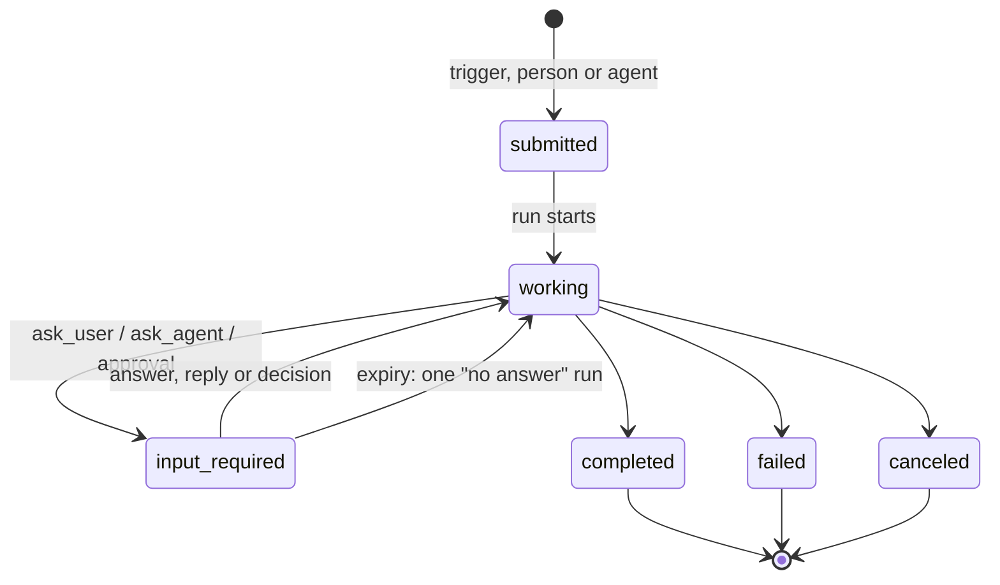

# 0065. Work model: A2A-shaped tasks, the inbox, and asking people and agents

- Status: Accepted
- Date: 2026-10-26
- Relates to: [#146](https://github.com/stateracloud/koinon/issues/146) (rounds 1 and 2, and the
  releases)
- Amends: [0010](0010-eventing.md) (tasks, not the board, are the queue),
  [0011](0011-agent-to-agent.md) (transport inside an install), [0030](0030-run-state-machine.md)
  (park reasons in use), [0032](0032-agent-home-checkpoints.md) (checkpoints in v0.1),
  [0049](0049-v01-scope-decisions.md) (board columns, sandbox idle), [0055](0055-chat-as-its-own-object.md)
  (chat next to tasks), [0051](0051-session-home-generations.md) (restored homes resume the session),
  [0006](0006-identity-layers.md), [0018](0018-v1-screens.md), [0019](0019-personal-agents-and-teams.md),
  [0036](0036-v01-demo.md), [0042](0042-ask-tier-park-and-execute.md) (safe defaults, scoped
  approvals); supersedes the rest of [0017](0017-board-and-chat-interaction-model.md)
- Triggers and latency: [0066](0066-triggers-and-scheduling.md)

## Context

Andre's user stories (#146, 2026-10-26), in the order the issue gives them: PR review on a new
PR; a FinOps agent asking a lead-engineer agent; daily stand-ups to Slack or Teams; a personal
agent asking experts; @mentions in a channel; long-running research; a support-channel ops agent;
weekly LCM upgrades; a personal agent with mail and reminders. "A person should never have to
administer tickets."

What Koinon has (research `ticketing-review.md`, `triggers-lifecycle.md`, `main` at c05b1d9):

- **A ticket is a human's request to one agent, plus its conversation.** Columns are the enum
  `todo | in_progress | waiting_on_you | done` (`internal/db/migrations/00003_tickets_and_runs.sql:9`).
  `created_by` references users only (`:18`). Only `CreateTicket` and `AppendMessage` start work;
  both call `scheduler.Enqueue` (`internal/services/tickets.go:119`, `:240`). An agent cannot create
  a ticket. The status does not follow the run: a new ticket shows To do while its agent works.
- **Every run belongs to a ticket** (`runs.ticket_id NOT NULL`, `00003…sql:54`). Approvals, spend
  and saved work are keyed by ticket and run.
- **The only human wait is the approval park.** Park reasons are
  `('approval','budget','a2a','input_required')` (`00003…sql:46`), and only `approval` is ever
  written; the others appear only in the proto mapping (`internal/services/convert.go:159-161`).
  An agent that asks a question just ends its turn: the run succeeds and the ticket does not move
  to Waiting on you (`internal/agentd/park.go:162` is the only such move).
- **Expiry cancels.** The approvals sweeper cancels runs parked past `park_expires_at` and moves
  the ticket back to To do (`internal/approvals/approvals.go:492-560`, `:594-620`). Approvals expire
  after 7 days (`internal/githubtools/server.go:68`).
- **A parked run does not keep its sandbox.** The sandbox stops 10 minutes after the last
  activity, parked runs included (`internal/reconciler/reconciler.go:76`; ADR 0049 "Sandbox
  lifecycle"). Resuming from a stopped sandbox takes about 30–45 s _(inferred from spike 1.6 and
  7)_.
- **A recreated sandbox loses its home.** OpenShell 0.1.5 deletes the volume with the sandbox; the
  run continues with `session/new` and a handoff (ADR 0051). Checkpoints (ADR 0032) are not built.

A2A v1.0 task states are submitted, working, input-required, auth-required, completed, failed,
canceled and rejected (https://a2a-protocol.org/latest/specification/ §4.1.3). A follow-up message
with the same `taskId` answers an `input-required` task (§6.3).

## Decision

### Tasks replace tickets

1. **The work record is an A2A-shaped task.** States: submitted, working, input-required,
   completed, canceled, failed.
2. **Triggers, people or agents create tasks** ([0066](0066-triggers-and-scheduling.md)). Each task
   is **owned by one agent**. A task holds its runs, approvals and conversation.
3. **People don't manage tasks.** Nobody moves cards or closes tasks to keep the system working;
   the inbox shows what needs a person.
4. **Today's tickets migrate to tasks.** The board stays as a **secondary view** over tasks.
5. **Koinon tasks never sync, link or import with external trackers** ([0064](0064-work-tracker-connectors.md)).

### The inbox is the front door

6. **"Waiting on you" is the home screen**: notifications with actions, such as approve a PR,
   validate a reply, answer a question, read a report. Chat with agents and with the personal agent
   sits next to it ([0055](0055-chat-as-its-own-object.md)).
7. **Notifications** go in-app, and to Slack and Teams through their connectors, including
   approvals with buttons. Email comes later.

### Asking a person: `ask_user`

8. An MCP tool `ask_user(to, question, draft?, choices?)`:
   - the task moves to input-required;
   - an inbox item appears, plus a Slack or Teams message with buttons;
   - the run parks with reason `input_required`;
   - the sandbox stays warm for 15 minutes ([0066](0066-triggers-and-scheduling.md));
   - the answer resumes the run.

   The same mechanism covers "create the PR?" (the LCM story) and "may I post this reply?" (the
   support story).
9. **Who answers, from where.** In Koinon's UI, or in Slack or Teams by a user whose chat account is
   linked to their Koinon user, through the OIDC email or a one-time link. Their Koinon role
   applies. A tap from an unlinked account is refused. Free-text answers in the thread count too.
10. **No answer.** A reminder after 24 hours (inbox and chat), expiry after 7 days. On expiry the
    agent gets one short "no answer" run, so it can close the task as canceled or ask someone else.
    Both times are set per agent or template.
10a. **Safe defaults and scoped approvals** (#146 A4; amends [0042](0042-ask-tier-park-and-execute.md)):
    - every question names a safe default, used when it is dismissed or expires; the agent is told;
    - approvals can be scoped: once, this task, or this agent and this kind of action until a date;
    - a scope wider than once needs an admin, shows in the agent's grants, and is audited.

### Asking an agent: `ask_agent` and `reply`

11. **Inside an install, agents talk through Postgres and two MCP tools,** `ask_agent` and `reply`:
    - the request is a **child task**, and the expert's sandbox starts as soon as the task exists;
    - the asking run parks with reason `a2a` and resumes on the reply;
    - each agent uses only its own grants and budget, and membership and role caps apply
      ([0019](0019-personal-agents-and-teams.md));
    - sandboxes never talk to each other over the network.
12. **An external A2A gateway comes later** (v1.0, `/.well-known/agent-card.json`) and maps onto the
    same tasks. Andre: build `ask_agent` first, then judge whether it works in practice.
12a. **`ask_agent` guards** (#146 A3), all tunable per org:
    - refused when the asked agent is already in the chain;
    - the chain is at most 3 deep;
    - an agent has at most 5 open questions to other agents;
    - the same question to the same agent in the same task returns the existing child.
12b. **Interruption** (#146 A2): only a person's chat message on the task can interrupt a running
    turn. Events, replies from other agents and answers wait until the turn ends, then arrive
    together ([0066](0066-triggers-and-scheduling.md)).

### Long waits survive restarts

13. **Home checkpoints ([0032](0032-agent-home-checkpoints.md)) are built now.** The home (session,
    notes, scratch work) is saved when a sandbox stops or before it is recreated, and restored
    afterwards, so long waits and long tasks survive drains and image bumps.
13a. **Checkpoint lineage** (#146 A6): a sandbox restored from a checkpoint keeps its home
    generation and reloads the same session; only a sandbox created without a checkpoint gets a
    new generation ([0051](0051-session-home-generations.md) amendment).
13b. **Archive tier** (#146 A7, v0.1): after N days stopped (default 7), once a checkpoint is
    complete, Koinon deletes the sandbox and its volume and restores into a fresh one on the next
    run ([0032](0032-agent-home-checkpoints.md) amendment).
13c. **Ephemeral agents** (#146 A8): an agent or template can be marked ephemeral. Each task gets a
    fresh sandbox without a home volume, deleted when the task ends; memory lives in task notes and
    the [0033](0033-file-based-memory.md) stores. The default stays persistent.
13d. **Failure classes** (#146 A1): a failed run carries a `failure_class` (`transient`,
    `throttled`, `context_overflow`, `budget`, `policy`, `fatal`) that drives retries and inbox
    messages; `context_overflow` shrinks the largest input once, then asks the user
    ([0030](0030-run-state-machine.md) amendment).

The diagram is a reading aid. The mapping from today's columns and parks is recorded under Open questions (answered by TK1).

### Releases (#146)

- v0.1: tasks, the inbox, `ask_user` (with safe defaults and scoped approvals), home checkpoints with
  lineage and the archive tier, ephemeral agents, failure classes (Andre placed scoped approvals and
  ephemeral agents in v0.1 on 2026-10-26).
- v0.2: `ask_agent` with its guards; Slack and Teams with approval buttons and account linking;
  the interruption rule lands with events.

## Alternatives considered

- **Keep tickets as the work record** (ADR 0010, 0017, 0049). Rejected: tickets are human-to-agent
  requests that people move between columns, agents cannot create them, and the status does not
  follow the run (`ticketing-review.md` §3.1).
- **A lighter inter-agent object next to tickets,** as chat became one (`ticketing-review.md`
  §3.2, question 9). Rejected: one task model for people, triggers and agents.
- **A2A over the network between sandboxes.** Rejected: sandboxes deny east-west traffic by
  default ([0045](0045-openshell-hardening-defaults.md)), the callee is usually asleep, and the
  guards live in Koinon anyway (`messaging-and-workflows.md` §3.3).
- **Wait for input with the sandbox kept running until the answer** (option A in
  `triggers-lifecycle.md` Part 3). Rejected: one Kata VM per waiting agent for up to 7 days; #99 was
  filed for that cost. Chosen: a 15-minute warm window, then stop and resume.
- **Memory snapshots instead of home checkpoints** (option D there). Not available on Kata, Agent
  Sandbox v1.0.7 or OpenShell 0.1.5.
- **Expiry cancels the run** (today's approval behaviour). Rejected for questions: the agent gets
  one "no answer" run instead.

## Consequences

- Positive: one record for every kind of work: a person's request, a trigger, an agent's question.
- Positive: questions park and resume like approvals, so an agent never sits idle on a question in
  a running VM for long.
- Positive: long tasks and long waits survive drains, image bumps and recreation.
- Negative: a data migration from tickets to tasks, and renames through the API, UI and docs
  (`TicketService`, `ticket.proto:15-39`, the board page) _(inferred)_.
- Negative: `created_by` must allow agents and triggers, and the prompt builder, which sends only
  user messages (`ListTicketMessagesAfter`), must deliver answers, replies and events _(inferred)_.
- Negative: the 15-minute warm window costs VM time for every parked question _(inferred)_.
- Follow-ups _(inferred)_: `ask_user` and `reply` resolve the park (`ResolveRunPark`) instead of
  queueing a new run; reminders and expiry on DBOS timers ([0066](0066-triggers-and-scheduling.md));
  depth and cycle guards and cost roll-up for child tasks ([0011](0011-agent-to-agent.md)); the inbox
  screen; audit of task actions, which tickets lack today (ADR 0023 amendment).

## Open questions

- ~~The mapping of today's ticket columns and run parks to task states.~~ **Answered by TK1
  (2026-10-26):** the candidate holds. The migration (`00020_tasks.sql`) maps To do → submitted,
  In progress → working, Waiting on you → input-required and Done → completed; no old ticket
  becomes canceled or failed, because a ticket could only be Done. A run parked on an approval that
  a person has not decided moves its task from submitted or working to input-required, and the
  decision moves it back to working; an approval that expires moves it back to submitted, as it
  moved the ticket to To do. Every park the code makes today is an approval park, so no other
  park reason has a mapping yet: `ask_user` (TK3) parks to input-required, and `a2a` stays
  working. Task events keep their rows: `ticket.created` becomes `task.created`, and the `from`
  and `to` of `status.changed` become states. `TicketService` stays as a deprecated layer over
  tasks until TK2: the column is derived from the state (completed, canceled and failed show as
  Done) and a move to Done completes the task.
  TK1 keeps today's behaviour otherwise: a run starting does not move a task to working and runs
  do not end tasks, so a task stays submitted while its agent works, as a ticket stayed in To do;
  that comes with TK2/TK3/LT1, and the diagram above is the target.
- How a direct message in the inbox chat (a trigger, [0066](0066-triggers-and-scheduling.md)) relates
  to [0055](0055-chat-as-its-own-object.md)'s private chat that "becomes a ticket when the person
  confirms".
- What the `to` argument of `ask_user` accepts (a user, a role, a group) and who may answer a
  question sent to a group.
- Whether a free-text answer in a thread is always an answer, or only when the task is
  input-required.
- Which home paths a checkpoint includes. #146 says "session, notes, scratch work"; ADR 0032
  excludes repository checkouts and caches. restic or kopia, and sidecar or Job, stay open there.
- Whether the park, run-end and periodic checkpoint points of ADR 0032 also ship in v0.1.
- Task retention and deletion.
- The default N for archive is 7 days; whether it is tunable per org or per agent.

## Upstream verification

- 2026-10-26: A2A v1.0 task states, `returnImmediately`, push notifications, continuation by
  `taskId` and the agent card path `/.well-known/agent-card.json` (§3.2.2, §4.1.3, §6.3, §8.2 of
  https://a2a-protocol.org/latest/specification/; a2a-go v2.7.0, Apache-2.0). This answers ADR
  0011's unverified card path.
- 2026-10-26: Agent Sandbox v1.0.7 has suspend but no snapshot in core (KEP-0694); OpenShell 0.1.5
  keeps the PVC on stop and deletes it on delete (`crates/openshell-driver-kubernetes/README.md`).

## Links

- Issue [#146](https://github.com/stateracloud/koinon/issues/146); personal agent
  [#55](https://github.com/stateracloud/koinon/issues/55); idle-cost fix
  [#99](https://github.com/stateracloud/koinon/issues/99)
- ADRs [0010](0010-eventing.md), [0011](0011-agent-to-agent.md), [0019](0019-personal-agents-and-teams.md),
  [0030](0030-run-state-machine.md), [0032](0032-agent-home-checkpoints.md),
  [0042](0042-ask-tier-park-and-execute.md), [0051](0051-session-home-generations.md),
  [0055](0055-chat-as-its-own-object.md), [0064](0064-work-tracker-connectors.md),
  [0066](0066-triggers-and-scheduling.md)
- Research (session notes, 2026-10-26): `ticketing-review.md`, `triggers-lifecycle.md`,
  `messaging-and-workflows.md`
- Design adapted from [hydro-project/infinity](https://github.com/hydro-project/infinity) (Apache-2.0, commit 341f6c2): the interruption rule (`system/thread.rs:240-291`, `system/defer.rs`), the `ask_agent` guards (`tools/thread.rs:72-89`) and the failure classes. Research notes: `infinity-code-ideas.md`.
- Prior art (ideas only, no code; its servers are AGPL-3.0): [daytonaio/daytona](https://github.com/daytonaio/daytona) v0.190.0, for the archive tier and checkpoint lineage. Research notes: `daytona.md`.
