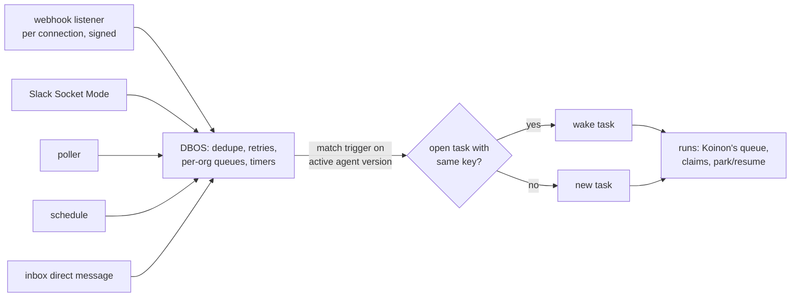

# 0066. Triggers and scheduling: DBOS on Koinon's Postgres, triggers on the agent version

- Status: Accepted
- Date: 2026-10-26
- Relates to: [#146](https://github.com/stateracloud/koinon/issues/146) (rounds 1 and 3, and the
  releases)
- Amends: [0010](0010-eventing.md) (ingress, subscriptions), [0030](0030-run-state-machine.md)
  (timers, the sandbox-timeout failure), [0049](0049-v01-scope-decisions.md) (sandbox idle stop)
- Work model: [0065](0065-work-model-tasks-inbox.md). Trackers: [0064](0064-work-tracker-connectors.md).

## Context

Only two API calls start work today, `CreateTicket` and `AppendMessage`
(`internal/services/tickets.go:119`, `:240`). There is no cron, no timer table, no inbound webhook
and no per-org limit (`triggers-lifecycle.md` Part 2). ADR 0010 planned org subscriptions over
CloudEvents; none are built (ADR 0010 amendment of 2026-10-26).

Koinon's queue is small and specific (`messaging-and-workflows.md` §1.1): the `runs` table, a
claim with `FOR UPDATE … SKIP LOCKED` that bumps the agent's epoch (`internal/db/queries/runs.sql:31-90`),
30-second leases (`internal/agentd/agentd.go:147`), the shared `run_claimable` test
(`internal/db/migrations/00017_run_claimable.sql:11-35`), and `pg_notify` wake-ups for the
reconciler (`00006_agent_sandboxes.sql:79-97`). Timeouts are columns swept every 30 s
([0030](0030-run-state-machine.md) amendment). What it lacks is the layer above: cron and timers,
webhook ingest with dedupe and retries, and per-org concurrency and rate limits.

**Latency.** The spike measured 22 s from start to Ready for a stopped Kata sandbox and 4–10 s for
OpenCode's ACP `initialize` (`hack/spike/results/1-install.md:16`, `7-harnesses.md:28`). A resume
from a stopped sandbox is about 30–45 s, and a two-agent exchange 60–90 s _(estimates,
`triggers-lifecycle.md` §1.3, #146)_. Today:

- a sandbox stops after 10 idle minutes, parked runs included (`internal/reconciler/reconciler.go:76`);
- a run whose sandbox is not Ready within 5 minutes fails (`internal/agentd/agentd.go:150`,
  `internal/agentd/sandbox.go:83-84`), so a burst beyond cluster capacity shows up as failed runs;
- runs are claimed FIFO, with no priority (`runs.sql:31-90`).

No broker or workflow engine removes the cold start: a message reaches a stopped VM no faster
than a Postgres row does (`messaging-and-workflows.md` §3.4).

## Decision

### Commodity parts: DBOS Go on the existing Postgres

1. **DBOS Transact for Go** (MIT), used as a **library inside Koinon's processes, on Koinon's
   existing Postgres**, with no new service. It runs schedules, timers, webhook processing, and
   per-org concurrency and rate limits.
2. **Who owns which state:**

   | State | Owner |
   | --- | --- |
   | Run queue, claims, leases, ownership epoch, park and resume (`runs`, `run_claimable`, `agents.epoch`) | Koinon, unchanged ([0030](0030-run-state-machine.md)) |
   | Tasks, their conversation, approvals, spend | Koinon ([0065](0065-work-model-tasks-inbox.md)) |
   | Trigger definitions | Koinon, in the versioned agent config (decision 4) |
   | Schedule firing, durable timers (reminders, expiry, pre-warm), inbound event processing with dedupe and retries, per-org queues and rate limits | DBOS, in its own system tables |

   DBOS work acts on Koinon only by calling Koinon's own operations: create or wake a task, queue
   a run, resolve a park.

### Four trigger types

3. **First build, all four core types:**
   - **schedules:** cron with a timezone;
   - **code-host events** from GitHub and Gitea: PR opened or updated, push, comment;
   - **chat events** from Slack and Teams: a channel message matching rules, or an @mention;
   - **direct messages** to an agent in the inbox chat.

   Tracker events (Jira, Linear and the rest) come with the tracker connectors
   ([0064](0064-work-tracker-connectors.md)).
4. **Triggers live on the agent and its template, in the versioned agent config.** Each has a
   type, a filter (repositories, `draft: false`, channel, rules) and an instruction for that
   trigger. They are edited on the agent page, audited, and change when a new version is
   activated.

### Ingress

5. **Webhooks** arrive on their own listener and path, per connection, and are verified by
   signature: GitHub HMAC, the Slack signing secret, the Teams JWT.
6. **Slack Socket Mode**, an outbound WebSocket that needs no public endpoint.
7. **Polling** where neither works, for example a code host that cannot reach Koinon.
8. **Everything lands in DBOS** for dedupe and retries.

### Correlation

9. **Each trigger type has a correlation key:** PR = repository + number; chat = thread;
   schedule = none. An event whose key matches an open task wakes that task with the event;
   otherwise it creates a new task.
10. **Bursts** within a short window are batched into one wake-up.

### Hiding the wake-up

11. Defaults, **all tunable per org**:
    - acknowledge at once;
    - start the expert's sandbox when the request is made, not when the caller's turn ends;
    - keep a sandbox warm for **15 minutes** when its run waits on `a2a` or `input_required`,
      against **10 minutes** idle otherwise;
    - **pre-warm** scheduled agents before they fire, with jitter;
    - **wait in the queue** instead of failing after 5 minutes;
    - give **interactive work priority** over scheduled work.

### Interruption, watches and warm pools

12. **Interruption** (#146 A2): only a person's chat message on the task can interrupt a running
    turn. Events, replies from other agents and answers that match a task mid-turn wait until the
    turn ends, then arrive together. A parked run is resumed by any matching input.
13. **Task-scoped watch** (#146 A5): an MCP tool `watch(kind, key, until)` waits for one event tied
    to the agent's own task. It is allowed only for event kinds that the agent's triggers or
    connections already cover. It expires, is removed when the task ends, and the run parks
    meanwhile. **This is not agent-created triggers:** triggers stay on the versioned agent
    (decision 4); a watch adds no new ingress and no new permission.
14. **Warm pools** (#146 A9, v0.3): only for sandboxes without a home volume (ephemeral agents,
    [0065](0065-work-model-tasks-inbox.md)), and only once Agent Sandbox and OpenShell support them
    upstream. Agent Sandbox v1.0.7 ships a `SandboxWarmPool` extension, but OpenShell 0.1.5 drives
    `Sandbox` directly and has no warm or claim path (`triggers-lifecycle.md` Part 2).

### Releases (#146)

- v0.1: DBOS; schedule and direct-message triggers.
- v0.2: code-host and Slack/Teams events (webhooks, Socket Mode, polling, correlation); the
  interruption rule and `watch`.
- v0.3: tracker triggers with the tracker connectors; warm pools for home-less sandboxes.

## Alternatives considered

From #146 and `messaging-and-workflows.md` Part 2 (licences read from each repository's licence
file on 2026-10-26):

- **Restate** (v1.8.1): BSL 1.1, Apache-2.0 four years after each release. Not OSI open source, and
  a second stateful system.
- **Redpanda** (v26.2.2): BSL 1.1, which bans use for "a Streaming or Queuing Service".
- **Inngest** (v1.49.0): SSPL v1 with an Apache-2.0 grant after three years. Not OSI; unsuitable to
  bundle with an Apache-2.0 product.
- **River Pro**: River is MPL-2.0, but concurrency limits, workflows and durable periodic jobs are
  in River Pro, a paid add-on ($125 a month, riverqueue.com/pro).
- **A Temporal or Hatchet service** (both MIT). A second state model and one to four more services
  to run; Temporal was already rejected for v0.x ([0030](0030-run-state-machine.md)).
- **A NATS JetStream broker** (Apache-2.0). A 3-node StatefulSet; request and reply with a sleeping
  agent still needs Postgres rows, and the dual write with Postgres returns
  ([0010](0010-eventing.md)).
- **Build the layer in Koinon's own code** (cron parser, timer table, ingest, limits; about 2–4k
  lines). Not chosen: DBOS is the commodity part with no new service.
- **Triggers as org subscriptions** ([0010](0010-eventing.md)). Replaced by triggers on the
  versioned agent config, edited on the agent page and activated with a version.

## Consequences

- Positive: no new service to run; schedules, timers, dedupe and limits are a library's job.
- Positive: trigger changes are reviewed and activated like any other agent change.
- Positive: a burst queues instead of failing.
- Negative: two state models in one database. Every DBOS step that writes Koinon state must be
  idempotent _(inferred, `messaging-and-workflows.md` §4b)_.
- Negative: DBOS's Go SDK is young (v1.7.0, 2026-10-15) _(inferred)_.
- Negative: webhooks need an endpoint reachable from the code host and Slack or Teams; the chart
  must expose one listener for them _(inferred)_.
- Negative: the 15-minute warm window and pre-warming cost VM time.
- Follow-ups _(inferred)_:
  - `ready_at` is set to `now()` on insert (`internal/db/queries/runs.sql:11-17`) and can serve as
    "not before"; a priority joins it in the claim order;
  - the agentd worker should not be held for the whole sandbox wait, and the 5-minute
    `SandboxTimeout` failure becomes a requeue;
  - DBOS's migrations run in the migration Job ([0060](0060-migrations-as-a-job.md)).

## Amendment 2026-10-26 (DB1)

- DBOS Transact for Go v1.7.0 (MIT), schema `dbos` in Koinon's database. Its tables are created by
  `koinon-api migrate` (`dbos.Migrate`, then grants to `koinon_app` when that role exists), and
  `koinon-api` launches DBOS with `SkipMigrations`, so a missing schema fails the start. Closes the
  schema question below; the workers run in `koinon-api` only, behind `--durable`
  (chart `api.durable.enabled`, off by default). Code: `internal/durable`. `koinon_app` gets DML
  only on the schema (SELECT/INSERT/UPDATE/DELETE, sequence USAGE/SELECT, function EXECUTE), as in
  the chart's CNPG bootstrap, not the SDK's `GRANT ALL`.

## Open questions

- ~~DBOS's system tables: a separate schema or a separate database in the same cluster, and which
  Koinon processes run DBOS workers.~~ Answered by the 2026-10-26 (DB1) amendment: schema `dbos`,
  workers in `koinon-api` only.
- DBOS executor identity and upgrades (prerequisite for TR2/TK4, before any workflow is registered):
  DBOS recovers pending workflows for its own executor ID on Launch, and the API leaves the ID at
  the default `local`, so with `api.replicas` > 1 or a surge during a rolling update a new pod
  re-runs workflows another live pod is still running. Each replica needs a unique, stable executor
  ID (for example the pod name) or the durable runtime must stay at one replica. The other side:
  `ApplicationVersion` is the release version, so workflows left pending by the previous release
  (a long durable timer) are not recovered after an upgrade; decide how they are carried over.
- Where per-org concurrency is enforced for runs: DBOS queues, `run_claimable`, or both.
- The burst window length, the pre-warm lead time and the jitter range.
- The filter language for rules (CEL was ADR 0010's candidate) and whether a trigger has its own
  budget, as ADR 0010's subscriptions did.
- Which process hosts the webhook listener, and how the chart exposes it.
- Gitea's webhook signature scheme, and the polling interval per provider.
- Whether the inbox chat's thread correlation ships in v0.1 with direct-message triggers, since #146
  lists correlation under v0.2.
- The DBOS management plane (Conductor) is an enterprise module (`go.dbos.dev/dbos-enterprise-go`);
  how operators inspect DBOS state without it.

## Amendment (2026-10-26, plan item LT1): latency defaults as built

- **Sandbox wait.** A run whose sandbox is not ready within the org's queue wait (default 5
  minutes) goes back to `queued` (new transition `starting -> queued`, owner only, migration
  00022), behind the older runs of its origin, and is claimed again. It no longer fails. A sandbox
  in a terminal state (deleted, retained, error with an unhealthy agent) still fails the run at once.
  The time between the claim and the requeue (`runs.claimed_at`) is credited to `parked_seconds`,
  so waiting for a sandbox does not count against the run's wall-clock cap.
- **Priority.** `runs.origin` is `interactive` (default) or `scheduled`. `ClaimNextRun` orders by
  origin, then `ready_at`: interactive work is claimed before scheduled work, FIFO within each.
  Triggers and schedules (TR1) enqueue with `scheduler.EnqueueOrigin(..., RunOriginScheduled)`.
- **Per-org tunables.** `org_settings` holds `idle_timeout_seconds`, `park_warm_seconds` and
  `queue_wait_seconds`; a NULL value is the platform default (chart values
  `reconciler.idleTimeout`, `reconciler.parkWarm`, agentd `SandboxTimeout`). They are set from Go
  (`orgsettings.Set`) or SQL for now; the admin API to read and change them is not part of this
  item and comes with the org settings page, in a later item.
- **Acknowledge at once.** Decision 11's first bullet is met at the API: `CreateTask` and
  `AppendMessage` return as soon as the task event and the queued run are committed, without
  waiting for a sandbox. The chat-side acknowledgement (a reaction or a "working on it" message in
  Slack or Teams) belongs to the chat connector items (TR1, CH); LT1 adds none.
- **Activity (B5).** A sandbox's activity is the latest of its last start, the last run of the
  agent that finished or parked, and the last pre-wake signal (`agent_sandboxes.woken_at`). A
  claimable or active run keeps it up regardless. It stops once the idle timeout has passed since
  its last activity; a sandbox whose run parked on `a2a` or `input_required` stays up until the
  later of that and the park window (15 minutes by default) from the park. Approval and budget
  parks use the idle timeout. A pre-wake signal on a stopped sandbox starts it, and one that no run
  follows lets it stop again after the idle timeout.
- **Pre-wake signals.** Package `wake`: `TaskCreated`, `Typing` and `CronDue`. All write
  `woken_at` and wake the reconciler. `CreateTask` calls `TaskCreated` after its transaction
  commits (best effort). `TaskService.NotifyTyping(task_id)` is the API hook for a person typing:
  members and above, at most one wake per task per ten seconds per API replica, ignored for an
  ended task. `CronDue` is called by TR1 a lead time, with jitter, ahead of a fire.
- **Per-sandbox jobs (B4).** The reconciler runs one job per agent, at most `sandboxJobs` at once.
  Agents whose gateway key is already live start before and during `gw.Apply`, so a start does not
  wait for the hot reload; agents with a new key wait for the Apply, as before.
- **Pre-pull (B6).** The chart can run a DaemonSet that pulls the flavor images onto the Kata
  nodes (`flavorPrepull`). Koinon does not place sandbox pods, so it sets no node preference for
  them; the runtime class's node selector decides, and the pre-pull makes those nodes warm.

## Upstream verification

Checked 2026-10-26 (`messaging-and-workflows.md` §2):

- DBOS Transact Go v1.7.0, MIT; system database in Postgres; queues with
  `WithPartitionConcurrency`, `WithPartitionRateLimiter`, priority, dedupe ID and delay
  (https://docs.dbos.dev/golang/tutorials/queue-tutorial). Scheduled workflows not re-verified on
  the Go page.
- Licence files: Restate BSL 1.1 (https://github.com/restatedev/restate/blob/main/LICENSE),
  Redpanda BSL 1.1 (`licenses/bsl.md`), Inngest SSPL v1 (`LICENSE.md`), River MPL-2.0 with Pro
  features listed at https://riverqueue.com/pro, Temporal and Hatchet MIT, NATS Apache-2.0.
- Slack Socket Mode, Slack signing secrets and the Teams JWT were not re-read for this ADR.

## Links

- Issue [#146](https://github.com/stateracloud/koinon/issues/146); Restate licence
  [#11](https://github.com/stateracloud/koinon/issues/11)
- ADRs [0010](0010-eventing.md), [0030](0030-run-state-machine.md), [0049](0049-v01-scope-decisions.md),
  [0060](0060-migrations-as-a-job.md), [0062](0062-code-host-connectors.md),
  [0064](0064-work-tracker-connectors.md), [0065](0065-work-model-tasks-inbox.md)
- Research (session notes, 2026-10-26): `triggers-lifecycle.md`, `messaging-and-workflows.md`
- Design adapted from [hydro-project/infinity](https://github.com/hydro-project/infinity) (Apache-2.0, commit 341f6c2): the interruption rule (`system/thread.rs:240-291`, `system/defer.rs:1-17`) and the task-scoped watch (`event_processor.rs:1127-1305`). Research notes: `infinity-code-ideas.md`.
- Prior art (ideas only, no code; its servers are AGPL-3.0): [daytonaio/daytona](https://github.com/daytonaio/daytona) v0.190.0, for warm pools of home-less sandboxes (`warm-pool.entity.ts:8-48`). Research notes: `daytona.md`.

## Amendment (2026-10-27, plan item TR1): triggers on the agent version

- **Shape.** `templates.Trigger` is `{id, type, filter, instruction}` in the template (`spec.triggers`, schema `$defs.trigger`) and in `agentconfig.Config.Triggers`; the agent proto carries `Trigger` (`cron` and `timezone` for the schedule filter). `id` is a lowercase slug, unique within the agent and stable across versions, so TR2 can key a schedule on `(agent, id)`. At most 16 triggers, instruction at most 4096 characters.
- **Filters are typed per type, no expression language (#146).** `schedule`: a five-field cron expression (`robfig/cron/v3` standard parser; descriptors such as `@daily` and `TZ=`/`CRON_TZ=` prefixes are refused) and an IANA timezone, validated with `time.LoadLocation` (`Local` refused; `time/tzdata` is embedded so validation does not depend on the image). `direct_message`: no filter, at most one per agent. `code_host_event` and `channel_event` exist as enum values and are rejected until v0.2.
- **Versioned, activated, audited.** The new RPC `AgentService.SetAgentTriggers(agent_id, base_version, triggers)` (admins and owners, because a trigger starts autonomous work) adds a version copying the latest config with the new triggers and audits `agent.triggers.propose` (before and after, with instructions). `base_version` must equal `latest_version`. Activation is the existing `ActivateAgent`; its audit event now also records the activated version's triggers and, in `before`, the previous version's.
- **An active agent stays active while a trigger change is proposed.** `ReturnAgentToDraft` (grant changes) would stop the agent's runs for a change that adds no grant, so `SetAgentTriggers` does not use it. Instead `ActivateAgent` also accepts an active agent whose latest version is newer than its active one (the query allows `status IN ('draft','active')`; activating the version it already runs is still refused). Judgement call: the active version keeps running and its triggers stay in effect until the new version is activated.
- **Read side.** `internal/triggers`: `ForOrg`, `All` (every live org; query `ListActiveAgentVersionsAllOrgs`, on the cross-org allowlist) and `ForAgent`, each optionally filtered by type. A trigger is in effect when it is in the active version of an `active` agent; draft, archived and proposed versions contribute none. They do not check `unhealthy_at`; TR2 and TR3 decide what to do for an unhealthy agent. `templates.Trigger.Next(t)` computes the next schedule firing in the trigger's zone. Nothing is scheduled or fired by TR1; trigger state such as last-fired belongs to TR2 (no migration).
- **Concurrency (review fix).** `ActivateAgent`'s UPDATE only matches a draft, or an active agent whose active version differs from the one named, so a concurrent duplicate gets no row and `Aborted`. `SetAgentTriggers` locks the agent row (`GetAgentForUpdate`, `FOR UPDATE`) before checking `base_version`, so two proposals on the same base cannot both succeed.
- **Web.** The agent page has a Triggers section (the active version's, or the proposed ones while a version is pending) and, for admins and owners, an editor that proposes a new version; the existing Activate button activates it.
