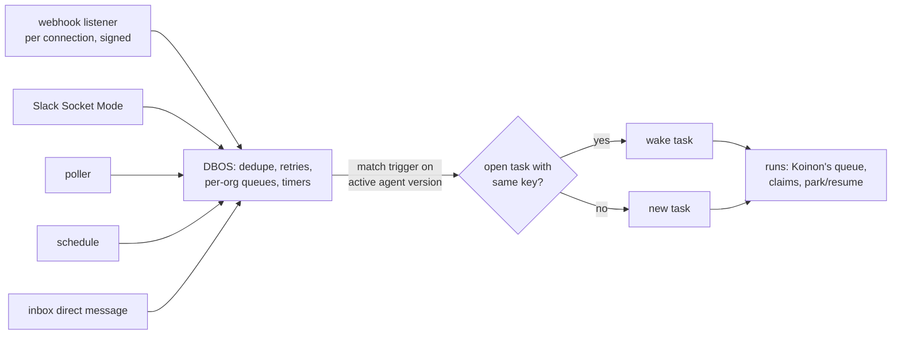

# 0066. Triggers and scheduling: DBOS on Koinon's Postgres, triggers on the agent version

- Status: Accepted
- Date: 2026-10-26
- Area: work-model
- Tags: triggers, eventing, runs, database
- Amended by: [0078](0078-sandbox-observer.md) (the wait cause set and where its input comes from)
- Relates to: old issue 146 (rounds 1 and 3, and the
  releases)
- Amends: [0010](0010-eventing.md) (ingress, subscriptions), [0030](0030-run-state-machine.md)
  (timers, the sandbox-timeout failure), [0049](0049-v01-scope-decisions.md) (sandbox idle stop),
  [0018](0018-v1-screens.md) (the trigger and schedule screens)
- Work model: [0065](0065-work-model-tasks-inbox.md). Trackers: [0064](0064-work-tracker-connectors.md).

## Context

Only two API calls start work today, `CreateTicket` and `AppendMessage`
(`internal/services/tickets.go:119`, `:240`). There is no cron, no timer table, no inbound webhook
and no per-org limit (`triggers-lifecycle.md` Part 2). ADR 0010 planned org subscriptions over
CloudEvents; none are built (ADR 0010 amendment of 2026-10-26).

Koinon's queue is small and specific (`messaging-and-workflows.md` §1.1): the `runs` table, a
claim with `FOR UPDATE … SKIP LOCKED` that bumps the agent's epoch (`internal/db/queries/runs.sql:31-90`),
30-second leases (`internal/agentd/agentd.go:147`), the shared `run_claimable` test
(`internal/db/migrations/00017_run_claimable.sql:11-35`), and `pg_notify` wake-ups for the
reconciler (`00006_agent_sandboxes.sql:79-97`). Timeouts are columns swept every 30 s
([0030](0030-run-state-machine.md) amendment). What it lacks is the layer above: cron and timers,
webhook ingest with dedupe and retries, and per-org concurrency and rate limits.

**Latency.** The spike measured 22 s from start to Ready for a stopped Kata sandbox and 4–10 s for
OpenCode's ACP `initialize` (`hack/spike/results/1-install.md:16`, `7-harnesses.md:28`). A resume
from a stopped sandbox is about 30–45 s, and a two-agent exchange 60–90 s _(estimates,
`triggers-lifecycle.md` §1.3, old issue 146)_. Today:

- a sandbox stops after 10 idle minutes, parked runs included (`internal/reconciler/reconciler.go:76`);
- a run whose sandbox is not Ready within 5 minutes fails (`internal/agentd/agentd.go:150`,
  `internal/agentd/sandbox.go:83-84`), so a burst beyond cluster capacity shows up as failed runs;
- runs are claimed FIFO, with no priority (`runs.sql:31-90`).

No broker or workflow engine removes the cold start: a message reaches a stopped VM no faster
than a Postgres row does (`messaging-and-workflows.md` §3.4).

## Decision

### Commodity parts: DBOS Go on the existing Postgres

1. **DBOS Transact for Go** (MIT), used as a **library inside Koinon's processes, on Koinon's
   existing Postgres**, with no new service. It runs schedules, timers, webhook processing, and
   per-org concurrency and rate limits.
2. **Who owns which state:**

   | State | Owner |
   | --- | --- |
   | Run queue, claims, leases, ownership epoch, park and resume (`runs`, `run_claimable`, `agents.epoch`) | Koinon, unchanged ([0030](0030-run-state-machine.md)) |
   | Tasks, their conversation, approvals, spend | Koinon ([0065](0065-work-model-tasks-inbox.md)) |
   | Trigger definitions | Koinon, in the versioned agent config (decision 4) |
   | Schedule firing, durable timers (reminders, expiry, pre-warm), inbound event processing with dedupe and retries, per-org queues and rate limits | DBOS, in its own system tables |

   DBOS work acts on Koinon only by calling Koinon's own operations: create or wake a task, queue
   a run, resolve a park.

### Four trigger types

3. **First build, all four core types:**
   - **schedules:** cron with a timezone;
   - **code-host events** from GitHub and Gitea: PR opened or updated, push, comment;
   - **chat events** from Slack and Teams: a channel message matching rules, or an @mention;
   - **direct messages** to an agent in the inbox chat.

   _(Changed: v0.1 builds schedules and direct messages; code-host events and chat events come in v0.2 and are rejected until then. See "Releases" and the TR1 amendment of 2026-10-27 below.)_

   Tracker events (Jira, Linear and the rest) come with the tracker connectors
   ([0064](0064-work-tracker-connectors.md)).
4. **Triggers live on the agent and its template, in the versioned agent config.** Each has a
   type, a filter (repositories, `draft: false`, channel, rules) and an instruction for that
   trigger. They are edited on the agent page, audited, and change when a new version is
   activated.

### Ingress

5. **Webhooks** arrive on their own listener and path, per connection, and are verified by
   signature: GitHub HMAC, the Slack signing secret, the Teams JWT.
6. **Slack Socket Mode**, an outbound WebSocket that needs no public endpoint.
7. **Polling** where neither works, for example a code host that cannot reach Koinon.
8. **Everything lands in DBOS** for dedupe and retries.

### Correlation

9. **Each trigger type has a correlation key:** PR = repository + number; chat = thread;
   schedule = none. An event whose key matches an open task wakes that task with the event;
   otherwise it creates a new task.
10. **Bursts** within a short window are batched into one wake-up.

### Hiding the wake-up

11. Defaults, **all tunable per org**:
    - acknowledge at once;
    - start the expert's sandbox when the request is made, not when the caller's turn ends;
    - keep a sandbox warm for **15 minutes** when its run waits on `a2a` or `input_required`,
      against **10 minutes** idle otherwise;
    - **pre-warm** scheduled agents before they fire, with jitter;
    - **wait in the queue** instead of failing after 5 minutes;
    - give **interactive work priority** over scheduled work.

### Interruption, watches and warm pools

12. **Interruption** (old issue 146 A2): only a person's chat message on the task can interrupt a running
    turn. Events, replies from other agents and answers that match a task mid-turn wait until the
    turn ends, then arrive together. A parked run is resumed by any matching input.
13. **Task-scoped watch** (old issue 146 A5): an MCP tool `watch(kind, key, until)` waits for one event tied
    to the agent's own task. It is allowed only for event kinds that the agent's triggers or
    connections already cover. It expires, is removed when the task ends, and the run parks
    meanwhile. **This is not agent-created triggers:** triggers stay on the versioned agent
    (decision 4); a watch adds no new ingress and no new permission.
14. **Warm pools** (old issue 146 A9, v0.3): only for sandboxes without a home volume (ephemeral agents,
    [0065](0065-work-model-tasks-inbox.md)), and only once Agent Sandbox and OpenShell support them
    upstream. Agent Sandbox v1.0.7 ships a `SandboxWarmPool` extension, but OpenShell 0.1.5 drives
    `Sandbox` directly and has no warm or claim path (`triggers-lifecycle.md` Part 2).

### Releases (old issue 146)

- v0.1: DBOS; schedule and direct-message triggers.
- v0.2: code-host and Slack/Teams events (webhooks, Socket Mode, polling, correlation); the
  interruption rule and `watch`.
- v0.3: tracker triggers with the tracker connectors; warm pools for home-less sandboxes.

## Alternatives considered

From old issue 146 and `messaging-and-workflows.md` Part 2 (licences read from each repository's licence
file on 2026-10-26):

- **Restate** (v1.8.1): BSL 1.1, Apache-2.0 four years after each release. Not OSI open source, and
  a second stateful system.
- **Redpanda** (v26.2.2): BSL 1.1, which bans use for "a Streaming or Queuing Service".
- **Inngest** (v1.49.0): SSPL v1 with an Apache-2.0 grant after three years. Not OSI; unsuitable to
  bundle with an Apache-2.0 product.
- **River Pro**: River is MPL-2.0, but concurrency limits, workflows and durable periodic jobs are
  in River Pro, a paid add-on ($125 a month, riverqueue.com/pro).
- **A Temporal or Hatchet service** (both MIT). A second state model and one to four more services
  to run; Temporal was already rejected for v0.x ([0030](0030-run-state-machine.md)).
- **A NATS JetStream broker** (Apache-2.0). A 3-node StatefulSet; request and reply with a sleeping
  agent still needs Postgres rows, and the dual write with Postgres returns
  ([0010](0010-eventing.md)).
- **Build the layer in Koinon's own code** (cron parser, timer table, ingest, limits; about 2–4k
  lines). Not chosen: DBOS is the commodity part with no new service.
- **Triggers as org subscriptions** ([0010](0010-eventing.md)). Replaced by triggers on the
  versioned agent config, edited on the agent page and activated with a version.

## Consequences

- Positive: no new service to run; schedules, timers, dedupe and limits are a library's job.
- Positive: trigger changes are reviewed and activated like any other agent change.
- Positive: a burst queues instead of failing.
- Negative: two state models in one database. Every DBOS step that writes Koinon state must be
  idempotent _(inferred, `messaging-and-workflows.md` §4b)_.
- Negative: DBOS's Go SDK is young (v1.7.0, 2026-10-15) _(inferred)_.
- Negative: webhooks need an endpoint reachable from the code host and Slack or Teams; the chart
  must expose one listener for them _(inferred)_.
- Negative: the 15-minute warm window and pre-warming cost VM time.
- Follow-ups _(inferred)_:
  - `ready_at` is set to `now()` on insert (`internal/db/queries/runs.sql:11-17`) and can serve as
    "not before"; a priority joins it in the claim order;
  - the agentd worker should not be held for the whole sandbox wait, and the 5-minute
    `SandboxTimeout` failure becomes a requeue;
  - DBOS's migrations run in the migration Job ([0060](0060-migrations-as-a-job.md)).

## Amendment 2026-10-26 (DB1)

- DBOS Transact for Go v1.7.0 (MIT), schema `dbos` in Koinon's database. Its tables are created by
  `koinon-api migrate` (`dbos.Migrate`, then grants to `koinon_app` when that role exists), and
  `koinon-api` launches DBOS with `SkipMigrations`, so a missing schema fails the start. Closes the
  schema question below; the workers run in `koinon-api` only, behind `--durable`
  (chart `api.durable.enabled`, off by default). Code: `internal/durable`. `koinon_app` gets DML
  only on the schema (SELECT/INSERT/UPDATE/DELETE, sequence USAGE/SELECT, function EXECUTE), as in
  the chart's CNPG bootstrap, not the SDK's `GRANT ALL`.

## Amendment 2026-10-27 (DB3)

- **Dedupe (B1).** Table `dedupe_records (org_id, source, key)` (migration 00024), written by
  `durable.Once` in the same transaction as the effect. Sources: `webhook` (delivery ID), `slack`
  (`event_id`), `trigger` (`durable.TriggerFireKey`: trigger ID plus the scheduled fire time in
  Unix seconds, not the processing time), `question`, `child_task`. A concurrent duplicate waits on
  the first transaction (`ON CONFLICT DO NOTHING`); if the effect fails the claim rolls back with
  it, so the redelivery runs. The record names the effect (`task`, id), so a replay returns the
  existing task. `services.CreateTriggeredTask` is the helper TR2 and TR3 call: record, task,
  events and queued run in one transaction. Records are not swept yet (`DeleteDedupeRecordsBefore`
  exists; the retention window is TR's decision). Approval and inbox effects have no source key
  today: their natural key is the question ID, used when TK3 lands.
- **Review fixes (DB3).** One `(source, key)` guards exactly one effect kind; `CreateTriggeredTask`
  rejects a replay whose record names another kind or none. `Once` needs READ COMMITTED (the
  default). The sweep index is `(org_id, created_at)`. `services.ErrAgentInactive` marks the
  permanent inactive-agent failure (drop, do not retry). A task without an agent sends no pre-wake.
- **Ordering (B2).** `durable.Commit` runs a transaction and sends the notifications it returns
  only after the commit. A `durable.Notifier` sends them as a DBOS workflow `koinon.notify` whose
  workflow ID is the notification ID (derived from the effect, e.g. `wake.agent:task-created:<task>`),
  so a second send is the same workflow, and one step (8 retries, DBOS backoff) runs the handler:
  a failure after the commit is retried and recovered after a restart, and the checkpointed step
  does not run again once it succeeded. Handlers must still be idempotent. Without `--durable` the
  Notifier is inline and best effort, as before.
- **Audit.** `createTask` and `appendMessage` already woke after the commit, inline and
  unretried; both now return a pre-wake notification from `commit`. `NotifyTyping` is not a state
  change and stays a direct call. LT1's reconciler pre-wakes and the sandbox start already run
  after the state write that causes them.
- **Not covered.** A crash between the commit and the start of the notification workflow loses that
  notification (the sandbox then starts when the queued run is claimed, which is the pre-LT1
  behaviour). Closing it needs an outbox row written in the effect's transaction; not built, since
  a lost pre-wake only costs latency. TK3's inbox notifications, where a loss is visible, should
  use one.

## Open questions

- ~~DBOS's system tables: a separate schema or a separate database in the same cluster, and which
  Koinon processes run DBOS workers.~~ Answered by the 2026-10-26 (DB1) amendment: schema `dbos`,
  workers in `koinon-api` only.
- ~~DBOS executor identity and upgrades (prerequisite for TR2/TK4, before any workflow is registered):
  DBOS recovers pending workflows for its own executor ID on Launch, and the API leaves the ID at
  the default `local`, so with `api.replicas` > 1 or a surge during a rolling update a new pod
  re-runs workflows another live pod is still running. Each replica needs a unique, stable executor
  ID (for example the pod name) or the durable runtime must stay at one replica.~~
  Answered by ADR 0085 (old issue 413): the executor ID is the pod name (downward API), and a leader recovers
  the workflows of executors whose heartbeat went stale.
- ~~`ApplicationVersion` is the release version, so workflows left pending by the previous release
  (a long durable timer) are not recovered after an upgrade; decide how they are carried over.~~
  Answered by ADR 0085, decision 11 (old issue 412): a fixed `durable.WorkflowVersion`, bumped only when a
  workflow's steps change, and `durable.CarryOver` forks older pending workflows from step 0.
- ~~Where per-org concurrency is enforced for runs: DBOS queues, `run_claimable`, or both.~~ Answered by
  the 2026-10-27 (DB2) amendment: `run_claimable`.
- The burst window length, the pre-warm lead time and the jitter range.
- ~~The filter language for rules (CEL was ADR 0010's candidate)~~ Answered by the TR1 amendment of
  2026-10-27: filters are typed per type, no expression language. Still open: whether a trigger has its own
  budget, as ADR 0010's subscriptions did.
- Which process hosts the webhook listener, and how the chart exposes it.
- ~~Gitea's webhook signature scheme, and the polling interval per provider.~~ Answered by the
  2026-11-12 (issue #25) amendment: Gitea signs a webhook with a hex HMAC-SHA256 of the body in
  `X-Gitea-Signature` (and the same value as `X-Hub-Signature-256: sha256=...`); the poll interval
  is Koinon's floor (1 minute) or the provider's stated interval, whichever is longer.
- ~~Whether the inbox chat's thread correlation ships in v0.1 with direct-message triggers, since old issue 146
  lists correlation under v0.2.~~ Answered by the 2026-10-27 (TR3) amendment: it ships in v0.1 for the
  inbox chat (old issue 146, procoduck, 2026-10-26); Slack and Teams stay in v0.2.
- The DBOS management plane (Conductor) is an enterprise module (`go.dbos.dev/dbos-enterprise-go`);
  how operators inspect DBOS state without it.

## Amendment (2026-10-26, plan item LT1): latency defaults as built

- **Sandbox wait.** A run whose sandbox is not ready within the org's queue wait (default 5
  minutes) goes back to `queued` (new transition `starting -> queued`, owner only, migration
  00022), behind the older runs of its origin, and is claimed again. It no longer fails. A sandbox
  in a terminal state (deleted, retained, error with an unhealthy agent) still fails the run at once.
  The time between the claim and the requeue (`runs.claimed_at`) is credited to `parked_seconds`,
  so waiting for a sandbox does not count against the run's wall-clock cap.
- **Priority.** `runs.origin` is `interactive` (default) or `scheduled`. `ClaimNextRun` orders by
  origin, then `ready_at`: interactive work is claimed before scheduled work, FIFO within each.
  Triggers and schedules (TR1) enqueue with `scheduler.EnqueueOrigin(..., RunOriginScheduled)`.
- **Per-org tunables.** `org_settings` holds `idle_timeout_seconds`, `park_warm_seconds` and
  `queue_wait_seconds`; a NULL value is the platform default (chart values
  `reconciler.idleTimeout`, `reconciler.parkWarm`, agentd `SandboxTimeout`). They are set from Go
  (`orgsettings.Set`) or SQL for now; the admin API to read and change them is not part of this
  item and comes with the org settings page, in a later item.
- **Acknowledge at once.** Decision 11's first bullet is met at the API: `CreateTask` and
  `AppendMessage` return as soon as the task event and the queued run are committed, without
  waiting for a sandbox. The chat-side acknowledgement (a reaction or a "working on it" message in
  Slack or Teams) belongs to the chat connector items (TR1, CH); LT1 adds none.
- **Activity (B5).** A sandbox's activity is the latest of its last start, the last run of the
  agent that finished or parked, and the last pre-wake signal (`agent_sandboxes.woken_at`). A
  claimable or active run keeps it up regardless. It stops once the idle timeout has passed since
  its last activity; a sandbox whose run parked on `a2a` or `input_required` stays up until the
  later of that and the park window (15 minutes by default) from the park. Approval and budget
  parks use the idle timeout. A pre-wake signal on a stopped sandbox starts it, and one that no run
  follows lets it stop again after the idle timeout.
- **Pre-wake signals.** Package `wake`: `TaskCreated`, `Typing` and `CronDue`. All write
  `woken_at` and wake the reconciler. `CreateTask` calls `TaskCreated` after its transaction
  commits (best effort). `TaskService.NotifyTyping(task_id)` is the API hook for a person typing:
  members and above, at most one wake per task per ten seconds per API replica, ignored for an
  ended task. `CronDue` is called by TR1 a lead time, with jitter, ahead of a fire.
- **Per-sandbox jobs (B4).** The reconciler runs one job per agent, at most `sandboxJobs` at once.
  Agents whose gateway key is already live start before and during `gw.Apply`, so a start does not
  wait for the hot reload; agents with a new key wait for the Apply, as before.
- **Pre-pull (B6).** The chart can run a DaemonSet that pulls the flavor images onto the Kata
  nodes (`flavorPrepull`). Koinon does not place sandbox pods, so it sets no node preference for
  them; the runtime class's node selector decides, and the pre-pull makes those nodes warm.

## Upstream verification

Checked 2026-10-26 (`messaging-and-workflows.md` §2):

- DBOS Transact Go v1.7.0, MIT; system database in Postgres; queues with
  `WithPartitionConcurrency`, `WithPartitionRateLimiter`, priority, dedupe ID and delay
  (https://docs.dbos.dev/golang/tutorials/queue-tutorial). Scheduled workflows not re-verified on
  the Go page.
- Licence files: Restate BSL 1.1 (https://github.com/restatedev/restate/blob/main/LICENSE),
  Redpanda BSL 1.1 (`licenses/bsl.md`), Inngest SSPL v1 (`LICENSE.md`), River MPL-2.0 with Pro
  features listed at https://riverqueue.com/pro, Temporal and Hatchet MIT, NATS Apache-2.0.
- Slack Socket Mode, Slack signing secrets and the Teams JWT were not re-read for this ADR.

## Links

- Old issue 146; Restate licence
  old issue 11
- ADRs [0010](0010-eventing.md), [0030](0030-run-state-machine.md), [0049](0049-v01-scope-decisions.md),
  [0060](0060-migrations-as-a-job.md), [0062](0062-code-host-connectors.md),
  [0064](0064-work-tracker-connectors.md), [0065](0065-work-model-tasks-inbox.md)
- Research (session notes, 2026-10-26): `triggers-lifecycle.md`, `messaging-and-workflows.md`
- Design adapted from [hydro-project/infinity](https://github.com/hydro-project/infinity) (Apache-2.0, commit 341f6c2): the interruption rule (`system/thread.rs:240-291`, `system/defer.rs:1-17`) and the task-scoped watch (`event_processor.rs:1127-1305`). Research notes: `infinity-code-ideas.md`.
- Prior art (ideas only, no code; its servers are AGPL-3.0): [daytonaio/daytona](https://github.com/daytonaio/daytona) v0.190.0, for warm pools of home-less sandboxes (`warm-pool.entity.ts:8-48`). Research notes: `daytona.md`.

## Amendment (2026-10-27, plan item TR1): triggers on the agent version

- **Shape.** `templates.Trigger` is `{id, type, filter, instruction}` in the template (`spec.triggers`, schema `$defs.trigger`) and in `agentconfig.Config.Triggers`; the agent proto carries `Trigger` (`cron` and `timezone` for the schedule filter). `id` is a lowercase slug, unique within the agent and stable across versions, so TR2 can key a schedule on `(agent, id)`. At most 16 triggers, instruction at most 4096 characters.
- **Filters are typed per type, no expression language (old issue 146).** `schedule`: a five-field cron expression (`robfig/cron/v3` standard parser; descriptors such as `@daily` and `TZ=`/`CRON_TZ=` prefixes are refused) and an IANA timezone, validated with `time.LoadLocation` (`Local` refused; `time/tzdata` is embedded so validation does not depend on the image). `direct_message`: no filter, at most one per agent. `code_host_event` and `channel_event` exist as enum values and are rejected until v0.2.
- **Versioned, activated, audited.** The new RPC `AgentService.SetAgentTriggers(agent_id, base_version, triggers)` (admins and owners, because a trigger starts autonomous work) adds a version copying the latest config with the new triggers and audits `agent.triggers.propose` (before and after, with instructions). `base_version` must equal `latest_version`. Activation is the existing `ActivateAgent`; its audit event now also records the activated version's triggers and, in `before`, the previous version's.
- **An active agent stays active while a trigger change is proposed.** `ReturnAgentToDraft` (grant changes) would stop the agent's runs for a change that adds no grant, so `SetAgentTriggers` does not use it. Instead `ActivateAgent` also accepts an active agent whose latest version is newer than its active one (the query allows `status IN ('draft','active')`; activating the version it already runs is still refused). Judgement call: the active version keeps running and its triggers stay in effect until the new version is activated.
- **Read side.** `internal/triggers`: `ForOrg`, `All` (every live org; query `ListActiveAgentVersionsAllOrgs`, on the cross-org allowlist) and `ForAgent`, each optionally filtered by type. A trigger is in effect when it is in the active version of an `active` agent; draft, archived and proposed versions contribute none. They do not check `unhealthy_at`; TR2 and TR3 decide what to do for an unhealthy agent. `templates.Trigger.Next(t)` computes the next schedule firing in the trigger's zone. Nothing is scheduled or fired by TR1; trigger state such as last-fired belongs to TR2 (no migration).
- **Concurrency (review fix).** `ActivateAgent`'s UPDATE only matches a draft, or an active agent whose active version differs from the one named, so a concurrent duplicate gets no row and `Aborted`. `SetAgentTriggers` locks the agent row (`GetAgentForUpdate`, `FOR UPDATE`) before checking `base_version`, so two proposals on the same base cannot both succeed.
- **Web.** The agent page has a Triggers section (the active version's, or the proposed ones while a version is pending) and, for admins and owners, an editor that proposes a new version; the existing Activate button activates it.

## Amendment (2026-10-27, plan item DB2): per-org concurrency and rate limits as built

Settles the open question on where per-org concurrency is enforced (old issue 146, procoduck, 2026-10-26).

- **Run concurrency lives in Postgres.** `run_claimable` (migration 00023) refuses a claim while the
  org already has `max_concurrent_runs` runs in `starting` or `running`; parked runs do not count.
  `ClaimNextRun` and the reconciler's `has_demand` share that function, so a queued run held back by
  the cap keeps no sandbox up. Default 20 per org, tunable in `org_settings.max_concurrent_runs`
  (1 to 10000). Claims by different agents of one org that overlap can overshoot the cap by the
  number of racing claimers; the cap is a fairness bound, not a billing limit.
- **DBOS limits trigger firings, webhook processing and task creation, not runs.** One queue,
  `koinon.org-work`, is partitioned by org with `WithPartitionConcurrency` and
  `WithPartitionRateLimiter` (DBOS Go 1.7), so a burst from one org waits in its own partition.
  Defaults per org: 4 items at once and 60 starts per minute. `internal/durable` exposes
  `NewOrgWork` and `EnqueueForOrg` for TR2, TR3 and later webhooks.
- **Per-org tuning.** DBOS applies one partition limit to all partitions of a queue, so an org whose
  `org_settings` (`trigger_concurrency`, `trigger_rate_per_minute`) differ from the defaults is
  enqueued on a profile queue `koinon.org-work/c<N>/r<M>p<seconds>`, registered on first use and still
  partitioned by org. DBOS stores queue configuration in its tables and its runners reload the queue
  list, so every replica serves a profile queue. Changed settings apply to work enqueued afterwards.
  Many distinct limit pairs mean many queues; operators should keep to a few tiers.
- **Restarts.** DBOS counts workflow starts in Postgres, so a rate limit holds when the API restarts
  inside the window (tested by stopping and relaunching the runtime against the same database).
- **2026-10-27 (DB2 review):** `orgsettings.QueueLimits` reads the org's `trigger_concurrency` and
  `trigger_rate_per_minute` for `OrgQueueConfig.Limits`, and `orgsettings.QueueDefaults` fills
  `OrgQueueConfig.Defaults` so an org left at the defaults stays on the main queue. The settings are
  per minute, so production keeps `RateWindow` at one minute; the window is also part of the profile
  queue name. Renumbered at integration (wave 2) to migration 00023; it was planned as 00025 behind two other
  migrations, because `hack/migrate-lint.sh` needs contiguous numbers.

## Amendment 2026-10-27 (TR2): the schedule trigger as built

- **No schedule state, no migration.** Every `koinon-api` replica with `api.durable.enabled` runs a
  `schedule.Scheduler` (`internal/triggers/schedule`). Each tick (5 s) reads the schedule triggers in
  effect (`triggers.All`) and the activation time of each agent's version, computes the due times
  in the window since its last tick, and enqueues one DBOS workflow `koinon.trigger-fire` per due
  time with `durable.EnqueueForOrg` (so the org's concurrency and rate limits apply). The workflow
  ID and the DB3 dedupe key (`trigger` source, `durable.TriggerFireKey`) both name the trigger and the
  scheduled due time (not the jittered start), so a due time fires once across replicas, overlapping
  ticks, DBOS recovery and restarts. The fire creates the task with `services.CreateTriggeredTask`:
  first message is the trigger's instruction, creator kind `trigger`, run origin `scheduled`
  (the origin enum has `interactive` and `scheduled`; there is no `trigger` origin, so scheduled
  runs use `scheduled`, which interactive work outranks). The trigger ID is a slug unique only within
  its agent, so the creator ID and dedupe key use `schedule.TriggerUUID(agent, slug)`.
- **Defaults (tunable in `schedule.Config`).** Pre-warm lead 2 minutes, jitter 0 to 30 s
  (millisecond resolution), tick 5 s, catch-up window 1 hour. The burst window (60 s) stays with
  TR3 and v0.2.
- **Jitter and pre-warm.** A run starts `Jitter(agent, due)` after its due time: the first 8 bytes of
  SHA-256 over the agent ID and the due time, modulo 30 000 ms. Many agents due in the same minute
  therefore spread over 30 s, the same every time and on every replica. The sandbox is woken
  (`wake.CronDue`, the LT1 pre-wake) `Lead` before that start, once per agent per due time.
  Start times are accurate to the tick interval, because the tick enqueues the workflow when the
  start has passed; a DBOS delay would not follow a test clock.
- **Missed due times.** A replica that starts, and the first tick after it, looks back at most
  `CatchUp` (1 hour) and fires only the latest due time whose start has passed, never a backlog; the
  same coalescing applies after a stall. It never fires a due time at or before the activation of
  the version that defines the trigger. A due time older than the window is skipped. A due time that
  another replica already fired is a dedupe replay and creates nothing. Without stored state, "down
  since" is not known, so the window is a bound rather than an exact rule.
- **Changed or removed triggers.** The next tick reads the active version, so a new version
  activated with a changed cron or without the trigger stops the old schedule at once; a fire
  enqueued before that is dropped by the workflow when its trigger (ID and version) is no longer in
  effect. An agent that is not active fires nothing (`ErrAgentInactive` drops the fire).
- **Without `api.durable.enabled`** schedule triggers do not fire; `koinon-api` logs a warning once
  at start. The simpler alternative (a timer without DBOS) has no cross-replica once-only guarantee
  other than the dedupe key, and was not built.
- **Review fixes (2026-10-27).** A fire goes ahead while the trigger in effect still has the same
  cron, timezone and instruction as when the due time was enqueued; the version number is only
  logged, so an unrelated new version no longer drops a pending run. The tick reads triggers with
  `triggers.AllLenient`: an active version whose config does not parse, or a schedule that does not
  parse, is logged and skipped, and one bad row no longer stops the cursor for every org. A schedule
  is parsed once per trigger per tick, not once per due time.

## Amendment (2026-10-27, plan item TR3): the direct-message trigger as built

Settles the open question on thread correlation in v0.1 (old issue 146, procoduck, 2026-10-26, decision 2): inbox-chat
thread correlation ships in v0.1; Slack and Teams thread correlation stays in v0.2.

- **The thread is the task.** No table and no migration. `TaskService.SendDirectMessage(agent_id,
  task_id?, text, message_id)`, members and above. Without `task_id` it starts a thread; with it, it
  replies in that thread.
- **A direct-message trigger must be in effect.** The agent must be `active` and have a `direct_message`
  trigger in its active version (`triggers.ForAgent`, TR1); a proposed trigger does not count. Otherwise
  the API answers `FAILED_PRECONDITION` "this agent does not take direct messages". Replies need it too,
  so removing the trigger stops the chat with that agent. The web chat says so next to the composer and
  offers no text box. An unhealthy agent is refused by `scheduler.Enqueue` as for any task.
- **New thread.** A task with `created_by_kind = trigger` (the "origin"), `created_by_trigger_id` the v5
  UUID of the agent (`services.DirectMessageTriggerID`; triggers are slugs in the agent config and the
  column is a uuid, and an agent has at most one direct-message trigger, so the ID is stable across
  versions), a `task.created` event, and a `message` event written as the sender's own message
  (`actor_kind = user`, because agentd's prompt carries only user messages). The message's `text`
  is the trigger's instruction, a blank line and the person's text; `display` holds the person's text,
  which the timeline shows. The title is the message's first line, at most 80 characters. The run is
  queued with origin `interactive`: a person is waiting. Tasks have `direct_message_thread` in the API
  so the web can tell these threads from other trigger-created tasks (schedules, TR2).
- **Reply in an open thread.** The message (without the instruction) is appended and a run is queued
  unless one is queued already, which will see it; the agent's sandbox is pre-woken after the commit
  (LT1). Replies to a task that a direct message did not start are refused (use `AppendMessage`), as
  are replies for another agent's thread.
- **Reply to a completed thread: a follow-up reopens the same task.** `completed` moves to `submitted`
  (`finished_at` cleared), a `status.changed` event records `reason: follow_up`, then the message and the
  run follow as for an open task. The task keeps its timeline, runs, cost and harness session (a
  recreated sandbox continues through the handoff, ADR 0051); an ephemeral agent gets a fresh sandbox,
  as its home ended with the task. The follow-up is not a new task and has no parent link.
  **Canceled and failed** threads take no reply (`FAILED_PRECONDITION`, "start a new thread"):
  conservative, since a person ended or the system failed them. The chat lists open threads and
  completed ones.
- **Dedupe (DB3).** The client's `message_id` (a UUID, kept across retries by the web client until the
  send succeeds) is the dedupe key, source `direct_message`. The record, task, events and run commit in
  one transaction; a replay returns the first result without an `event` and has no second effect.
- **Rate limits (DB2).** With `api.durable.enabled` the message is delivered by the workflow
  `koinon.direct-message` on the org-partitioned queue (`durable.EnqueueForOrg`, workflow ID
  `dm:<org>:<message_id>`), so one org's chat burst is limited by its own `trigger_concurrency` and
  `trigger_rate_per_minute`. The request waits up to 30 s for its turn and then answers `UNAVAILABLE`;
  sending again attaches to the same workflow. The API errors travel as workflow output, since an error
  loses its code in Postgres. Without durable, the same delivery runs inline in one transaction.
- **Authorisation.** Any member may start or reply in any thread of the org, as with `AppendMessage`;
  the person's ID is on the message event (the task's creator is the trigger, because
  `tasks_created_by_actor` allows a user only for `created_by_kind = user`).
- **Not done here.** Interruption of a running turn (v0.2, decision 12), burst batching, and the
  `ask_user` reply path of the same thread.

- **2026-10-27 (TR3 review):** with the durable queue an API error is recorded as workflow output
  under `dm:<org>:<message_id>` and replays for that ID. The web client therefore keeps a message ID
  only after Unavailable and DeadlineExceeded (a possibly lost response) and takes a new one after any
  other error. A durable replay returns the original event and created flag; an inline replay returns
  no event. `SourceDirectMessage` lives with the other dedupe sources in `internal/durable`.
- 2026-10-27 (wave-3 integration): a trigger's instruction is a system message whose payload carries
  its `source`; `ListTaskMessagesAfter` returns user messages and these, so a scheduled run's first
  prompt contains its instruction. A direct-message replay (`!First`) returns the recorded task only
  when it belongs to the same agent (and the same thread when one is given); otherwise it is
  `AlreadyExists`.

## Amendment (2026-10-28, rc.6): the sandbox wait cap, notify targets and a warning before the time limit

1. *The sandbox wait is capped (old issue 160).*
   - The LT1 requeue is bounded by `org_settings.sandbox_wait_cap_seconds` (default 1 h, agentd
     `--sandbox-wait-cap`). It counts from the first not-ready poll of the current wait
     (`runs.sandbox_wait_started_at`, set by agentd and kept across requeues, so queue time between claims
     counts). It is cleared for all of the agent's runs when any of them finds the sandbox ready, and
     when the agent is resumed. So the cap measures "the sandbox has not been ready since this run
     started waiting", and not time spent queued behind a sibling run that had the sandbox. Every claim
     gets at least one reconciler nudge and one poll before the cap can fail it.
   - At the cap the run fails with class `sandbox_unavailable`. agentd names the cause from the
     sandbox's latest condition reason and message (`agent_sandboxes.reason`, new):
     `image_pull`, `admission`, `no_nodes` or `unknown`.
   - The agent is marked unhealthy (audited `agent.mark_unhealthy`), the org's owners and admins get an
     `agent.unhealthy` notification, and the inbox shows an item for every unhealthy agent that is not
     archived until it is resumed. The decision says "the agent's owners". Koinon has no per-agent owner, so
     this means the admins and owners, who are the ones who can resume an agent. Every task with a
     waiting run of the agent gets a note.
   - Supersedes in part the follow-up "the 5-minute `SandboxTimeout` failure becomes a requeue" and the LT1 amendment (latency defaults as built): the requeue is no longer unbounded.
   - Alternative rejected: failing at the first queue wait, which brings back old issue 160's fail-on-burst.
2. *Notify targets on triggers (old issue 182).*
   - `Trigger.notify` is `{kind: user|role|channel, user, role, channel}`. It is accepted on every
     trigger type except `direct_message`, which asks the chat's person. A template names a role only:
     a person and a channel both belong to one org.
   - Unset means the org's default, today admins and owners. From v0.2 the default is the org's notify
     channel when one is set, else the admins, and the inbox item is always created.
   - `channel` is refused until chat connectors exist.
   - The target is copied to the task when the trigger fires (`tasks.notify_*`), so a later version
     change does not move a task's questions.
   - A person target is checked when the triggers are set (member or higher) and again when the question
     is asked. If it is no longer valid, the question falls back to the default and the tool result says so.
3. *A warning before the time limit (old issue 183).*
   - `WrapUpNotice` before `started_at + max_wall_clock + parked`, agentd cancels the current turn
     (`session/cancel`) and sends a wrap-up prompt on the same session. If a turn starts inside the window,
     the notice is prepended instead.
   - The notice is armed once per run: `runs.wrap_up_notice_at` is set when it is sent or when it is suppressed because the harness ignored the cancel. Only a sent notice is recorded as `run.wrap_up_notice`; that event, not the column, shows that the agent was told.
   - Cost: an in-flight tool call is interrupted. Accepted, because ACP has no way to inject a message
     into a running turn. A refusal is different: there the harness ends the turn itself. This is the
     first time agentd sends `session/prompt` after its own `session/cancel` on a live session. ACP
     allows it, but the shipped harnesses must show that they do. If a harness does not end the turn
     within `CancelGrace`, no second prompt is sent and the run ends at the cap as before. If the turn
     ended on its own at that moment (for example after an `ask_user`), that end is honoured and the
     notice waits for the next turn.
   - At the cap, both agentd and the api's sweep write the same `run.canceled` payload: reason
     `wall_clock_cap`, a message, and the agent's text since its last park as `summary`, or the task's
     notes when it said nothing.
   - *Generalised by [ADR 0081](0081-run-limits.md) (2026-10-29): the same notice also fires at about 80%
     of the run's model-request limit and of its spend limit, whichever limit is nearest names it, and
     the ledger's cancel at those limits carries the same `summary`. The event gains `limit`.*
   - Continuation runs (after v0.1.0: at most 3 per task, set per template or agent, only with budget
     left, then the task goes to input-required "blocked on you") build on this note and on
     the `run.wrap_up_notice` event (`wrap_up_notice_at` alone also covers a suppressed notice). They need only additive columns (a per-task continuation count, and a
     per-template or per-agent maximum in the config).

## Amendment (2026-10-29, rc.7): the wait cause reads the pod, and `crash_loop`

The cause set is `image_pull`, `admission`, `no_nodes`, `crash_loop`, `container_create` and `unknown`. In rc.6 an image that
cannot be pulled was always `unknown`, because OpenShell replaces the pod's reason with
`ConfigurationPending` (capture on kind, 2026-10-29). [0078](0078-sandbox-observer.md) has the reconciler
read the pod when OpenShell's reason says nothing and write the kubelet's reason and message into
`agent_sandboxes.reason` and `message`; agentd and the classifier are unchanged. The observer is a
workaround that [0078](0078-sandbox-observer.md) removes once OpenShell surfaces pod failures itself.

## Amendment (2026-11-12, issue 573): a work queue per agent replaces "a pass waits for all jobs"

The section "Per-sandbox jobs (B4)" above says the reconciler runs one job per agent, at most
`sandboxJobs` at once. It does not say what the pass does while the jobs run. The first build made
a pass wait for all of its jobs. The logs of e2e run 43134423089 show the cost: the sandbox delete
of one agent (a recreate after an image change) stayed open for about 30 s, until the pods ended.
A second agent, created during that pass, could be seen only by the next pass. Its wake-up sat in
the one-slot NOTIFY channel until the first pass ended. One slow backend call for one agent delayed
every new agent. The decision below replaces that part; the rest of B4 stands.

- **Per-agent work queue.** The key is (org ID, agent ID). The queue lives as long as the leader
  (it stops with the lead context) and has at most `sandboxJobs` workers. One key never runs twice at
  the same time. An item added for a key that is queued replaces the queued item. An item added for a
  key that is running runs after it (requeue), never in parallel. Each item has its own timeout
  (`WorkTimeout`, default 5 minutes). Code: `internal/reconciler/workqueue.go`.
- **A pass does not wait for the queue.** A pass loads the state, runs the gateway step and hands
  the sandbox work of each agent to the queue. The gateway plan, `gw.Apply` and `recordServed` stay
  one global step per pass, because an Apply that does not know every agent revokes keys. Agents
  whose key is served already are queued before the Apply; the others after it. An agent whose new key
  is not served yet is not queued: it is held back by its own key, not by the other agents' work.
  `ReconcileAll` (tests, one-shot use) waits for the work of its pass; the loop does not.
- **Rejection notes** of the gateway are part of the agent's work item: the note is recorded after the
  agent's own state, by the item or, when the item has ended already, by the pass. A note written by
  the pass (a held-back agent, a note for an item that has ended) changes only the `message` column
  (`SetAgentSandboxMessage`). The pass can run while an older item of the same agent still works, and
  a note that rewrote state, phase and reason from the pass's snapshot could put an old `ready` back.
  An item re-reads the agent's row when it starts, so an item that waited behind a running one does
  not act on a row from before that one. When passes record notes for one agent, the newest pass's
  rejection note is the one recorded.
- **Recreate cap.** `maxRecreatesPerPass` is now a token bucket: that many tokens, refilled at that
  many per `ResyncInterval`. That is the rate of the old per-pass cap, because a pass ran at least
  once per interval. Work items run outside a pass, so a pass is no unit to count in. An agent
  holds its token from the first request until it has deleted its sandbox, and at most that many
  agents hold one at a time, so slow home gates cannot pile up a larger group that deletes together.
  A hold ends without a delete when the agent's item ends with no recreate wanted (spec reverted,
  archived, deleted, a run holds it); the token then goes back to the bucket. Agents that wait for
  a failed backup keep their hold until a human acts, as they did with the old per-pass cap.
- **A delete is requested, then observed.** `execution.Backend.DeleteSandbox` returns OpenShell's
  outcome (`completed`, `accepted`, `absent`). The reconciler records the sandbox as deleting and
  observes the end in a later pass (`GetSandbox` reports the phase). The OpenShell `DeleteSandbox`
  RPC can still block until the pods end (a Terminating pod with a 30 s grace period). The fix is
  the queue, not the call: that agent and one worker slot stay blocked, and the pass and the other
  agents go on.
- **Logs.** A pass logs its start, its end (duration, job count) and, when its jobs have ended, the
  slowest job. Each delete logs a line before the call and one after it, with the duration.

The model is the Kubernetes controller work queue (per-key dedup with a dirty set and a processing
set, a key that changes while it runs is requeued). Koinon keeps the item in the queue instead of
re-reading it from a cache, has no rate-limited requeue (the next pass is the retry), and bounds
workers with a fixed number.

This amendment fixes one cause of issue 573, the missing-image wait of 30 s. It does not fix the
other two, which stay open: the first-task wait of about 77 s (only 7.5 s of it is the gateway Apply;
the new pass and job log lines are the tool to split the rest) and the fixed 90 s settle time behind
the 110 s wait for a new MCP server (removed by ADR 0097 step 2, where the gateway acknowledges what it
loaded). The pull request uses "Refs #573", not "Closes".

## Amendment (2026-11-12, issue #25): one shared poller per connection and resource

Polling is the ingress of decision 7 for a code host that cannot reach Koinon. As built
(`internal/triggers/poll`, table `code_host_pollers`, migration `00083`):

- **One poller per (org, connection, resource), shared by every trigger on it.** A resource is a
  kind and a repository (`repo_events:acme/app`, `issue_comments:acme/app`). Each sync derives the
  rows from the triggers in effect: a missing row is inserted, a row no trigger needs is deleted.
  There is no reference count. Keying by connection is also the per-credential partition: two orgs
  never share a token, a validator or a cursor. Ten triggers on one repository cost one request per
  interval.
- **Conditional requests.** GitHub's first page is sent with `If-None-Match` (or
  `If-Modified-Since`) and always with the same query, so the validator stays valid. A `304` ends
  the poll before the body is read and before any trigger work; GitHub does not count it against
  the primary rate limit. Gitea's API lists carry no ETag and no Last-Modified, so the Gitea adapter
  hashes the first page and compares it with the stored hash (`page_hash`): an identical first page
  that is also the last ends the poll the same way. The list runs oldest first, so a full first page
  is walked further (at most 5 pages); a walk that hits that bound moves `since` to the last comment
  it read, so a burst of old comments cannot hide new ones. Issue comments are read with `since` (cursor time minus 5 minutes) so the
  page stays small and the hash stable.
- **The interval.** `next_poll_at = max(now + floor, now + provider interval, backoff_until)`,
  computed and stored per row, where `now` is when that row's answer arrived, not when the pass began. The floor is 1 minute (`Config.Floor`, per provider in
  `Config.Floors`); the provider interval is GitHub's `X-Poll-Interval`, kept until a response
  states another. Koinon never polls faster than either. The leader never sleeps on a minimum across
  rows: a row told 120 s does not hold back a row told 60 s.
- **Failures and rate limits.** A rate limit (`403`/`429` with `Retry-After`, or
  `X-RateLimit-Remaining: 0` with `X-RateLimit-Reset`) waits until the stated time, at least the
  floor and at most an hour, and is not counted as a failure. Other errors back off from 1 minute,
  doubling to an hour (from 4 minutes for `401`, `403`, `404` or an unsupported resource, which a
  retry rarely fixes), plus up to 10% jitter. `koinon_code_host_polls_total{provider,outcome}` counts the outcomes
  (`not_modified`, `changed`, `error`, `rate_limited`).
- **One leader, at-least-once enqueue, once-only delivery.** Every `koinon-api` replica with
  `api.durable.enabled` runs the loop; a Postgres advisory lock picks the leader, which claims due
  rows with `FOR UPDATE SKIP LOCKED` and a lease. The first poll of a row records the baseline and
  delivers nothing. A changed poll enqueues one DBOS workflow `koinon.code-host-poll-event` per new
  item (workflow ID from the connection, the resource and the item's ID at the provider) and stores
  the cursor only after every item was enqueued. The workflow delivers inside `durable.Once` with
  the dedupe source `poll`, so a re-poll, a restart or a second leader deliver an item once. Adding
  the workflow bumped `durable.WorkflowVersion` to 2 ([0085](0085-upgrade-compatibility-and-recovery-policy.md)).
- **Not built yet.** The `code_host_event` trigger filter is still rejected by templates, so the API
  runs the poller with no subscriptions and a delivery that only logs; creating or waking tasks from
  a polled event comes with that trigger type. Pull-request resources are not polled, and a
  connection carries no health condition for a failing poller.
- **Prior art.** The shape (a shared poller per resource, the ETag, the provider's interval honoured)
  is adapted from hydro-project/infinity (Apache-2.0); infinity sleeps on the smallest interval of
  all keys, Koinon stores a due time per row. Revalidating every poll and keeping the validator per
  credential follow Prow's ghcache (kubernetes-sigs/prow, Apache-2.0). No code was copied, and none
  from Daytona (AGPL).

## Amendment (2026-11-12, issue #27): the sandbox creation rate lives in Postgres with the run limits

Settles where the per-org limit on sandbox creations per minute lives (maintainer decision on the
issue, 2026-11-11: with the run limits, not on the DBOS queue).

- **Where.** In Postgres, next to `max_concurrent_runs`, tuned in `org_settings` and audited with it
  (`org.run_limits.set`, which now carries `sandbox_creations_per_minute`; `koinon-api org-limits set
  --sandbox-creations-per-minute`). A DBOS queue limit would not see the reconciler's creations, which
  are not queue items, and would be a second place for per-org limits.
- **What counts.** A creation is a `CreateSandbox` or a `StartSandbox` of a stopped sandbox: both are the
  cold starts a burst of schedules causes. Each is a row in `sandbox_creations` (migration 00086, keyed
  `(org_id, id)`, composite foreign key to the agent), written by the reconciler before the backend call
  in the same transaction that counts the last minute. A per-org advisory lock serializes concurrent
  reconciler workers, so the limit is exact, not a racing bound. A creation whose backend call fails gives
  its slot back, so an agent that keeps failing cannot starve the org's healthy agents (the agent's own
  unhealthy marking and the pass interval bound the retries). The writer prunes rows older than an hour.
  The wake-for-backup start in the home gate of a recreate is not counted; the recreate cap bounds it.
- **Default 10 per org per minute**, 1 to 10000 in `org_settings.sandbox_creations_per_minute` (NULL is
  the default).
- **A burst queues; it does not fail.** An agent held back records phase `WaitingForCreationRate` with
  the time to the next slot; its runs stay queued or starting and the next reconciler pass retries. The
  sandbox wait cap (an hour) and `queue_wait` requeue apply as before, so at the default 10 a minute a
  burst at the 20-run cap clears in two minutes, far inside the 5-minute wait. Another org is never
  affected. The counter `koinon_reconciler_sandbox_creations_held_total` has no org label (ADR 0023).
- **Not a run claim condition.** `run_claimable` is unchanged: a held run keeps its place, and a sandbox
  that is already up serves it without a slot.
