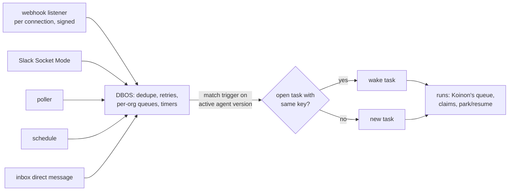

# 0066. Triggers and scheduling: DBOS on Koinon's Postgres, triggers on the agent version

- Status: Accepted
- Date: 2026-10-26
- Relates to: [#146](https://github.com/stateracloud/koinon/issues/146) (rounds 1 and 3, and the
  releases)
- Amends: [0010](0010-eventing.md) (ingress, subscriptions), [0030](0030-run-state-machine.md)
  (timers, the sandbox-timeout failure), [0049](0049-v01-scope-decisions.md) (sandbox idle stop)
- Work model: [0065](0065-work-model-tasks-inbox.md). Trackers: [0064](0064-work-tracker-connectors.md).

## Context

Only two API calls start work today, `CreateTicket` and `AppendMessage`
(`internal/services/tickets.go:119`, `:240`). There is no cron, no timer table, no inbound webhook
and no per-org limit (`triggers-lifecycle.md` Part 2). ADR 0010 planned org subscriptions over
CloudEvents; none are built (ADR 0010 amendment of 2026-10-26).

Koinon's queue is small and specific (`messaging-and-workflows.md` §1.1): the `runs` table, a
claim with `FOR UPDATE … SKIP LOCKED` that bumps the agent's epoch (`internal/db/queries/runs.sql:31-90`),
30-second leases (`internal/agentd/agentd.go:147`), the shared `run_claimable` test
(`internal/db/migrations/00017_run_claimable.sql:11-35`), and `pg_notify` wake-ups for the
reconciler (`00006_agent_sandboxes.sql:79-97`). Timeouts are columns swept every 30 s
([0030](0030-run-state-machine.md) amendment). What it lacks is the layer above: cron and timers,
webhook ingest with dedupe and retries, and per-org concurrency and rate limits.

**Latency.** The spike measured 22 s from start to Ready for a stopped Kata sandbox and 4–10 s for
OpenCode's ACP `initialize` (`hack/spike/results/1-install.md:16`, `7-harnesses.md:28`). A resume
from a stopped sandbox is about 30–45 s, and a two-agent exchange 60–90 s _(estimates,
`triggers-lifecycle.md` §1.3, #146)_. Today:

- a sandbox stops after 10 idle minutes, parked runs included (`internal/reconciler/reconciler.go:76`);
- a run whose sandbox is not Ready within 5 minutes fails (`internal/agentd/agentd.go:150`,
  `internal/agentd/sandbox.go:83-84`), so a burst beyond cluster capacity shows up as failed runs;
- runs are claimed FIFO, with no priority (`runs.sql:31-90`).

No broker or workflow engine removes the cold start: a message reaches a stopped VM no faster
than a Postgres row does (`messaging-and-workflows.md` §3.4).

## Decision

### Commodity parts: DBOS Go on the existing Postgres

1. **DBOS Transact for Go** (MIT), used as a **library inside Koinon's processes, on Koinon's
   existing Postgres**, with no new service. It runs schedules, timers, webhook processing, and
   per-org concurrency and rate limits.
2. **Who owns which state:**

   | State | Owner |
   | --- | --- |
   | Run queue, claims, leases, ownership epoch, park and resume (`runs`, `run_claimable`, `agents.epoch`) | Koinon, unchanged ([0030](0030-run-state-machine.md)) |
   | Tasks, their conversation, approvals, spend | Koinon ([0065](0065-work-model-tasks-inbox.md)) |
   | Trigger definitions | Koinon, in the versioned agent config (decision 4) |
   | Schedule firing, durable timers (reminders, expiry, pre-warm), inbound event processing with dedupe and retries, per-org queues and rate limits | DBOS, in its own system tables |

   DBOS work acts on Koinon only by calling Koinon's own operations: create or wake a task, queue
   a run, resolve a park.

### Four trigger types

3. **First build, all four core types:**
   - **schedules:** cron with a timezone;
   - **code-host events** from GitHub and Gitea: PR opened or updated, push, comment;
   - **chat events** from Slack and Teams: a channel message matching rules, or an @mention;
   - **direct messages** to an agent in the inbox chat.

   Tracker events (Jira, Linear and the rest) come with the tracker connectors
   ([0064](0064-work-tracker-connectors.md)).
4. **Triggers live on the agent and its template, in the versioned agent config.** Each has a
   type, a filter (repositories, `draft: false`, channel, rules) and an instruction for that
   trigger. They are edited on the agent page, audited, and change when a new version is
   activated.

### Ingress

5. **Webhooks** arrive on their own listener and path, per connection, and are verified by
   signature: GitHub HMAC, the Slack signing secret, the Teams JWT.
6. **Slack Socket Mode**, an outbound WebSocket that needs no public endpoint.
7. **Polling** where neither works, for example a code host that cannot reach Koinon.
8. **Everything lands in DBOS** for dedupe and retries.

### Correlation

9. **Each trigger type has a correlation key:** PR = repository + number; chat = thread;
   schedule = none. An event whose key matches an open task wakes that task with the event;
   otherwise it creates a new task.
10. **Bursts** within a short window are batched into one wake-up.

### Hiding the wake-up

11. Defaults, **all tunable per org**:
    - acknowledge at once;
    - start the expert's sandbox when the request is made, not when the caller's turn ends;
    - keep a sandbox warm for **15 minutes** when its run waits on `a2a` or `input_required`,
      against **10 minutes** idle otherwise;
    - **pre-warm** scheduled agents before they fire, with jitter;
    - **wait in the queue** instead of failing after 5 minutes;
    - give **interactive work priority** over scheduled work.

### Releases (#146)

- v0.1: DBOS; schedule and direct-message triggers.
- v0.2: code-host and Slack/Teams events (webhooks, Socket Mode, polling, correlation).
- v0.3: tracker triggers with the tracker connectors.

## Alternatives considered

From #146 and `messaging-and-workflows.md` Part 2 (licences read from each repository's licence
file on 2026-10-26):

- **Restate** (v1.8.1): BSL 1.1, Apache-2.0 four years after each release. Not OSI open source, and
  a second stateful system.
- **Redpanda** (v26.2.2): BSL 1.1, which bans use for "a Streaming or Queuing Service".
- **Inngest** (v1.49.0): SSPL v1 with an Apache-2.0 grant after three years. Not OSI; unsuitable to
  bundle with an Apache-2.0 product.
- **River Pro**: River is MPL-2.0, but concurrency limits, workflows and durable periodic jobs are
  in River Pro, a paid add-on ($125 a month, riverqueue.com/pro).
- **A Temporal or Hatchet service** (both MIT). A second state model and one to four more services
  to run; Temporal was already rejected for v0.x ([0030](0030-run-state-machine.md)).
- **A NATS JetStream broker** (Apache-2.0). A 3-node StatefulSet; request and reply with a sleeping
  agent still needs Postgres rows, and the dual write with Postgres returns
  ([0010](0010-eventing.md)).
- **Build the layer in Koinon's own code** (cron parser, timer table, ingest, limits; about 2–4k
  lines). Not chosen: DBOS is the commodity part with no new service.
- **Triggers as org subscriptions** ([0010](0010-eventing.md)). Replaced by triggers on the
  versioned agent config, edited on the agent page and activated with a version.

## Consequences

- Positive: no new service to run; schedules, timers, dedupe and limits are a library's job.
- Positive: trigger changes are reviewed and activated like any other agent change.
- Positive: a burst queues instead of failing.
- Negative: two state models in one database. Every DBOS step that writes Koinon state must be
  idempotent _(inferred, `messaging-and-workflows.md` §4b)_.
- Negative: DBOS's Go SDK is young (v1.7.0, 2026-10-15) _(inferred)_.
- Negative: webhooks need an endpoint reachable from the code host and Slack or Teams; the chart
  must expose one listener for them _(inferred)_.
- Negative: the 15-minute warm window and pre-warming cost VM time.
- Follow-ups _(inferred)_:
  - `ready_at` is set to `now()` on insert (`internal/db/queries/runs.sql:11-17`) and can serve as
    "not before"; a priority joins it in the claim order;
  - the agentd worker should not be held for the whole sandbox wait, and the 5-minute
    `SandboxTimeout` failure becomes a requeue;
  - DBOS's migrations run in the migration Job ([0060](0060-migrations-as-a-job.md)).

## Open questions

- DBOS's system tables: a separate schema or a separate database in the same cluster, and which
  Koinon processes run DBOS workers.
- Where per-org concurrency is enforced for runs: DBOS queues, `run_claimable`, or both.
- The burst window length, the pre-warm lead time and the jitter range.
- The filter language for rules (CEL was ADR 0010's candidate) and whether a trigger has its own
  budget, as ADR 0010's subscriptions did.
- Which process hosts the webhook listener, and how the chart exposes it.
- Gitea's webhook signature scheme, and the polling interval per provider.
- Whether the inbox chat's thread correlation ships in v0.1 with direct-message triggers, since #146
  lists correlation under v0.2.
- The DBOS management plane (Conductor) is an enterprise module (`go.dbos.dev/dbos-enterprise-go`);
  how operators inspect DBOS state without it.

## Upstream verification

Checked 2026-10-26 (`messaging-and-workflows.md` §2):

- DBOS Transact Go v1.7.0, MIT; system database in Postgres; queues with
  `WithPartitionConcurrency`, `WithPartitionRateLimiter`, priority, dedupe ID and delay
  (https://docs.dbos.dev/golang/tutorials/queue-tutorial). Scheduled workflows not re-verified on
  the Go page.
- Licence files: Restate BSL 1.1 (https://github.com/restatedev/restate/blob/main/LICENSE),
  Redpanda BSL 1.1 (`licenses/bsl.md`), Inngest SSPL v1 (`LICENSE.md`), River MPL-2.0 with Pro
  features listed at https://riverqueue.com/pro, Temporal and Hatchet MIT, NATS Apache-2.0.
- Slack Socket Mode, Slack signing secrets and the Teams JWT were not re-read for this ADR.

## Links

- Issue [#146](https://github.com/stateracloud/koinon/issues/146); Restate licence
  [#11](https://github.com/stateracloud/koinon/issues/11)
- ADRs [0010](0010-eventing.md), [0030](0030-run-state-machine.md), [0049](0049-v01-scope-decisions.md),
  [0060](0060-migrations-as-a-job.md), [0062](0062-code-host-connectors.md),
  [0064](0064-work-tracker-connectors.md), [0065](0065-work-model-tasks-inbox.md)
- Research (session notes, 2026-10-26): `triggers-lifecycle.md`, `messaging-and-workflows.md`
