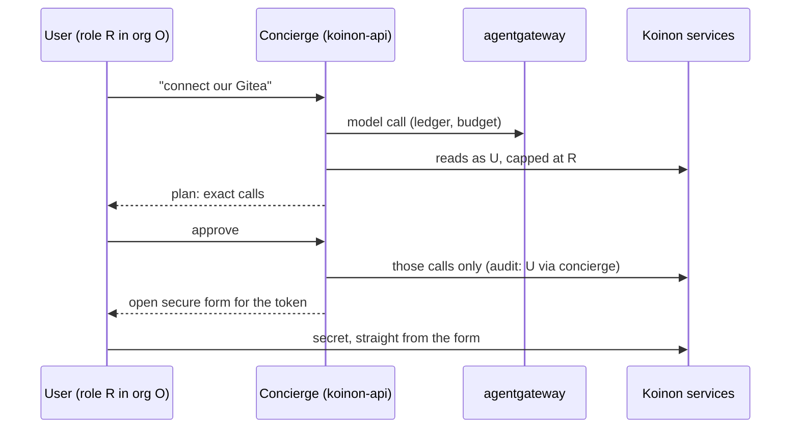

# 0067. The concierge: a setup and management assistant in koinon-api

- Status: Accepted
- Date: 2026-10-26
- Area: work-model
- Tags: identity, approvals, audit, ui
- Relates to: old issue 146 (round 4 and the releases)
- Amends: [0005](0005-agent-identity.md) (an explicit exception: the concierge acts as the
  logged-in user)
- Delivery: v0.3 (old issue 146)

## Context

Setting Koinon up takes a fixed order of steps, and each step fails in its own way. The quickstart
is that order: sign in, provider, model, GitHub, agent, ticket, approve
(`docs/site/src/content/docs/quickstart.md:89-215`). The UI research decided that "a setup
checklist shows until the first PR" (`docs/research/ui-foundations.md:664`); no checklist exists
yet.

What a setup assistant can reach (research `concierge-agent.md` Part 1, `main` at c05b1d9):

- **Two API surfaces.** The connect-rpc API the UI uses authenticates with the session cookie only
  (`internal/auth/rpc.go:24-46`). The admin REST API takes bearer tokens for admin or owner and
  covers providers, models, MCP servers, prices, budgets, tokens and audit
  (`api/admin/v1/openapi.yaml:3-37`). Connections, agents and templates are connect-rpc only.
- **Roles.** `authorize(ctx, orgID, minRole)` is the single check in the service layer
  (`internal/services/services.go:171-187`). Platform admins hold every role in every org
  (`internal/auth/principal.go:57-65`).
- **Secrets travel in the create RPCs:** `CreateProviderRequest.api_key`
  (`api/proto/koinon/provider/v1alpha1/provider.proto:94`) and
  `CreateGitHubConnectionRequest.private_key` (`api/proto/koinon/connection/v1alpha1/connection.proto:157`).
  ADR 0021 says secrets never enter the chat or the model context.
- **Audit** is written in the service layer, in the same transaction as the change (ADR 0056
  amendment). Actor kinds are `user, token, agent, secret, system` (`api/admin/v1/openapi.yaml:669`);
  there is no "on behalf of" field.
- **Agents act as themselves** ([0005](0005-agent-identity.md)). Koinon calls no model from
  koinon-api today; model calls go through agentgateway and the spend ledger
  ([0041](0041-koinon-spend-ledger-and-budget-stops.md)).
- **ADR 0020's builder** "proposes, never grants": its result is a draft, and only an admin or
  owner activates.

Comparable assistants that change their own product's settings (Vercel Agent, Datadog Bits,
ServiceNow, Retool) act as the signed-in user, capped at their role. Reads are free; writes need
confirmation. Vercel's plan approval "applies only to the listed targets, operations, scopes, and
risk" (https://vercel.com/docs/agent/chat/permissions). Vercel and n8n keep secrets out of the
model.

## Decision

1. **The concierge runs inside koinon-api** as an assistant panel in the UI.
   - Its model calls go through agentgateway, so they count in the ledger and budgets.
   - Its tools are Koinon's own RPCs: providers, models, connections, agents, triggers, and
     reading audit.
   - It has no sandbox, because it runs no code.
2. **Permissions: it acts as the logged-in user in the current org, capped at their role.** Its
   changes use the same RPCs and the same audit, and audit records "via concierge". This is an
   **explicit exception to [0005](0005-agent-identity.md)** ("agents act as themselves"), for the
   concierge only.
3. **Changes: plan, approve, execute.** It reads freely. For a change it shows a plan of the exact
   calls; one approval covers only those calls.
4. **Secrets never pass through it.** It opens the secure form ([0021](0021-connector-setup-guides.md))
   and the user types the secret there.
5. **Bootstrap.** A fresh install shows a setup checklist built from the setup guides: provider,
   then model, then code-host connection, then first agent, then first trigger. The concierge
   switches on once the first model works.
6. **Separate from the personal agent ([#11](https://github.com/stateracloud/koinon/issues/11)).**
   The personal agent can hand over to the concierge for admin tasks, but holds no admin power
   itself.
7. **Optional.** Everything stays doable without it.

## Alternatives considered

From the research (`concierge-agent.md` §3.1–3.3):

- **A dogfooded agent in a sandbox,** with a `koinon-admin` MCP server behind agentgateway.
  Strong isolation and full reuse of Koinon's machinery, but it needs a working sandbox and
  gateway before it can help with the first step, it carries the agent's identity rather than the
  user's, and a chat would wait for a cold start. Not chosen: it runs no code, so it needs no
  sandbox.
- **A privileged service account for the assistant.** Rejected by the pattern every comparable
  product follows: act as the user, capped at their role.
- **A platform-level concierge model in Helm values** (`concierge-agent.md` §3.1). It would spend
  a platform credential on a platform budget. Not chosen as a bootstrap path: the concierge
  switches on once the first model works. Whose budget pays is the open question below.
- **The concierge calls the create RPCs with secrets.** Rejected: the secret would pass through the
  model (ADR 0021).
- **Make it the personal agent.** Rejected: the personal agent lives in the personal org and holds
  no admin power; it hands over instead.

## Consequences

- Positive: setup gets help at the moment it fails, without new privileges: the concierge can do
  only what the user could do in the UI.
- Positive: changes are visible as exact calls before they happen, and audit shows they came
  through the concierge.
- Negative: model output drives calls inside the API process. The tool list must be a strict
  allowlist of RPCs, with no shell or network tools _(inferred, `concierge-agent.md` §3.1)_.
- Negative: koinon-api gains a model client and a tool loop, and needs a gateway key for its
  calls _(inferred)_.
- Follow-ups _(inferred)_: a "via concierge" marker in audit; the checklist component; secure-form
  hand-off from the panel; tools for triggers once [0066](0066-triggers-and-scheduling.md) lands.

## Open questions

- Platform admins hold every role in every org (`internal/auth/principal.go:57-65`): is the
  concierge capped at the platform-admin role, or at the org role only?
- Whose budget pays for the concierge's model calls (the org's, or another), and which gateway key
  it uses.
- Whether activating an agent, which grants access, is a concierge tool at all, given ADR 0020's
  rule that the builder never activates; and how the concierge relates to the agent builder of
  ADR 0020.
- How long an approved plan stays valid, and what happens when the state changed between plan and
  execution.
- How the audit records "via concierge" (a new actor kind, or a field next to the user).
- Which prompt-injection sources reach it (connector guides are trusted; repository content, MCP
  tool descriptions and audit summaries are not) and how they are quoted.

## Upstream verification

Checked 2026-10-26 (`concierge-agent.md` Part 2): Vercel Agent permissions (plan approval bound to
targets; secrets referred to by name); Datadog Bits Chat (acts with the user's role; audit records
the delegator); n8n AI Workflow Builder (credentials not sent to the model). ServiceNow, Retool,
Zapier and Rovo rest on search summaries only.

## Links

- Old issues 146, [#11](https://github.com/stateracloud/koinon/issues/11)
- ADRs [0005](0005-agent-identity.md), [0019](0019-personal-agents-and-teams.md),
  [0020](0020-agent-builder-and-templates.md), [0021](0021-connector-setup-guides.md),
  [0023](0023-observability-and-audit.md), [0041](0041-koinon-spend-ledger-and-budget-stops.md),
  [0056](0056-model-providers-pricing-and-budgets-per-org.md)
- Research (session notes, 2026-10-26): `concierge-agent.md`
