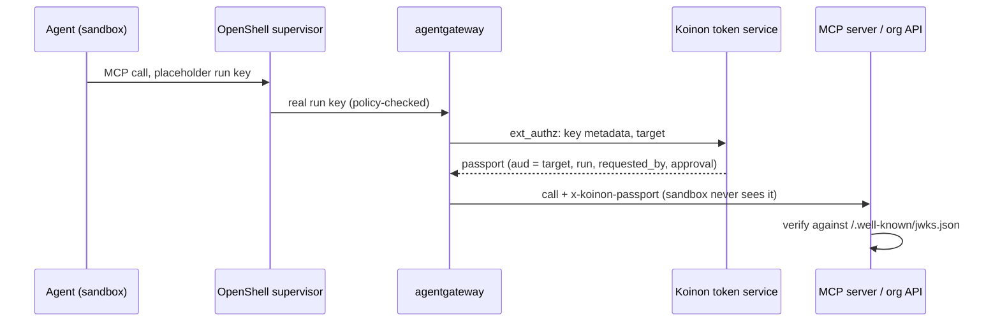

# 0073. Agent passport: a verifiable identity for every agent call

- Status: Accepted (delivery after v0.1.0)
- Date: 2026-10-28
- Amended by: [0097](0097-koinon-owned-gateway.md) (decision 6 delivery and the decision 12 delivery spike, in step 2)
- Amends: [0006](0006-identity-layers.md), [0043](0043-workload-identity-adapters-and-koinon-issuer.md)
- Relates to: [0005](0005-agent-identity.md), [0019](0019-personal-agents-and-teams.md), [0023](0023-observability-and-audit.md), [0042](0042-ask-tier-park-and-execute.md), [0057](0057-mcp-servers.md), [0058](0058-gateway-modes.md), [0065](0065-work-model-tasks-inbox.md), [#28](https://github.com/stateracloud/koinon/issues/28)
- Pending verification: the gateway delivery spike (decision 6)

## Context

Agents act as themselves ([0005](0005-agent-identity.md)), and no usable credential lives in the
sandbox ([0006](0006-identity-layers.md)). Inside Koinon both hold. Outside Koinon, a system an agent
calls learns almost nothing it can check.

**What exists.**

- **The gateway key.** Each agent has one long-lived agentgateway key, `kgw_` plus 256 random bits
  (`internal/gateway/gateway.go:216-243`). The sandbox sees it only as an OpenShell placeholder in
  `OPENAI_API_KEY` (`internal/reconciler/render.go:39-44`). The gateway knows the key's ID, agent, org
  and an `internal` flag, which CEL reads as `apiKey.*` (`internal/gateway/kubernetes/render.go:385-395`).
- **The access log.** It records `koinon.key`, `koinon.agent` and `koinon.request` (`gateway.go:624-633`).
  It records no run. The spend ledger attributes a request to a run by time window, with
  `RunGrace = 1m` (`internal/ledger/ledger.go:44-47`).
- **MCP servers.** Each server has at most one static credential per org, which every agent of the
  org shares. The gateway injects it from a gateway-only Secret (`kubernetes/render.go:562-576`;
  [0057](0057-mcp-servers.md) amendment item 5).
- **The agent header.** On every MCP request the gateway also sets `x-koinon-agent: <org>/<agent>`,
  overwriting what the client sent (`kubernetes/render.go:616-618`). The header is not signed.
  Koinon's own tool servers trust it because the chart's NetworkPolicy lets only the gateway reach
  them (`gateway.go:155-159`, `internal/mcpask/mcpask.go:14-19`, `internal/askuser/askuser.go:14-18`).
  A third-party server receives the same header with nothing behind it.
- **Approved ask-tier calls.** After a human approves, koinon-api makes the call through the gateway
  with the org's executor key (`internal/mcpservers/call.go:23`, `:64`). The server therefore sees
  `<org>/mcp-exec`, not the agent that asked, and nothing about who approved.
- **Per-user OAuth servers.** A server that asks each user to sign in with OAuth is refused when it
  is added (`internal/mcpservers/diagnose.go:18-31`). This is planned for v0.2.
- **The audit log.** It records one actor (`user`, `token`, `agent`, `secret` or `system`) and has no
  "on behalf of" field (`internal/audit/audit.go:23-36`).
- **Commits.** Commits carry `Requested-by` and `Approved-by` trailers
  (`internal/approvals/execute.go:26-27`). That is text, not a signature.
- **The issuer, decided but not built.** [0043](0043-workload-identity-adapters-and-koinon-issuer.md)
  already decided on a Koinon-owned OIDC issuer (`sub=koinon:<org>:<agent>`), but only to mint
  cloud credentials. No issuer, JWKS or `IdentityProviderAdapter` exists on main.

**The gaps.**

- **No run, user or approval at the receiver.** An MCP server or an org API cannot tell which run is
  calling, on whose behalf, or under which approval.
- **Per-user MCP access has no input.** It needs to know which user a call is for. The gateway knows
  only the agent.
- **Preview URLs need the same piece.** Authenticated preview URLs ([#28](https://github.com/stateracloud/koinon/issues/28))
  need a short-lived token for a viewer, which is the same issuer with a different audience.

**Prior art.**

- **Vercel Passport** puts apps behind the company IdP. It strips any client-supplied
  `x-vercel-oidc-passport-token` and injects a JWT that backends verify against a public JWKS. Every
  grant is audited as `passport-access-granted` ([Passport](https://vercel.com/docs/passport),
  [token claims](https://vercel.com/docs/passport/token-claims)).
- **Vercel Connect** replaces static secrets with short-lived tokens. The workload proves itself with
  its OIDC token, and Connect exchanges that for a provider token ([Connect](https://vercel.com/docs/connect)).
- **Delegation.** RFC 8693 token exchange records delegation in a nested `act` claim
  ([RFC 8693 §4.1](https://datatracker.ietf.org/doc/html/rfc8693#section-4.1)).
- **The MCP authorization spec.** It requires tokens bound to one server through RFC 8707 resource
  indicators and RFC 9728 metadata, and forbids passing tokens through
  ([security considerations](https://modelcontextprotocol.io/specification/draft/basic/authorization/security-considerations)).
- **Transaction Tokens.** The IETF draft carries per-call context inside one trust domain, which is
  close to this design ([draft-ietf-oauth-transaction-tokens](https://datatracker.ietf.org/doc/draft-ietf-oauth-transaction-tokens/)).

**What agentgateway v1.7.0 offers** (the pinned version; read from its source at tag `v1.7.0`):

- **`jwtSign`.** It signs a fresh JWT per request, but its claims are static JSON from the config
  (`crates/agentgateway/src/http/auth/jwt_sign.rs:75-79`, `:161-184`). It cannot name the calling
  agent, run or user.
- **Per-request credentials.** A `backendAuth` key can be a CEL expression evaluated per request
  (`http/auth/mod.rs:79-86`, `:182-215`). CEL can read ext_authz dynamic metadata (`cel/types.rs:75`),
  and an ext_authz allow response can set request headers (`http/ext_authz.rs:658-667`).
- **Token exchange.** `oauthTokenExchange` does RFC 8693 with an actor token
  ([docs](https://agentgateway.dev/docs/standalone/main/documentation/configuration/security/backend-authn/)).

procoduck decided the open points on 2026-10-28.

## Decision

1. **A Koinon issuer, built now.**
   - It is the issuer of [0043](0043-workload-identity-adapters-and-koinon-issuer.md), with one issuer
     per install: `iss = <public URL>`. The org is a claim, not a separate issuer.
   - koinon-api serves `/.well-known/openid-configuration` and `/.well-known/jwks.json` behind the
     Ingress, without authentication.
   - An operator may also mirror both documents to a public bucket. AWS and Entra federation need
     this when the install is not reachable from the internet.
   - The subject is `koinon:<org>:<agent>`, as in 0043. The SPIFFE form of
     [0006](0006-identity-layers.md) stays an alias for a later SPIRE issuer.

2. **Signing keys and rotation.**
   - Tokens are signed ES256, with a `kid`. RS256 is available for receivers that need it (AWS STS).
   - The private key lives in Vault or OpenBao, or in the secret store as the fallback
     ([0056](0056-model-providers-pricing-and-budgets-per-org.md)). It is never in the chart values.
   - A new key is published in the JWKS at least 24 hours before it signs anything. The old key stays
     published for the longest token lifetime plus leeway after its last use.
   - Each rotation is audited. An emergency rotation invalidates every token at once.

3. **The passport's claims.**
   - The token type is `typ: koinon-passport+jwt`.
   - Standard claims: `iss`, `sub`, `aud`, `iat`, `exp` and `jti`.
   - Koinon's own claims, prefixed with the project domain from `internal/project`:
     - `org`, `agent`, `agent_version`, `run` and `task`;
     - `requested_by`, with its kind and ID (user, trigger or agent, from the task's `created_by_kind`);
     - `approval` (approver IDs, scope ID, scope kind and expiry), when the call runs under an approval;
     - `scope`: the tools allowed for this audience, or the hash of an approved plan
       ([0067](0067-concierge.md) decision 3);
     - `on_behalf_of`, only for delegated-user connectors and personal agents ([0019](0019-personal-agents-and-teams.md)).
   - **Delegation** uses the RFC 8693 `act` chain:
     - an approved executor call is `sub` = the asking agent, `act` = `mcp-exec`;
     - a personal agent calling a team agent nests the caller.
   - The chain is at most three deep, the [0065](0065-work-model-tasks-inbox.md) decision 12a limit.
   - Claims carry IDs only, with no email or other personal data. A receiver that needs names resolves
     the IDs through an optional introspection endpoint.

4. **One audience per receiver.**
   - `aud` is the MCP server's canonical URL (RFC 8707 style) or a configured audience per connection.
   - A token never names several audiences, and a wildcard audience is refused.

5. **Lifetime.**
   - 5 minutes by default, 15 minutes at most. There is no refresh token.
   - Receivers allow 60 seconds of clock skew.
   - Tokens are cached per (run, audience, scope) and replaced at 75 % of their lifetime.

6. **A Koinon token service mints it, and the gateway attaches it.**
   - **Minting.** The service runs in koinon-api and reads the run, task and approval from Postgres.
     It refuses to mint for an archived, paused or over-budget agent, a finished run, or a revoked scope.
   - **Delivery.** The gateway calls the service through ext_authz on the MCP route. A per-target
     `backendAuth` key CEL expression then copies the token for that target's audience into a header.
     The header is `x-koinon-passport`, or `Authorization` when the server has no static credential.
     Plain RFC 8693 `oauthTokenExchange` against the service is the fallback.
   - **Spike first.** One `/mcp` request fans out to many targets (`prefixMode: Always`). A spike on
     kind with agentgateway v1.7.0 must show that a different token per target works through ext_authz
     metadata and per-target CEL before anything is built on it. This is not yet tested.
   - **Never in the sandbox.** The token exists only between the gateway and the receiver. The sandbox
     holds only its gateway-key placeholder, so the passport is never visible to the agent or the
     model context. The gateway strips any client-supplied copy of the header.
   - **Never logged.** It does not appear in the gateway access log, the run timeline or audit
     summaries. Only its `jti` is logged.
   - **Escape suite.** The escape suite checks that no JWT is readable in the sandbox's environment,
     files or home ([0025](0025-testing-strategy.md)).

7. **A gateway key per run.**
   - Each run gets its own short-lived gateway key bound to that run. agentd starts the run with it,
     and the key is revoked when the run ends or parks past its idle timeout.
   - The key's metadata carries the run ID, so `apiKey.run` names the run exactly. That makes the
     passport's `run` claim exact.
   - The access log gains `koinon.run`, and the spend ledger attributes by it instead of the `RunGrace`
     time window.
   - The run key keeps its placeholder. A new key reaches the running process by `provider update`, as
     a rotated key does today (`render.go:49-52`).
   - The agent's budgets stay keyed by agent, not by key ID, so a new run does not start a fresh
     budget window.

8. **Opt-in per receiver.**
   - The passport is on by default for Koinon's own tool servers and for servers the org runs itself.
   - It is off for third-party and registry servers until an admin turns it on. Sending a run, user
     and approval to someone else's server is a disclosure in itself.
   - The setting is per server and is audited. The Servers page shows it.

9. **Revocation.**
   - The short lifetime is the main control.
   - The token service stops minting for revoked keys, archived agents, ended runs and revoked
     approval scopes.
   - An optional `jti` deny list is published for receivers that want it.
   - Rotating the signing key revokes everything.

10. **Audit.**
    - A mint is recorded with its `jti`, audience and run, as a ledger-style row rather than one audit
      event per call.
    - Receivers are asked to log the `jti`, which joins their log to Koinon's.
    - The audit `Actor` gains `on_behalf_of` and `approved_by`, taken from the same claims.

11. **Koinon becomes an OAuth authorization server for MCP servers in v0.2.**
    - A server that trusts Koinon names it in its RFC 9728 `authorization_servers`.
    - Koinon issues tokens bound to one server through resource indicators, the passport being the
      first token type.
    - Per-user OAuth for MCP comes with it. The user consents once in the UI, and Koinon holds the
      user's tokens outside the sandbox.
    - An agent acting "on behalf of" that user gets a token through RFC 8693 exchange: the passport is
      the subject token, `act` names the agent, and the user's grant caps it.
    - The refusal in `diagnose.go` stays until this ships.

12. **What ships first, after v0.1.0.**
    1. The issuer, the JWKS and discovery endpoints, the keys and rotation, and the token service.
    2. The delivery spike.
    3. Per-run gateway keys, with run attribution in the access log and the ledger.
    4. The passport on Koinon's own tool servers, verified in addition to NetworkPolicy, and on
       org-run servers.
    5. The executor's `act` chain.

    Then: opt-in for third-party servers, [0043](0043-workload-identity-adapters-and-koinon-issuer.md)
    cloud adapters on the same issuer, the OAuth authorization server with per-user OAuth (v0.2),
    viewer tokens for preview URLs ([#28](https://github.com/stateracloud/koinon/issues/28), v0.3)
    and the external A2A gateway (v1.0).

## Consequences

- **Receivers can decide for themselves.** Systems Koinon does not control can check who calls: the
  agent, the run, on whose behalf and under which approval. They need only standard OIDC tooling and
  Koinon's public keys, and no shared secret.
- **Approved calls are attributable.** Their passport names the agent and the approver, not just `mcp-exec`.
- **Spend attribution is exact.** Run keys remove the time-window guess.
- **A leak is small.** The token lasts minutes and names one receiver. This improves on a static
  org-wide credential, although that credential stays where a server cannot verify a JWT.
- **The receiver becomes a second check.** A receiver can refuse what the approval scope did not
  cover _(inferred)_.
- **The issuer key becomes critical.** It is high-value and the token service sits on every MCP call.
  Its availability and latency need a budget and a cache.
- **Tokens can still reach the model.** A malicious server can echo the header into a tool result,
  which puts the passport in the model context. The short lifetime and single audience limit what it
  is worth. Redacting JWT-shaped strings from tool results is a follow-up, not yet tested.
- **More keys.** Per-run keys mean more key churn in the gateway config: one issue and one revoke per
  run. The Kubernetes driver's ConfigMap update path must keep up at run start _(inferred)_.
- **Metrics stay fixed.** Claims never become metric labels ([0023](0023-observability-and-audit.md)).
- **Issues to file:**
  - the executor-key attribution gap (approved calls arrive as `mcp-exec`);
  - the ledger's run attribution by time window.

## Alternatives

- **The passport on every server by default.** It is simpler and gives full attribution everywhere,
  but it tells third parties about runs, users and approvals that the org has not agreed to share.
  Rejected for third-party and registry servers.
- **The token service looks up the agent's active run** instead of per-run keys. There is no key
  churn, and `askuser` does this today (`askuser.go:142`). But it is ambiguous when runs overlap or a
  response arrives after a run ends, and it leaves the ledger's time window in place.
- **The JWKS only in a public bucket,** as [0043](0043-workload-identity-adapters-and-koinon-issuer.md)
  first suggested. Every install would need a bucket, and receivers inside the network would depend
  on the internet. It stays as an optional mirror.
- **A passport header only, without an OAuth authorization server.** Less to build, but MCP servers
  that follow the spec expect an authorization server, and per-user OAuth would still have no way to
  get a token "on behalf of" a user.
- **agentgateway `jwtSign` alone.** No Koinon service is needed, but its claims are static per target
  (`jwt_sign.rs:75-79`), so every agent of an org would present the same token. That proves only "the
  gateway", which the static credential already does.

## Upstream verification

- 2026-10-28, agentgateway at tag `v1.7.0` (the chart pins `v1.7.0`, `charts/koinon/values.yaml:238`):
  - `jwtSign` has static claims, a 300 s default lifetime and `iat` backdated by 10 s (`jwt_sign.rs:15-23`, `:75-91`);
  - `BackendAuthValue::Expression` is evaluated per request (`http/auth/mod.rs:182-215`);
  - CEL can read `extauthz` (`cel/types.rs:75`, `:2319-2321`);
  - an ext_authz OK response can set request headers (`http/ext_authz.rs:658-667`).

  Per-target delivery through these pieces is not yet tested (decision 6).
- 2026-10-28: [Vercel Passport](https://vercel.com/docs/passport), [Vercel Connect](https://vercel.com/docs/connect),
  [Vercel OIDC reference](https://vercel.com/docs/oidc/reference), [RFC 8693](https://datatracker.ietf.org/doc/html/rfc8693),
  [MCP versioning](https://modelcontextprotocol.io/specification/versioning) (current revision 2026-07-28),
  [SPIFFE JWT-SVID](https://spiffe.io/docs/latest/spiffe-specs/jwt-svid/).

## Links

- [0005](0005-agent-identity.md), [0006](0006-identity-layers.md),
  [0043](0043-workload-identity-adapters-and-koinon-issuer.md), [0057](0057-mcp-servers.md),
  [0058](0058-gateway-modes.md), [0065](0065-work-model-tasks-inbox.md), [0067](0067-concierge.md)
- https://datatracker.ietf.org/doc/draft-ietf-oauth-transaction-tokens/
- https://datatracker.ietf.org/doc/draft-ietf-oauth-identity-chaining/
