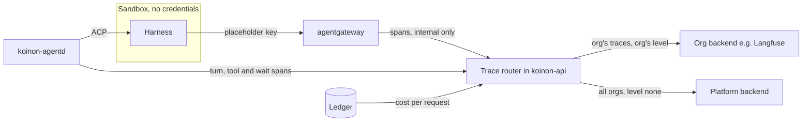

# 0074. Run traces: a Koinon trace router to each org's OTLP backend

- Status: Accepted; option C (decision 11 step 1) ships in v0.1.0-rc.9; amended 2026-10-30, 2026-10-31 and 2026-11-11 (below); platform destination and ceiling audit moved by [0100](0100-install-audit-chain.md) (note of 2026-11-07 below)
- Date: 2026-10-28
- Amends: [0023](0023-observability-and-audit.md) (run traces, deferred there)
- Relates to: [0041](0041-koinon-spend-ledger-and-budget-stops.md), [0049](0049-v01-scope-decisions.md), [0050](0050-spend-ledger-ingestion-and-net-limits.md), [0056](0056-model-providers-pricing-and-budgets-per-org.md), [0059](0059-v01-opencode-only.md), [0065](0065-work-model-tasks-inbox.md), [0072](0072-agent-model-run-now-echo-check.md), [0073](0073-agent-passport.md), old issue 213
- Pending verification: OpenShell passing `traceparent` through, and agentgateway v1.7.0's tracing policy with CEL attributes (both not yet tested)

## Context

[0023](0023-observability-and-audit.md) decided that run traces go only to an OTLP endpoint an org
admin or platform admin supplies, that an org endpoint receives only that org's traces, and that
nothing is exported by default. It deferred the build. Run traces carry prompts, tool arguments and
outputs, which belong to the org.

**What exists.**

- **agentd** runs in the control plane and drives the harness over ACP through OpenShell's exec
  stream. Nothing of Koinon runs in the sandbox ([0049](0049-v01-scope-decisions.md)). agentd sees the
  run, its task, each `session/prompt` turn and `session/load` resume, the `tool_call` and
  `tool_call_update` notifications (`toolCallId`, `title`, `kind`, `status`, `rawInput`, `rawOutput`,
  [ACP tool calls](https://agentclientprotocol.com/protocol/tool-calls)), the parks for approvals,
  `ask_user` and `ask_agent` ([0065](0065-work-model-tasks-inbox.md)), and the run's outcome.
- **The access log.** agentgateway exports it over OTLP/HTTP to koinon-api's `:4318/v1/logs`, with no
  authentication and a NetworkPolicy in front ([0050](0050-spend-ledger-ingestion-and-net-limits.md)).
  It records `koinon.key`, `koinon.agent` and `koinon.request` (`internal/gateway/gateway.go:708-714`).
  The ledger attributes a request to a run by time window (`internal/ledger/ledger.go:44-47`).
- **The cost Koinon bills** is the ledger's, recomputed from the org's price schema. The gateway's
  figure is kept only to flag differences (`internal/ledger/price.go:21`, [0056](0056-model-providers-pricing-and-budgets-per-org.md)).
- **The run ID already reaches the gateway.** `koinon-opencode --session-id <run>` adds
  `"body":{"session_id":"<run>"}` to every model request for sticky routing
  (`flavors/opencode/koinon-opencode:109-118`).
- **The harness's own telemetry is off.** The entry script unsets `OTEL_EXPORTER_OTLP_ENDPOINT` and
  `OTEL_EXPORTER_OTLP_HEADERS` (`flavors/opencode/koinon-opencode:65`). OpenCode 2.2.0 exports only when
  that endpoint is set, and then emits its internal Effect spans (`SessionModelTransport.send`), not
  GenAI spans ([otlp.ts](https://github.com/anomalyco/opencode/blob/v2.2.0/packages/util/src/observability/otlp.ts),
  `packages/core/src/session/model-transport.ts:219`, `:389`). `experimental.openTelemetry` is listed as
  unsupported (`packages/core/src/config/normalize.ts:45-51`).
- **A per-run key is decided.** [0073](0073-agent-passport.md) decision 7 gives each run its own gateway
  key whose metadata names the run, so `apiKey.run` is exact. It is not built yet.

**The OpenTelemetry GenAI conventions** moved to their own repository, which has no release tag yet.
Their status is **Development** for the whole area and every `gen_ai.*` attribute
([README](https://github.com/open-telemetry/semantic-conventions-genai/blob/3fe84604a581b3d50dd5b4bd29383b462d2a5018/docs/gen-ai/README.md),
read at commit `3fe8460`, 2026-10-28; the old pages on opentelemetry.io say "This page has moved").

- **Model calls.** The span is named `{gen_ai.operation.name} {gen_ai.request.model}`, kind CLIENT. It
  carries `gen_ai.provider.name`, `gen_ai.request.model`, `gen_ai.response.model`,
  `gen_ai.response.finish_reasons`, `gen_ai.conversation.id`, `gen_ai.usage.input_tokens`,
  `gen_ai.usage.output_tokens`, `gen_ai.usage.cache_read.input_tokens`,
  `gen_ai.usage.cache_write.input_tokens` and `gen_ai.usage.reasoning.output_tokens`. The spec has no
  cost attribute ([client-inference.md](https://github.com/open-telemetry/semantic-conventions-genai/blob/3fe84604a581b3d50dd5b4bd29383b462d2a5018/docs/gen-ai/client-inference.md)).
- **Agents and tools.** The spans are `invoke_agent {gen_ai.agent.name}` (CLIENT or INTERNAL) and
  `execute_tool {gen_ai.tool.name}` (INTERNAL). An "agent as a tool" refinement adds
  `gen_ai.transfer.mode` and `gen_ai.transfer.target.name`
  ([gen-ai-agent-spans.md](https://github.com/open-telemetry/semantic-conventions-genai/blob/3fe84604a581b3d50dd5b4bd29383b462d2a5018/docs/gen-ai/gen-ai-agent-spans.md)).
- **Content.** Instructions, messages, and tool arguments and results "SHOULD NOT" be captured by
  default. Capture is "gated by an explicit user opt-in"; the switch is
  `OTEL_INSTRUMENTATION_GENAI_CAPTURE_CONTENT`, which defaults to `NO_CONTENT`. In production the spec
  recommends storing content externally and recording `*_ref` attributes on the span
  ([gen-ai-spans.md](https://github.com/open-telemetry/semantic-conventions-genai/blob/3fe84604a581b3d50dd5b4bd29383b462d2a5018/docs/gen-ai/gen-ai-spans.md#capturing-instructions-inputs-and-outputs)).
- **Propagation.** MCP and ACP both reserve `traceparent`, `tracestate` and `baggage` in `_meta`
  ([mcp.md](https://github.com/open-telemetry/semantic-conventions-genai/blob/3fe84604a581b3d50dd5b4bd29383b462d2a5018/docs/gen-ai/mcp.md),
  [ACP extensibility](https://agentclientprotocol.com/protocol/extensibility)).

**What agentgateway v1.7.0 offers** (the pinned version; read from its source at tag `v1.7.0`):

- **One SERVER span per request.** It is named `{method} {path match}`, or by the MCP method, or by a
  CEL `span.name`. It is parented on the incoming `traceparent` (`crates/agentgateway/src/telemetry/trc.rs:272-335`).
- **Its attributes** are `gen_ai.operation.name`, `gen_ai.provider.name`, the request and response
  models, and token counts. Cost goes under `agw.ai.usage.cost.*`. A test forbids `gen_ai.usage.cost`
  (`telemetry/log.rs:1820-1960`, `:1652-1670`, `:3868`). Two names differ from the conventions:
  `gen_ai.usage.cache_creation.input_tokens` and `gen_ai.usage.reasoning_tokens`.
- **No content by default.** Prompts and completions are reachable only as CEL (`llm.prompt`,
  `llm.completion`, `llm.toolCalls`), through `frontendPolicies.tracing.attributes`. CEL can also read
  `apiKey.*` metadata and `request.body` (`schema/cel.md:13-19`, `:51-53`, `:80-86`).
- **One exporter per frontend policy.** It is not per route and not per key
  (`proxy/httpproxy.rs:1477-1497`). The OTLP headers sit in gateway config (`schema/config.md:105`,
  `:1709`). Sampling and filters are CEL (`schema/config.md:1713-1716`).
- **Propagation upstream.** A sampled request is forwarded with the gateway's own `traceparent`
  (`proxy/httpproxy.rs:1501-1508`).

**Prior art.** Claude Code redacts prompts, tool details and tool content by default, and in SDK
sessions it parents under a `TRACEPARENT` from its environment
([monitoring](https://code.claude.com/docs/en/monitoring-usage)). kagent sets the standard `OTEL_*`
variables in every runtime, with `OTEL_INSTRUMENTATION_GENAI_CAPTURE_MESSAGE_CONTENT`
([kagent#2909](https://github.com/kagent-dev/kagent/pull/2909)). The Vercel AI SDK emits
`invoke_agent`, `chat` and `execute_tool`, and records inputs and outputs by default
([telemetry](https://ai-sdk.dev/docs/ai-sdk-core/telemetry)). The OpenHands SDK traces through
Laminar ([observability](https://docs.openhands.dev/sdk/guides/observability)). Each of them runs the
agent loop in-process and exports with a credential in its own environment. In Koinon that loop runs
in an untrusted sandbox, which holds no credential. The trusted views are agentd and the gateway.

**The story.** Mara, an admin of org Acme, connects Langfuse on the org's Observability page.
Yesterday the FinOps analyst's run cost $0.40, where it usually costs about $0.08. She wants to see
why: which turn, which tool result and which model calls.

procoduck decided the open points on 2026-10-28.

## Decision

1. **A Koinon trace router, fed by agentd and the gateway.**
   - **agentd emits the run's structure.** That is the turns, tool calls, waits and sub-run links
     (decision 3).
   - **The gateway sends model-call spans only to Koinon.** agentgateway exports through
     `frontendPolicies.tracing` to a receiver on koinon-api's internal OTLP listener (`/v1/traces`
     next to `/v1/logs`). Like the log receiver, it is reachable only from the gateway pods. The gateway
     never exports to a third party.
   - **The router** runs in koinon-api. For every span it:
     - attributes the span to an org and a run (decision 4);
     - re-parents it under the turn (decision 2);
     - sets the cost (decision 5);
     - renames attributes to the pinned conventions;
     - applies the destination's content level (decision 6);
     - exports to each matching destination (decision 8).
   - **Sampling.** A run is traced whole or not at all. The decision is made when agentd claims the run
     and is stored on it. The setting is per org, and the default is every run when the org has a
     destination. The gateway samples every request to Koinon, and the router drops spans of untraced
     runs.

2. **Shape: one trace per turn, and Koinon assigns the trace IDs.**
   - **A turn** is one `session/prompt`, from the first prompt or a resume after a park, until the
     turn ends. Each turn is one trace. The trace ID is random, is stored on the turn row in Postgres,
     and comes from the platform's ID generator, not from the harness.
   - **The session** is the run and its task. Every span carries:
     - `gen_ai.conversation.id` = the run ID;
     - `session.id` = the run ID;
     - `koinon.task` = the task ID.

     Langfuse, Datadog and Opik group by these attributes (backend table below).
   - **No span stays open across a park.** An approval, `ask_user` or `ask_agent` ends the turn's
     trace with a `koinon.park` event that gives the reason. The next turn's root carries a span link
     to the previous turn and a `koinon.wait` event with the wait's duration. A wait of seven days is
     two events, not a seven-day span.
   - **Sub-runs.** The parent's `execute_tool koinon_ask_agent` span uses the "agent as a tool"
     refinement (`gen_ai.transfer.mode = return_to_caller`, `gen_ai.transfer.target.name`) and links
     to the child run's first turn. The child's traces go to the child's org's destinations.
   - **Propagation is not needed for correctness.** The router places gateway spans by run, not by
     `traceparent`. As a hint for harnesses that honour it, agentd also sets `traceparent` in the ACP
     `_meta` of `session/prompt`. A trace ID is not a secret. Whether OpenShell's proxy passes the
     header from the harness to the gateway is **not yet tested**. Koinon never relies on it for
     attribution, because the sandbox could forge or drop it.

3. **Spans and attributes, following the GenAI conventions at a pinned date.**
   - **Pinning.** The conventions are in Development. Koinon pins one dated commit (initially
     `3fe8460`, 2026-10-28), sets the span `schema_url` to it, and names it in the docs site. Moving
     to a newer commit is a reviewed change with a golden-file test of the emitted spans.
   - **Spans:**

     | Span | Kind | Source | Name |
     | --- | --- | --- | --- |
     | Turn (root) | INTERNAL | agentd | `invoke_agent {agent name}` |
     | Model call | CLIENT | gateway, via the router | `chat {gen_ai.request.model}` |
     | Tool call | INTERNAL | agentd (ACP `tool_call`) | `execute_tool {tool}` |
     | MCP call | CLIENT | gateway, via the router | `{mcp.method.name} {target}`, the child of its tool span when the `toolCallId` matches |
     | Approval, `ask_user`, `ask_agent` | INTERNAL | agentd | `execute_tool koinon_<tool>`, ending at the park |

   - **The root span** carries `gen_ai.agent.id` (the agent ID), `gen_ai.agent.name`,
     `gen_ai.agent.version` (the agent version), `gen_ai.request.model`, and the turn's totals of
     `gen_ai.usage.*` and cost. It also carries `koinon.run`, `koinon.task`, `koinon.org`,
     `koinon.turn` (its sequence number), `koinon.requested_by.kind` and `koinon.requested_by.id`, and
     on the last turn `koinon.outcome` and `koinon.failure_class`.
   - **Tool spans** carry `gen_ai.tool.name`, `gen_ai.tool.call.id` (the ACP `toolCallId`) and
     `gen_ai.tool.type`, plus `koinon.tool.kind` (the ACP kind) and `koinon.tool.status`.
   - **IDs, not names, on the platform's copy.** The org's own copy carries names; the platform's copy
     carries IDs only (decision 8).
   - **Before C, model calls come from the ledger.** Until the gateway's spans flow (decision 11), the
     router makes each model-call span from a `spend_entries` row: model, tokens, cost and the
     record's time.

4. **Attribution by the run key, never by the sandbox.**
   - **With per-run keys** ([0073](0073-agent-passport.md) decision 7), a CEL attribute in the gateway's
     tracing policy adds `koinon.run` from `apiKey.run`. The gateway also adds `koinon.key` and
     `koinon.agent`, as in the access log.
   - **Until then**, the router uses the `session_id` body field, which is the run ID, and checks it
     against the key's agent and the run's time window, the ledger's rule. A span whose run ID does
     not belong to the key's agent is dropped and counted.
   - Whether agentgateway v1.7.0 applies CEL `attributes` on `frontendPolicies.tracing` as its source
     reads (`apiKey.run`, `request.body`, `llm.prompt`) is **not yet tested**. A kind spike comes first,
     as for 0073's delivery spike.

5. **Cost comes from the ledger.**
   - **Model calls.** A model-call span carries the cost of its `spend_entries` row, which is what
     Koinon bills. It is written as `gen_ai.usage.cost` (read by Langfuse and Opik) and as
     `koinon.cost_usd`, and joined by `koinon.request`. The gateway's own `agw.ai.usage.cost.*` is kept
     as `koinon.gateway_cost_usd`, so a priced difference is visible.
   - **Waiting for the cost.** A span waits in the router for its ledger row for up to 30 seconds. If
     the row does not arrive, the span is exported without a cost and with `koinon.cost_pending = true`.
   - **Turns.** The root span sums its turn's entries, so Mara sees $0.40 broken down by turn and by call.

6. **Content levels per org.**
   - **`none`** (the default). No prompts, completions, tool arguments, tool results or agent
     messages: only names, IDs, counts, timings, statuses and cost.
   - **`redacted`**. Content is included after the scrubber.
   - **`full`**. Content as is, apart from credentials, which are always removed.
     - Only an org owner can choose `full`, and the change is audited.
     - The org's Observability page and every destination using `full` show a badge.
   - **The platform sets the highest level an org may pick** (`none`, `redacted` or `full`). Lowering
     it lowers every org above it at once, and that is audited too.
   - **Content is taken where it arises.**
     - Tool arguments and results come from ACP `rawInput` and `rawOutput`.
     - Agent messages come from `session/update`.
     - Prompts and completions come from the gateway's CEL `llm.prompt` and `llm.completion`, only for
       keys whose metadata carries `trace_content` above `none`. An org at `none` sends no content off
       the gateway at all.
     - Content goes on the span attributes `gen_ai.input.messages`, `gen_ai.output.messages`,
       `gen_ai.tool.call.arguments` and `gen_ai.tool.call.result`, truncated to a per-attribute limit
       (default 16 KiB) that keeps the JSON structure.
     - Storing content externally with `*_ref` attributes is a follow-up.
   - **The scrubber** runs in the router, on every span at every level:
     - **Always:** the gateway-key placeholder and real `kgw_` keys, `Authorization` and cookie values,
       JWT-shaped strings (passports, [0073](0073-agent-passport.md)), and the values of the org's secret
       store and provider records when they appear verbatim, and vendor credential shapes. A scrubbed
       value is replaced with `[redacted:<kind>]`.
     - **Vendor credential shapes come from gitleaks' maintained rule set** (MIT, the scanner this
       repository runs in CI), pinned at `GITLEAKS_VERSION` in `hack/versions.env`, not from a list we
       keep (issue #56: three review rounds each found shapes the hand-written list missed). The rules
       (regular expression, keywords, entropy floor, allowlists) are generated by
       `hack/gitleaks-rules.sh` into `internal/tracing/scrub/gitleaksrules`; a test generates a sample from each
       rule's regular expression at run time (no key-shaped string is committed) and it must be
       redacted at `full`. Updating is a reviewed bump with that test, like the GenAI conventions pin. What stays ours: exact matching of known
       secrets in every encoding, JSON-aware cleaning, header and credential key names, PEM and JWT,
       `kgw_` and the OpenShell placeholder, the false-positive exemptions, and a short list of
       shapes gitleaks has no rule for (OpenRouter, truncated Anthropic keys, Google OAuth), each with
       a test that fails when gitleaks starts to cover it. That list is interim: it deviates from the
       rule that nothing is hand-written, and issue #212 tracks its exit condition (an upstream rule
       for each shape).
     - **At `redacted`, also:** email addresses, phone numbers, IBANs and payment-card numbers, and
       high-entropy tokens.

     The scrubber is one Go package with golden tests, using fake, low-entropy fixtures (AGENTS.md). It
     never sends content to a model.

7. **Bounded queues and failure isolation.**
   - **Off the run's path.** Export never blocks a run, the ledger or the gateway. agentd hands spans
     to the router over an in-cluster call that drops spans rather than waiting. The gateway's export
     is batched and fire-and-forget.
   - **One queue per destination.** Each queue is bounded (default 10,000 spans), with OTLP/HTTP
     protobuf batches, retry with exponential backoff on 429, 5xx and network errors, and
     drop-oldest when full.
   - **Circuit breaker.** A destination that keeps failing is paused for a growing interval. One slow
     Langfuse never delays another org, the platform destination, or any run.
   - **Health in the UI.** Each destination's state (last success, last error, spans dropped) is
     recorded in Postgres and shown on its page.
   - **Restarts.** Spans are not persisted. A router restart loses what was queued, and the trace says
     so with a `koinon.spans_dropped` count on the next root.
   - **Dialling.** The router dials only addresses the egress policy allows, and follows no redirects,
     as `internal/mcpservers/diagnose.go` does.

8. **Destinations: org endpoints and one platform endpoint.**
   - **An org destination** receives only that org's traces, at that org's content level.
   - **The platform destination**, set by a platform admin, receives every org's traces at level
     `none`, unless an org opts in to sending more (up to its own level). On the platform's copy, names
     are replaced with IDs.
   - **A destination record** is org-scoped, keyed `(org_id, id)`, with:
     - an endpoint URL;
     - a protocol (OTLP/HTTP protobuf in v1);
     - a backend preset;
     - its headers;
     - optional resource attributes.
   - **Credentials** live in the secret store, as provider keys do
     ([0056](0056-model-providers-pricing-and-budgets-per-org.md)). They are never in chart values,
     gateway config, the sandbox or logs.
   - **A preset** adds what a backend needs: Langfuse's Basic header from a public and secret key,
     Datadog's `dd-otlp-source: llmobs`, LangSmith's `Langsmith-Project`, Opik's `Comet-Workspace`.
     `generic` takes headers as given.

9. **API and UI, tested before saving.**
   - **API.** A `TraceDestinationService` (Connect) offers create, update, delete, list and test, plus
     `GET/PUT /admin/v1/trace-destinations` for the platform destination.
   - **UI.** An Observability page for org admins, and one for platform admins.
   - **Test before save.** Creating or changing a destination first sends one synthetic trace (a root
     span and one child, no content, `koinon.test = true`). The destination is saved only when the
     backend accepts it with 2xx and no rejected spans. This is the providers' pattern (the echo check,
     [0072](0072-agent-model-run-now-echo-check.md)) and the MCP servers' add-time diagnose. The result
     and its time are kept and shown.
   - **Audit.** Changes to destinations, content levels and the platform ceiling are recorded in the
     audit log.

10. **Metrics stay fixed** ([0023](0023-observability-and-audit.md)).
    - **Router counters:** spans received by `source` (`agentd`, `gateway`); spans exported, dropped
      and rejected by `reason`; export duration by `outcome`; queue depth in total. Each counter splits
      by `destination_kind` (`org`, `platform`) and `backend` (the preset).
    - **No IDs as labels.** No org, destination, agent, run or task ID is ever a label.
    - **Per destination.** Health is a database record (decision 7), not a metric series.

11. **What ships first, after v0.1.0.**
    1. **Option C.**
       - agentd's turn, tool and wait spans;
       - model-call spans made from the ledger;
       - destinations with test-before-save;
       - the router's queues;
       - content levels for ACP content.
    2. **The spikes.**
       - agentgateway v1.7.0's tracing policy with CEL `attributes` and the koinon-api receiver;
       - OpenShell passing `traceparent` through.
    3. **Option D.**
       - the gateway's model-call and MCP spans into the router;
       - attribution by `session_id`, then by `apiKey.run` once [0073](0073-agent-passport.md)'s run keys
         ship;
       - prompt and completion content from the gateway.
    4. Then: external content storage with `*_ref` attributes; OTLP/gRPC; an OpenTelemetry Collector as
       one more kind of destination.

## Backend compatibility

Checked 2026-10-28. Every backend below accepts OTLP/HTTP protobuf and authenticates with a header,
so the router needs only that.

| Backend | Traces endpoint | Auth | Conventions read | Session and type | Hosting, licence |
| --- | --- | --- | --- | --- | --- |
| Langfuse ([OTel](https://langfuse.com/integrations/native/opentelemetry)) | `<host>/api/public/otel/v1/traces`; HTTP only, no gRPC | `Authorization: Basic base64(pk:sk)` | `gen_ai.operation.name` (`chat` → generation, `invoke_agent` → agent, `execute_tool` → tool), `gen_ai.input/output.messages`, OpenInference; cost from `gen_ai.usage.cost` ([ObservationTypeMapper.ts](https://github.com/langfuse/langfuse/blob/v4.71.0/packages/shared/src/server/otel/ObservationTypeMapper.ts)) | `session.id`, then `gen_ai.conversation.id` ([OtelIngestionProcessor.ts](https://github.com/langfuse/langfuse/blob/v4.71.0/packages/shared/src/server/otel/OtelIngestionProcessor.ts)) | Cloud or self-hosted; MIT outside `ee/` |
| Arize Phoenix ([setup](https://arize.com/docs/phoenix/tracing/how-to-tracing/setup-tracing/setup-using-phoenix-otel)) | `<host>:6006/v1/traces`; gRPC too | `Authorization: Bearer` when auth is on | OpenInference; `gen_ai.*` converted at ingest since 15.10.0 ([release note](https://github.com/Arize-ai/phoenix/blob/main/docs/phoenix/release-notes/05-2026/05-15-2026-otel-semconv-conversion.mdx)) | Project per resource or header | Self-hosted or cloud; Elastic License 2.0 |
| Grafana Tempo ([config](https://grafana.com/docs/tempo/latest/configuration/)) | 4318 HTTP, 4317 gRPC | None built in; needs an authenticating proxy, which sets `X-Scope-OrgID` ([auth](https://grafana.com/docs/tempo/latest/operations/authentication/)) | Any; `max_attribute_bytes` default 2048 truncates content | Trace view only | AGPL-3.0 |
| Datadog LLM Observability ([OTel](https://docs.datadoghq.com/llm_observability/instrumentation/otel_instrumentation/)) | Site-specific; `http/protobuf` | `dd-api-key`, `dd-otlp-source: llmobs` | GenAI 1.37+ and OpenInference; spans without `gen_ai.*` are dropped | `chat` → llm, `execute_tool` → tool, `invoke_agent` → agent; cross-trace links stored, not drawn | SaaS |
| Honeycomb ([OTel](https://docs.honeycomb.io/send-data/opentelemetry/)) | `api.honeycomb.io/v1/traces` (EU `api.eu1`) | `x-honeycomb-team` | Any; no LLM view | Queries | SaaS |
| LangSmith ([OTel](https://docs.langchain.com/langsmith/trace-with-opentelemetry)) | `api.smith.langchain.com/otel/v1/traces`; self-hosted `<api>/api/v1/otel` | `x-api-key`, `Langsmith-Project` | `gen_ai.*`, OpenInference, `langsmith.*` | `langsmith.trace.session_id` (the preset copies the run ID) | SaaS; self-hosted enterprise |
| Opik ([OTel](https://www.comet.com/docs/opik/integrations/opentelemetry)) | `<host>/api/v1/private/otel/v1/traces`; HTTP only | `Authorization: <key>`, `Comet-Workspace`, `projectName`; all optional, because self-hosted Opik runs without authentication | `gen_ai.*` including `gen_ai.usage.cost`, OpenInference | `gen_ai.conversation.id` → thread | Cloud or self-hosted; Apache-2.0 |

## Consequences

- **Mara gets her answer.**
  - **With C:** a session for the run, three turns, and in turn 2 fourteen generations of about 60k
    cached input tokens each, after a billing tool returned a 2 MB CSV. The costs add up to the bill.
  - **With D:** the real latency of each call too, and at `redacted` or above the prompt that carried
    the CSV.
- **Credentials stay out of the sandbox and the gateway.** Each org's backend key lives in the secret
  store, and the gateway exports only to Koinon.
- **The cost matches the bill.** It is the ledger's, not the gateway's catalog price.
- **Any harness works.** Nothing depends on the harness's own telemetry, which keeps the flavor rule
  of [0059](0059-v01-opencode-only.md) intact.
- **One place enforces privacy.** The content level and the scrubber run in the router, and an org at
  `none` sends no content off the gateway. The scrubber can still miss a secret the org's own data
  contains; `full` makes that the owner's decision, with a badge and an audit record.
- **The router is new load on koinon-api.** It handles a span per model call and per tool call, plus
  memory for the queues. It may later move to its own Deployment _(inferred)_.
- **Span names follow a Development spec.** Pinning keeps the output stable. Each move to a newer
  commit is work, and backends may lag or lead the pinned names.
- **Traces can be lossy.** Bounded queues drop spans under backpressure, and a router restart loses
  its queue. Traces are a diagnosis aid; the ledger and the audit log stay the records
  ([0023](0023-observability-and-audit.md)).
- **One gateway exporter still serves every org.** Per-org routing is Koinon's job, so a Koinon bug
  could send a span to the wrong org. Tests check that every exported span's `koinon.org` matches its
  destination's org, in the isolation suite.
- **Issues to file:**
  - the router and destinations;
  - the agentd spans;
  - the two spikes;
  - the scrubber;
  - gateway content by key metadata.

## Alternatives

- **A: the gateway exports straight to each backend.** `frontendPolicies.tracing` points at Langfuse.
  - Least work for one platform endpoint.
  - But there is one exporter per frontend policy, so per-org endpoints need a listener or gateway per
    org, with each org's credential in gateway config.
  - Mara would see flat `POST /v1/chat/completions` spans with no run, turn or tool structure, and the
    gateway's price, not the bill.
  - Kept only as a platform operator's debug option, documented as such.
- **B: harness-native telemetry.** Turn on OpenCode's OTLP export in the sandbox.
  - It needs an OTLP credential in the sandbox, which the hard rule forbids.
  - Its spans are OpenCode's internal ones, not GenAI spans.
  - The agent can forge or suppress its own trace.
  - A relay that adds the credential solves only the first problem.
  - Rejected.
- **C alone: agentd spans and model calls made from the ledger, with no gateway spans.**
  - Medium effort, and the cost matches the bill.
  - But model-call timing is approximate, MCP calls are invisible, and prompts and completions can
    never be shown.
  - Built first, as step 1 of D, not as the end state.
- **E: an OpenTelemetry Collector as the router.** A routing connector keyed on `koinon.org`, with
  exporters per org.
  - Mature batching and retry.
  - But it adds a component to the chart, changes its config for every org's destination, keeps org
    credentials in Collector config, and still needs Koinon for attribution, ledger cost and the
    scrubber.
  - Rejected as the router. A Collector is allowed later as a kind of destination.
- **Run-length spans across parks.** One trace per run, with the wait as a span.
  - Simpler joins.
  - But a parked run would hold a span open for up to seven days
    ([0065](0065-work-model-tasks-inbox.md)), and backends show such traces poorly or drop them
    _(inferred)_.
  - Rejected for trace per turn.
- **`traceparent` through the harness as the join.** Propagation in the style of Claude Code.
  - Standard.
  - But it depends on each harness, and the sandbox could choose the value.
  - Kept as a hint (decision 2), not as attribution.

## Upstream verification

- 2026-10-28, GenAI conventions at
  [`open-telemetry/semantic-conventions-genai@3fe8460`](https://github.com/open-telemetry/semantic-conventions-genai/tree/3fe84604a581b3d50dd5b4bd29383b462d2a5018):
  - status Development;
  - span names and attributes as in the Context;
  - `OTEL_INSTRUMENTATION_GENAI_CAPTURE_CONTENT` values;
  - no cost attribute.
- 2026-10-28, agentgateway at tag `v1.7.0` (the chart's pin):
  - `telemetry/trc.rs:272-335` (span name, SERVER kind, parent);
  - `telemetry/log.rs:1652-1670`, `:1820-1960`, `:3868` (attributes, cost names);
  - `proxy/httpproxy.rs:1471-1508` (tracer per frontend policy, `traceparent` upstream);
  - `schema/config.md:103-112`, `:1703-1718`;
  - `schema/cel.md:13-19`, `:51-53`, `:80-86`.

  Behaviour with CEL `attributes` and an internal receiver is not yet tested (decision 4).
- 2026-10-28, OpenCode at tag `v2.2.0`: `packages/util/src/observability/otlp.ts`,
  `packages/core/src/config/normalize.ts:45-51`, `packages/core/src/session/model-transport.ts:219`,
  `:389`.
- 2026-10-28, Langfuse at tag `v4.71.0`: `ObservationTypeMapper.ts:250-268`,
  `OtelIngestionProcessor.ts:2455`, `:2782-2795`, `LICENSE`.
- 2026-10-28: [ACP extensibility](https://agentclientprotocol.com/protocol/extensibility),
  [ACP tool calls](https://agentclientprotocol.com/protocol/tool-calls), the backend pages in the
  table, and the prior-art pages in the Context.
- OpenShell passing a harness's `traceparent` header to the gateway: not yet tested (decision 2).

## Amendment (2026-10-29): the gateway logs no response body

Decision 6 says an org at `none` sends no content off the gateway at all. A first version of the
failed-response log field (`koinon.error_body`, ADR 0056 amendment 2026-10-29) did not meet that: a
provider that echoes the prompt (OpenRouter's `metadata.flagged_input`) put it in the gateway's stdout
log and in the OTLP export. Redacting it in CEL would have fixed that, but reading agentgateway v1.7.0
showed a larger fault: any log or tracer expression that references `response.body` or
`response.bodyPrefix` makes the gateway record the body of every response on the listener (up to 32 MiB
on an LLM route, held for the whole stream; ADR 0056 amendment 2026-10-29, point 6).

1. **No rendered expression reads a response body**, in the access log or in a tracer field, in either
   driver. The field and `errbody.GatewayExpr` are removed, and a render spec in each driver fails if
   `response.body` appears in any rendered output.
2. **Content level is unaffected.** The gateway's log and the OTLP export hold provider status and
   metadata only, never the request, the completion or an error body, so `none` stays true to its word.
3. **Any future trace field that wants a body** must be weighed against that cost first; the
   per-response buffering is what a per-field status guard cannot avoid.

## Amendment (2026-10-30): the destinations API and its defaults (rc.9)

The foundation slice (schema, service layer, `TraceDestinationService`) fixes what decisions 6, 8 and 9
left open.

1. **The platform destination and ceiling are Connect calls, not `/admin/v1`.** Admin API tokens are
   org-scoped (ADR 0056), so no token can act as a platform admin, and the platform ceiling for budgets
   is a platform-admin call in the UI for the same reason. `TraceDestinationService` carries
   `GetPlatform`, `SetPlatformDestination`, `DeletePlatformDestination`, `TestPlatformDestination` and
   `SetPlatformCeiling`, for platform admins. `GET/PUT /admin/v1/trace-destinations` is not built; an
   org-scoped REST face for an org's own destinations can be added on the same service layer.
2. **Credentials.** A destination's secrets are one envelope (`trace_destinations.credentials`, bound to
   org, table, row and column), a JSON object of the preset's secret fields or, for `generic`, header
   name to value. The names of the fields that are set are stored in the clear (`secret_fields`) so the UI
   can show them; values are never returned or audited.
3. **The ceiling defaults to `full`** (no restriction until a platform admin lowers it). The owner-only
   rule for `full` still applies. An org without a settings row has level `none`, every run sampled, and
   nothing extra for the platform.
4. **Audit.** The log has no org-less events (ADR 0023), so a change to the platform destination or
   ceiling is recorded in the platform admin's personal org, and each org lowered by a new ceiling gets its
   own `trace.settings.lowered` event.

   **Note (2026-11-07).** [ADR 0100](0100-install-audit-chain.md) moves `trace.platform_destination.*` and
   `trace.platform_ceiling.set` out of the platform admin's personal org into the install-level audit chain,
   and `trace.settings.lowered` carries `install_event_id` (the install event of the ceiling change that
   lowered the org). The text above is left as accepted.
5. **Run tracing state.** `runs.traced` is NULL until agentd decides at claim and then never changes;
   the migration sets it to false for runs already past their queue, so a run is traced whole or not at
   all. `run_turns` holds one row per turn with its `seq` (from `runs.last_turn_seq`, taken under the run's
   row lock) and `trace_id`.
6. **Stored credentials follow their endpoint.** Update keeps stored secrets only while the backend and
   the endpoint's origin (scheme, host, port) are unchanged; otherwise every secret field must be entered
   again, so a credential is never sent to an endpoint just typed in. Endpoints are stored normalised, and
   must be https unless the host is in the platform's allowed hosts (a lab or test backend).
7. **When a change is tested.** Only a change to the connection (backend, endpoint, settings, secrets) is
   tested before saving. Enabled, name and resource attributes are saved untested, so a destination whose
   backend is down can still be disabled. Backend response text is never quoted in a result (it can echo
   the credentials in another encoding): the message is the status and a fixed description.
8. **Versions.** `config_version` changes only with the configuration, never with the router's health
   writes; an update may carry the version it was loaded with and fails with ABORTED when it is stale. A
   re-test records its result only against the version it tested.
9. **Who may send what.** `full`, and any raise of the content level or the platform copy, follows the
   caller's real membership: a platform admin who is not a member of the org may lower its settings but not
   raise them, and does not count as its owner. A non-owner admin could otherwise add a destination that
   receives the org's chosen level, `full` included, so while the org's effective level is `full` only an
   owner may add a destination or change its connection (turning one off or renaming it stays open to
   admins). Not accepting that gap is the sustainable default.
10. **Router resilience.** A destination whose credentials cannot be opened is skipped, logged and marked
    with an error on its health; the org's other destinations still get its traces. `sample_rate` is
    optional on update and the stored rate stays when it is left out.

## Amendment (2026-10-30): the internal OTLP listener is authenticated

The context above (the access log "with no authentication and a NetworkPolicy in front") is superseded
by the amendment of the same date in [0050](0050-spend-ledger-ingestion-and-net-limits.md). The whole
internal OTLP listener, `/v1/logs` and `/v1/traces`, requires a bearer token from the Secret
`koinon-otlp-token`. The gateway's log export and koinon-agentd's span export both send it
(`--otlp-endpoint` and `--otlp-token-file` on koinon-agentd, `KOINON_OTLP_ENDPOINT` and
`KOINON_OTLP_TOKEN_FILE` in the chart). This closes old issue 52.

## Amendment (2026-10-30): how koinon-agentd emits the run's spans (rc.9)

1. **Root span IDs are derived.** The turn's trace ID is random and stored on `run_turns`; its root span
   ID is the first 8 bytes of SHA-256(`"koinon.turn.root"` + trace ID). A later turn, a takeover or the
   router can therefore name a turn's root (a span link, a parent) from the row alone.
2. **A turn is one `session/prompt`.** A retry, a refusal note or a wrap-up prompt in the same
   execution each start a turn of their own; the turn row's `end_reason` says how it ended (`end_turn`,
   `park:<reason>`, `failed`, `canceled`, `wrap_up`, `refused`, `interrupted`, `fenced`, `shutdown`).
   The `koinon.wait` event is added only when the previous turn ended in a park. A run that fails
   before its first prompt has no turn and so no trace.
3. **Content is marked.** A span that carries content has `koinon.content.attributes`, a string array
   of the names of its content attributes (`gen_ai.input.messages`, `gen_ai.output.messages`,
   `gen_ai.tool.call.arguments`, `gen_ai.tool.call.result`). agentd sets content only when the org's
   level (held to the platform ceiling) is above `none`; the router strips or scrubs exactly the listed
   attributes per destination level and removes the marker. agentd pre-caps each value at 64 KiB to
   bound memory; a longer value becomes a JSON string of its cut-off text.
4. **Tool names.** A tool call is named by its first message and never renamed: OpenCode fills in a file
   path or URL as the title of a finished call. `gen_ai.tool.name` and the span name use the ACP title
   only if it is a known tool name (the harness's built-ins, `koinon_*` or `mcp__*`); anything else
   falls back to the ACP kind. `gen_ai.transfer.target.name` is set only above content level `none`.
5. **Turn rows.** A turn row is inserted only by the run's current owner (`InsertOwnedRunTurn`: the epoch
   matches and the run is starting or running), and the same statement ends any row a previous owner
   left open as `interrupted`. The park transaction ends the turn's row with `park:<reason>`, so a fast
   resume on another replica sees it. A control-plane cancel ends the last turn as `canceled`.
6. **Content JSON.** Over the pre-cap, the leaf strings of `gen_ai.input.messages` and
   `gen_ai.output.messages` are cut, so they stay the messages array; only an opaque tool value falls
   back to a JSON string of its cut-off text.
7. **Export.** A bounded queue (2048 spans) that drops when full, one worker, 256-span batches with a
   5 s deadline; a failed batch is dropped, spans the listener rejected in a partial success are counted
   apart, and errors are logged at most every 30 s. `koinon_agentd_trace_spans_dropped_total{reason}`
   (`queue_full`, `export_failed`, `rejected`, `shutdown`) and `..._exported_total` count them.
8. **Provisional: `ask_agent`.** The tool does not exist yet. The span's `gen_ai.transfer.*` attributes
   and the link to the child run's first turn read guessed argument and result fields (`agent`/`to`,
   `runId`/`run`); revisit when the tool is built.

## Amendment (2026-10-30): how the trace router works in rc.9

`internal/tracing/router` in koinon-api fills in what decisions 1, 3 to 8 and 10 left open.

1. **Receiver.** `POST /v1/traces` on the internal OTLP listener, inside the bearer-token check, OTLP/HTTP
   protobuf only (gzip allowed, 32 MiB bound). It hands the spans to a bounded intake (8192) without
   waiting and answers at once; spans that do not fit are counted and reported as `rejected_spans` in
   the partial success. OTLP JSON is refused with 415: it writes trace and span IDs as hex where proto3
   JSON writes base64, so a generic decoder would mangle every ID, and agentd sends protobuf.
2. **Attribution (decision 4, agentd spans).** A span is kept only if its run exists in the org it names,
   `runs.traced` is true and its trace ID is one of that run's `run_turns`. The answer is cached (ten
   minutes; a refusal 30 seconds, so a flood of forged spans costs one query). Everything else is
   discarded and counted by reason (`unattributed`, `unknown_run`, `unknown_trace`, `untraced`,
   `lookup_failed`). A database error drops the span rather than guessing. The org and run on the
   exported copy are the canonical forms of what was proven.
3. **Model-call spans (decision 3, last bullet; decision 5).**
   - The root span of a turn triggers them. The router reads the run's `spend_entries` rows whose time
     is in the turn's `[started_at, ended_at]` window (the root's end time while the row is open) and
     makes one `chat {model}` CLIENT span per row, parented under the root. Span IDs are derived from
     the trace ID and the request ID, so a replayed root makes the same spans.
   - `gen_ai.provider.name` is the provider's type, found through the model catalog (`_OTHER` when the
     model is gone). Tokens are the ledger's (input includes cache, output includes reasoning, as the
     conventions mean them). `gen_ai.usage.cost` and `koinon.cost_usd` are the ledger's cost,
     `koinon.gateway_cost_usd` the gateway's, `koinon.request` the join key. The ledger knows when the
     gateway logged a request, not how long it took, so a span is a point at that time (start = end);
     option D brings the real timing.
   - **Waiting.** The root is held until two polls two seconds apart find the same rows and none is
     pending (no cost, or a provider figure still awaited), or 30 seconds after it arrived. At the
     deadline a span whose cost is missing or provisional carries `koinon.cost_pending = true` (and no
     cost if it has none), and so does the root.
   - **Totals on the root, not a summary span.** The root carries the turn's `gen_ai.usage.*`,
     `gen_ai.usage.cost`, `koinon.cost_usd` and `koinon.model_calls`, as decision 3 says. Holding only
     the root keeps memory bounded: tool spans and the rest go out at once, and one small span per open
     turn waits at most 30 seconds. The hold is bounded by count (2048) and bytes (32 MiB), because a
     root can carry content; a root that does not fit is released at once with the ledger as it stands.
     A child summary span would have held nothing, but no backend would show the turn's cost on the turn.
     If the ledger cannot be read, the root goes out without totals rather than being lost.
4. **A copy per destination (decisions 3, 6 and 8).** At `none` every attribute listed in
   `koinon.content.attributes`, and the four known content names even when unlisted, is removed. At
   `redacted` and `full` each is scrubbed with `scrub.Content` at that level and cut to 16 KiB. The marker
   never leaves. Every other string (attributes, events, links, the span name and status message) goes
   through the always tier, so a credential in a tool name or an error message is removed at every level.
   Content that is not a string is removed. The org's known secrets are the values of its provider keys,
   connection fields, remote MCP credentials, agent home repository passwords and its own trace
   destination credentials, opened with the key-encryption keys and cached for five minutes. If they
   cannot be loaded the router sends no content (fail closed). On the platform's copy the agent's name
   becomes its ID (attribute and span name), a transfer target's name is removed and an MCP tool loses its
   server's name.
5. **Queues (decision 7).** One queue per org destination and one for the platform, started on first use
   and stopped when idle for five minutes or when its destination is disabled or deleted (what is queued
   is then dropped, not sent). 10,000 spans, drop-oldest, 512-span batches. A retryable failure backs off
   from one second to a minute and honours `Retry-After`; a batch is dropped after six attempts, or at
   once for a refusal retrying cannot fix. The circuit breaker opens after three failures in a row and
   pauses 30 seconds, doubling with each further failure up to ten minutes; it also holds back the next
   batches. Health is written by the destination's own worker at most every five seconds (success, last
   error, spans dropped). A span count lost since the last root is added to that destination's next root
   as `koinon.spans_dropped`, once.
6. **Metrics (decision 10).** `koinon_api_trace_spans_received_total{source}` (`agentd`, `ledger`;
   the ledger-made spans, where the ADR said `gateway`, which is option D),
   `..._discarded_total{reason}` before any destination, `..._exported_total`, `..._dropped_total{reason}`
   and `..._rejected_total{reason}` by `destination_kind` and `backend`,
   `koinon_api_trace_export_duration_seconds{outcome}`, `koinon_api_trace_queue_depth` and
   `koinon_api_trace_redactions_total{kind}`. No ID is a label.
7. **Test.** The isolation suite runs two orgs, each with its own fake backend, and a platform
   destination, and asserts that every exported span's `koinon.org` is its destination's org, that no
   org's content appears in another's payload, and that the platform's copy has IDs and its own level. A
   golden file per level and for the platform's copy pins the emitted spans.

## Amendment (2026-10-30): the router applies settings when it sends, and bounds its input

A review of the first router found privacy and safety gaps. These replace the matching parts of the
router amendment above.

1. **The copy is made when a batch is sent.** A queue holds the span as received, with its org. Before
   every attempt (a retry included) the worker reads the destination's settings as they are then and
   makes the copy, so a level lowered to `none` while spans waited, in a breaker pause or a retry
   backoff, applies to them. The settings are fingerprinted (`tracedest.Service.ConfigVersion`: ceiling,
   the org's settings, each destination's `config_version` and enabled flag, the platform destination's;
   health writes do not change it) and checked at most once a second per org, reloaded when the
   fingerprint changes. A failed check or load sends nothing and retries: no stale answer is served. A
   source that cannot be fingerprinted reloads after a TTL.
2. **Deleted or disabled destinations stop at once.** Each queue has a context that its retirement
   cancels, so a request or a sleep in progress ends, and the batch and the queue are dropped, not sent.
   Retirement is checked before every attempt, and a periodic re-check (15 s) syncs the live queues of
   orgs that send nothing.
3. **Content names.** `gen_ai.transfer.target.name` is content: removed at `none` whether or not the span
   lists it.
4. **Health.** An error is written once per episode (the same message again changes nothing the admin
   sees), so a failing destination no longer rewrites `last_error_at` every interval and its idle queue
   can close. The breaker has its own failure count.
5. **Input bounds.** A request is at most 4 MiB on the wire and 16 MiB decompressed, at most 1024 spans
   (counted from the wire format before anything is decoded; agentd sends 256) and at most 8 are handled
   at once (503 with `Retry-After` beyond). A span with IDs of the wrong length, a zero trace ID, or an
   unreasonable size is rejected before the intake. The intake (64 MiB) and all queues together (256 MiB)
   have byte budgets; a queue over budget drops its own oldest spans.
6. **Duplicate roots.** A root whose trace is held, or finished within ten minutes, is dropped, so a
   retried export does not make the model calls twice.
7. **Secrets.** The set is fingerprinted by the org's stored envelopes (an md5 over provider keys,
   connections, MCP credentials, home repository passwords and trace destination credentials), so a
   changed credential applies within a second. If the set cannot be confirmed or reloaded it is used for
   one minute at most, then the org gets no content. An envelope that cannot be opened is logged and
   counted, and the org gets no content until it can. Generic destinations' header values also add the
   token after a known auth scheme (and the decoded user and password of Basic).
8. **Ledger window.** The turn row is read again when the root is held. The window is
   `[started_at, ended_at + 2 s)`, never into the next turn, so a row on a boundary counts once.
9. **Platform copy.** An agent's name is replaced by its ID and the root span is always renamed to
   `invoke_agent <agent id>`; a chat span's model name is replaced by the catalog model's ID
   (`koinon.model.id`, also set on the org's copy), or removed where the ID is unknown. `koinon.spans_dropped`
   is counted per org on the shared platform queue. Ledger reads for held roots run in parallel (8) with a
   5 s timeout each. A span no live queue could take is counted as discarded (`enqueue_failed`).

### Second review (2026-10-30)

- The platform destination's fingerprint includes its `updated_at`, because deleting and recreating it
  resets `config_version`.
- The pre-scan walks the whole request on the wire and rejects it before decoding when it has more than
  262,144 sub-messages, 64 resources or scopes, the span cap, or values nested deeper than 16.
- A trace is claimed (for ten minutes after it finishes) in the same critical section as the duplicate
  check, so two roots arriving together make the model calls once.
- A batch stays in the byte budget until its final outcome, and a batch is bounded by 4 MiB as well as
  512 spans. When the global budget is full, the queue holding the most bytes drops its oldest spans, so
  a destination that is down does not take the memory of a healthy one.
- The last secret set is used for the grace only when the credentials' fingerprint cannot be read. Once it
  says they changed, or an envelope cannot be opened, a failed reload sends no content.
- Every database read on the path of a span has a deadline (3 s), runs once per org at a time, and a
  failure is remembered for a second, still failing closed.
- A retired queue leaves the router at once; a partial rejection is shared among the batch's orgs by
  their spans; the drop count a lost batch's root carried is not lost; an older load never replaces a
  newer one. A held root settles only after its window (turn end + 2 s) has closed, and the poll interval
  is never shorter than that grace.

### Third review (2026-10-30)

- A backend's `rejected_spans` is clamped to the batch before it is counted or shared among the orgs.
- **Memory.** The byte budgets derive from the container's memory limit (the cgroup's `memory.max` or
  `memory.limit_in_bytes`, or `KOINON_MEMORY_LIMIT_BYTES` when that is lower; a container without a limit
  gets the node's allocatable memory in the variable but "max" in its cgroup, and then there is no limit
  and the defaults below without a limit apply):
  queues 20%, spans waiting for attribution 5%, held roots 3%, requests being read and decoded 8% (128,
  32, 16 and 64 MiB without a limit), each overridable with `--trace-queue-bytes`, `--trace-intake-bytes`,
  `--trace-held-bytes` and `--trace-request-bytes`. Bytes are the encoded size plus 100 bytes for every
  attribute, event and link, which approximates the decoded objects. A request charges its encoded
  size, then four times its decompressed size before decoding; it is refused with 503 and `Retry-After`
  when the budget is full, or 413 when it could never fit. At the chart's 512 MiB limit the request
  budget is about 41 MiB, so a body that decompresses to more than about 9 MiB (4 MiB encoded plus four
  times the decompressed size) is refused as too large, below the 16 MiB hard ceiling. The body buffer is
  sized from `Content-Length` plus `bytes.MinRead` (a gzip body's pre-sized for at most eight times its
  length and half the remaining budget). Each refusal says why and is counted in
  `koinon_api_trace_requests_rejected_total{reason}`.
- **Isolation (decision 7).** Each queue has an equal share of the queue budget (at least 256 KiB, and no more than a quarter of the budget while fewer than four exist) and
  drops only its own oldest spans beyond it; in-flight bytes count toward the share. A batch that failed
  goes back to the front of its queue for its backoff or the breaker's pause instead of being held
  outside the budget, so a destination that is down loses its own oldest spans and nothing else. When a
  new queue shrinks the shares, queues above theirs trim themselves.
- A failed batch is retried as the same items, and its attempts start again when its head was trimmed. A
  failure to read the destination's settings from the database is not the destination's: it neither counts
  as an attempt nor opens the breaker nor writes the destination's health; the batch waits and is retried.
- Attribution reads share one read per key and remember a failure for a second; the turn row of a held
  root is read in the sweep, off the intake worker. A read that panics gives its waiters an error.
- A destination whose stored credentials cannot be opened is listed as `Unreadable`, not left out: its
  queue is kept, what would go to it is counted as dropped (`credentials_unreadable`), and it is not
  mistaken for a deleted destination.

## Links

- [0023](0023-observability-and-audit.md), [0050](0050-spend-ledger-ingestion-and-net-limits.md),
  [0056](0056-model-providers-pricing-and-budgets-per-org.md), [0065](0065-work-model-tasks-inbox.md),
  [0073](0073-agent-passport.md)
- https://github.com/open-telemetry/semantic-conventions-genai
- https://agentgateway.dev/docs/standalone/main/documentation/observability/traces/attribute-reference/

## Amendment (2026-10-30): delivered before v0.1.0

Decision 11 placed the first step after v0.1.0. On 2026-10-29 procoduck moved it ahead of v0.1.0, into
rc.9. The rc.7 re-run showed that models behave very differently, and traces show the thinking, the
tool calls and each turn's cost. rc.9 ships option C as amended above: agentd's spans, model-call
spans built from the ledger, destinations with test-before-save, the router's queues, and the content
levels with the scrubber. The spikes and option D (the gateway's own spans) still follow v0.1.0.

## Amendment (2026-10-30): "session" means the harness session

Wording only, no decision change. In Koinon's vocabulary (GLOSSARY.md) a **session** is the harness
session: one per task, spanning its runs, reloaded by each run (ADR 0029, 0051). Decision 2's
"The session is the run and its task" names something else: the **trace session**, the grouping a
tracing backend builds from `session.id` and `gen_ai.conversation.id`, which Koinon sets to the run
ID. Read "session" in this ADR's trace attributes as "trace session".

## Amendment (2026-10-31, old issue 343): stored run content is items, diagnostic events never fence, per-org retention

Decision of procoduck, 2026-10-31 ([#50](https://github.com/stateracloud/koinon/issues/50)): as
proposed, shipping in v0.1.x at P1, with a 30-day default retention. The finding: agentd writes every
ACP chunk as a synchronous `run_events` row and fences the run if a write fails; at about 9,000 rows a
run and 10k runs a day that is about 90 M rows a day, and the content is stored whatever the org's
trace content level. [0023](0023-observability-and-audit.md) carries the matching amendment for the
event classes. The code lands in old issue 344 (items), old issue 345 (business and diagnostic events) and #69
(retention and purge), which point here.

1. **`run_events` stores completed items.** agentd coalesces ACP chunks into completed items
   (messages, thoughts and tool calls) and stores those. ACP chunks are live-only: streamed to the
   UI, never stored.
2. **Business and diagnostic events.** Events are split in two classes:
   - **Business events** are state the run depends on. A failed write may fence the run. Classes
     (procoduck, 2026-11-01): run state changes, park and resume, approvals and `ask_user` answers, task
     status, and the final reply.
   - **Diagnostic events** are everything else. A failed write is logged and counted and never fences
     the run (except a write that matches no row: the run is no longer the worker's). Classes: thoughts, tool-call items and progress, usage notes, and debug events.
3. **Per-org retention of stored run content** (procoduck, 2026-11-01). Org admins set the retention
   from 1 to 365 days; the default is 30. A platform admin can set a lower platform maximum. Every
   change is audited (old and new value). A purge job removes content older than the org's retention
   (#69).
4. **What retention does not touch.** Run traces (this ADR's router and its destinations) and the
   spend ledger are unaffected; the ledger stays append-only ([0041](0041-koinon-spend-ledger-and-budget-stops.md)).
   Audit records are not covered by run-content retention either: audit retention is its own policy
   (#29), and run-content retention never deletes audit records (procoduck, 2026-11-01).
5. **A purge removes content only** (procoduck, 2026-11-01). Message, thought and tool payloads are
   deleted, as are the prompt text, the tool call of a permission answer and the refused calls (the
   state fields next to them stay); event rows keep type, time, state and cost, so the timeline, the costs and the audit links
   keep working. The UI shows "content expired after N days" for a run past retention.
6. **Content level** (procoduck, 2026-11-01). Stored run content is independent of the trace content
   level (decision 6): items are always stored, with the always-on secret scrubber, and the trace level
   governs only what the router exports to trace destinations. Retention is the privacy control for
   stored content.
7. **Tool calls and message chunks are business events** (old issue 345, 2026-11-02). This overrides item 2
   for tool calls: `acp.tool_call` and `acp.tool_call_update` are business events, not diagnostic
   ones as "tool-call items" in item 2 says, and so are the agent's message chunks
   (`acp.agent_message_chunk`). The rule that decides it: an event the run's outcome or the task's
   reply reads is business. The reply (`internal/runreply`) is built from the message chunks and uses
   the tool calls as the boundaries between the agent's messages; a dropped tool call would merge the
   agent's interim narration ("I'll pull the data ...") into the reply the task posts. When old issue 344 turns
   chunks into items, the reply still needs those boundaries, so the items keep the class.
8. **Live chunks travel in the NOTIFY payload** (old issue 344, procoduck, 2026-11-02 and 2026-11-04). Chunks are
   live-only (item 1), and the way to the run page is the `koinon_run` NOTIFY that already reaches every
   API replica. agentd batches the chunks of a run about every 100 ms (`runwatch.ChunkPublisher`),
   joins neighbours of one kind and item, and sends each batch as `<org_id>/<run_id>/<JSON array of {k, t, i}>`,
   split so that a payload stays under 7,500 bytes (Postgres refuses 8,000). The Hub parses the third
   part and gives the batch to the run's subscriptions; WatchRun sends it as a `LiveChunks` message,
   which has no seq, is never replayed and is never stored. A lost batch costs a viewer some live text,
   not an event: the stored item that follows carries the whole text, and the run page replaces the
   live text with it. This is the one exception to [0022](0022-frontend-architecture.md)'s rule that
   NOTIFY carries keys only; the plain wake-up (`<org_id>/<run_id>`) is unchanged. Every item has a name,
   `<epoch>-<n>`, unique in the run (the Owner counts items; a takeover has a new epoch). The chunks of
   an item carry it (`i`, `LiveChunk.item`) and the stored event carries it as `item` in its payload.
   Items are stored in order and epochs only grow within a run, so the client keeps the newest stored
   item as a watermark and drops live text at or below it. An item that is never stored (its owner was
   fenced or taken over) is cleared when a later item is stored, and by the end of the run otherwise.
   A client that has the stored event drops the live text of that item, in whatever order the two
   arrive: the Hub hands over notifications and WatchRun reads the store on separate paths, so a tail
   can trail its item, and correctness rests on the name. WatchRun still drains `Subscription.Chunks`
   before every read and the Owner flushes the publisher before it stores an item, so the tail usually
   comes first; that only saves the viewer a flicker.
   A canceled run is not complete when it turns terminal: its worker stores the item it was typing
   after the cancel (`AppendCanceledRunEventOnce`), so item 1's "every event is committed when the run
   finishes" does not hold for a canceled run that was claimed. WatchRun keeps such a stream open for a
   grace (10 s, `WatchCancelGrace`, counted from the run's `finished_at`, so a stream opened on an old
   canceled run ends at once), sends the late item and then a second final snapshot; the run page
   drops live text when the stream ends. The worker chooses the cut-off write itself (only
   `FlushItems` does); an event that races the cancel is refused like any other.

### Open questions

- ~~The metric name for failed diagnostic writes.~~ `koinon_agentd_run_event_write_failures_total`,
  labelled `class` (`diagnostic`, `business`) and `reason` (`timeout`, `conn`, `transient`, `canceled`,
  `other`) (old issue 345). It counts business writes too: those abandon the run, as before. The class of every kind
  agentd writes is the table in `internal/runoutcome/eventclass.go`; an unlisted kind is business. A
  diagnostic write is tried twice, each try with a 2 s deadline, a business one five times; a write that matches no row fences the
  run whatever its class, since the run is no longer the worker's.

## Amendment (2026-11-11, issue 55): `/v1/traces` has its own token, held only by koinon-agentd

The amendment of 2026-10-30 above put one bearer token on the whole internal OTLP listener, so the
gateway's token (which only needs `/v1/logs`) also admitted spans. Anything holding it could post spans
into a traced run whose org, run and trace IDs it knew (the trace IDs reach the sandbox through the
`traceparent` hint), including a forged root that makes the router build ledger spans. The router trusts
agentd's spans for structure and attribution, so the credential for that path must be one the gateway
does not hold.

1. **Two tokens, two scopes.** `/v1/logs` takes the gateway's token (`koinon-otlp-token`, as before).
   `/v1/traces` takes a second one, the Secret `koinon-otlp-traces-token` (key `token`, plus `previous`
   while it is rotated), made by the same ensure-secrets hook Job. Each path accepts only its own token:
   the gateway's token gets 401 on `/v1/traces`, agentd's gets 401 on `/v1/logs` and on every other path.
   koinon-api's `--otlp-traces-token-dir` (`KOINON_OTLP_TRACES_TOKEN_DIR`) names the directory; it is
   required with `--otlp-addr` like `--otlp-token-dir`.
2. **Who mounts what.** koinon-api mounts both at `/secrets/otlp` and `/secrets/otlp-traces`.
   koinon-agentd mounts only the second (its `--otlp-token-file` now points at
   `/secrets/otlp-traces/token`); the standalone gateway and the kubernetes-mode controller keep the
   first. No sandbox mounts either. `api.otlpTracesToken.existingSecret` names your own Secret.
3. **Rotation** is the same design (current plus previous, files re-read every few seconds). Only
   koinon-agentd sends the traces token and it reads the file on each export, so no gateway reload is
   involved.
4. **Matching is exact on the URL path.** `otlpauth.ScopedMiddleware` looks the path up in a table
   (`/v1/traces`); every other path, a variant such as `/v1/traces/` included, falls to the gateway's
   token. A variant therefore never reaches the traces scope with a gateway token, and the handler only
   serves the exact path.
5. **Upgrade.** A running install has no `koinon-otlp-traces-token`; the hook Job creates it before the
   Deployments roll. While old and new pods run together, an old agentd (gateway token) is refused by a
   new koinon-api, and a new agentd (traces token) by an old one. agentd logs the 401 and drops those
   spans, which are best effort; the window is one rollout.
6. **Gateway spans.** If the gateway ever exports model-call spans to `/v1/traces` (decision 1 of the
   original text), it needs a third credential of its own for that path; it must not be given agentd's.
   Nothing exports them today.
