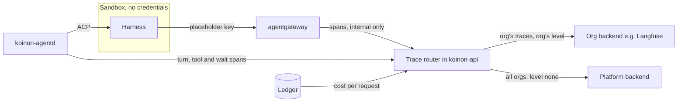

# 0074. Run traces: a Koinon trace router to each org's OTLP backend

- Status: Accepted (delivery after v0.1.0)
- Date: 2026-10-28
- Amends: [0023](0023-observability-and-audit.md) (run traces, deferred there)
- Relates to: [0041](0041-koinon-spend-ledger-and-budget-stops.md), [0049](0049-v01-scope-decisions.md), [0050](0050-spend-ledger-ingestion-and-net-limits.md), [0056](0056-model-providers-pricing-and-budgets-per-org.md), [0059](0059-v01-opencode-only.md), [0065](0065-work-model-tasks-inbox.md), [0072](0072-agent-model-run-now-echo-check.md), [0073](0073-agent-passport.md), [#213](https://github.com/stateracloud/koinon/issues/213)
- Pending verification: OpenShell passing `traceparent` through, and agentgateway v1.7.0's tracing policy with CEL attributes (both not yet tested)

## Context

[0023](0023-observability-and-audit.md) decided that run traces go only to an OTLP endpoint an org
admin or platform admin supplies, that an org endpoint receives only that org's traces, and that
nothing is exported by default. It deferred the build. Run traces carry prompts, tool arguments and
outputs, which belong to the org.

**What exists.**

- **agentd** runs in the control plane and drives the harness over ACP through OpenShell's exec
  stream. Nothing of Koinon runs in the sandbox ([0049](0049-v01-scope-decisions.md)). agentd sees the
  run, its task, each `session/prompt` turn and `session/load` resume, the `tool_call` and
  `tool_call_update` notifications (`toolCallId`, `title`, `kind`, `status`, `rawInput`, `rawOutput`,
  [ACP tool calls](https://agentclientprotocol.com/protocol/tool-calls)), the parks for approvals,
  `ask_user` and `ask_agent` ([0065](0065-work-model-tasks-inbox.md)), and the run's outcome.
- **The access log.** agentgateway exports it over OTLP/HTTP to koinon-api's `:4318/v1/logs`, with no
  authentication and a NetworkPolicy in front ([0050](0050-spend-ledger-ingestion-and-net-limits.md)).
  It records `koinon.key`, `koinon.agent` and `koinon.request` (`internal/gateway/gateway.go:708-714`).
  The ledger attributes a request to a run by time window (`internal/ledger/ledger.go:44-47`).
- **The cost Koinon bills** is the ledger's, recomputed from the org's price schema. The gateway's
  figure is kept only to flag differences (`internal/ledger/price.go:21`, [0056](0056-model-providers-pricing-and-budgets-per-org.md)).
- **The run ID already reaches the gateway.** `koinon-opencode --session-id <run>` adds
  `"body":{"session_id":"<run>"}` to every model request for sticky routing
  (`flavors/opencode/koinon-opencode:109-118`).
- **The harness's own telemetry is off.** The entry script unsets `OTEL_EXPORTER_OTLP_ENDPOINT` and
  `OTEL_EXPORTER_OTLP_HEADERS` (`flavors/opencode/koinon-opencode:65`). OpenCode 2.2.0 exports only when
  that endpoint is set, and then emits its internal Effect spans (`SessionModelTransport.send`), not
  GenAI spans ([otlp.ts](https://github.com/anomalyco/opencode/blob/v2.2.0/packages/util/src/observability/otlp.ts),
  `packages/core/src/session/model-transport.ts:219`, `:389`). `experimental.openTelemetry` is listed as
  unsupported (`packages/core/src/config/normalize.ts:45-51`).
- **A per-run key is decided.** [0073](0073-agent-passport.md) decision 7 gives each run its own gateway
  key whose metadata names the run, so `apiKey.run` is exact. It is not built yet.

**The OpenTelemetry GenAI conventions** moved to their own repository, which has no release tag yet.
Their status is **Development** for the whole area and every `gen_ai.*` attribute
([README](https://github.com/open-telemetry/semantic-conventions-genai/blob/3fe84604a581b3d50dd5b4bd29383b462d2a5018/docs/gen-ai/README.md),
read at commit `3fe8460`, 2026-10-28; the old pages on opentelemetry.io say "This page has moved").

- **Model calls.** The span is named `{gen_ai.operation.name} {gen_ai.request.model}`, kind CLIENT. It
  carries `gen_ai.provider.name`, `gen_ai.request.model`, `gen_ai.response.model`,
  `gen_ai.response.finish_reasons`, `gen_ai.conversation.id`, `gen_ai.usage.input_tokens`,
  `gen_ai.usage.output_tokens`, `gen_ai.usage.cache_read.input_tokens`,
  `gen_ai.usage.cache_write.input_tokens` and `gen_ai.usage.reasoning.output_tokens`. The spec has no
  cost attribute ([client-inference.md](https://github.com/open-telemetry/semantic-conventions-genai/blob/3fe84604a581b3d50dd5b4bd29383b462d2a5018/docs/gen-ai/client-inference.md)).
- **Agents and tools.** The spans are `invoke_agent {gen_ai.agent.name}` (CLIENT or INTERNAL) and
  `execute_tool {gen_ai.tool.name}` (INTERNAL). An "agent as a tool" refinement adds
  `gen_ai.transfer.mode` and `gen_ai.transfer.target.name`
  ([gen-ai-agent-spans.md](https://github.com/open-telemetry/semantic-conventions-genai/blob/3fe84604a581b3d50dd5b4bd29383b462d2a5018/docs/gen-ai/gen-ai-agent-spans.md)).
- **Content.** Instructions, messages, and tool arguments and results "SHOULD NOT" be captured by
  default. Capture is "gated by an explicit user opt-in"; the switch is
  `OTEL_INSTRUMENTATION_GENAI_CAPTURE_CONTENT`, which defaults to `NO_CONTENT`. In production the spec
  recommends storing content externally and recording `*_ref` attributes on the span
  ([gen-ai-spans.md](https://github.com/open-telemetry/semantic-conventions-genai/blob/3fe84604a581b3d50dd5b4bd29383b462d2a5018/docs/gen-ai/gen-ai-spans.md#capturing-instructions-inputs-and-outputs)).
- **Propagation.** MCP and ACP both reserve `traceparent`, `tracestate` and `baggage` in `_meta`
  ([mcp.md](https://github.com/open-telemetry/semantic-conventions-genai/blob/3fe84604a581b3d50dd5b4bd29383b462d2a5018/docs/gen-ai/mcp.md),
  [ACP extensibility](https://agentclientprotocol.com/protocol/extensibility)).

**What agentgateway v1.7.0 offers** (the pinned version; read from its source at tag `v1.7.0`):

- **One SERVER span per request.** It is named `{method} {path match}`, or by the MCP method, or by a
  CEL `span.name`. It is parented on the incoming `traceparent` (`crates/agentgateway/src/telemetry/trc.rs:272-335`).
- **Its attributes** are `gen_ai.operation.name`, `gen_ai.provider.name`, the request and response
  models, and token counts. Cost goes under `agw.ai.usage.cost.*`. A test forbids `gen_ai.usage.cost`
  (`telemetry/log.rs:1820-1960`, `:1652-1670`, `:3868`). Two names differ from the conventions:
  `gen_ai.usage.cache_creation.input_tokens` and `gen_ai.usage.reasoning_tokens`.
- **No content by default.** Prompts and completions are reachable only as CEL (`llm.prompt`,
  `llm.completion`, `llm.toolCalls`), through `frontendPolicies.tracing.attributes`. CEL can also read
  `apiKey.*` metadata and `request.body` (`schema/cel.md:13-19`, `:51-53`, `:80-86`).
- **One exporter per frontend policy.** It is not per route and not per key
  (`proxy/httpproxy.rs:1477-1497`). The OTLP headers sit in gateway config (`schema/config.md:105`,
  `:1709`). Sampling and filters are CEL (`schema/config.md:1713-1716`).
- **Propagation upstream.** A sampled request is forwarded with the gateway's own `traceparent`
  (`proxy/httpproxy.rs:1501-1508`).

**Prior art.** Claude Code redacts prompts, tool details and tool content by default, and in SDK
sessions it parents under a `TRACEPARENT` from its environment
([monitoring](https://code.claude.com/docs/en/monitoring-usage)). kagent sets the standard `OTEL_*`
variables in every runtime, with `OTEL_INSTRUMENTATION_GENAI_CAPTURE_MESSAGE_CONTENT`
([kagent#2909](https://github.com/kagent-dev/kagent/pull/2909)). The Vercel AI SDK emits
`invoke_agent`, `chat` and `execute_tool`, and records inputs and outputs by default
([telemetry](https://ai-sdk.dev/docs/ai-sdk-core/telemetry)). The OpenHands SDK traces through
Laminar ([observability](https://docs.openhands.dev/sdk/guides/observability)). Each of them runs the
agent loop in-process and exports with a credential in its own environment. In Koinon that loop runs
in an untrusted sandbox, which holds no credential. The trusted views are agentd and the gateway.

**The story.** Mara, an admin of org Acme, connects Langfuse on the org's Observability page.
Yesterday the FinOps analyst's run cost $0.40, where it usually costs about $0.08. She wants to see
why: which turn, which tool result and which model calls.

procoduck decided the open points on 2026-10-28.

## Decision

1. **A Koinon trace router, fed by agentd and the gateway.**
   - **agentd emits the run's structure.** That is the turns, tool calls, waits and sub-run links
     (decision 3).
   - **The gateway sends model-call spans only to Koinon.** agentgateway exports through
     `frontendPolicies.tracing` to a receiver on koinon-api's internal OTLP listener (`/v1/traces`
     next to `/v1/logs`). Like the log receiver, it is reachable only from the gateway pods. The gateway
     never exports to a third party.
   - **The router** runs in koinon-api. For every span it:
     - attributes the span to an org and a run (decision 4);
     - re-parents it under the turn (decision 2);
     - sets the cost (decision 5);
     - renames attributes to the pinned conventions;
     - applies the destination's content level (decision 6);
     - exports to each matching destination (decision 8).
   - **Sampling.** A run is traced whole or not at all. The decision is made when agentd claims the run
     and is stored on it. The setting is per org, and the default is every run when the org has a
     destination. The gateway samples every request to Koinon, and the router drops spans of untraced
     runs.

2. **Shape: one trace per turn, and Koinon assigns the trace IDs.**
   - **A turn** is one `session/prompt`, from the first prompt or a resume after a park, until the
     turn ends. Each turn is one trace. The trace ID is random, is stored on the turn row in Postgres,
     and comes from the platform's ID generator, not from the harness.
   - **The session** is the run and its task. Every span carries:
     - `gen_ai.conversation.id` = the run ID;
     - `session.id` = the run ID;
     - `koinon.task` = the task ID.

     Langfuse, Datadog and Opik group by these attributes (backend table below).
   - **No span stays open across a park.** An approval, `ask_user` or `ask_agent` ends the turn's
     trace with a `koinon.park` event that gives the reason. The next turn's root carries a span link
     to the previous turn and a `koinon.wait` event with the wait's duration. A wait of seven days is
     two events, not a seven-day span.
   - **Sub-runs.** The parent's `execute_tool koinon_ask_agent` span uses the "agent as a tool"
     refinement (`gen_ai.transfer.mode = return_to_caller`, `gen_ai.transfer.target.name`) and links
     to the child run's first turn. The child's traces go to the child's org's destinations.
   - **Propagation is not needed for correctness.** The router places gateway spans by run, not by
     `traceparent`. As a hint for harnesses that honour it, agentd also sets `traceparent` in the ACP
     `_meta` of `session/prompt`. A trace ID is not a secret. Whether OpenShell's proxy passes the
     header from the harness to the gateway is **not yet tested**. Koinon never relies on it for
     attribution, because the sandbox could forge or drop it.

3. **Spans and attributes, following the GenAI conventions at a pinned date.**
   - **Pinning.** The conventions are in Development. Koinon pins one dated commit (initially
     `3fe8460`, 2026-10-28), sets the span `schema_url` to it, and names it in the docs site. Moving
     to a newer commit is a reviewed change with a golden-file test of the emitted spans.
   - **Spans:**

     | Span | Kind | Source | Name |
     | --- | --- | --- | --- |
     | Turn (root) | INTERNAL | agentd | `invoke_agent {agent name}` |
     | Model call | CLIENT | gateway, via the router | `chat {gen_ai.request.model}` |
     | Tool call | INTERNAL | agentd (ACP `tool_call`) | `execute_tool {tool}` |
     | MCP call | CLIENT | gateway, via the router | `{mcp.method.name} {target}`, the child of its tool span when the `toolCallId` matches |
     | Approval, `ask_user`, `ask_agent` | INTERNAL | agentd | `execute_tool koinon_<tool>`, ending at the park |

   - **The root span** carries `gen_ai.agent.id` (the agent ID), `gen_ai.agent.name`,
     `gen_ai.agent.version` (the agent version), `gen_ai.request.model`, and the turn's totals of
     `gen_ai.usage.*` and cost. It also carries `koinon.run`, `koinon.task`, `koinon.org`,
     `koinon.turn` (its sequence number), `koinon.requested_by.kind` and `koinon.requested_by.id`, and
     on the last turn `koinon.outcome` and `koinon.failure_class`.
   - **Tool spans** carry `gen_ai.tool.name`, `gen_ai.tool.call.id` (the ACP `toolCallId`) and
     `gen_ai.tool.type`, plus `koinon.tool.kind` (the ACP kind) and `koinon.tool.status`.
   - **IDs, not names, on the platform's copy.** The org's own copy carries names; the platform's copy
     carries IDs only (decision 8).
   - **Before C, model calls come from the ledger.** Until the gateway's spans flow (decision 11), the
     router makes each model-call span from a `spend_entries` row: model, tokens, cost and the
     record's time.

4. **Attribution by the run key, never by the sandbox.**
   - **With per-run keys** ([0073](0073-agent-passport.md) decision 7), a CEL attribute in the gateway's
     tracing policy adds `koinon.run` from `apiKey.run`. The gateway also adds `koinon.key` and
     `koinon.agent`, as in the access log.
   - **Until then**, the router uses the `session_id` body field, which is the run ID, and checks it
     against the key's agent and the run's time window, the ledger's rule. A span whose run ID does
     not belong to the key's agent is dropped and counted.
   - Whether agentgateway v1.7.0 applies CEL `attributes` on `frontendPolicies.tracing` as its source
     reads (`apiKey.run`, `request.body`, `llm.prompt`) is **not yet tested**. A kind spike comes first,
     as for 0073's delivery spike.

5. **Cost comes from the ledger.**
   - **Model calls.** A model-call span carries the cost of its `spend_entries` row, which is what
     Koinon bills. It is written as `gen_ai.usage.cost` (read by Langfuse and Opik) and as
     `koinon.cost_usd`, and joined by `koinon.request`. The gateway's own `agw.ai.usage.cost.*` is kept
     as `koinon.gateway_cost_usd`, so a priced difference is visible.
   - **Waiting for the cost.** A span waits in the router for its ledger row for up to 30 seconds. If
     the row does not arrive, the span is exported without a cost and with `koinon.cost_pending = true`.
   - **Turns.** The root span sums its turn's entries, so Mara sees $0.40 broken down by turn and by call.

6. **Content levels per org.**
   - **`none`** (the default). No prompts, completions, tool arguments, tool results or agent
     messages: only names, IDs, counts, timings, statuses and cost.
   - **`redacted`**. Content is included after the scrubber.
   - **`full`**. Content as is, apart from credentials, which are always removed.
     - Only an org owner can choose `full`, and the change is audited.
     - The org's Observability page and every destination using `full` show a badge.
   - **The platform sets the highest level an org may pick** (`none`, `redacted` or `full`). Lowering
     it lowers every org above it at once, and that is audited too.
   - **Content is taken where it arises.**
     - Tool arguments and results come from ACP `rawInput` and `rawOutput`.
     - Agent messages come from `session/update`.
     - Prompts and completions come from the gateway's CEL `llm.prompt` and `llm.completion`, only for
       keys whose metadata carries `trace_content` above `none`. An org at `none` sends no content off
       the gateway at all.
     - Content goes on the span attributes `gen_ai.input.messages`, `gen_ai.output.messages`,
       `gen_ai.tool.call.arguments` and `gen_ai.tool.call.result`, truncated to a per-attribute limit
       (default 16 KiB) that keeps the JSON structure.
     - Storing content externally with `*_ref` attributes is a follow-up.
   - **The scrubber** runs in the router, on every span at every level:
     - **Always:** the gateway-key placeholder and real `kgw_` keys, `Authorization` and cookie values,
       JWT-shaped strings (passports, [0073](0073-agent-passport.md)), and the values of the org's secret
       store and provider records when they appear verbatim. A scrubbed value is replaced with
       `[redacted:<kind>]`.
     - **At `redacted`, also:** email addresses, phone numbers, IBANs and payment-card numbers, and
       high-entropy tokens.

     The scrubber is one Go package with golden tests, using fake, low-entropy fixtures (AGENTS.md). It
     never sends content to a model.

7. **Bounded queues and failure isolation.**
   - **Off the run's path.** Export never blocks a run, the ledger or the gateway. agentd hands spans
     to the router over an in-cluster call that drops spans rather than waiting. The gateway's export
     is batched and fire-and-forget.
   - **One queue per destination.** Each queue is bounded (default 10,000 spans), with OTLP/HTTP
     protobuf batches, retry with exponential backoff on 429, 5xx and network errors, and
     drop-oldest when full.
   - **Circuit breaker.** A destination that keeps failing is paused for a growing interval. One slow
     Langfuse never delays another org, the platform destination, or any run.
   - **Health in the UI.** Each destination's state (last success, last error, spans dropped) is
     recorded in Postgres and shown on its page.
   - **Restarts.** Spans are not persisted. A router restart loses what was queued, and the trace says
     so with a `koinon.spans_dropped` count on the next root.
   - **Dialling.** The router dials only addresses the egress policy allows, and follows no redirects,
     as `internal/mcpservers/diagnose.go` does.

8. **Destinations: org endpoints and one platform endpoint.**
   - **An org destination** receives only that org's traces, at that org's content level.
   - **The platform destination**, set by a platform admin, receives every org's traces at level
     `none`, unless an org opts in to sending more (up to its own level). On the platform's copy, names
     are replaced with IDs.
   - **A destination record** is org-scoped, keyed `(org_id, id)`, with:
     - an endpoint URL;
     - a protocol (OTLP/HTTP protobuf in v1);
     - a backend preset;
     - its headers;
     - optional resource attributes.
   - **Credentials** live in the secret store, as provider keys do
     ([0056](0056-model-providers-pricing-and-budgets-per-org.md)). They are never in chart values,
     gateway config, the sandbox or logs.
   - **A preset** adds what a backend needs: Langfuse's Basic header from a public and secret key,
     Datadog's `dd-otlp-source: llmobs`, LangSmith's `Langsmith-Project`, Opik's `Comet-Workspace`.
     `generic` takes headers as given.

9. **API and UI, tested before saving.**
   - **API.** A `TraceDestinationService` (Connect) offers create, update, delete, list and test, plus
     `GET/PUT /admin/v1/trace-destinations` for the platform destination.
   - **UI.** An Observability page for org admins, and one for platform admins.
   - **Test before save.** Creating or changing a destination first sends one synthetic trace (a root
     span and one child, no content, `koinon.test = true`). The destination is saved only when the
     backend accepts it with 2xx and no rejected spans. This is the providers' pattern (the echo check,
     [0072](0072-agent-model-run-now-echo-check.md)) and the MCP servers' add-time diagnose. The result
     and its time are kept and shown.
   - **Audit.** Changes to destinations, content levels and the platform ceiling are recorded in the
     audit log.

10. **Metrics stay fixed** ([0023](0023-observability-and-audit.md)).
    - **Router counters:** spans received by `source` (`agentd`, `gateway`); spans exported, dropped
      and rejected by `reason`; export duration by `outcome`; queue depth in total. Each counter splits
      by `destination_kind` (`org`, `platform`) and `backend` (the preset).
    - **No IDs as labels.** No org, destination, agent, run or task ID is ever a label.
    - **Per destination.** Health is a database record (decision 7), not a metric series.

11. **What ships first, after v0.1.0.**
    1. **Option C.**
       - agentd's turn, tool and wait spans;
       - model-call spans made from the ledger;
       - destinations with test-before-save;
       - the router's queues;
       - content levels for ACP content.
    2. **The spikes.**
       - agentgateway v1.7.0's tracing policy with CEL `attributes` and the koinon-api receiver;
       - OpenShell passing `traceparent` through.
    3. **Option D.**
       - the gateway's model-call and MCP spans into the router;
       - attribution by `session_id`, then by `apiKey.run` once [0073](0073-agent-passport.md)'s run keys
         ship;
       - prompt and completion content from the gateway.
    4. Then: external content storage with `*_ref` attributes; OTLP/gRPC; an OpenTelemetry Collector as
       one more kind of destination.

## Backend compatibility

Checked 2026-10-28. Every backend below accepts OTLP/HTTP protobuf and authenticates with a header,
so the router needs only that.

| Backend | Traces endpoint | Auth | Conventions read | Session and type | Hosting, licence |
| --- | --- | --- | --- | --- | --- |
| Langfuse ([OTel](https://langfuse.com/integrations/native/opentelemetry)) | `<host>/api/public/otel/v1/traces`; HTTP only, no gRPC | `Authorization: Basic base64(pk:sk)` | `gen_ai.operation.name` (`chat` → generation, `invoke_agent` → agent, `execute_tool` → tool), `gen_ai.input/output.messages`, OpenInference; cost from `gen_ai.usage.cost` ([ObservationTypeMapper.ts](https://github.com/langfuse/langfuse/blob/v4.71.0/packages/shared/src/server/otel/ObservationTypeMapper.ts)) | `session.id`, then `gen_ai.conversation.id` ([OtelIngestionProcessor.ts](https://github.com/langfuse/langfuse/blob/v4.71.0/packages/shared/src/server/otel/OtelIngestionProcessor.ts)) | Cloud or self-hosted; MIT outside `ee/` |
| Arize Phoenix ([setup](https://arize.com/docs/phoenix/tracing/how-to-tracing/setup-tracing/setup-using-phoenix-otel)) | `<host>:6006/v1/traces`; gRPC too | `Authorization: Bearer` when auth is on | OpenInference; `gen_ai.*` converted at ingest since 15.10.0 ([release note](https://github.com/Arize-ai/phoenix/blob/main/docs/phoenix/release-notes/05-2026/05-15-2026-otel-semconv-conversion.mdx)) | Project per resource or header | Self-hosted or cloud; Elastic License 2.0 |
| Grafana Tempo ([config](https://grafana.com/docs/tempo/latest/configuration/)) | 4318 HTTP, 4317 gRPC | None built in; needs an authenticating proxy, which sets `X-Scope-OrgID` ([auth](https://grafana.com/docs/tempo/latest/operations/authentication/)) | Any; `max_attribute_bytes` default 2048 truncates content | Trace view only | AGPL-3.0 |
| Datadog LLM Observability ([OTel](https://docs.datadoghq.com/llm_observability/instrumentation/otel_instrumentation/)) | Site-specific; `http/protobuf` | `dd-api-key`, `dd-otlp-source: llmobs` | GenAI 1.37+ and OpenInference; spans without `gen_ai.*` are dropped | `chat` → llm, `execute_tool` → tool, `invoke_agent` → agent; cross-trace links stored, not drawn | SaaS |
| Honeycomb ([OTel](https://docs.honeycomb.io/send-data/opentelemetry/)) | `api.honeycomb.io/v1/traces` (EU `api.eu1`) | `x-honeycomb-team` | Any; no LLM view | Queries | SaaS |
| LangSmith ([OTel](https://docs.langchain.com/langsmith/trace-with-opentelemetry)) | `api.smith.langchain.com/otel/v1/traces`; self-hosted `<api>/api/v1/otel` | `x-api-key`, `Langsmith-Project` | `gen_ai.*`, OpenInference, `langsmith.*` | `langsmith.trace.session_id` (the preset copies the run ID) | SaaS; self-hosted enterprise |
| Opik ([OTel](https://www.comet.com/docs/opik/integrations/opentelemetry)) | `<host>/api/v1/private/otel/v1/traces`; HTTP only | `Authorization: <key>`, `Comet-Workspace`, `projectName`; all optional, because self-hosted Opik runs without authentication | `gen_ai.*` including `gen_ai.usage.cost`, OpenInference | `gen_ai.conversation.id` → thread | Cloud or self-hosted; Apache-2.0 |

## Consequences

- **Mara gets her answer.**
  - **With C:** a session for the run, three turns, and in turn 2 fourteen generations of about 60k
    cached input tokens each, after a billing tool returned a 2 MB CSV. The costs add up to the bill.
  - **With D:** the real latency of each call too, and at `redacted` or above the prompt that carried
    the CSV.
- **Credentials stay out of the sandbox and the gateway.** Each org's backend key lives in the secret
  store, and the gateway exports only to Koinon.
- **The cost matches the bill.** It is the ledger's, not the gateway's catalog price.
- **Any harness works.** Nothing depends on the harness's own telemetry, which keeps the flavor rule
  of [0059](0059-v01-opencode-only.md) intact.
- **One place enforces privacy.** The content level and the scrubber run in the router, and an org at
  `none` sends no content off the gateway. The scrubber can still miss a secret the org's own data
  contains; `full` makes that the owner's decision, with a badge and an audit record.
- **The router is new load on koinon-api.** It handles a span per model call and per tool call, plus
  memory for the queues. It may later move to its own Deployment _(inferred)_.
- **Span names follow a Development spec.** Pinning keeps the output stable. Each move to a newer
  commit is work, and backends may lag or lead the pinned names.
- **Traces can be lossy.** Bounded queues drop spans under backpressure, and a router restart loses
  its queue. Traces are a diagnosis aid; the ledger and the audit log stay the records
  ([0023](0023-observability-and-audit.md)).
- **One gateway exporter still serves every org.** Per-org routing is Koinon's job, so a Koinon bug
  could send a span to the wrong org. Tests check that every exported span's `koinon.org` matches its
  destination's org, in the isolation suite.
- **Issues to file:**
  - the router and destinations;
  - the agentd spans;
  - the two spikes;
  - the scrubber;
  - gateway content by key metadata.

## Alternatives

- **A: the gateway exports straight to each backend.** `frontendPolicies.tracing` points at Langfuse.
  - Least work for one platform endpoint.
  - But there is one exporter per frontend policy, so per-org endpoints need a listener or gateway per
    org, with each org's credential in gateway config.
  - Mara would see flat `POST /v1/chat/completions` spans with no run, turn or tool structure, and the
    gateway's price, not the bill.
  - Kept only as a platform operator's debug option, documented as such.
- **B: harness-native telemetry.** Turn on OpenCode's OTLP export in the sandbox.
  - It needs an OTLP credential in the sandbox, which the hard rule forbids.
  - Its spans are OpenCode's internal ones, not GenAI spans.
  - The agent can forge or suppress its own trace.
  - A relay that adds the credential solves only the first problem.
  - Rejected.
- **C alone: agentd spans and model calls made from the ledger, with no gateway spans.**
  - Medium effort, and the cost matches the bill.
  - But model-call timing is approximate, MCP calls are invisible, and prompts and completions can
    never be shown.
  - Built first, as step 1 of D, not as the end state.
- **E: an OpenTelemetry Collector as the router.** A routing connector keyed on `koinon.org`, with
  exporters per org.
  - Mature batching and retry.
  - But it adds a component to the chart, changes its config for every org's destination, keeps org
    credentials in Collector config, and still needs Koinon for attribution, ledger cost and the
    scrubber.
  - Rejected as the router. A Collector is allowed later as a kind of destination.
- **Run-length spans across parks.** One trace per run, with the wait as a span.
  - Simpler joins.
  - But a parked run would hold a span open for up to seven days
    ([0065](0065-work-model-tasks-inbox.md)), and backends show such traces poorly or drop them
    _(inferred)_.
  - Rejected for trace per turn.
- **`traceparent` through the harness as the join.** Propagation in the style of Claude Code.
  - Standard.
  - But it depends on each harness, and the sandbox could choose the value.
  - Kept as a hint (decision 2), not as attribution.

## Upstream verification

- 2026-10-28, GenAI conventions at
  [`open-telemetry/semantic-conventions-genai@3fe8460`](https://github.com/open-telemetry/semantic-conventions-genai/tree/3fe84604a581b3d50dd5b4bd29383b462d2a5018):
  - status Development;
  - span names and attributes as in the Context;
  - `OTEL_INSTRUMENTATION_GENAI_CAPTURE_CONTENT` values;
  - no cost attribute.
- 2026-10-28, agentgateway at tag `v1.7.0` (the chart's pin):
  - `telemetry/trc.rs:272-335` (span name, SERVER kind, parent);
  - `telemetry/log.rs:1652-1670`, `:1820-1960`, `:3868` (attributes, cost names);
  - `proxy/httpproxy.rs:1471-1508` (tracer per frontend policy, `traceparent` upstream);
  - `schema/config.md:103-112`, `:1703-1718`;
  - `schema/cel.md:13-19`, `:51-53`, `:80-86`.

  Behaviour with CEL `attributes` and an internal receiver is not yet tested (decision 4).
- 2026-10-28, OpenCode at tag `v2.2.0`: `packages/util/src/observability/otlp.ts`,
  `packages/core/src/config/normalize.ts:45-51`, `packages/core/src/session/model-transport.ts:219`,
  `:389`.
- 2026-10-28, Langfuse at tag `v4.71.0`: `ObservationTypeMapper.ts:250-268`,
  `OtelIngestionProcessor.ts:2455`, `:2782-2795`, `LICENSE`.
- 2026-10-28: [ACP extensibility](https://agentclientprotocol.com/protocol/extensibility),
  [ACP tool calls](https://agentclientprotocol.com/protocol/tool-calls), the backend pages in the
  table, and the prior-art pages in the Context.
- OpenShell passing a harness's `traceparent` header to the gateway: not yet tested (decision 2).

## Amendment (2026-10-29): the gateway logs no response body

Decision 6 says an org at `none` sends no content off the gateway at all. A first version of the
failed-response log field (`koinon.error_body`, ADR 0056 amendment 2026-10-29) did not meet that: a
provider that echoes the prompt (OpenRouter's `metadata.flagged_input`) put it in the gateway's stdout
log and in the OTLP export. Redacting it in CEL would have fixed that, but reading agentgateway v1.7.0
showed a larger fault: any log or tracer expression that references `response.body` or
`response.bodyPrefix` makes the gateway record the body of every response on the listener (up to 32 MiB
on an LLM route, held for the whole stream; ADR 0056 amendment 2026-10-29, point 6).

1. **No rendered expression reads a response body**, in the access log or in a tracer field, in either
   driver. The field and `errbody.GatewayExpr` are removed, and a render spec in each driver fails if
   `response.body` appears in any rendered output.
2. **Content level is unaffected.** The gateway's log and the OTLP export hold provider status and
   metadata only, never the request, the completion or an error body, so `none` stays true to its word.
3. **Any future trace field that wants a body** must be weighed against that cost first; the
   per-response buffering is what a per-field status guard cannot avoid.

## Amendment (2026-10-30): the destinations API and its defaults (rc.9)

The foundation slice (schema, service layer, `TraceDestinationService`) fixes what decisions 6, 8 and 9
left open.

1. **The platform destination and ceiling are Connect calls, not `/admin/v1`.** Admin API tokens are
   org-scoped (ADR 0056), so no token can act as a platform admin, and the platform ceiling for budgets
   is a platform-admin call in the UI for the same reason. `TraceDestinationService` carries
   `GetPlatform`, `SetPlatformDestination`, `DeletePlatformDestination`, `TestPlatformDestination` and
   `SetPlatformCeiling`, for platform admins. `GET/PUT /admin/v1/trace-destinations` is not built; an
   org-scoped REST face for an org's own destinations can be added on the same service layer.
2. **Credentials.** A destination's secrets are one envelope (`trace_destinations.credentials`, bound to
   org, table, row and column), a JSON object of the preset's secret fields or, for `generic`, header
   name to value. The names of the fields that are set are stored in the clear (`secret_fields`) so the UI
   can show them; values are never returned or audited.
3. **The ceiling defaults to `full`** (no restriction until a platform admin lowers it). The owner-only
   rule for `full` still applies. An org without a settings row has level `none`, every run sampled, and
   nothing extra for the platform.
4. **Audit.** The log has no org-less events (ADR 0023), so a change to the platform destination or
   ceiling is recorded in the platform admin's personal org, and each org lowered by a new ceiling gets its
   own `trace.settings.lowered` event.
5. **Run tracing state.** `runs.traced` is NULL until agentd decides at claim and then never changes;
   the migration sets it to false for runs already past their queue, so a run is traced whole or not at
   all. `run_turns` holds one row per turn with its `seq` (from `runs.last_turn_seq`, taken under the run's
   row lock) and `trace_id`.
6. **Stored credentials follow their endpoint.** Update keeps stored secrets only while the backend and
   the endpoint's origin (scheme, host, port) are unchanged; otherwise every secret field must be entered
   again, so a credential is never sent to an endpoint just typed in. Endpoints are stored normalised, and
   must be https unless the host is in the platform's allowed hosts (a lab or test backend).
7. **When a change is tested.** Only a change to the connection (backend, endpoint, settings, secrets) is
   tested before saving. Enabled, name and resource attributes are saved untested, so a destination whose
   backend is down can still be disabled. Backend response text is never quoted in a result (it can echo
   the credentials in another encoding): the message is the status and a fixed description.
8. **Versions.** `config_version` changes only with the configuration, never with the router's health
   writes; an update may carry the version it was loaded with and fails with ABORTED when it is stale. A
   re-test records its result only against the version it tested.
9. **Who may send what.** `full`, and any raise of the content level or the platform copy, follows the
   caller's real membership: a platform admin who is not a member of the org may lower its settings but not
   raise them, and does not count as its owner. A non-owner admin could otherwise add a destination that
   receives the org's chosen level, `full` included, so while the org's effective level is `full` only an
   owner may add a destination or change its connection (turning one off or renaming it stays open to
   admins). Not accepting that gap is the sustainable default.
10. **Router resilience.** A destination whose credentials cannot be opened is skipped, logged and marked
    with an error on its health; the org's other destinations still get its traces. `sample_rate` is
    optional on update and the stored rate stays when it is left out.

## Amendment (2026-10-30): the internal OTLP listener is authenticated

The context above (the access log "with no authentication and a NetworkPolicy in front") is superseded
by the amendment of the same date in [0050](0050-spend-ledger-ingestion-and-net-limits.md). The whole
internal OTLP listener, `/v1/logs` and `/v1/traces`, requires a bearer token from the Secret
`koinon-otlp-token`. The gateway's log export and koinon-agentd's span export both send it
(`--otlp-endpoint` and `--otlp-token-file` on koinon-agentd, `KOINON_OTLP_ENDPOINT` and
`KOINON_OTLP_TOKEN_FILE` in the chart). This closes issue #52.

## Amendment (2026-10-30): how koinon-agentd emits the run's spans (rc.9)

1. **Root span IDs are derived.** The turn's trace ID is random and stored on `run_turns`; its root span
   ID is the first 8 bytes of SHA-256(`"koinon.turn.root"` + trace ID). A later turn, a takeover or the
   router can therefore name a turn's root (a span link, a parent) from the row alone.
2. **A turn is one `session/prompt`.** A retry, a refusal note or a wrap-up prompt in the same
   execution each start a turn of their own; the turn row's `end_reason` says how it ended (`end_turn`,
   `park:<reason>`, `failed`, `canceled`, `wrap_up`, `refused`, `interrupted`, `fenced`, `shutdown`).
   The `koinon.wait` event is added only when the previous turn ended in a park. A run that fails
   before its first prompt has no turn and so no trace.
3. **Content is marked.** A span that carries content has `koinon.content.attributes`, a string array
   of the names of its content attributes (`gen_ai.input.messages`, `gen_ai.output.messages`,
   `gen_ai.tool.call.arguments`, `gen_ai.tool.call.result`). agentd sets content only when the org's
   level (held to the platform ceiling) is above `none`; the router strips or scrubs exactly the listed
   attributes per destination level and removes the marker. agentd pre-caps each value at 64 KiB to
   bound memory; a longer value becomes a JSON string of its cut-off text.
4. **Tool names.** `gen_ai.tool.name` is the ACP title only when it is a plain identifier; free text
   (which can carry arguments) falls back to the ACP kind.
5. **Export.** A bounded queue (2048 spans) that drops when full, one worker, 256-span batches with a
   5 s deadline; a failed batch is dropped. `koinon_agentd_trace_spans_dropped_total{reason}`
   (`queue_full`, `export_failed`) and `..._exported_total` count them.

## Links

- [0023](0023-observability-and-audit.md), [0050](0050-spend-ledger-ingestion-and-net-limits.md),
  [0056](0056-model-providers-pricing-and-budgets-per-org.md), [0065](0065-work-model-tasks-inbox.md),
  [0073](0073-agent-passport.md)
- https://github.com/open-telemetry/semantic-conventions-genai
- https://agentgateway.dev/docs/standalone/main/documentation/observability/traces/attribute-reference/
