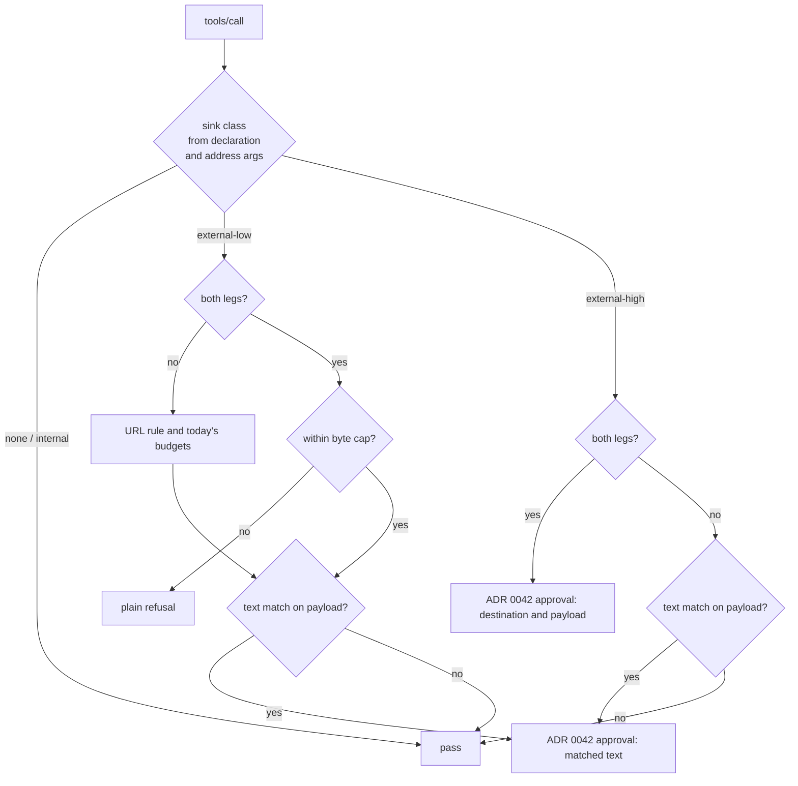

# 0091. Leak guard by destination: sink classes, session legs and a byte cap

- Status: Accepted (decisions by procoduck, 2026-11-03); amended by [0092](0092-leak-guard-judge-model.md) (2026-11-03: the both-legs `external-high` approval becomes rules, a judge model, then a person)
- Date: 2026-11-03
- Amends: [0084](0084-leak-guard.md) (the main protection moves from the text check to where a call sends data; decisions 2, 3, 5, 7, 8 and 12 change)
- Relates to: [0042](0042-ask-tier-park-and-execute.md) (approvals), [0051](0051-session-home-generations.md) (home generations), [0057](0057-mcp-servers.md) (tool tiers), [0062](0062-code-host-connectors.md) (code-host repository list), [0080](0080-tool-set-matches-egress-and-escape-hosts.md) (no web egress from the sandbox)
- Issue: old issue 625, part of #51; changes old issue 348, old issue 349, old issue 350, old issue 351, #70 and old issue 609

## Context

ADR 0084 made a text check the main protection against leaks. The guard looks for private text in
the arguments of each MCP tool call, after undoing the encodings an attacker might use. Since then
every round of work on it found a new gap or a new false alarm:

| Round | What happened |
|---|---|
| old issue 348, review rounds 1 to 10 (PR old issue 582) | Each review found a new spelling the decoders missed: punctuation between letters, UTF-16 with emoji, chunked base64 of non-ASCII text, 13 to 14 byte pieces, a NUL every 11 bytes, invalid-byte polyglots. Each got a new decoder heuristic. |
| old issue 348, cost | Readings times alignments times argument pairs blew past the 1 s clock. That led to the work budget, the 5 s backstop (ADR 0084 amendment), `budget_args` and pair windows switched off above 8000 pairs, which is a bypass in its own right. |
| old issue 609 | A list of accepted gaps (tiny separately-encoded pieces, padding that turns off the windows). The issue itself says the approach probably needs to change. |
| old issue 350 (PR old issue 621) | Legs are declared per server, but the risk depends on where one call sends its data. |
| #70 (PR old issue 623) | Pair reassembly glued owner `northwind` and repo `platform-handbook`, the address of a write into the org's own repo, into 25 characters that matched a private title: 91 of 272 benign Gitea writes blocked. The pending fix, "glued text needs both halves", was one more heuristic. |

**Root cause.** The guard decides by what the outgoing bytes look like, without knowing where they
go. `TaintChecker.Check(ctx, scope, fp, args []string)` gets a flat list of strings: no tool, no
destination, no split between the address of a call and its payload. The attacker picks the
encoding, so the question "does this argument contain private text?" has no complete answer, and it
is the wrong question when the call writes into the org's own system. Every fix against evasion
widens the check (more cost, more false alarms); every fix against a false alarm narrows it (more
evasion).

The published work agrees. Detection-based defences "remain fundamentally heuristic" (the
design-patterns paper); twelve published prompt-injection defences fell to adaptive attacks, most
at over 90% success ("The Attacker Moves Second"). The guarantees in Meta's Rule of Two, CaMeL and
FIDES come from structure: which session holds which legs, and which sinks it may reach. Comparable
products (Codex cloud, Claude Code's sandbox, the Copilot coding agent firewall, Gemini) limit the
destination, not the content. The GitHub MCP exploit (Invariant Labs) is the #70 shape with an
attacker in it: one server is private data, untrusted input and outbound at once, and only a class
that depends on the destination of the call (a public repo versus a private one) tells them apart.

A limit on how many bytes leave for untrusted hosts holds whatever the encoding, because it bounds
bits, not spellings. A text match holds only for the spellings it decodes. So the byte limit and the
destination are the guarantee, and the text match is an alarm.

Koinon's own benign numbers are weaker than ADR 0084 suggests: G1's "0 of 218, 0 of 272" predates the
pair joins, and the #70 replay corpus is hand-built, not real recordings. The benign rate on real
traffic is unmeasured.

## Decision

Everything below is deterministic and does not depend on how the data is encoded. ADR 0084
decisions 1 (the guard in koinon-api behind ExtMcp), 4 (scope of a home generation), 9 (templates),
10 (fail closed), 11 and the work-budget amendment stand.

### 1. Sink classes

Every tool call has one sink class:

| Class | Meaning | Examples |
|---|---|---|
| `none` | Reads only; sends nothing that leaves. | read a file, list issues, get a page of the org's own docs |
| `internal` | Writes only into a system the org owns and does not publish. | an issue or comment in one of the org's own private repos |
| `external-low` | A small payload in an address or query to an outside party. | fetch a URL, a web search query |
| `external-high` | Free text to a party outside the org. | an issue or PR on a public repo or a foreign owner, an email, a chat post, an arbitrary POST |

**Unknown or unclassified tools count as `external-high`.** That is the cautious reading, the same
choice as old issue 350's all-three-legs default for an unclassified server.

### 2. Where the class is declared

The class is declared **per tool**, not per server. Each tool's declaration says:

- its sink class, either **fixed** (one of the four) or **derived** from its address arguments
  (decision 3);
- which arguments are **address arguments** (where the call goes: `owner`, `repo`, `url`) and,
  by elimination, which are **payload arguments** (what it carries: a title, a body, a query);
- what its results carry for the session legs (decision 4): untrusted input, private data or
  neither. The declaration is pinned to the tool's content hash, like the rest of it. A tool
  without its own declaration takes its server's legs (old issue 350), which are both until an admin says
  otherwise. Koinon's own tools declare theirs in code (`mcpguard.OwnResultLegs`): none of them
  returns third-party text or org data, so none sets a leg, and an own tool nobody declared sets both.

Declarations live on the MCP server records of old issue 350 (per tool, next to the server's kind and legs)
and in the code-host connector's data for its own write tools (ADR 0062, `connector.yaml`). They are
set through the admin API and the console and audited with before and after, like the data class.
A tool's declaration goes back to the default (`external-high`, server legs) when the server's URL
changes (the old issue 350 rule) or when the tool's content hash changes (the ADR 0057 rule that moves a
changed tool back to the ask tier): the declaration described the old tool.

### 3. How one call's class is derived

A derived class is decided per call from the address arguments only:

- **Code host.** The tool names its owner and repo arguments. The call is `internal` when that
  `owner/repo` is in the org's repository list for the connection (the connector knows its scope,
  ADR 0062) and the repository is not public. A public repository, a repository outside the list or
  an owner outside the org makes the call `external-high`. So an issue in
  `northwind/platform-handbook` is internal and never counts as a leak; a PR on a public repo is
  external-high, which is what the Invariant case needs.

  The list is that of the connection the server is linked to, so a server may be linked only to a
  connection of its own code host (#117). The server's URL must be https and name the connection's
  own web or API host, or, for a connection on the connector's default host only, one of the
  connector's `mcpHosts` (`api.githubcopilot.com` for github.com). A GitHub Enterprise Server or
  Gitea connection accepts only its own host. Hosts are compared by name without the port. A change
  of a connection's `baseUrl` unlinks the servers it no longer serves, audited as
  `mcp_server.data_class.reset`.
- **Repository visibility** (settled 2026-11-06 by procoduck, #115). The connector reads each
  code-host connection's repositories and their visibility when the connection is created, given a
  new secret or tested, and every 20 minutes after that (one koinon-api replica per round). A reading
  counts for 1 hour: an older one is treated as unknown, so two failed refreshes in a row still leave
  a fresh reading and a repository that turned public is seen well inside the hour. Only a repository
  the code host reports as private is `internal`. Unknown (no reading, a stale reading, a server that
  leaves the visibility out), GitHub's or Gitea's internal (readable beyond the repository's
  collaborators) and any answer the connector is unsure of all count as public, so the call is
  `external-high`. A newer reading is never replaced by an older one, and a secret entered anew in
  Koinon drops the readings taken with the old one (a declared Secret's rotation, a reading in flight
  and an empty newest reading are #244).
- **Fetch.** The tool names its URL argument. The host is the address. A host on the org's
  fetch-trusted list (old issue 350's contract: an exact lower-case name, or a `*.example.com` wildcard that
  covers subdomains at any depth but not `example.com` itself) makes the call `internal`. Any other
  host makes it `external-low`. The path, query and fragment of the URL are **payload** and count
  toward the byte cap; to a host that is not trusted, so are the host's labels (they carry data as
  well as a path does).
- **Search.** A search query always leaves for the provider (ADR 0084 decision 6), so a search tool
  is `external-low` and its query is payload.

An address argument the guard cannot parse (a URL without a host, an owner without a repo) makes
the call `external-high`.

### 4. Session legs

Per home generation (ADR 0051, the scope ADR 0084 decision 4 already uses), the guard records two
legs:

- **untrusted input**: set when the session receives a result of a tool or server declared
  untrusted (a web page, a search result, a public issue);
- **private data**: set when the session receives a result of a tool or server declared private,
  or when agentd reports a repository read or shell output (the fingerprint feed of ADR 0084
  decision 2).

A leg is set by a response, after the call that brought it. The legs **only grow**: nothing within
a generation clears them, not the end of a run, not a new run, not an admin action. Only a new home
generation starts with both legs clear. The third leg, outbound, is no longer a session flag: it is
the sink class of the call being decided.

agentd's tool results and the harness's MCP calls reach Koinon by different paths, so a call can
overtake the update that finished a shell read. The guard therefore waits for the feed (procoduck,
2026-11-03, option A): agentd counts each finished tool call when it reads the update off the
harness's stream and again once it has reported it, per run and worker epoch; before it reads the
legs for an `external-low` or `external-high` call, the guard waits until the second count reaches
what the first was when the call arrived. If it does not within 2 s, the call is decided as if the
session held both legs: a card or a refusal, never a pass. `none` and `internal` calls do not wait.
A tool kind agentd does not know (ACP `other`, a missing kind, or a newer kind) sets both legs.
An MCP tool is the exception (procoduck, 2026-11-03, old issue 643): its result passed the gateway, which sets the
legs from the tool's own declaration, so agentd reports nothing for a finished call whose title
carries the flavor's MCP prefix (`flavor.Descriptor.MCPToolPrefix`, `koinon_` for OpenCode). Without
this a single MCP call, Koinon's own `create_pull_request` included, held both legs until the home was
replaced, and every declared result leg was undone. A flavor with no prefix keeps both legs for kind
`other`.

How the wait works, and what it leaves open (old issue 349 review, 2026-11-03):

- **The reader never waits for the database.** agentd counts in memory as it reads, and one writer
  per harness copies both counts to the database, in order and as absolute values that only grow.
  A slow report holds the handler, not the reader: the next result in the pipe is still counted,
  so the guard sees that the session is behind and waits. **Residual:** the guard can only wait
  for what agentd has read and written. The harness must write a tool's update to its stream before
  it makes its next gateway call, and the read count reaches the database only after the writer's
  goroutine runs and its write lands: a few milliseconds when the database answers, up to the
  writer's retry backoff (0.2 s, then 0.4 s, each try bounded by 10 s) when a write fails. The call
  races that write. A harness that sends the call first, or a call that wins that race, is decided
  on the legs before the result.
- **The wait covers the end-of-turn summary.** The harness still runs then, and a tool can finish
  during the summary (it blocks permission requests, not tools), so the guard waits for the run's
  feed whether or not it is summarizing, and agentd feeds such a result before it counts it as done.
- **A worker whose feed is already fenced** (a newer epoch started it) stops as taken over,
  records nothing, and leaves the run to that worker; the counts writer does the same.
- **A stall is a reason of its own.** A call decided as if both legs were held because the feed
  stalled carries the reason `feed_stalled`, and goes to a person, never to an automatic Decider:
  the legs were assumed, not read. Only a call whose one reason is `both_legs`, with no text match
  and no stall, may reach the Decider seam; ADR 0092's judge must keep that rule.
- **A takeover does not wait for the old worker.** The new worker starts the counts at zero under
  its epoch, and the old worker's later writes count nothing (they are fenced). Its in-flight
  reports are not waited for: the new worker loads the session, and the harness replays its history
  as updates, each counted and reported again, before it answers the load; the guard sees the new
  harness's calls only after that. Reports are idempotent (legs only grow, fingerprints are a set).
- **One report may repeat its own fingerprints.** A tool's update carries its text as content and
  again as raw output, and an edit's two sides share most lines, so the texts of one report winnow
  to the same fingerprints more than once. The store holds each once and its write takes the
  repeats in one statement; a store that refuses them fails every report of such a tool, and the
  run is given up worker after worker. A feed write that fails gives the run up, as a business
  event does (ADR 0074), and another worker resumes it. An error that cannot succeed on retry (a
  database error of class 21, 22, 23, 42, 44 or 0A: `runoutcome.PermanentSQLState`) is not retried
  and does not go through a takeover per worker: the run fails once, in the epoch that met it, with
  a reason that names the SQLSTATE (koinon#123). Failing closed stays.
- **A call outside a task adds no leg.** With no running run there is no feed to wait for and no
  leg is assumed: the call is decided on the legs the generation holds. Those are what earlier tasks
  left, and they only grow, so an `external-high` call outside a task from a generation that holds
  both legs needs an approval, and is refused because no approval exists outside a run (ADR 0042).
  A read-only tool is declared `none` (no address arguments), which is not `external-high`.

Every refusal and every call sent to a person is logged at info, with the reason codes, the class,
the legs, whether a run was found and whether the feed stalled; never an argument value or payload.

### 5. The decision table

| Session state | `none`, `internal` | `external-low` | `external-high` |
|---|---|---|---|
| Not both legs | pass | today's limits | pass |
| Both legs | pass | byte cap | ADR 0042 approval |

- **`none` and `internal` always pass.** They carry nothing out. The ADR 0057 tool tiers still
  govern writes, and integrity of what is written is not this guard's job.
- **Before both legs**, today's limits apply: ADR 0084 decision 5's URL shape rule and its per-host
  and per-run budgets (20 hosts, 1 KB per host, 8 KB of search) for `external-low`; the ordinary
  tiers for `external-high`.
- **Both legs and `external-high`**: the call becomes an ADR 0042 approval for that exact call. The
  card shows what would leave: the destination (the address arguments) and the full payload. An
  ask-tier tool that hits this branch gets one approval, not two, and its card carries the leak
  reason. The approved call runs with the org's executor key (ADR 0057), which the gateway
  therefore opens to every tool a person can approve a call of: present tools of the auto and ask
  tiers whose names agents can see, never the never tier. The key is koinon-api's alone and runs
  only approved calls with their exact arguments, so this gives no agent a tool. What may still run
  is decided in koinon-api when it executes: the server, its URL, the tool still offered and its
  content unchanged, not the never tier, the agent's allowance. An approval stays valid when its
  tool moves between the auto and ask tiers: a person approved that exact call, which is more than
  either tier asks.
- **Both legs and `external-low`**: a **byte cap per run** on what goes to untrusted hosts. It counts
  the payload bytes as sent (the URL's path, query and fragment, the search query), with no decoding,
  so it holds whatever the encoding. It counts from the first call after the run holds both legs,
  since no byte sent before that can carry private data under injected instructions. The **starting
  value is about 2 KB**, set from real traffic measurements (open questions). A call that would go
  over the cap is a **plain refusal** with a reason the agent can read, not an approval. The URL
  shape rule keeps applying inside the cap.
- **Shipped templates never reach the approval branch.** No shipped template combines a leg-setting
  read of untrusted input, private data and an auto-tier `external-high` tool; the old issue 351 templates
  test reads the sink classes and fails if one does. So normal use adds no click ("no agent
  nannies", 2026-10-31).

### 6. Text matching: a frozen secondary alarm

The taint store, the keyed winnowing, the normaliser and the single-layer decoders of old issue 348 stay.
Their role changes:

- They run **only on payload arguments of `external-low` and `external-high` calls**, never on
  the address arguments of a derived class and never on `none` or `internal` calls. A fixed tool's
  address arguments decide nothing, so they are payload.
- The decoder set is **frozen**: no new evasion heuristics. The package documentation says plainly
  that it catches verbatim and simply-encoded copies, not an adaptive attacker.
- Joins happen **only in call order**: the payload arguments of one call, joined in their order in
  the call. The any-pair joins and the pair windows go. (Amended 2026-11-06, #256: also in three
  key-sorted orders of the call's JSON members; see the amendment below.)
- A match becomes an ADR 0042 approval showing the matched text (ADR 0084 decision 7 stays), on an
  `external-low` call that would otherwise pass, and on an `external-high` call before both legs.
  On an `external-high` call that is already an approval, the match is marked on the card.
- **Ends and separators (#286).** An argument longer than `2*JoinEndBytes` (default 512, so 1024
  bytes) contributes its two ends to a join, and the ends are measured in **raw bytes**, before any
  decoding. The projected decoders read through a separator of any length, so a sender can pad a
  half past the ends and the join then holds too few encoded symbols to match. **Known limit:** a
  secret split across two arguments and encoded as separator-padded base64, with each half longer
  than the join ends, passes the text match. The same holds for three nested variants, where the
  padding sits one decoding layer down: base64 of padded base64, `\u` escapes of padded base64 and
  percent-encoding of padded base64. The same text in one argument is still caught, and the byte
  cap and the session legs bound the damage (decision 8). The text match stays a secondary alarm
  (this decision's first bullets), so the gap is accepted, not hidden.
  - **No separator cap.** Bounding the separator a projected decoder accepts would let a padded
    secret in a single argument pass, which is caught today. It would also need its own bound per
    decoder and per nesting depth.
  - **The general fix is a later option, not a promise:** measure the join ends in decoded symbols
    at every decoding layer. It is gated on a benchmark of CPU, memory and the benign work caps
    (`MaxWorkBytes`, 32 MiB) and tracked in #369. Until it lands, the doc.go promise of a separator
    "of any length" holds for one argument, and for a split only while each raw end still holds a
    whole match window.
  - Halves encoded in different chains (one percent-padded, one `\u`-padded) and arguments that are
    not adjacent in a join order are not paired; that cost class was removed with the any-pair joins.
- **failClosed stays**, with the work budget and the 5 s backstop. A check that cannot finish
  refuses the call.

### 7. What the guard's input is

The guard no longer decides on `[]string`. Its input per call is the tool, its sink class (fixed or
derived), the address arguments, the payload arguments and the session legs. It maintains the legs
from responses and from agentd's feed.

The address must have one reading, the one the server acts on. A call that gives an address
argument more than once (a repeated key in the raw JSON, which a decoder would collapse to one of
them), as a dotted literal key, in another case (decoders that match names case-insensitively) or
inside a list is refused, whatever its class would be.

### 8. Guarantees and non-guarantees

**Guaranteed:**

- No shipped template holds both legs with an auto-tier `external-high` tool (a static test, old issue 351).
- Once a session holds both legs, no free-text body reaches a party outside the org without a person
  approving that exact call, with the payload on the card.
- Through `external-low` sinks, such a run sends at most the byte cap to untrusted hosts, whatever
  the encoding.
- Verbatim and simply-encoded copies of private text in the payload of an external call are shown to
  a person.
- Writes into the org's own private repos are never blocked as leaks, so the #70 class of false
  alarm is gone by construction.

**Not guaranteed:**

- **Leaks under the byte cap.** Up to the cap per run leaves through `external-low` sinks, and a run
  after a run in the same generation gets its own cap. A secret of 40 bytes fits, so the cap must
  stay small, and keys belong in the secret store, not in the context.
- **A misclassified internal sink.** A repo or host declared internal that is in fact world-readable
  leaks freely. The classification has to be right; its default is external.
- **Integrity attacks.** Injected content written into the org's own repo is an internal write and
  passes. That is the ADR 0057 tiers and review, a separate concern.
- **Side channels**: which host is called, timing, the number of calls.
- **Paraphrase** under the cap, and any rewording the frozen decoders do not undo.
- The model provider as a channel (trusted by design), and anything outside MCP and agentd's view,
  which is narrow because the sandbox has no web egress (ADR 0080).

### 9. The v0.2+ path

Per-value labels in the CaMeL or FIDES style (a planner that takes control flow from the trusted
query, values that carry their confidentiality and integrity labels, policy checked at each sink)
need Koinon to own the agent loop, so they belong in koinon-harness (#48), not in OpenCode. They
use the same vocabulary: the four sink classes, the two legs and the address-versus-payload split.
Nothing in this ADR is a stopgap that work would throw away; it moves the labels from the whole
session to single values.

## Alternatives considered

- **Keep the text check as the main protection** (ADR 0084 as written). Rejected: the attacker
  picks the encoding, so each round finds a new gap, and the check cannot tell an in-org write from a
  leak. The patch rounds in Context are the evidence.
- **Fix the #70 false alarm with "glued text needs both halves".** Rejected: one more heuristic of
  the same kind. The false alarm goes away because in-org writes are internal and address arguments
  are never matched.
- **Chase old issue 609's small encoded pieces.** Rejected: the byte cap bounds that class whatever the
  encoding.
- **Keep the legs per server only.** Rejected: it cannot tell a private repo from a public one on the
  same server, so both the #70 false alarm and the GitHub public-repo leak stay possible.
- **Refuse, instead of asking, for `external-high` in a session with both legs.** Not chosen: shipped
  templates never get there, and an admin-built agent that needs it should be able to have a person
  approve the exact call.
- **Rebuild the loop the CaMeL way now.** Strongest, but it needs Koinon's own harness (#48); it is
  the v0.2+ path.
- **Force the ask tier on every outbound tool of a three-leg agent** (the first #51 proposal).
  Still rejected: approval fatigue. Here a person sees only the rare call that would send free text
  out of a session that holds both legs.

## Consequences

- Positive: the guarantee no longer depends on the encoding, and the decoders stop growing.
- Positive: in-org writes never trip the guard, so the 91-of-272 false alarm class of #70 disappears.
- Positive: the text check gets cheaper (no any-pair joins, no windows, external payloads only).
- Negative: correctness now rests on the sink-class declarations. A wrong `internal` is a hole, so
  the default is `external-high` and a declaration resets when the tool or URL changes.
- Negative: admins must classify tools and name their address arguments before an agent holding both
  legs can use them without approvals; an unclassified write tool asks.
- Negative: the code-host scope needs each repository's visibility, which the connector reads and
  keeps current (decision 3): a refresh every 20 minutes for every code-host connection, a 1 hour
  freshness window, and code-host writes that are `external-high` until the first reading lands or
  once the readings stop.
- Negative: a long research run that has read private data loses most of its fetch and search room
  once it also reads the web.
- Metrics (ADR 0023): decisions counted with fixed labels (decision, reason, sink class), never org,
  agent, run or ticket IDs.

**Effect on the issues:**

| Issue | Change |
|---|---|
| old issue 348 (merged core) | Freeze the decoders. Drop the any-pair joins and the pair windows; join payload arguments in call order. `doc.go` calls it a secondary signal. |
| old issue 609 | Superseded by the byte cap; close as by design. |
| old issue 349 (wiring) | The guard's input becomes tool, sink class, address args, payload args and session legs. It maintains the legs from responses and agentd's feed. Text matching on external payloads only. Byte-cap and URL-rule refusals are plain refusals; a text match or a both-legs `external-high` call is an approval. failClosed and a timeout over 5 s stay. |
| old issue 350 / PR old issue 621 (schema) | Keep kind, legs, the URL reset, the fetch-trusted hosts and the threshold. Add a sink class per tool (default `external-high`), the address-argument declaration, and the org's own code-host scope. Can follow in old issue 349. |
| old issue 351 (templates) | Keep. The test reads sink classes and fails on untrusted input, private data and an auto-tier `external-high` tool together. |
| #70 / PR old issue 623 (tests) | Build the replay from real, scrubbed recordings, not the generated corpus, and assert per sink class. Keep the planted leaks and the RT1 canaries. The `northwind/platform-handbook` case becomes the "internal write passes" regression. |
| "Glued text needs both halves" | Dropped. |

## Open questions

These need numbers from real traffic: the scrubbed recordings of #70. The implementer of #70
measures; procoduck decides each number.

- **The byte cap.** The starting value (about 2 KB) against the `external-low` payload bytes real
  runs send after they hold both legs.
- **How often real runs hold both legs**, and so how often an admin-built agent would see the
  approval branch.
- **The text-match threshold** (24 by default, 12 to 256) now that it runs on external payloads
  only: whether 24 is still right, measured as false alarms on real external calls.
- **The cap's scope.** Per run, as decided, or per home generation like the legs, if recordings
  show agents spreading work across runs of one generation.
- ~~**Repository visibility.**~~ Settled (2026-11-06, #115): a 1 hour freshness window and a 20
  minute refresh; unknown, internal and unsure readings all count as public (decision 3).

## Amendment (2026-11-06, #256): joins in call order and in key order

Decision 6 joined the payload in call order only, so whether a text split across two members of
one object was caught depended on the order an encoder wrote the keys in: a model harness that
sorts keys turned a caught split into a missed one. A JSON object has no order, so the reading
must not depend on it. The text match now scans:

- each payload string on its own;
- the payload joined in call order, as before;
- the payload joined in three more orders of the same strings (`internal/mcpguard` `Args`), each
  recursive into nested objects, with lists kept in their order:
  - members sorted by key, each key next to its value;
  - keys sorted, then the values in that order, so no key stands between two values;
  - keys in call order, then the values in call order.

An order equal to call order or to an earlier order adds nothing, so a call with one member costs
what it did. A split in
the order the call wrote its members, or in key order, is caught whatever the encoder did. A split
against both orders (the keys written sorted and the halves the other way round) is still not
promised: the replay corpus pins it as `not_promised` (`split-args-against-both`). Nothing else in
decision 6 changes: no any-pair joins, no pair windows, the same budgets (each join is one more
text under the work budget, cut to its ends by `JoinEndBytes`). Every order is joined with the
same ends, however heavy the call: shorter ends under load would let a padded call split text in
key order unseen (an encoding of 30 bytes a character needs more than 128 bytes each side). The
heaviest benign shape takes about 19 MB of the 32 MiB work budget; a call over it fails closed.

## Upstream verification

No upstream behaviour changes. The guard still runs behind agentgateway v1.6.0 ExtMcp
`mcpGuardrails`, failClosed (ADR 0084).

## References

- Simon Willison, "The lethal trifecta for AI agents", 2025-06-16. https://simonwillison.net/2025/Jun/16/the-lethal-trifecta/
- Meta, "Agents Rule of Two: A Practical Approach to AI Agent Security", 2025-10-31. https://ai.meta.com/blog/practical-ai-agent-security/
- Debenedetti et al., "Defeating Prompt Injections by Design" (CaMeL), arXiv 2503.18813. https://arxiv.org/abs/2503.18813
- Costa et al., "Securing AI Agents with Information-Flow Control" (FIDES), arXiv 2505.23643. https://arxiv.org/abs/2505.23643
- Beurer-Kellner et al., "Design Patterns for Securing LLM Agents against Prompt Injections", arXiv 2506.08837. https://arxiv.org/html/2506.08837v3
- Nasr, Carlini, Tramèr et al., "The Attacker Moves Second", arXiv 2510.09023. https://arxiv.org/abs/2510.09023
- MSRC, "How Microsoft defends against indirect prompt injection attacks", 2025-07. https://www.microsoft.com/msrc/blog/2025/07/how-microsoft-defends-against-indirect-prompt-injection-attacks
- Google, "Mitigating prompt injection attacks with a layered defense strategy", 2025-06-13. https://blog.google/security/mitigating-prompt-injection-attacks/
- Invariant Labs, "GitHub MCP exploited: accessing private repositories via MCP", 2025-05-26. https://invariantlabs.ai/blog/mcp-github-vulnerability
- OpenAI, Codex cloud internet access. https://learn.chatgpt.com/docs/cloud/internet-access
- Anthropic, "Beyond permission prompts: making Claude Code more secure and autonomous", 2025-10-20. https://www.anthropic.com/engineering/claude-code-sandboxing
- GitHub, "Customize the agent firewall" (Copilot coding agent). https://docs.github.com/en/copilot/how-tos/use-copilot-agents/coding-agent/customize-the-agent-firewall
- Microsoft Purview, document fingerprinting. https://learn.microsoft.com/en-us/purview/document-fingerprinting
- Schleimer, Wilkerson, Aiken, "Winnowing: local algorithms for document fingerprinting", SIGMOD 2003.

## Links

- procoduck's decisions, 2026-11-03: [#51 comment](https://github.com/stateracloud/koinon/issues/51#issuecomment-6608053150)
- The design review behind them is kept by the maintainers (not in the repository).
- Issues #51, old issue 348, old issue 349, old issue 350, old issue 351, #70, old issue 609, #48; PRs old issue 582, old issue 621, old issue 623
- ADRs [0084](0084-leak-guard.md), [0042](0042-ask-tier-park-and-execute.md), [0051](0051-session-home-generations.md), [0057](0057-mcp-servers.md), [0062](0062-code-host-connectors.md), [0080](0080-tool-set-matches-egress-and-escape-hosts.md), [0023](0023-observability-and-audit.md)
