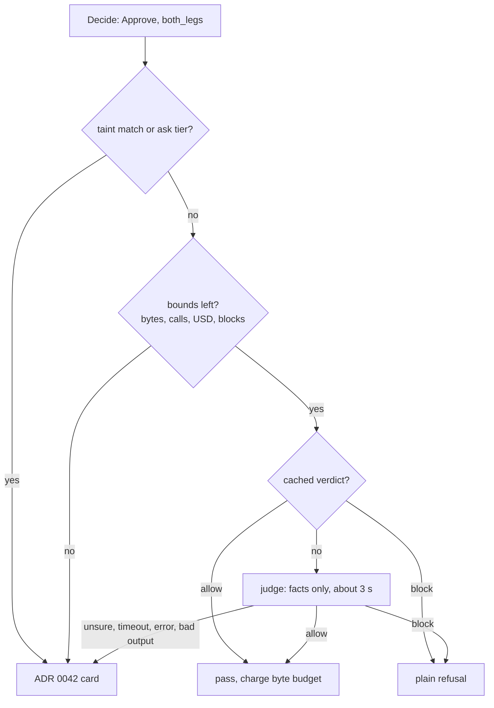

# 0092. Leak guard judge: rules, then a cheap judge model, then a person

- Status: Accepted (decisions by procoduck, 2026-11-03)
- Date: 2026-11-03
- Amends: [0091](0091-leak-guard-by-destination.md) (decision 5: the both-legs `external-high` approval becomes rules, judge, person; decision 8: the guarantee wording)
- Relates to: [0042](0042-ask-tier-park-and-execute.md) (approvals), [0084](0084-leak-guard.md) (the 5 s backstop, failClosed), [0068](0068-prompt-caching-always-on.md) (prompt caching), [0023](0023-observability-and-audit.md) (metrics and audit), [0041](0041-koinon-spend-ledger-and-budget-stops.md) and [0081](0081-run-limits.md) (the run's USD ledger), [0056](0056-model-providers-pricing-and-budgets-per-org.md) (providers and prices), [0072](0072-agent-model-run-now-echo-check.md) (calls Koinon makes itself)
- Issue: old issue 630, part of #51; built by #116; measured by #70

## Context

ADR 0091 decision 5 sends every `external-high` call of a session that holds both legs to a person,
as an ADR 0042 approval. Shipped templates never get there (old issue 351). Admin-built agents can, and for
them each such call is a click. procoduck, 2026-11-03: asking a person on every risky call is nannying.

Claude Code's auto mode solves the same problem in three tiers. Fixed rules let the obvious calls
through. A classifier model checks the rest. A person is asked only after 3 blocks in a row or 20 in
a session. Two facts about it matter here:

- **The classifier never sees what the agent read.** Tool results are stripped, and so is the
  agent's own text. Anthropic calls stripping tool results the primary prompt-injection defence of
  that layer. Its ablation found that adding tool results and agent text made the classifier worse.
- **It still misses.** On a Sonnet-class model it misses 17% of real over-eager actions and 5.7% of
  synthetic exfiltration, at 0.4% false alarms on real traffic. Anthropic says it is not a drop-in
  replacement for careful human review.

Others who ship a judge hide untrusted text from it too. Google's Chrome critic sees only metadata
about the proposed action. Meta's AlignmentCheck excludes tool outputs and still says it can be
targeted by prompt injection. None claims a guarantee.

Judges fall to adaptive attackers. Twelve published defences, four of them detector models, fell at
over 90% success for most ("The Attacker Moves Second"). Monitors rated injected output as less
suspicious than honest output when the injection sat in the output they reviewed (Terekhov et al.).
That is Koinon's case exactly: **the payload of an outgoing call is written by the agent after it
read untrusted input.** A judge that reads the payload can be talked round.

No design catches everything. So a judge may decide only where its mistakes stay **bounded** and
**visible**: it sees facts, not attacker text; what it allows has a byte budget; every verdict is
audited; and every failure falls back to a person, which is today's behaviour.

The research behind this ADR is kept by the maintainers (not in the repository); its primary sources
are under References.

## Decision

ADR 0091 decisions 1 to 4, 6, 7 and 9 stand. Decision 5 changes only in its both-legs
`external-high` cell. Decision 8 changes in its guarantee wording (decision 11 below).

### 1. Three tiers

1. **Rules** decide the clear cases: ADR 0091 as written.
2. **A judge model** (Haiku-class) decides the unclear ones: the scope of decision 2.
3. **A person** decides only when the judge is unsure, fails or runs out of a bound (decision 6).

### 2. Scope: one branch only

The judge runs **only** when `Decide` returns `Approve` with reason `both_legs` and **no `taint`
match**, on a call of an auto-tier tool. Everything else stays rules:

- `Pass` and `Refuse` never reach the judge. It cannot loosen a refusal (byte cap, URL rule, a check
  that could not finish) or add a step to a pass.
- A `taint` match stays a person's call, alone or with `both_legs`: the rules found private text in
  the payload.
- An ask-tier tool already gets its one ADR 0042 card (ADR 0091 decision 5); the judge does not run
  for it.

The judge can only turn that one approval into allow, block or a card. In PR old issue 628 the seam is in
`Guard.check`, between `Decide` and `ApproveFunc`; `Decide` stays pure. With no judge configured the
branch is an approval, as today.

### 3. What the judge sees

Structured facts only, each a typed field with a length bound. Code computes every fact; the agent
writes none of them.

- **Task text**: the task instruction **only when a person wrote it** in Koinon, or a shipped
  template did. A task a trigger started from an outside system (an issue body, an email) gives
  **none**, and the field says so. At most 4,000 characters; longer text is cut and marked cut.
- **Tool**: server name and tool name, from the admin's declaration.
- **Sink class**, and why it is `external-high` (public repository, foreign owner, unclassified tool).
- **Destination**: the normalised address arguments of ADR 0091 decision 3. The attacker can choose
  it, so it is bounded hard. A host is lower-case letters, digits, `.` and `-`, at most 253
  characters. An owner and a repository are letters, digits, `.`, `-` and `_`, at most 100
  characters each, with the repository's visibility. Any other address argument is not shown; only
  its declared name and its length are. A destination outside these limits does not go to the judge:
  the call gets the card.
- **Whether a person named the destination**: yes when the normalised destination appears in
  person-written task text. Code computes it; it is always no for a trigger-started task.
- **Payload size and kinds**: total bytes and, per payload argument, its declared name, its byte
  count and its kinds (plain text, contains URLs, base64-like, high-entropy). Counts and classes,
  never characters.
- **Which reads set the legs**: the server and tool names whose results set untrusted input and
  private data, with their data classes.
- **Run counters**: judge calls, allows and blocks so far in the run, blocks in a row, and the judge
  byte budget used and left.

### 4. What the judge never sees

The payload text, tool results, the agent's messages or reasoning, untrusted trigger text,
repository content, the source text of a taint fingerprint, and secrets.

### 5. Output

Forced structured output, temperature 0:

```json
{
  "verdict": "allow | block | unsure",
  "reason_code": "intent_match | intent_mismatch | destination_unexplained | payload_unexplained | data_kind_sensitive | insufficient_facts",
  "reason": "at most 200 characters"
}
```

Anything else is bad output: an unknown enum value, an extra field, a longer reason, refusal text.
The guard never asks the judge again for a better answer: resampling is the best-of-n attack.

### 6. What each answer does

- **allow**: the call passes. Its payload bytes count against the judge byte budget (decision 7).
- **block**: a **plain refusal** returned to the agent, with the reason and an instruction not to
  retry or route around it and to tell the person on the task what it needed.
- **unsure**: the ADR 0042 card for that call, with the judge's reason on it.

These all give the **ADR 0042 card**, so the worst case is today's behaviour, never a silent pass:

- unsure;
- a **timeout**: the judge gets about **3 s**, taken from what is left of ADR 0084's 5 s backstop
  for the decision, so a decision never takes longer than it does today;
- an error: transport, provider refusal, no model or no price configured;
- bad output;
- a spent bound of decision 7.

**Three blocks in a row or 20 in a run give a card.** The call that would be the third block in a
row, or the twentieth in the run, becomes a card that also lists the run's earlier blocked calls
(destination and reason code). After 20 blocks the judge stops for that run: every later call on
this branch gets the card. A person's answer on a card resets the count in a row.

### 7. Bounds

- **A judge byte budget per run** on the payload bytes the judge allows, counted as sent, with no
  decoding, like ADR 0091's byte cap. It is separate from the 2 KB `external-low` cap. Starting
  value **about 8 KB**, tuned from #70's data. A call that would go over it gets the card. This
  keeps a fooled judge's leak bounded whatever the encoding.
- **A cap on judge calls per run**, starting at 30. Past it, the card.
- **Money.** Each judge call is charged to the run's USD ledger (ADR 0041, 0081) as its own line,
  through agentgateway like the echo check of ADR 0072. A run whose USD left cannot cover a judge
  call gets the card. The judge model is an org setting, checked like the agent's model (served and
  priced); the default is the cheapest priced Haiku-class model on an allowed provider (decision 10).
- **Caching (ADR 0068).** The prompt is ordered static policy and schema, then the run block (task
  text), then the per-call facts, with cache breakpoints after the static and the run blocks. The
  static block must reach the model's minimum cacheable prompt or it never caches: 4,096 tokens on
  Haiku 4.5, 512 on Haiku 5.5. The model check warns when it does not.

### 8. A verdict cache per run

Key: tool (and its declaration hash), normalised destination, task intent (a hash of the task text,
or "none"), judge policy version, and judge model. Scope: **one run**, never across runs, tasks,
agents or orgs. Allows and blocks are cached; unsure is not.

- **A cached allow still charges the judge byte budget.** That is where one fooled verdict would turn
  into many sends.
- An entry does not apply when the payload facts move to another bucket: a different size class, a
  new kind, or a new read that set a leg.

### 9. Audit

A `guard_verdicts` audit record for every call that reaches the judge branch, keyed `(org_id, id)`:
run, task, tool, sink class, destination, the facts as sent (they hold no payload text by
construction), source (`judge`, `cache` or `person`), verdict, reason code, reason, judge model,
policy version, latency, tokens, USD and cache hit. When a person answers a card the judge sent
there, both answers are kept: that is the set for tuning the judge.

Metrics use fixed labels only (ADR 0023): verdict, reason code, sink class and source. Never org,
agent, user, task or run IDs.

### 10. Provider

The judge calls **a direct provider**, not a route that rewrites its input. In RT1, OpenRouter's PII
masking rewrote names to `[PERSON_NAME]`; that would rewrite destinations and task text, and the
judge would decide on something else. The judge model check refuses a route known to rewrite input.

### 11. ADR 0091 changes

**Decision 5.** The both-legs `external-high` cell reads: "rules, then the judge, then an ADR 0042
approval (ADR 0092)". The card, when it comes, still shows the destination and the full payload. A
both-legs call with a taint match stays an approval.

**Decision 8, guaranteed**, replaces the second item: once a session holds both legs, no free-text
body reaches a party outside the org unless a person approved that exact call, or the judge allowed
it within its byte budget for the run. Every judge allow is audited.

**Decision 8, not guaranteed**, adds: **leaks the judge allows.** A fooled judge sends up to its byte
budget per run, and a later run in the same generation gets its own budget.



## Alternatives considered

- **A judge that reads the payload or the transcript.** Easier, with better intent context.
  Rejected: the payload is the attacker's channel, and adaptive attacks on monitors are documented.
  Later it would need a redesign after users had learned to trust it.
- **No byte budget on what the judge allows.** Simpler. Rejected: one fooled verdict leaks without
  bound, which breaks ADR 0091's bounded-leak shape.
- **Fail open on a timeout or an error.** Fewer stuck runs. Rejected: it is a bypass. Make the judge
  slow or confused and everything passes.
- **Cache verdicts across tasks or agents.** Fewer judge calls. Rejected: one fooled verdict becomes
  a standing hole for every later task.
- **A person on every call** (ADR 0091 as written). Nothing to build. Rejected: the nannying, for
  every admin-built agent that holds both legs.
- **A generic injection detector** (Prompt Shields, PromptGuard) instead of a judge. No prompt to
  keep. Not chosen: they detect injection text, not whether this data should go there, and they fell
  at over 90% under adaptive attack.

## Consequences

- Positive: admin-built agents that hold both legs see a card only when the judge is unsure or a
  bound runs out.
- Positive: the worst case of every failure is today's card, and what the judge allows is bounded
  and audited.
- Negative: a fooled judge leaks up to its budget per run, without a person seeing it first.
- Negative: one more model call on the decision's clock and the run's bill, and one more provider
  that sees destinations and task text.
- Negative: the judge's prompt, schema and policy version become something to maintain and evaluate.

## Open risks

- **A fooled judge leaks up to its budget.** About 8 KB per run, and each run in a generation gets its
  own.
- **Trigger-started runs give the judge less to go on.** Their task text is withheld and "a person
  named the destination" is always no, so the judge is weakest exactly where agents are most
  autonomous. Expect more cards there.
- **Destinations are attacker-chosen.** The bounds of decision 3 limit what an attacker can say
  through a repository or host name; they do not stop a well-chosen name.
- **Haiku accuracy on this task is unmeasured.** Anthropic's own classifier runs on a Sonnet-class
  model and still misses 17% of real dangerous actions.
- **The provider sees destinations** and person-written task text.
- **Latency is unpublished.** Measure it before the 3 s timeout is final.

## Open questions

Numbers from #70's scrubbed recordings and a real-model evaluation outside CI
(`docs/dev/real-model-tests.md`); procoduck decides each:

- how often real runs reach this branch at all, which decides whether #116 is worth building;
- the judge byte budget (about 8 KB) and the call cap (30);
- the timeout (about 3 s);
- the judge model, by its false alarms and misses on the recordings plus planted attacks.

## CI

- A `Judge` interface with a **FakeJudge**, scripted by tool and destination, with modes for timeout,
  error, bad output, unsure and allow-everything. The allow-everything mode proves that the byte
  budget, the call cap and the block counts hold whatever the judge says.
- A **canary test** feeds canary strings into payloads, tool results and trigger text, and fails if
  one reaches the judge's request.
- The HTTP path is tested against the fake model server: bad JSON and slow answers give the card.
- CI never calls paid models.

## Follow-ups

- #116 builds the judge Decider: the interface, the fake, the bounds, the cache, the audit table, the
  org setting for the judge model and its check.
- #70 first measures how often real runs reach this branch and what payload sizes they send.

## Upstream verification

No upstream behaviour changes. The guard still runs behind agentgateway ExtMcp `mcpGuardrails`,
failClosed, inside the gateway's processor timeout (ADR 0084, ADR 0091).

## References

- Anthropic, "Claude Code auto mode" (engineering). https://www.anthropic.com/engineering/claude-code-auto-mode
- Claude Code, permission modes. https://code.claude.com/docs/en/permission-modes
- Anthropic, auto mode launch post. https://claude.com/blog/auto-mode
- Anthropic, pricing. https://platform.claude.com/docs/en/about-claude/pricing
- Anthropic, prompt caching (minimum cacheable length). https://platform.claude.com/docs/en/build-with-claude/prompt-caching
- Meta, "LlamaFirewall", arXiv 2505.03574. https://arxiv.org/abs/2505.03574
- Google, "Architecting security for agentic capabilities in Chrome", 2025-12-08. https://blog.google/security/architecting-security-for-agentic/
- OpenAI, Operator system card. https://cdn.openai.com/operator_system_card.pdf
- Microsoft, Prompt Shields. https://learn.microsoft.com/en-us/azure/ai-services/content-safety/concepts/jailbreak-detection
- Nasr, Carlini, Tramèr et al., "The Attacker Moves Second", arXiv 2510.09023. https://arxiv.org/abs/2510.09023
- Terekhov et al., "Adaptive Attacks on Trusted Monitors Subvert AI Control Protocols", ICLR 2026, arXiv 2510.09462. https://arxiv.org/abs/2510.09462
- Debenedetti et al., "Defeating Prompt Injections by Design" (CaMeL), arXiv 2503.18813. https://arxiv.org/abs/2503.18813
- Beurer-Kellner et al., "Design Patterns for Securing LLM Agents against Prompt Injections", arXiv 2506.08837. https://arxiv.org/html/2506.08837v3

## Links

- procoduck's decision, 2026-11-03: old issue 630
- Issues #51, old issue 349, old issue 351, #70, old issue 630, #116; PR old issue 628
- ADRs [0091](0091-leak-guard-by-destination.md), [0084](0084-leak-guard.md), [0042](0042-ask-tier-park-and-execute.md), [0068](0068-prompt-caching-always-on.md), [0023](0023-observability-and-audit.md), [0041](0041-koinon-spend-ledger-and-budget-stops.md), [0081](0081-run-limits.md), [0072](0072-agent-model-run-now-echo-check.md)
