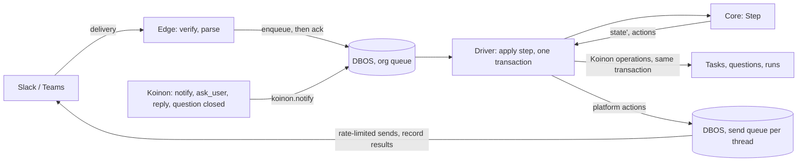

# 0127. Slack and Teams adapter as a pure event-to-actions core

- Status: Proposed (step 1 of #24: the maintainer reviews this ADR before any code)
- Date: 2026-11-26
- Area: connectors-tools
- Tags: connectors, eventing, triggers, secrets, testing
- Relates to: [0006](0006-identity-layers.md), [0007](0007-connector-model.md), [0010](0010-eventing.md),
  [0017](0017-board-and-chat-interaction-model.md), [0023](0023-observability-and-audit.md),
  [0024](0024-roadmap.md), [0055](0055-chat-as-its-own-object.md), [0065](0065-work-model-tasks-inbox.md),
  [0066](0066-triggers-and-scheduling.md), [0110](0110-held-copy-isolation.md)
- Design adapted from hydro-project/infinity (Apache-2.0): the split into a core without I/O, with platform events in
  and platform actions out, and a driver around it (Upstream verification).

## Context

Release v0.2 adds Slack and Teams ([0024](0024-roadmap.md), the v0.2 row). Accepted ADRs decide what the two
connectors do:

- Channel event triggers: a channel message that matches rules, or an @mention, starts or wakes a task
  ([0066](0066-triggers-and-scheduling.md) decision 3).
- Notifications and `ask_user` questions go to Slack and Teams with buttons. A person whose chat account is linked to
  their Koinon user answers there, with a button or with free text in the thread. Their Koinon role applies. A tap from
  an unlinked account is refused ([0065](0065-work-model-tasks-inbox.md) decisions 7 to 9).
- Only a person's chat message on a task can interrupt a running turn. Other input waits until the turn ends
  ([0066](0066-triggers-and-scheduling.md) decision 12).

[0017](0017-board-and-chat-interaction-model.md) proposed two-way mirroring of threads and tasks. It is superseded, and
its amendment says that two-way mirroring "was not decided again". This ADR does not decide it either (open question
8).

[0066](0066-triggers-and-scheduling.md) also decides the ingress:

- Webhooks are verified by signature: the Slack signing secret, the Teams JWT (decision 5).
- Slack Socket Mode is an outbound WebSocket (decision 6).
- Everything lands in DBOS for dedupe and retries (decision 8).
- The correlation key of a channel event is the thread (decision 9). Bursts in a short window become one wake-up
  (decision 10). Koinon acknowledges at once (decision 11).
- The DB3 amendment builds `durable.Once` and the table `dedupe_records`, with the source `slack` keyed on `event_id`.
  One `(source, key)` guards one effect kind. `durable.Commit` sends notifications only after the commit, through the
  `koinon.notify` workflow.

Both platforms put hard limits on the adapter:

- They expect an HTTP answer in a few seconds. Slack retries an event that it does not see acknowledged in time. So a
  slow handler causes duplicate deliveries.
- They limit how fast a bot can send. An over-limit call gets HTTP 429, usually with a `Retry-After` header in seconds.
- Message bodies are org content. Logs, metrics and errors must not carry them ([0023](0023-observability-and-audit.md)
  keeps run content under the org's retention and content level).
- Bot tokens, signing secrets and the Teams app credential are connection credentials. They must not reach a sandbox
  (AGENTS.md hard rule; [0006](0006-identity-layers.md)).

Adapter code that mixes the transport, the platform SDK and the decisions is hard to test without the platform. It
also spreads the retry, rate-limit and logging rules over many handlers. Two platforms double this cost.

## Decision

### 1. Three parts: edge, core, driver

The adapter has three parts. Only the core makes decisions.

| Part | Does | Does not |
| --- | --- | --- |
| **Edge** (one per platform and transport) | Receives the delivery (HTTP webhook or Socket Mode), verifies the signature, parses it into an `Event`, enqueues it in DBOS, acknowledges | Decide, call Koinon services, send to the platform |
| **Core** (one, for both platforms) | A pure function `Step(state, event, now) -> (state', actions)` | I/O of any kind |
| **Driver** (one per platform) | Runs the apply step (decision 4), runs the send workflows (decision 6), renders messages for the platform, applies rate limits | Decide what to do with an event |

The core package must not import network, database, DBOS, logging or platform SDK packages. A Go test of the import
graph enforces this. The core gets the time as the input `now`. It uses no random values. It returns actions in a
fixed order. So the same input gives the same output, and the core is unit-testable without the platform.

### 2. The core's types

The types are platform-neutral. A platform field appears only where the platforms differ.

- **`Key`**: `{platform, team, channel, thread}`. Decision 5 gives the values. The key is the channel-event
  correlation key of [0066](0066-triggers-and-scheduling.md) decision 9, made exact.
- **`Event`**: `key`, `connection` (and through it the org), `cause_id` (decision 4), `kind`, and the fields of the
  kind. The kinds come from two sides:
  - **Platform side**: `message`, `mention`, `choice` (a button tap), `message_changed`, `message_deleted`,
    `uninstalled`. Fields: `actor` (the platform user ID and a bot flag), `at` (the platform timestamp), `message_ts`
    (the platform ID of the message), `root_by_koinon` (the thread root is a message from Koinon's bot), `body` (a
    `Body` value, decision 9) and, for `choice`, the question ID and the choice ID that Koinon put in the button.
  - **Koinon side**: `notify` (a notification for a channel), `ask` (an `ask_user` question for a channel or a bound
    thread), `reply` (an agent message on a bound task), `question_closed` (a question was answered elsewhere,
    dismissed or expired). A `durable.Notifier` handler sends them after the commit that causes them, through the
    `koinon.notify` workflow of [0066](0066-triggers-and-scheduling.md) DB3.
  - **Timer**: `flush` (decision 4).
- **`State`**: a snapshot that the driver loads in the apply step. It has two parts:
  - **Read-only facts**: the connection's status and outward state; the org's channel event triggers in effect
    (`triggers.ForOrg`, [0066](0066-triggers-and-scheduling.md) TR1 read side) that name this connection; the actor's
    account link (a Koinon user or none); for the bound task, whether it is open, whether its agent is active, whether
    it has a running turn, and its open questions with their recipients.
  - **Thread state**, one row per key: the bound task (or none), the burst buffer and its flush time, the recent
    `message_ts` values that the core applied, the platform IDs of the messages Koinon sent to the thread (each with
    the action key that sent it), and the Teams conversation reference.
- **`Action`**: a closed set. Each action has an action key: its cause ID, its kind and its index in the output.
  - Koinon effects:
    - `CreateTask(agent, trigger, events)`: also binds the key to the new task (decision 5);
    - `WakeTask(task, events, interrupt)`: `interrupt` is true only for a message from a linked person, as
      [0066](0066-triggers-and-scheduling.md) decision 12 requires; the wake path keeps other input until the turn
      ends;
    - `AnswerQuestion(question, answer, user)`: from a `choice`, or from a free-text `message` (decision 5).
  - Platform effects: `Post`, `Update`, `React`, `SetStatus` (a typing or "working on it" status), `Ephemeral` (a
    short answer that only the actor sees, for example "your account is not linked" or "this question is closed").
  - Timers: `ScheduleFlush(key, at)`.
  - `Defer(until)`: apply this event again later (decision 5).
  - `Drop(reason)`: the core ignores the event. The reason is a fixed enum and becomes a metric label.

The core works with a neutral message model: text, and buttons with choice IDs. The driver renders it as Slack Block
Kit or as a Teams Adaptive Card. The core never builds platform JSON.

The core drops events from Koinon's own bot user and from other bots, unless a trigger allows bots. This is loop
prevention.

### 3. Enqueue, then acknowledge

The edge does these steps, in this order:

1. Verify the signature: the Slack signing secret with its timestamp window, or the Teams JWT. A delivery that fails
   gets HTTP 401. Koinon does not log its body.
2. Parse the delivery into an `Event`. Find the connection from the team and the app. An unknown team gets HTTP 200
   and a `Drop` metric, so that the platform does not retry it.
3. Enqueue one apply workflow on the org's queue (`durable.EnqueueForOrg`). The workflow ID is
   `chat:<platform>:<team>:<cause_id>`. So a platform retry maps to the same workflow.
4. Acknowledge: HTTP 200, or the Socket Mode envelope acknowledgement.

The edge does no other work before the acknowledgement: a connection lookup, the org's queue limits and one enqueue
write. This is what "acknowledge first" means in #24 and in [0066](0066-triggers-and-scheduling.md) decision 11: the
acknowledgement does not wait for any task work. The enqueue comes before the acknowledgement, because an event that is
acknowledged and then lost in a crash never comes back. If the enqueue fails, the edge answers with HTTP 5xx (or does
not acknowledge the envelope), and the platform delivers again.

A visible acknowledgement (a reaction or a status) is different. It is a core action, and the driver sends it after
the apply step. [0066](0066-triggers-and-scheduling.md) (LT1 amendment) gives this to the chat connector.

### 4. The apply step: idempotency, errors and order

Each event has one apply workflow with one **apply step**. The apply step is one DBOS step and one Postgres
transaction:

1. Create the thread row for the key if it does not exist, then lock it (`SELECT ... FOR UPDATE`). So events for one
   key are applied one at a time. Different keys run in parallel, within the org's queue limits.
2. If the row records the event's `cause_id` as applied, return the actions stored with it, and stop.
3. Load the read-only facts and call `Step`.
4. Run the Koinon effects in this transaction, each under its own savepoint.
5. Write the new thread state, the `cause_id` and the platform actions. Commit with `durable.Commit`, so the
   notifications that the effects return (for example a pre-wake) go out after the commit.
6. Enqueue the platform actions on the send queue (decision 6).

The actions in the step's result are the ones that run. A crash after the commit and before DBOS records the step runs
the step again. Step 2 then returns the stored actions, and `Step` does not run again on the new state. The
notifications of the first try are lost in this case. DB3 accepts this for pre-wakes. Applied cause IDs are removed
after the dedupe window.

- **Dedupe of effects.** Each Koinon effect is keyed by its action key with the source `slack` or `teams` (new).
  `CreateTask` passes the action key as `TriggeredTask.Source` and `Key`. `CreateTriggeredTask` already calls
  `durable.Once` with them, so the driver does not wrap it in a second `Once`. The wake and answer effects call
  `durable.Once` with the action key. Today `services.CreateTriggeredTask` opens its own transaction. The first code
  issue lets it, and the wake and answer paths, run in the caller's transaction, as `durable.Once` does.
- **Expected outcomes are not errors.** A Koinon effect can end in an expected outcome: the agent is inactive
  (`services.ErrAgentInactive`, "drop, do not retry" in DB3), the question is not open (`questions.ErrNotOpen`), the
  user may not answer (`questions.ErrNotAskedTo` or the role check). The core reads these facts first and returns
  `Drop` or `Ephemeral` without the effect. If an effect still returns one of them (a race), the driver rolls back to
  the savepoint, records `Drop(reason)` for that action, and commits the cause ID and the new state. Only an
  unexpected error rolls back the transaction, and the DBOS step retries it.
- **Lock order.** The apply step locks the thread row first, then the Koinon operations take their own locks (the run,
  then the question, as `questions.resolve` documents). No other path locks a thread row while it holds a task, run or
  question lock. The task end does not write the thread row: the core reads "the bound task is closed" as a fact and
  treats the key as unbound. Koinon-side events reach the thread row only through the apply step.
- **Cause IDs.**
  - Slack Events API (HTTP and Socket Mode): the `event_id`. The Socket Mode `envelope_id` is only for the
    acknowledgement.
  - Slack interactivity (a button tap), which has no `event_id`: the container message `ts`, the `action_ts` and the
    user ID.
  - Teams: the conversation ID and the activity `id`. The activity ID alone may not be unique across conversations.
  - Koinon side: the notification ID, the question ID with the event kind (`ask` or `question_closed`), the agent
    message ID.
  - Flush: `flush:<key>:<flush time in Unix seconds>`.

  The first code issue for each platform checks these against the platform documentation.
- **Bursts.** The core puts `message` events for a key in the burst buffer. It returns `ScheduleFlush` only when no
  flush is pending for the key, so one burst has one timer. At the flush time a `flush` event arrives. If its time is
  not the pending flush time, the core returns `Drop(stale_flush)`. Otherwise the core returns one `CreateTask` or
  `WakeTask` with all buffered events, in platform-timestamp order, and clears the buffer. An `@mention`, a `choice` or
  an answer does not wait: the core puts the buffered events and the new event in one effect, in timestamp order, and
  clears the buffer and the pending flush. The window is per org (open question 2).
- **One message, two events.** Slack can send `app_mention` and `message` for one message, with two `event_id`
  values. The core keeps the recent `message_ts` values in the thread state and applies a message only once.

### 5. Keys and the thread binding

| Field | Slack | Teams |
| --- | --- | --- |
| `team` | `team_id` of the workspace (the `enterprise_id` too, for an org-wide Enterprise Grid install) | the Microsoft Entra tenant ID |
| `channel` | the channel ID | the channel conversation ID, without the `;messageid=` part |
| `thread` | `thread_ts`, or the message `ts` for a top-level message | the ID of the root message of the reply chain |

The key holds platform IDs only, never names or text. Logs can hold it. Metric labels must not hold it
([0023](0023-observability-and-audit.md) label rule).

- **A thread that a person starts.** `CreateTask` binds the key to the task in the transaction that creates the task
  (`TriggeredTask.OnCreate`). A unique constraint allows one open binding per key. Two mentions in a new thread are
  applied one after the other (decision 4), so the second one sees the binding and wakes the task.
- **A thread that Koinon starts** (a `notify` or `ask` event for a channel). The key exists only after the post
  returns its `ts` or ID. The send step records the result in a short transaction right after the platform call: it
  creates the thread row, binds the key to the task and stores the message ID with its action key. A second record for
  the same action key changes nothing.
- **A reply before the record.** A person can reply in the gap between the post and the record. The event then has
  `root_by_koinon` set, and the key is not bound yet. The core returns `Defer` for a short time instead of following the
  triggers. After a fixed number of tries it returns `Drop(unbound_koinon_thread)`. If a crash makes the send step post
  twice, the first post is never recorded, and replies to it end in this drop. This is rare and visible in the metric.
- **Every post records its result**, also a reply in a bound thread. So a later `Update` (for example, to remove the
  buttons of an answered question) finds the message ID.
- **The end of a task.** The core treats the binding of a closed task as no binding. The next event for the key
  follows the triggers again and replaces the binding.
- **Free-text answers.** A `message` from a linked person counts as the answer when the bound task has exactly one open
  question that was posted in this thread and the person is a recipient of it with a role that may answer
  ([0065](0065-work-model-tasks-inbox.md) decision 9). Every other message wakes the task.
- **A question closed elsewhere.** A `question_closed` event makes the core `Update` the question's message: the
  buttons go, and the message says how the question ended. A tap that arrives later gets an `Ephemeral` answer.

### 6. Sends: batches, 429 and `Retry-After`

Rate limits live in the driver. The core only states what to send.

- **Queues.** The apply step enqueues the platform actions as one send workflow on a send queue, partitioned by the
  thread key with a concurrency of one. So sends for one thread keep their order, and a sleeping send holds a slot on
  the send queue only, never on the org queue that the apply steps use. The flush timer is its own delayed workflow,
  started outside the org queue. When it fires, it enqueues the `flush` apply workflow.
- **Coalesce.** In one send workflow, the driver joins consecutive `Post` actions for one thread into one message when
  the result is under the platform's size limit. Status changes for one thread go out at most once per interval.
- **Proactive limits.** The driver keeps token buckets sized from the platform's published limits: per connection and
  method for Slack, per conversation for Teams.
- **On 429.** The driver reads `Retry-After` and stores "paused until" in Postgres for the scope of that limit (the
  bucket that the call used), so every replica obeys it. It waits with a durable DBOS sleep, not a goroutine sleep, and
  then runs the step again. It never sends to that scope before the time has passed. Without a `Retry-After` header, it
  uses exponential backoff with jitter. The first code issue for each platform confirms the scopes.
- **On 5xx and network errors.** Exponential backoff with jitter.
- **Give up.** After a fixed number of attempts, the action fails. The driver records a metric and shows the failure
  on the connection's status, for the org admin. A failed `ask` post does not change the question: the inbox still has
  it ([0065](0065-work-model-tasks-inbox.md)).

### 7. Secrets

- The bot token, the signing secret and the Teams app credential are connection credentials of the `app-credential`
  auth type ([0006](0006-identity-layers.md), [0007](0007-connector-model.md)), stored in the secret store. Only the
  edge and the driver read them, in `koinon-api`.
- No chat credential goes into a sandbox. An agent reaches Slack or Teams only through Koinon: notifications,
  `ask_user` and its own task's replies. It never gets a chat token.
- The driver calls only hosts on a fixed list per platform. Teams gives a `serviceUrl` in each activity. The driver
  refuses a `serviceUrl` that is not on the list, so a forged activity cannot make Koinon call another host.

### 8. The outward switch

- A Slack or Teams connection is a row of the `connections` table ([0007](0007-connector-model.md)). The outward kind
  `connection` ([0110](0110-held-copy-isolation.md), `internal/outward`) already covers that table, so it covers chat
  connections too. The code issue renames the Go constant `CodeHostConnection` to a name that is not limited to code
  hosts, and updates the comment on the kinds.
- When an admin disables the connection, or the install is held after a restore, the core returns
  `Drop(outward_disabled)` for every inbound event: no task is created or woken. The edge still acknowledges, so the
  platform does not retry.
- Each send step checks the outward state again at send time, not only in the apply step's snapshot. A disabled
  target gets no call.

### 9. Message bodies are never logged

- `Body` is a type, not a string. Its `String`, `GoString`, `slog.LogValuer` and JSON output give only
  `[redacted, N bytes]`. Code that must read the text calls one method (`Text()`). A lint rule allows that call only
  in the core, in the code that writes task messages and in the platform renderers.
- The core has no logger. The edge and the driver log the connection ID, the key, the event kind, the outcome and the
  platform error code. They never log text, blocks, cards, file names, display names or a platform error message that
  echoes the request.
- Metrics use fixed label sets only: platform, event kind, action kind, outcome, drop reason
  ([0023](0023-observability-and-audit.md)).
- A leak test sends a canary body through the edge, the core and the driver with a capturing logger, a metrics
  registry and a trace exporter. It fails if the canary appears in any of them.
- Bodies are stored in these places, and each one is bounded:
  - the task message, under the org's run-content retention ([0023](0023-observability-and-audit.md));
  - the burst buffer in the thread row, until the flush clears it; the run-content purge also clears it;
  - the apply workflow input of the event and the send workflow input of a post (open question 5).

### 10. Tests

- The core: table tests of event sequences and their expected actions; property tests for determinism and for order
  (the same buffered events in any arrival order give one wake-up in timestamp order; a mention after buffered
  messages keeps their order; `app_mention` and `message` for one message apply once).
- The apply step: a replay after a crash between the commit and the checkpoint gives the same actions and no second
  effect; two concurrent mentions in a new thread give one task; an inactive agent at flush time and a tap on a closed
  question end in a `Drop`, not in a retry loop; a reply before the post is recorded is deferred, then bound.
- The edge: recorded deliveries, including bad signatures and retries.
- The driver: a fake Slack and a fake Teams server in the test process, which return 429 with `Retry-After`, 5xx and
  slow answers. A 429 on one thread does not delay the apply steps. No test calls the real platforms, as no test calls
  a paid model.

## Alternatives considered

- **Logic in the platform SDK handlers** (slack-go event handlers, the Bot Framework activity handler)
  _(reconstructed)_. This is cheaper now: fewer types, and the SDK examples apply. The cost comes later: tests need the
  platform or large mocks, Slack and Teams get two copies of each rule, and every handler must remember the retry,
  rate-limit and no-body-log rules. Rejected.
- **Work before the acknowledgement** _(reconstructed)_. The handler does the task work and then answers. This is
  simpler, but a slow database or a slow start misses the platform deadline. The platform then retries, and the
  duplicates need more dedupe. Rejected: the acknowledgement must not depend on Koinon's load.
- **Acknowledge before the enqueue** _(reconstructed)_. This answers a few milliseconds sooner, but a crash after the
  answer loses the event, and the platform does not deliver it again. Rejected.
- **Optimistic versioning of the thread row, without a lock** _(reconstructed)_. It avoids a row lock, but a retry
  after a conflict runs `Step` on a new state, and the effects of the first try must then be found and undone.
  Rejected: the row lock is short, because the apply step does no platform I/O.
- **Effects in their own transactions after the state write** _(reconstructed)_. This keeps the thread row lock
  shorter, but a crash between the two leaves a state that names a task that does not exist, or the reverse. Rejected.
- **Infinity's runtime as it is** _(reconstructed)_. Infinity builds its Slack core as a Hydro dataflow in Rust.
  Koinon is Go and already has DBOS for durability. Rejected: we take the shape (no-I/O core, events in, actions out),
  not the runtime.
- **A separate chat gateway process** _(reconstructed)_. It isolates the chat traffic, but
  [0066](0066-triggers-and-scheduling.md) runs DBOS workers in `koinon-api` only, and a second process needs its own
  credential access. Rejected for now: the edge and the driver stay in `koinon-api`. The pure core keeps a later move
  cheap.
- **A hosted chat bridge or a third-party relay** _(reconstructed)_. Rejected: the chat credentials and the bodies
  would leave the install.
- **Rate limits in the core** _(reconstructed)_. The core would need the clock and the platform's answers as state,
  and every limit change would touch the decision code. Rejected: limits are transport facts, so they stay in the
  driver.

## Consequences

- Positive: the decisions for both platforms are in one pure function with fast unit tests. Slack and Teams share
  them.
- Positive: the acknowledgement does not depend on Koinon's load, so slow work does not cause platform retries.
- Positive: retries, rate limits, secret access and the no-body-log rule are each in one place.
- Negative: there are more types (event, state, action, a renderer per platform) and two queues (apply and send) than
  in a handler-based adapter.
- Negative: Koinon's task, wake and answer operations must accept the caller's transaction and report expected
  outcomes as values. _(inferred)_
- Negative: posts are at-least-once. A crash at the wrong time can post a message twice, and replies to the unrecorded
  copy are dropped. _(inferred)_
- Negative: the DBOS system tables hold message bodies in workflow inputs until DBOS removes the workflow records.
  _(inferred)_
- Follow-ups: the code goes in issues filed after the review of this ADR. Proposed split: (1) the core types and
  `Step`, with the import-graph test; (2) the apply step, the thread table and the caller's transaction for the task
  operations; (3) the Koinon-side events through `koinon.notify`; (4) the Slack edge (Events API, interactivity and
  Socket Mode); (5) the Slack driver with the send queue, rate limits and the fake Slack server; (6) the Teams edge
  and driver; (7) account linking ([0065](0065-work-model-tasks-inbox.md) decision 9); (8) the body leak test.
- Follow-ups: when this ADR is accepted, [0066](0066-triggers-and-scheduling.md) gets an "Amended by" line for the
  exact channel-event key (decision 9), the `teams` dedupe source and the synthetic cause IDs (`flush:`, Slack
  interactivity) under the `slack` source (DB3 list; also the comment in `internal/durable/dedupe.go`).

## Open questions

Each question gets a tracking issue with the code issues, after the review of this ADR.

1. **Names.** The glossary keeps "Chat" for a planned object ([0055](0055-chat-as-its-own-object.md)). Proposed
   package: `internal/chatadapter`, with the core in `internal/chatadapter/core`. The maintainer decides the name.
2. **Burst window.** Proposed default: 2 seconds, per org. The value is not decided.
3. **One workspace, more than one org.** Can two Koinon orgs connect the same Slack workspace or Teams tenant? If not,
   `(platform, team)` is unique across connections and routing is simple. If yes, the edge needs a second routing rule
   (for example by channel).
4. **Socket Mode with more than one API replica.** Each replica can open its own connection, or one replica holds a
   lease. The DBOS workflow ID makes duplicates harmless, but each connection costs a platform session.
5. **Bodies in DBOS inputs.** Option A: keep the bodies in the workflow inputs and remove chat workflow records after
   the dedupe window. Option B: write the body to a Koinon table first and put only a reference in the input. Option B
   keeps all bodies under one retention rule. It costs one more write before the acknowledgement.
6. **Teams API.** The Bot Framework connector or Microsoft Graph for channel messages. This ADR assumes the Bot
   Framework (activities with `serviceUrl`).
7. **Limits not decided:** the give-up limit and the status interval of decision 6, and the `Defer` time and tries of
   decision 5.
8. **Two-way mirroring.** Should Koinon post every task message to a bound thread, or only notifications, questions
   and the agent's replies? This ADR builds the second. The first needs a decision on loop prevention for edits.
9. **The `channel_event` trigger filter.** Its shape (connection, channels, rules, @mention only, bots allowed) is not
   decided. TR1 refuses `channel` until chat connectors exist.

## Upstream verification

- 2026-11-26: hydro-project/infinity, `main` branch. The workspace `Cargo.toml` lists `crates/infinity-slack-dataflow`
  and `crates/infinity-slack-bot`, both `license = "Apache-2.0"`. The `infinity-slack-dataflow` crate documentation
  says it "contains no I/O: Slack events and daemon events flow in as streams, Slack actions and daemon commands flow
  out". Its `SlackEvent` has `channel` and `thread_ts`, its `SlackAction` enum has `PostMessage`, `PostBlocks`,
  `UpdateMessage`, `SetStatus` and stream actions, and its tests drop bot and unauthorized messages. This ADR takes the
  shape and adds the team to the key, for multi-tenancy. It copies no code.
- Daytona: this ADR uses no idea from it. Daytona's servers are AGPL-3.0; nothing is copied from them.
- Not checked: the Slack documentation (the acknowledgement deadline, retries, rate-limit tiers, `Retry-After`,
  `app_mention` with `message`, the interactivity payload) and the Microsoft Teams documentation (the Bot Framework
  JWT, `serviceUrl`, activity IDs, rate limits). Their hosts were not reachable from the session that wrote this ADR.
  The first code issue for each platform checks them and records the numbers here.

## Links

- Issue #24 (this ADR is its step 1).
- hydro-project/infinity, crate `infinity-slack-dataflow` (Apache-2.0): design adapted from hydro-project/infinity.
- ADRs [0006](0006-identity-layers.md), [0007](0007-connector-model.md), [0010](0010-eventing.md),
  [0017](0017-board-and-chat-interaction-model.md), [0023](0023-observability-and-audit.md),
  [0024](0024-roadmap.md), [0055](0055-chat-as-its-own-object.md), [0065](0065-work-model-tasks-inbox.md),
  [0066](0066-triggers-and-scheduling.md), [0110](0110-held-copy-isolation.md).
