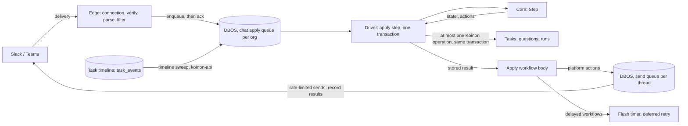

# 0127. Slack and Teams adapter as a pure event-to-actions core

- Status: Proposed (step 1 of #24: the maintainer reviews this ADR before any code)
- Date: 2026-11-26
- Area: connectors-tools
- Tags: connectors, eventing, triggers, secrets, testing
- Relates to: [0006](0006-identity-layers.md), [0007](0007-connector-model.md), [0010](0010-eventing.md),
  [0017](0017-board-and-chat-interaction-model.md), [0023](0023-observability-and-audit.md),
  [0024](0024-roadmap.md), [0055](0055-chat-as-its-own-object.md), [0065](0065-work-model-tasks-inbox.md),
  [0066](0066-triggers-and-scheduling.md), [0110](0110-held-copy-isolation.md)
- Design adapted from hydro-project/infinity (Apache-2.0): the split into a core without I/O, with platform events in
  and platform actions out, and a driver around it (Upstream verification).

## Context

Release v0.2 adds Slack and Teams ([0024](0024-roadmap.md), the v0.2 row). Accepted ADRs decide what the two
connectors do:

- Channel event triggers: a channel message that matches rules, or an @mention, starts or wakes a task
  ([0066](0066-triggers-and-scheduling.md) decision 3).
- Notifications and `ask_user` questions go to Slack and Teams with buttons. A person whose chat account is linked to
  their Koinon user answers there, with a button or with free text in the thread. Their Koinon role applies. A tap from
  an unlinked account is refused ([0065](0065-work-model-tasks-inbox.md) decisions 7 to 9).
- Only a person's chat message on a task can interrupt a running turn. Other input waits until the turn ends
  ([0066](0066-triggers-and-scheduling.md) decision 12).

[0017](0017-board-and-chat-interaction-model.md) proposed two-way mirroring of threads and tasks. It is superseded, and
its amendment says that two-way mirroring "was not decided again". This ADR does not decide it either (open question
8).

[0066](0066-triggers-and-scheduling.md) also decides the ingress:

- Webhooks are verified by signature: the Slack signing secret, the Teams JWT (decision 5).
- Slack Socket Mode is an outbound WebSocket (decision 6).
- Everything lands in DBOS for dedupe and retries (decision 8).
- The correlation key of a channel event is the thread (decision 9). Bursts in a short window become one wake-up
  (decision 10). Koinon acknowledges at once (decision 11).
- The DB3 amendment builds `durable.Once` and the table `dedupe_records`, with the source `slack` keyed on `event_id`.
  One `(source, key)` guards one effect kind. `durable.Commit` sends notifications only after the commit, through the
  `koinon.notify` workflow.

Both platforms put hard limits on the adapter:

- They expect an HTTP answer in a few seconds. Slack retries an event that it does not see acknowledged in time. So a
  slow handler causes duplicate deliveries.
- They limit how fast a bot can send. An over-limit call gets HTTP 429, usually with a `Retry-After` header in seconds.
- Message bodies are org content. Logs, metrics and errors must not carry them ([0023](0023-observability-and-audit.md)
  keeps run content under the org's retention and content level).
- Bot tokens, signing secrets and the Teams app credential are connection credentials. They must not reach a sandbox
  (AGENTS.md hard rule; [0006](0006-identity-layers.md)).

Adapter code that mixes the transport, the platform SDK and the decisions is hard to test without the platform. It
also spreads the retry, rate-limit and logging rules over many handlers. Two platforms double this cost.

## Decision

### 1. Three parts: edge, core, driver

The adapter has three parts. Only the core makes decisions.

| Part | Does | Does not |
| --- | --- | --- |
| **Edge** (one per platform and transport) | Receives the delivery (HTTP webhook or Socket Mode), finds the connection, verifies the signature, parses the delivery into an `Event`, filters it on facts, enqueues it in DBOS, acknowledges | Decide, change Koinon state, send to the platform |
| **Core** (one, for both platforms) | A pure function `Step(state, event, now) -> (state', actions)` | I/O of any kind |
| **Driver** (one per platform) | Runs the apply step (decision 4), the timeline sweep (decision 2), the send workflows (decision 6) and the timers; renders messages for the platform; applies rate limits | Decide what to do with an event |

The core package must not import network, database, DBOS, logging or platform SDK packages. A Go test of the import
graph enforces this. The core gets the time as the input `now`. It uses no random values. It returns actions in a
fixed order. So the same input gives the same output, and the core is unit-testable without the platform.

### 2. The core's types

The types are platform-neutral. A platform field appears only where the platforms differ.

- **`Key`**: `{platform, team, channel, thread}`. Decision 5 gives the values. The key is the channel-event
  correlation key of [0066](0066-triggers-and-scheduling.md) decision 9, made exact.
- **`Scope`**: the unit that the apply step locks (decision 4). It is a thread key, a channel (`thread` empty) or a
  connection (`channel` and `thread` empty). Each event has exactly one scope.
- **`Event`**: `scope`, `connection` (and through it the org), `cause_id` (decision 4), `attempt` (decision 5), `kind`
  and the fields of the kind. The kinds come from three sources:
  - **Platform side**: `message`, `mention`, `choice` (a button tap), `message_changed` and `message_deleted` (thread
    scope); `uninstalled` (connection scope). Fields: `actor` (the platform user ID and a bot flag), `at` (the
    platform timestamp), `message_ts` (the platform ID of the message), `root_by_koinon` (the thread root is a message
    from Koinon's bot), `body` (a `Body` value, decision 9) and, for `choice`, the question ID and the choice ID that
    Koinon put in the button.
  - **Koinon side: the task timeline.** The task timeline (`task_events`) is the outbox. Koinon does not need a new
    notifier for chat. The kinds are: `reply` (an agent `message` event), `ask` (`question.asked`), `question_closed`
    (`question.answered`, `question.dismissed`, `question.expired`, `question.canceled`) and `task_ended` (a
    `status.changed` event to an end state). Decision 4 tells how they arrive. The scope is the task's bound key
    (decision 5). For a task without a bound key and with a chat notify target (the `channel` value of
    `notify_target_kind`, from migration 00036), the scope is the target channel. An `ask` for a question addressed to
    a channel (`questions.target_channel_id`) has the scope of that channel.
  - **Timer**: `flush` (thread scope, decision 4).
- **`State`**: a snapshot that the driver loads in the apply step. It has two parts:
  - **Read-only facts**: the connection's status and outward state; the org's channel event triggers in effect
    (`triggers.ForOrg`, [0066](0066-triggers-and-scheduling.md) TR1 read side) that name this connection; the actor's
    account link (a Koinon user or none); for the bound task, its state, whether its agent is active, whether it has a
    running turn, and its open questions with their recipients and roles. The facts are read without locks. The
    Koinon operation checks them again under its own locks (decision 4).
  - **Scope state**, one row per scope: the bound task (or none), the burst buffer and its flush time, the recent
    `message_ts` values that the core applied, the platform IDs of the messages Koinon sent to the thread (each with
    the action key that sent it), the Teams conversation reference, and the timeline cursor of each task that the scope
    serves (decision 4).
- **`Action`**: a closed set. Each action has an action key: its cause ID, its kind and its index in the output.
  - Koinon operations. `Step` returns **at most one** of them for one event (decision 4, lock order):
    - `CreateTask(agent, trigger, origin, events)`: also binds the key to the new task (decision 5);
    - `WakeTask(task, events, interrupt)`: adds the events to the task's timeline and wakes it. `interrupt` is true
      only for a message from a linked person, as [0066](0066-triggers-and-scheduling.md) decision 12 requires. The
      interrupt of a running turn does not exist on `main` today: no task or wake path takes an `interrupt` input. The
      first code issue for the apply step adds it, as new work. Until then, `WakeTask` queues the input for the end of
      the turn, as the direct-message path does;
    - `AnswerQuestion(question, answer, user)`: from a `choice`, or from a free-text `message` (decision 5).
  - Platform effects: `Post`, `Update`, `React`, `SetStatus` (a typing or "working on it" status), `Ephemeral` (a
    short answer that only the actor sees, for example "your account is not linked" or "this question is closed").
  - Timers: `ScheduleFlush(scope, at)`.
  - `Defer`: apply this event again later (decision 5).
  - `Drop(reason)`: the core ignores the event. The reason is a fixed enum and becomes a metric label.

The core works with a neutral message model: text, and buttons with choice IDs. The driver renders it as Slack Block
Kit or as a Teams Adaptive Card. The core never builds platform JSON.

The core drops events from Koinon's own bot user and from other bots, unless a trigger allows bots. This is loop
prevention.

**Actors on the timeline.** A task event with the actor kind `user` must name a Koinon user (the check on
`task_events`, migration 00003). So a message from a linked person is a `user` event with the linked user. A message
from an unlinked person, which a channel event trigger can accept ([0066](0066-triggers-and-scheduling.md) decision
3), is a `system` event. Its payload holds the platform and the platform user ID, never a display name. The first code
issue confirms that the agent's prompt shows such a message as a message from a person (open question 10).

**Origin.** `CreateTask` sets the run origin. A mention, and a message from a linked person, give
`RunOriginInteractive`: a person waits in the thread. A burst that a channel rule matches gives `RunOriginScheduled`.
`CreateTriggeredTask` uses `RunOriginScheduled` when the origin is not given, so the driver always gives it.

### 3. Enqueue, then acknowledge

The edge does these steps, in this order:

1. Find the connection. An HTTP delivery arrives on the path of its connection
   ([0066](0066-triggers-and-scheduling.md) decision 5: webhooks arrive on their own listener and path, per
   connection). A Socket Mode delivery arrives on the socket of its connection. An unknown path gets HTTP 404.
2. Verify the signature with that connection's credential: the Slack signing secret with its timestamp window, or the
   Teams JWT. A delivery that fails gets HTTP 401. Koinon does not log its body. A team in the payload that is not the
   connection's team gets HTTP 200 and `Drop(wrong_team)`, so that the platform does not retry it.
3. Parse the delivery into an `Event`.
4. **Filter on facts.** The edge drops an event at once (HTTP 200, a `Drop` metric) when it can have no effect: a
   message from a bot when no trigger of the connection allows bots, and a `message` in a channel that no channel
   event trigger names and in a thread that has no scope row. The filter uses one indexed read and no cache. It reads
   facts only. It never selects an action; the core does that. A wrong pass costs one apply step. The filter must not
   drop an event that the core can act on, so a filter rule needs a core test that shows the core drops the same
   event.
5. Enqueue one apply workflow on the org's partition of the **chat apply queue** (decision 4). The workflow ID is
   `chat:<platform>:<team>:<cause_id>:<attempt>`, with attempt 0. So a platform retry maps to the same workflow.
6. Acknowledge: HTTP 200, or the Socket Mode envelope acknowledgement.

The edge does no other work before the acknowledgement: a connection lookup, the filter read and one enqueue write.
This is what "acknowledge first" means in #24 and in [0066](0066-triggers-and-scheduling.md) decision 11: the
acknowledgement does not wait for any task work. The enqueue comes before the acknowledgement, because an event that is
acknowledged and then lost in a crash never comes back. If the enqueue fails, the edge answers with HTTP 5xx (or does
not acknowledge the envelope), and the platform delivers again.

A visible acknowledgement (a reaction or a status) is different. It is a core action, and the driver sends it after
the apply step. [0066](0066-triggers-and-scheduling.md) (LT1 amendment) gives this to the chat connector.

### 4. The apply step: idempotency, errors and order

**The chat apply queue.** Apply workflows run on a queue of their own, `koinon.chat-apply`, partitioned by org like
`koinon.org-work` (`internal/durable/orgqueue.go`). They do not use `koinon.org-work`. That queue has a concurrency of
4 and 60 starts per minute per org, and it carries direct messages, schedules, webhooks and poll events. A busy Slack
channel on it would delay that work. The chat apply queue has its own limits per org (open question 7). The send
queue, the flush timers and the deferred retries are outside both queues (decision 6).

Each event has one apply workflow. The workflow has one **apply step**, then the **workflow body** acts on the step's
result.

The apply step is one DBOS step and one Postgres transaction:

1. Create the scope row if it does not exist, then lock it (`SELECT ... FOR UPDATE`). So events for one scope are
   applied one at a time. Different scopes run in parallel, within the queue limits.
2. Look up `(connection, cause_id)` in the table of applied causes. If the cause is applied, return the stored result,
   and stop. If the cause is deferred with an attempt that is not lower than the event's `attempt`, return the stored
   result, and stop. The table is keyed by connection and cause, not by scope, so an event with a channel or
   connection scope has a place for its cause too.
3. Load the read-only facts and call `Step`.
4. Run the Koinon operation, if there is one, under a savepoint (see "Expected outcomes").
5. Write the new scope state and the result: the platform actions, the timers and the `Defer` or `Drop`. Record the
   cause as applied, or as deferred with its attempt. Commit with `durable.Commit`, so the notifications that the
   operation returns (for example a pre-wake) go out after the commit. The apply step runs in `koinon-api`, which has
   the notifier.

The workflow body then reads the step's result. It does not matter if the result is new or a stored result from step
2:

6. Enqueue the platform actions as one send workflow (decision 6). Start the flush timer workflow for a
   `ScheduleFlush`. Start the deferred retry workflow for a `Defer` (decision 5). Each of these has a workflow ID that
   comes from the cause and the action key, so a replay of the body starts nothing twice.

A crash after the commit and before DBOS records the step runs the step again. Step 2 then returns the stored result,
and `Step` does not run again on the new state. The body runs step 6 from that result. The notifications of the first
try are lost in this case. DB3 accepts this for pre-wakes. Applied causes, and the results stored with them, are
removed after the dedupe window.

- **Dedupe of operations.** Each Koinon operation is keyed by its action key with the source `slack` or `teams`
  (new). `CreateTask` passes the action key as `TriggeredTask.Source` and `Key`. `CreateTriggeredTask` already calls
  `durable.Once` with them (`internal/services/notify.go`), so the driver does not wrap it in a second `Once`. The wake
  and answer operations call `durable.Once` with the action key. Today `services.CreateTriggeredTask` opens its own
  transaction. The direct-message path already has a form that runs in the caller's transaction
  (`deliverDirectMessage` takes the caller's queries). The first code issue gives the same form to the task creation,
  the wake and the answer operations.
- **Expected outcomes are not errors.** An operation can end in an expected outcome: the agent is inactive
  (`services.ErrAgentInactive`, "drop, do not retry" in DB3), the question is not open (`questions.ErrNotOpen`), the
  user may not answer (`questions.ErrNotAskedTo` or the role check). The core reads these facts first and returns
  `Drop` or `Ephemeral` without the operation. A race can still give one of them. So the driver opens the savepoint
  **before** the `durable.Once` claim, because `durable.Once` takes no savepoint itself
  (`internal/durable/dedupe.go`). On an expected outcome, the driver rolls back to the savepoint. This removes the
  claim and the partial writes together. The driver records `Drop(reason)` in the result and commits the cause and
  the new state. Only an unexpected error rolls back the transaction, and the DBOS step retries it.
- **Lock order.** The scope row is a new lock. Only the apply step, the timeline sweep's enqueue (no lock) and the
  send record (decision 5) touch scope rows, and they take no other lock first. The apply step takes the scope row
  first and then calls **at most one** existing Koinon operation. That operation takes its own locks in its own
  documented order: the wake path takes the task row (as `deliverDirectMessage` does, `runlock.LockTask` rules); the
  answer path takes the run, then the question (as `questions.resolve` documents); the task creation takes no
  existing row lock. So the apply step adds no new order between two existing locks, and no existing path can wait
  for a scope row. This is why `Step` returns at most one Koinon operation for one event. A burst and a mention go
  into one `WakeTask` or one `CreateTask`. A free-text answer is one `AnswerQuestion`, and the message is not also a
  wake. The core reads "the task has ended" as a fact. The task end does not write the scope row.
- **Bounded retries.** The apply step has a fixed retry limit in DBOS. When the limit is reached, the workflow body
  records the cause as applied with the result `Drop(apply_failed)` in a short transaction, and a metric counts it.
  For a `flush`, this transaction also clears the pending flush time, so the next `message` for the scope schedules a
  new flush. The buffered events stay in the buffer.
- **Cause IDs.**
  - Slack Events API (HTTP and Socket Mode): the `event_id`. The Socket Mode `envelope_id` is only for the
    acknowledgement.
  - Slack interactivity (a button tap), which has no `event_id`: the container message `ts`, the `action_ts` and the
    user ID.
  - Teams: the conversation ID and the activity `id`. The activity ID alone may not be unique across conversations.
  - The task timeline: the ID of the last task event in the batch (task events have a UUIDv7 `id`).
  - Flush: `flush:<scope>:<flush time in Unix seconds>`.

  The first code issue for each platform checks these against the platform documentation.
- **The task timeline as the outbox.** Agent messages and question events are written in `koinon-agentd` and in
  `koinon-api`. `koinon-agentd` has no `durable.Notifier`. So the driver does not wait for a notification. A **timeline
  sweep** in `koinon-api` runs every interval, like `questions.Sweeper` (`internal/questions/notify.go`). It finds the
  tasks that a scope serves (a bound task, or a task with a chat notify target) that have task events with a `seq`
  after the scope's cursor for that task, and enqueues one apply workflow per task, with the last `seq` it found. The
  apply step reads the task's events after the cursor up to that `seq`, in `seq` order, and passes them to the core
  as one batch. It moves the cursor in the scope state. A workflow whose `seq` is not after the cursor returns
  `Drop(already_applied)`. So a lost sweep, a crash or a second replica gives no loss and no double post. The latency
  of an agent reply is at most one sweep interval (open question 7). Questions keep their in-app notification, which
  `questions.NotifyPending` sends.
- **Bursts.** The core puts `message` events for a scope in the burst buffer. It returns `ScheduleFlush` only when no
  flush is pending, so one burst has one timer. At the flush time a `flush` event arrives. If its time is not the
  pending flush time, the core returns `Drop(stale_flush)`. Otherwise the core returns one `CreateTask` or `WakeTask`
  with all buffered events, in platform-timestamp order, and clears the buffer. A `mention`, a `choice` or an answer
  does not wait: the core puts the buffered events and the new event in one operation, in timestamp order, and clears
  the buffer and the pending flush. **A lost flush does not hold the buffer.** When an event arrives and the pending
  flush time is older than `now` minus a grace time, the core treats the buffer as due: it flushes it with this event
  in one operation, and a later `flush` event for the old time is stale. The timeline sweep also finds scope rows
  with an overdue flush and enqueues their `flush` event. The window is per org (open question 2).
- **One message, two events.** Slack can send `app_mention` and `message` for one message, with two `event_id`
  values. The core keeps the recent `message_ts` values in the scope state and applies a message only once.

### 5. Keys and the thread binding

| Field | Slack | Teams |
| --- | --- | --- |
| `team` | `team_id` of the workspace (the `enterprise_id` too, for an org-wide Enterprise Grid install) | the Microsoft Entra tenant ID |
| `channel` | the channel ID | the channel conversation ID, without the `;messageid=` part |
| `thread` | `thread_ts`, or the message `ts` for a top-level message | the ID of the root message of the reply chain |

The key holds platform IDs only, never names or text. Logs can hold it. Metric labels must not hold it
([0023](0023-observability-and-audit.md) label rule).

- **Channels.** A chat channel that Koinon posts to is a row of the v0.2 `channels` table: the connection and the
  platform channel ID. Migration 00036 already has the columns that point to it: `tasks.notify_channel_id` (the notify
  target `channel` of a trigger) and `questions.target_channel_id` (a question addressed to a channel). The first code
  issue adds the table and the composite foreign keys `(org_id, notify_channel_id)` and `(org_id, target_channel_id)`
  that the migration comment announces. This ADR uses those columns. It adds no other notify target.
- **A thread that a person starts.** `CreateTask` binds the key to the task in the transaction that creates the task
  (`TriggeredTask.OnCreate`). A unique constraint allows one open binding per key. Two mentions in a new thread are
  applied one after the other (decision 4), so the second one sees the binding and wakes the task.
- **A thread that Koinon starts** (an `ask` to a channel, or a `task_ended` for a task with a channel notify target).
  The event has the channel scope. The key exists only after the post returns its `ts` or ID. The send step records
  the result in a short transaction right after the platform call: it creates the thread's scope row, binds the key to
  the task, stores the message ID with its action key, and sets the new scope's timeline cursor for the task to the
  `seq` that the post covers (the `Post` action carries it). A second record for the same action key changes nothing.
- **More than one key for one task.** A task can be bound to more than one key: the thread where it started, and a
  thread that Koinon started in another channel for a question. Each key has at most one open binding. The first
  binding is the task's **home** key. Agent replies and the end of the task go to the home key. A question goes to the
  channel that the question names, and its thread is bound to the task for the answers. The timeline cursor is per
  scope and task, so each scope sends only what belongs to it.
- **A reply before the record.** A person can reply in the gap between the post and the record. The event then has
  `root_by_koinon` set, and the key is not bound yet. The core returns `Defer` instead of following the triggers. The
  apply step records the cause as deferred with the event's attempt `n`. The workflow body starts a delayed workflow
  with the ID `chat:<platform>:<team>:<cause_id>:retry:<n+1>`, outside the chat apply queue, so a waiting event holds
  no queue slot. When it fires, it enqueues the apply workflow with attempt `n+1` (decision 3 gives the ID). At a fixed
  limit of attempts the core returns `Drop(unbound_koinon_thread)`. If a crash makes the send step post twice, the
  first post is never recorded, and replies to it end in this drop. This is rare and visible in the metric.
- **Every post records its result**, also a reply in a bound thread. So a later `Update` (for example, to remove the
  buttons of an answered question) finds the message ID.
- **The end of a task.** The core follows the rules of the direct-message path (`internal/services/directmessage.go`,
  [0066](0066-triggers-and-scheduling.md) TR3 amendment). A message to a bound task that has `completed` reopens the
  task (same task, same timeline, reason `follow_up`). A message to a bound task that has been `canceled` or has
  `failed` does not reopen it: the core treats the binding as closed, and the event follows the triggers again. A new
  task then gets the binding of the key. The core cannot ask the person to start a new thread, as the inbox does,
  because the person is already in the thread.
- **Free-text answers.** A `message` from a linked person counts as the answer when the bound task has exactly one open
  question that was posted in this thread and the person is a recipient of it with a role that may answer
  ([0065](0065-work-model-tasks-inbox.md) decision 9). Every other message wakes the task.
- **A question closed elsewhere.** A `question_closed` event makes the core `Update` the question's message: the
  buttons go, and the message says how the question ended. A tap that arrives later gets an `Ephemeral` answer.
- **Uninstalled.** An `uninstalled` event has the connection scope. The core marks the connection as removed by the
  platform. It drops later events of the connection.

### 6. Sends: batches, 429 and `Retry-After`

Rate limits live in the driver. The core only states what to send.

- **Queues.** The apply workflow body enqueues the platform actions as one send workflow on a send queue, partitioned
  by the thread key with a concurrency of one. So sends for one thread keep their order, and a sleeping send holds a
  slot on the send queue only, never on the chat apply queue or on `koinon.org-work`. The flush timer and the deferred
  retry are delayed workflows of their own, started outside the queues. When they fire, they enqueue an apply
  workflow.
- **Coalesce.** In one send workflow, the driver joins consecutive `Post` actions for one thread into one message when
  the result is under the platform's size limit. Status changes for one thread go out at most once per interval.
- **Proactive limits.** The driver keeps token buckets sized from the platform's published limits: per connection and
  method for Slack, per conversation for Teams.
- **On 429.** The driver reads `Retry-After` and stores "paused until" in Postgres for the scope of that limit (the
  bucket that the call used), so every replica obeys it. It waits with a durable DBOS sleep, not a goroutine sleep, and
  then runs the step again. It never sends to that scope before the time has passed. Without a `Retry-After` header, it
  uses exponential backoff with jitter. The first code issue for each platform confirms the scopes.
- **On 5xx and network errors.** Exponential backoff with jitter.
- **Give up.** After a fixed number of attempts, the action fails. The driver records a metric and shows the failure
  on the connection's status, for the org admin. A failed `ask` post does not change the question: the inbox still has
  it ([0065](0065-work-model-tasks-inbox.md)).

### 7. Secrets

- The bot token, the signing secret and the Teams app credential are connection credentials of the `app-credential`
  auth type ([0006](0006-identity-layers.md), [0007](0007-connector-model.md)), stored in the secret store. Only the
  edge and the driver read them, in `koinon-api`.
- No chat credential goes into a sandbox. An agent reaches Slack or Teams only through Koinon: notifications,
  `ask_user` and its own task's replies. It never gets a chat token.
- The driver calls only hosts on a fixed list per platform. Teams gives a `serviceUrl` in each activity. The driver
  refuses a `serviceUrl` that is not on the list, so a forged activity cannot make Koinon call another host.

### 8. The outward switch

- A Slack or Teams connection is a row of the `connections` table ([0007](0007-connector-model.md)). The outward kind
  `connection` ([0110](0110-held-copy-isolation.md), `internal/outward`) already covers that table, so it covers chat
  connections too. The code issue renames the Go constant `CodeHostConnection` to a name that is not limited to code
  hosts, and updates the comment on the kinds.
- When an admin disables the connection, or the install is held after a restore, the core returns
  `Drop(outward_disabled)` for every inbound event: no task is created or woken. The edge still acknowledges, so the
  platform does not retry.
- Each send step checks the outward state again at send time, not only in the apply step's snapshot. A disabled
  target gets no call.

### 9. Message bodies are never logged

- `Body` is a type, not a string. Its `String`, `GoString`, `slog.LogValuer` and JSON output give only
  `[redacted, N bytes]`. Code that must read the text calls one method (`Text()`). A lint rule allows that call only
  in the core, in the code that writes task messages and in the platform renderers.
- The core has no logger. The edge and the driver log the connection ID, the key, the event kind, the outcome and the
  platform error code. They never log text, blocks, cards, file names, display names or a platform error message that
  echoes the request.
- Metrics use fixed label sets only: platform, event kind, action kind, outcome, drop reason
  ([0023](0023-observability-and-audit.md)).
- A leak test sends a canary body through the edge, the core and the driver with a capturing logger, a metrics
  registry and a trace exporter. It fails if the canary appears in any of them.
- Bodies are stored in these places, and each one is bounded:
  - the task message, under the org's run-content retention ([0023](0023-observability-and-audit.md));
  - the burst buffer in the scope row, until the flush clears it; the run-content purge also clears it;
  - the step result stored with an applied cause, which holds the `Post` and `Update` actions with their text, until
    the cause is removed after the dedupe window;
  - the apply workflow input of the event and the send workflow input of a post (open question 5).

### 10. Tests

- The core: table tests of event sequences and their expected actions; property tests for determinism and for order
  (the same buffered events in any arrival order give one wake-up in timestamp order; a mention after buffered
  messages keeps their order; `app_mention` and `message` for one message apply once).
- The apply step: a replay after a crash between the commit and the checkpoint gives the same actions and no second
  effect, and the body still enqueues the sends and the timers; two concurrent mentions in a new thread give one task;
  an inactive agent at flush time and a tap on a closed question end in a `Drop`, not in a retry loop, and leave no
  dedupe claim; a reply before the post is recorded is deferred, then bound, and holds no queue slot while it waits; a
  lost flush timer does not hold the buffer; an apply step that always fails ends in `Drop(apply_failed)`; a wake and an
  answer that race with a turn end give no deadlock.
- The timeline sweep: an agent reply and a question event reach the bound thread once, with two replicas and with a
  crash between the enqueue and the apply.
- The edge: recorded deliveries, including bad signatures, an unknown path and retries; each filter rule has a core
  test that shows the core drops the same event.
- The driver: a fake Slack and a fake Teams server in the test process, which return 429 with `Retry-After`, 5xx and
  slow answers. A 429 on one thread does not delay the apply steps. No test calls the real platforms, as no test calls
  a paid model.

## Alternatives considered

- **Logic in the platform SDK handlers** (slack-go event handlers, the Bot Framework activity handler)
  _(reconstructed)_. This is cheaper now: fewer types, and the SDK examples apply. The cost comes later: tests need the
  platform or large mocks, Slack and Teams get two copies of each rule, and every handler must remember the retry,
  rate-limit and no-body-log rules. Rejected.
- **Work before the acknowledgement** _(reconstructed)_. The handler does the task work and then answers. This is
  simpler, but a slow database or a slow start misses the platform deadline. The platform then retries, and the
  duplicates need more dedupe. Rejected: the acknowledgement must not depend on Koinon's load.
- **Acknowledge before the enqueue** _(reconstructed)_. This answers a few milliseconds sooner, but a crash after the
  answer loses the event, and the platform does not deliver it again. Rejected.
- **Optimistic versioning of the scope row, without a lock** _(reconstructed)_. It avoids a row lock, but a retry
  after a conflict runs `Step` on a new state, and the effects of the first try must then be found and undone.
  Rejected: the row lock is short, because the apply step does no platform I/O.
- **Effects in their own transactions after the state write** _(reconstructed)_. This keeps the scope row lock
  shorter, but a crash between the two leaves a state that names a task that does not exist, or the reverse. Rejected.
- **More than one Koinon operation in one apply step** _(reconstructed)_. For example, an answer and a wake for one
  message. It saves an event, but the answer path locks the run before the question, and the wake path locks the task
  row. Two operations in one transaction would join two lock orders that the existing paths do not join, and could
  deadlock with a turn end. Rejected: one operation per apply step.
- **Koinon-side events from a `durable.Notifier`** _(reconstructed)_. A notifier handler would send each agent
  message and question event after its commit, with less latency than a sweep. But agent messages are written in
  `koinon-agentd`, which has no notifier, and a lost notification would lose a chat message. Rejected: the task
  timeline is already durable and ordered, so it is the outbox. A wake-up signal (for example Postgres `LISTEN`) can
  cut the latency later without a change to this design (open question 7).
- **Chat apply on `koinon.org-work`** _(reconstructed)_. One queue is less configuration. But a busy channel would use
  the org's 4 slots and 60 starts per minute, and direct messages, schedules and poll events would wait. Rejected.
- **`Defer` as a sleep in the apply workflow** _(reconstructed)_. It is simpler, but the sleeping workflow holds a slot
  on the apply queue, and a replay of the step gives the stored `Defer` again. Rejected: a deferred event is a new
  attempt with its own workflow ID.
- **Infinity's runtime as it is** _(reconstructed)_. Infinity builds its Slack core as a Hydro dataflow in Rust.
  Koinon is Go and already has DBOS for durability. Rejected: we take the shape (no-I/O core, events in, actions out),
  not the runtime.
- **A separate chat gateway process** _(reconstructed)_. It isolates the chat traffic, but
  [0066](0066-triggers-and-scheduling.md) runs DBOS workers in `koinon-api` only, and a second process needs its own
  credential access. Rejected for now: the edge and the driver stay in `koinon-api`. The pure core keeps a later move
  cheap.
- **A hosted chat bridge or a third-party relay** _(reconstructed)_. Rejected: the chat credentials and the bodies
  would leave the install.
- **Rate limits in the core** _(reconstructed)_. The core would need the clock and the platform's answers as state,
  and every limit change would touch the decision code. Rejected: limits are transport facts, so they stay in the
  driver.

## Consequences

- Positive: the decisions for both platforms are in one pure function with fast unit tests. Slack and Teams share
  them.
- Positive: the acknowledgement does not depend on Koinon's load, so slow work does not cause platform retries.
- Positive: retries, rate limits, secret access and the no-body-log rule are each in one place.
- Negative: there are more types (event, state, action, a renderer per platform), two queues (chat apply and send),
  a timeline sweep and two kinds of delayed workflow than in a handler-based adapter.
- Negative: an agent reply reaches the thread up to one sweep interval after it is written.
- Negative: Koinon's task, wake and answer operations must accept the caller's transaction and report expected
  outcomes as values. The wake operation gets an `interrupt` input that does not exist today. _(inferred)_
- Negative: posts are at-least-once. A crash at the wrong time can post a message twice, and replies to the unrecorded
  copy are dropped. _(inferred)_
- Negative: the DBOS system tables hold message bodies in workflow inputs until DBOS removes the workflow records.
  _(inferred)_
- Follow-ups: the code goes in issues filed after the review of this ADR. Proposed split: (1) the core types and
  `Step`, with the import-graph test; (2) the apply step, the chat apply queue, the scope and applied-cause tables,
  the caller's transaction for the task operations and the new `interrupt` input of the wake path; (3) the timeline
  sweep, the `channels` table and the foreign keys of migration 00036; (4) the Slack edge (Events API, interactivity and
  Socket Mode); (5) the Slack driver with the send queue, rate limits and the fake Slack server; (6) the Teams edge
  and driver; (7) account linking ([0065](0065-work-model-tasks-inbox.md) decision 9); (8) the body leak test.
- Follow-ups: when this ADR is accepted, [0066](0066-triggers-and-scheduling.md) gets an "Amended by" line for the
  exact channel-event key (decision 9), the `teams` dedupe source, the synthetic cause IDs (`flush:`, Slack
  interactivity) under the `slack` source (DB3 list; also the comment in `internal/durable/dedupe.go`) and the
  `koinon.chat-apply` queue next to `koinon.org-work` (DB2).

## Open questions

Each question gets a tracking issue with the code issues, after the review of this ADR.

1. **Names.** The glossary keeps "Chat" for a planned object ([0055](0055-chat-as-its-own-object.md)). Proposed
   package: `internal/chatadapter`, with the core in `internal/chatadapter/core`. The maintainer decides the name.
2. **Burst window.** Proposed default: 2 seconds, per org. The value is not decided.
3. **One workspace, more than one org.** Can two Koinon orgs connect the same Slack workspace or Teams tenant? If not,
   `(platform, team)` is unique across connections and routing is simple. If yes, the edge needs a second routing rule
   (for example by channel).
4. **Socket Mode with more than one API replica.** Each replica can open its own connection, or one replica holds a
   lease. The DBOS workflow ID makes duplicates harmless, but each connection costs a platform session.
5. **Bodies in DBOS inputs.** Option A: keep the bodies in the workflow inputs and remove chat workflow records after
   the dedupe window. Option B: write the body to a Koinon table first and put only a reference in the input. Option B
   keeps all bodies under one retention rule. It costs one more write before the acknowledgement.
6. **Teams API.** The Bot Framework connector or Microsoft Graph for channel messages. This ADR assumes the Bot
   Framework (activities with `serviceUrl`).
7. **Limits not decided:** the give-up limit and the status interval of decision 6; the `Defer` time and tries of
   decision 5; the limits of the chat apply queue, the apply retry limit, the flush grace time and the sweep interval
   of decision 4. A wake-up signal for the sweep (Postgres `LISTEN`) is a later option if the interval is too slow.
8. **Two-way mirroring.** Should Koinon post every task message to a bound thread, or only notifications, questions
   and the agent's replies? This ADR builds the second. The first needs a decision on loop prevention for edits.
9. **The `channel_event` trigger filter.** Its shape (connection, channels, rules, @mention only, bots allowed) is not
   decided. TR1 refuses `channel` until chat connectors exist.
10. **Messages from unlinked people.** This ADR records them as `system` task events with the platform user ID in the
    payload (decision 2), because the `user` actor needs a Koinon user. The other option is a new actor kind, for
    example `external`. It changes the `task_actor_kind` enum and every reader of the timeline, so it needs its own
    decision. The first code issue checks that the agent's prompt shows these messages.

## Upstream verification

- 2026-11-26: hydro-project/infinity, `main` branch. The workspace `Cargo.toml` lists `crates/infinity-slack-dataflow`
  and `crates/infinity-slack-bot`, both `license = "Apache-2.0"`. The `infinity-slack-dataflow` crate documentation
  says it "contains no I/O: Slack events and daemon events flow in as streams, Slack actions and daemon commands flow
  out". Its `SlackEvent` has `channel` and `thread_ts`, its `SlackAction` enum has `PostMessage`, `PostBlocks`,
  `UpdateMessage`, `SetStatus` and stream actions, and its tests drop bot and unauthorized messages. This ADR takes the
  shape and adds the team to the key, for multi-tenancy. It copies no code.
- Daytona: this ADR uses no idea from it. Daytona's servers are AGPL-3.0; nothing is copied from them.
- Not checked: the Slack documentation (the acknowledgement deadline, retries, rate-limit tiers, `Retry-After`,
  `app_mention` with `message`, the interactivity payload) and the Microsoft Teams documentation (the Bot Framework
  JWT, `serviceUrl`, activity IDs, rate limits). Their hosts were not reachable from the session that wrote this ADR.
  The first code issue for each platform checks them and records the numbers here.

## Links

- Issue #24 (this ADR is its step 1).
- hydro-project/infinity, crate `infinity-slack-dataflow` (Apache-2.0): design adapted from hydro-project/infinity.
- ADRs [0006](0006-identity-layers.md), [0007](0007-connector-model.md), [0010](0010-eventing.md),
  [0017](0017-board-and-chat-interaction-model.md), [0023](0023-observability-and-audit.md),
  [0024](0024-roadmap.md), [0055](0055-chat-as-its-own-object.md), [0065](0065-work-model-tasks-inbox.md),
  [0066](0066-triggers-and-scheduling.md), [0110](0110-held-copy-isolation.md).
