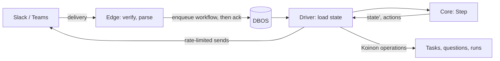

# 0127. Slack and Teams adapter as a pure event-to-actions core

- Status: Proposed (step 1 of #24: the maintainer reviews this ADR before any code)
- Date: 2026-11-26
- Area: connectors-tools
- Tags: connectors, eventing, triggers, secrets, testing
- Relates to: [0006](0006-identity-layers.md), [0007](0007-connector-model.md), [0010](0010-eventing.md),
  [0017](0017-board-and-chat-interaction-model.md), [0023](0023-observability-and-audit.md),
  [0055](0055-chat-as-its-own-object.md), [0065](0065-work-model-tasks-inbox.md),
  [0066](0066-triggers-and-scheduling.md), [0110](0110-held-copy-isolation.md)
- Design adapted from hydro-project/infinity (Apache-2.0): the split into a core without I/O, with chat events in and
  chat actions out, and a driver around it (Upstream verification).

## Context

Release v0.2 adds Slack and Teams ([0024](0024-roadmap.md)). Earlier ADRs decide what the two connectors do:

- Channel event triggers: a channel message that matches rules, or an @mention, starts or wakes a task
  ([0066](0066-triggers-and-scheduling.md) decision 3).
- Notifications and `ask_user` questions go to Slack and Teams with buttons. A person whose chat account is linked to
  their Koinon user answers there. A tap from an unlinked account is refused
  ([0065](0065-work-model-tasks-inbox.md) decisions 7 to 9).
- Threads mirror tasks in both directions. This needs dedupe and loop prevention
  ([0017](0017-board-and-chat-interaction-model.md), consequences).

[0066](0066-triggers-and-scheduling.md) also decides the ingress:

- Webhooks are verified by signature: the Slack signing secret, the Teams JWT (decision 5).
- Slack Socket Mode is an outbound WebSocket (decision 6).
- Everything lands in DBOS for dedupe and retries (decision 8).
- The correlation key of a chat event is the thread (decision 9). Bursts in a short window become one wake-up
  (decision 10). Koinon acknowledges at once (decision 11).
- The DB3 amendment builds `durable.Once` and the table `dedupe_records`, with the source `slack` keyed on `event_id`.
  `durable.Commit` sends notifications only after the commit.

Both platforms put hard limits on the adapter:

- They expect an HTTP answer in a few seconds. Slack retries an event that it does not see acknowledged in time. A
  slow handler thus causes duplicate deliveries.
- They limit how fast a bot can send. An over-limit call gets HTTP 429, usually with a `Retry-After` header in seconds.
- Message bodies are org content. Logs, metrics and errors must not carry them ([0023](0023-observability-and-audit.md)
  keeps run content under the org's retention and content level).
- Bot tokens, signing secrets and the Teams app credential are connection credentials. They must not reach a sandbox
  (AGENTS.md hard rule; [0006](0006-identity-layers.md)).

Adapter code that mixes the transport, the platform SDK and the decisions is hard to test without the platform. It
also spreads the retry, rate-limit and logging rules over many handlers. Two platforms double this cost.

## Decision

### 1. Three parts: edge, core, driver

The adapter has three parts. Only the core makes decisions.

| Part | Does | Does not |
| --- | --- | --- |
| **Edge** (one per platform and transport) | Receives the delivery (HTTP webhook or Socket Mode), verifies the signature, parses it into an `Event`, hands it to DBOS, acknowledges | Decide, call Koinon services, send to the platform |
| **Core** (one, for both platforms) | A pure function `Step(state, event, now) -> (state', actions)` | I/O of any kind |
| **Driver** (one per platform) | Loads the state, calls the core, runs each action as a DBOS step, renders messages for the platform, applies rate limits | Decide what to do with an event |

The core package must not import network, database, DBOS, logging or platform SDK packages. A Go test of the import
graph enforces this. The core gets the time as the input `now`. It uses no random values. It returns actions in a
fixed order. The same input thus gives the same output, and the core is unit-testable without the platform.

### 2. The core's types

The types are platform-neutral. A platform field appears only where the platforms differ.

- **`Key`**: `{platform, team, channel, thread}`. Decision 5 gives the values. The key is the chat correlation key of
  [0066](0066-triggers-and-scheduling.md) decision 9, made exact.
- **`Event`**:
  - `key`, `connection` (the Koinon connection the delivery arrived on, and through it the org);
  - `delivery_id`: the platform's ID for this delivery (Slack `event_id`, Teams activity `id`);
  - `kind`: one of `message`, `mention`, `choice` (a button tap), `message_changed`, `message_deleted`, `flush` (the
    burst timer of decision 4), `uninstalled`;
  - `actor`: the platform user ID and a bot flag;
  - `at`: the platform timestamp;
  - `body`: a `Body` value (decision 8);
  - `choice`: for a button tap, the question ID and the choice ID that Koinon put in the button.
- **`State`**: a snapshot that the driver loads before each step. It has two parts:
  - **Read-only facts**: the connection's status and outward state, the channel event triggers in effect for the
    connection ([0066](0066-triggers-and-scheduling.md) TR1 read side), the actor's account link (a Koinon user or
    none), and the open question that a `choice` names.
  - **Thread state**, stored per key with a version: the bound task (or none), the burst buffer and its flush time, the
    platform IDs of the messages Koinon sent to the thread, and the Teams conversation reference.
- **`Action`**: a closed set. Each action has an idempotency key: the delivery ID of its cause plus its index in the
  output.
  - Koinon effects: `CreateTask`, `WakeTask`, `AnswerQuestion`. The driver runs them through Koinon's own operations
    (`services.CreateTriggeredTask`, the wake and answer paths), as [0066](0066-triggers-and-scheduling.md) requires for
    all DBOS work.
  - Platform effects: `Post`, `Update`, `React`, `SetStatus` (a typing or "working on it" status), `RefuseUnlinked`
    (an ephemeral answer to an unlinked tap).
  - Timers: `ScheduleFlush(key, at)`.
  - `Drop(reason)`: the core ignores the event. The reason is a fixed enum and becomes a metric label.

The core works with a neutral message model: text, and buttons with choice IDs. The driver renders it as Slack Block
Kit or as a Teams Adaptive Card. The core never builds platform JSON.

The core drops events from Koinon's own bot user and from other bots, unless a trigger allows bots. This is the loop
prevention that [0017](0017-board-and-chat-interaction-model.md) asks for.

### 3. Acknowledge first, then hand the event to DBOS

The edge does these steps, in this order:

1. Verify the signature: the Slack signing secret with its timestamp window, or the Teams JWT. A delivery that fails
   gets HTTP 401. Koinon does not log its body.
2. Parse the delivery into an `Event`. Find the connection from the team and the app. An unknown team gets HTTP 200
   and a `Drop` metric, so that the platform does not retry it.
3. Enqueue one DBOS workflow on the org's queue (`durable.EnqueueForOrg`). The workflow ID is
   `chat:<platform>:<team>:<delivery_id>`. A platform retry thus maps to the same workflow.
4. Acknowledge: HTTP 200, or the Socket Mode envelope acknowledgement.

The edge does no other work before the acknowledgement. The enqueue is one Postgres write. If it fails, the edge
answers with HTTP 5xx (or does not acknowledge the envelope), and the platform delivers again.

A visible acknowledgement (a reaction or a status) is different. It is a core action, and the driver sends it after
the enqueue. [0066](0066-triggers-and-scheduling.md) (LT1 amendment) gives this to the chat connector.

### 4. Idempotency and ordering

- **Inbound.** The workflow ID stops a second workflow for one delivery. Each Koinon effect also runs in
  `durable.Once`, in the same transaction as the effect. The source is `slack` (existing) or `teams` (new), and the
  key is the delivery ID. A replay returns the existing effect.
- **Outbound.** The driver runs each platform action as its own DBOS step. A step that succeeded does not run again.
  Slack's `chat.postMessage` and the Teams send API have no idempotency key. A crash after the platform accepted a
  post and before DBOS recorded the step can thus post twice. This is at-least-once delivery. The driver records the
  platform message ID in the step result and uses `Update` on that ID for later changes, which are idempotent.
- **Order in one thread.** The driver writes the new thread state only if the version did not change since it loaded
  the state. On a conflict it loads again and runs the core again. Events for one key are thus applied one at a time.
  Different keys run in parallel, within the org's queue limits.
- **Bursts.** The core puts `message` events for a key in the burst buffer and returns `ScheduleFlush`. The driver
  starts a durable DBOS timer. At the flush time a `flush` event arrives, and the core returns one `CreateTask` or
  `WakeTask` with all buffered events, in platform-timestamp order. An `@mention` or a `choice` does not wait for a
  flush. The window is per org (open question 2).

### 5. Keys

| Field | Slack | Teams |
| --- | --- | --- |
| `team` | `team_id` of the workspace (the `enterprise_id` too, for an org-wide Enterprise Grid install) | the Microsoft Entra tenant ID |
| `channel` | the channel ID | the channel conversation ID, without the `;messageid=` part |
| `thread` | `thread_ts`, or the message `ts` for a top-level message | the ID of the root message of the reply chain |

The key holds platform IDs only, never names or text. Logs can hold it. Metric labels must not hold it
([0023](0023-observability-and-audit.md) label rule).

### 6. Batches, 429 and `Retry-After`

Rate limits live in the driver. The core only states what to send.

- **Coalesce.** In one step, the driver joins consecutive `Post` actions for one thread into one message when the
  result is under the platform's size limit. Status changes for one thread go out at most once per interval.
- **Proactive limits.** The driver keeps a token bucket per connection and per channel, sized from the platform's
  published limits.
- **On 429.** The driver reads `Retry-After` and stores "paused until" on the connection in Postgres, so every
  replica obeys it. It waits with a durable DBOS sleep, not a goroutine sleep, and then runs the step again. It never
  sends to that scope before the time has passed. Without a `Retry-After` header, it uses exponential backoff with
  jitter.
- **On 5xx and network errors.** Exponential backoff with jitter.
- **Give up.** After a fixed number of attempts, the action fails. The driver records a metric and shows the failure
  on the connection's status, for the org admin. A failed `ask_user` post does not change the question: the inbox
  still has it ([0065](0065-work-model-tasks-inbox.md)).

### 7. Secrets and the outward switch

- The bot token, the signing secret and the Teams app credential are connection credentials of the `app-credential`
  auth type ([0006](0006-identity-layers.md), [0007](0007-connector-model.md)), stored in the secret store. Only the
  edge and the driver read them, in `koinon-api`.
- No chat credential goes into a sandbox. An agent reaches Slack or Teams only through Koinon: notifications,
  `ask_user` and its own task's replies. It never gets a chat token.
- A chat connection is an outward target ([0110](0110-held-copy-isolation.md), `internal/outward`). Today the kind
  `connection` covers code-host connections only; chat connections join it. When an admin disables it, or the install is held after a restore, the driver sends nothing. The edge still acknowledges, so the
  platform does not retry, and the core returns `Drop(outward_disabled)`.
- The driver calls only hosts on a fixed list per platform. Teams gives a `serviceUrl` in each activity. The driver
  refuses a `serviceUrl` that is not on the list, so a forged activity cannot make Koinon call another host.

### 8. Message bodies are never logged

- `Body` is a type, not a string. Its `String`, `GoString`, `slog.LogValuer` and JSON output give only
  `[redacted, N bytes]`. Code that must read the text calls one method (`Text()`); a lint rule allows that call only
  in the core and in the code that writes task messages.
- The core has no logger. The edge and the driver log the connection ID, the key, the event kind, the outcome and the
  platform error code. They never log text, blocks, cards, file names, display names or a platform error message that
  echoes the request.
- Metrics use fixed label sets only: platform, event kind, action kind, outcome, drop reason
  ([0023](0023-observability-and-audit.md)).
- A leak test sends a canary body through the edge, the core and the driver with a capturing logger, a metrics
  registry and a trace exporter. It fails if the canary appears in any of them.
- The body is stored once, as a task message, under the org's run-content retention
  ([0023](0023-observability-and-audit.md)). The DBOS workflow input also holds the event (open question 5).

### 9. Tests

- The core: table tests of event sequences and their expected actions; property tests for determinism and for order
  (the same buffered events in any arrival order give one wake-up in timestamp order).
- The edge: recorded deliveries, including bad signatures and retries.
- The driver: a fake Slack and a fake Teams server in the test process, which return 429 with `Retry-After`, 5xx and
  slow answers. No test calls the real platforms, as no test calls a paid model.

## Alternatives considered

- **Logic in the platform SDK handlers** (slack-go event handlers, the Bot Framework activity handler)
  _(reconstructed)_. This is cheaper now: fewer types, and the SDK examples apply. The cost comes later: tests need the
  platform or large mocks, Slack and Teams get two copies of each rule, and every handler must remember the retry,
  rate-limit and no-body-log rules. Rejected.
- **Work before the acknowledgement** _(reconstructed)_. The handler does the task work and then answers. This is
  simpler, but a slow database or a cold path misses the platform deadline. The platform then retries, and the
  duplicates need more dedupe. Rejected: the acknowledgement must not depend on Koinon's load.
- **Infinity's runtime as it is** _(reconstructed)_. Infinity builds its Slack core as a Hydro dataflow in Rust.
  Koinon is Go and already has DBOS for durability. We take the shape (no-I/O core, events in, actions out), not the
  runtime.
- **A separate chat gateway process** _(reconstructed)_. It isolates the chat traffic, but [0066](0066-triggers-and-scheduling.md)
  runs DBOS workers in `koinon-api` only, and a second process needs its own credential access. The edge and the
  driver stay in `koinon-api`. The pure core keeps a later move cheap.
- **A hosted chat bridge or a third-party relay** _(reconstructed)_. Rejected: the chat credentials and the bodies
  would leave the install.
- **Rate limits in the core** _(reconstructed)_. The core would need the clock and the platform's answers as state,
  and every limit change would touch the decision code. Limits are transport facts, so they stay in the driver.

## Consequences

- Positive: the decisions for both platforms are in one pure function with fast unit tests. Slack and Teams share
  them.
- Positive: the acknowledgement does not depend on Koinon's load, so slow work does not cause platform retries.
- Positive: retries, rate limits, secret access and the no-body-log rule are each in one place.
- Negative: there are more types (event, state, action, a renderer per platform) than in a handler-based adapter.
- Negative: posts are at-least-once. A crash at the wrong time can post a message twice. _(inferred)_
- Negative: the DBOS system tables hold message bodies in workflow inputs until DBOS removes the workflow records.
  _(inferred)_
- Follow-ups: the code goes in issues filed after the review of this ADR. Proposed split: (1) the core types and
  `Step`, with the import-graph test; (2) the Slack edge (Events API and Socket Mode); (3) the Slack driver with rate
  limits and the fake Slack server; (4) the Teams edge and driver; (5) account linking
  ([0065](0065-work-model-tasks-inbox.md) decision 9); (6) the body leak test. The `teams` dedupe source goes into the
  [0066](0066-triggers-and-scheduling.md) DB3 list when it is built.

## Open questions

1. **Names.** The glossary keeps "Chat" for a planned object ([0055](0055-chat-as-its-own-object.md)). Proposed
   package: `internal/chatadapter`, with the core in `internal/chatadapter/core`. The maintainer decides the name.
2. **Burst window.** Proposed default: 2 seconds, per org. The value is not decided.
3. **One workspace, more than one org.** Can two Koinon orgs connect the same Slack workspace or Teams tenant? If not,
   `(platform, team)` is unique across connections and routing is simple. If yes, the edge needs a second routing rule
   (for example by channel).
4. **Socket Mode with more than one API replica.** Each replica can open its own connection, or one replica holds a
   lease. The DBOS workflow ID makes duplicates harmless, but each connection costs a platform session.
5. **Bodies in DBOS inputs.** Option A: keep the event in the workflow input and remove chat workflow records after
   the dedupe window. Option B: write the body to a Koinon table first and put only a reference in the input. Option B
   keeps all bodies under one retention rule. It costs one more write before the acknowledgement.
6. **Teams API.** The Bot Framework connector or Microsoft Graph for channel messages. This ADR assumes the Bot
   Framework (activities with `serviceUrl`).
7. **Give-up limit and the status interval** of decision 6. Not decided.

## Upstream verification

- 2026-11-26: hydro-project/infinity, `main` branch. The workspace `Cargo.toml` lists `crates/infinity-slack-dataflow`
  and `crates/infinity-slack-bot`, both `license = "Apache-2.0"`. The `infinity-slack-dataflow` crate documentation
  says it "contains no I/O: Slack events and daemon events flow in as streams, Slack actions and daemon commands flow
  out". Its `SlackEvent` has `channel` and `thread_ts`, its `SlackAction` enum has `PostMessage`, `PostBlocks`,
  `UpdateMessage`, `SetStatus` and stream actions, and its tests drop bot and unauthorized messages. This ADR takes the
  shape and adds the team to the key, for multi-tenancy. It copies no code.
- Daytona: this ADR uses no idea from it. Daytona's servers are AGPL-3.0; nothing is copied from them.
- Not checked: the Slack documentation (the acknowledgement deadline, retries, rate-limit tiers, `Retry-After`) and
  the Microsoft Teams documentation (the Bot Framework JWT, `serviceUrl`, rate limits). Their hosts were not reachable
  from the session that wrote this ADR. The first code issue for each platform checks them and records the numbers
  here.

## Links

- Issue #24 (this ADR is its step 1).
- hydro-project/infinity, crate `infinity-slack-dataflow` (Apache-2.0): design adapted from hydro-project/infinity.
- ADRs [0006](0006-identity-layers.md), [0007](0007-connector-model.md), [0010](0010-eventing.md),
  [0017](0017-board-and-chat-interaction-model.md), [0023](0023-observability-and-audit.md),
  [0024](0024-roadmap.md), [0055](0055-chat-as-its-own-object.md), [0065](0065-work-model-tasks-inbox.md),
  [0066](0066-triggers-and-scheduling.md), [0110](0110-held-copy-isolation.md).
