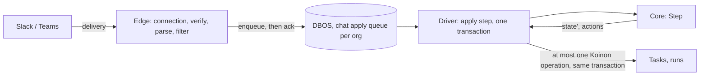

# 0127. Slack and Teams adapter as a pure event-to-actions core

- Status: Proposed (step 1 of #24: the maintainer reviews this ADR before any code); amended by
  [0130](0130-external-actor-kind.md) (the identity of an `external` actor is a row, not payload fields)
- Date: 2026-11-26
- Area: connectors-tools
- Tags: connectors, eventing, triggers, secrets, testing
- Relates to: [0006](0006-identity-layers.md), [0007](0007-connector-model.md), [0010](0010-eventing.md),
  [0017](0017-board-and-chat-interaction-model.md), [0023](0023-observability-and-audit.md),
  [0024](0024-roadmap.md), [0055](0055-chat-as-its-own-object.md), [0065](0065-work-model-tasks-inbox.md),
  [0066](0066-triggers-and-scheduling.md), [0110](0110-held-copy-isolation.md)
- Design adapted from hydro-project/infinity (Apache-2.0): the split into a core without I/O, with platform events in
  and actions out, and a driver around it (Upstream verification).

## Scope

This ADR decides the **inbound path** only: a Slack or Teams message (a mention, a direct message to the bot, a reply
in a thread) becomes a task event or a new task. The outbound path (agent replies, questions and buttons in chat,
notifications, the burst buffer, the task timeline as an outbox) is out of scope. Issue #1397 decides it in its own ADR
(section "Outbound path: out of scope").

## Context

Release v0.2 adds Slack and Teams ([0024](0024-roadmap.md), the v0.2 row). Accepted ADRs decide what the inbound side
does:

- Channel event triggers: a channel message that matches rules, or an @mention, starts or wakes a task
  ([0066](0066-triggers-and-scheduling.md) decision 3).
- Only a person's chat message on a task can interrupt a running turn. Other input waits until the turn ends
  ([0066](0066-triggers-and-scheduling.md) decision 12).
- A chat account can be linked to a Koinon user. The person's Koinon role then applies
  ([0065](0065-work-model-tasks-inbox.md) decision 9).

[0017](0017-board-and-chat-interaction-model.md) proposed two-way mirroring of threads and tasks. It is superseded, and
its amendment says that two-way mirroring "was not decided again". This ADR does not decide it either.

[0066](0066-triggers-and-scheduling.md) also decides the ingress:

- Webhooks arrive on their own listener and path, per connection, and are verified by signature: the Slack signing
  secret, the Teams JWT (decision 5).
- Slack Socket Mode is an outbound WebSocket (decision 6).
- Everything lands in DBOS for dedupe and retries (decision 8).
- The correlation key of a channel event is the thread (decision 9). Koinon acknowledges at once (decision 11).
- The DB2 amendment builds the org-partitioned queue `koinon.org-work`. The DB3 amendment builds `durable.Once` and
  the table `dedupe_records`, with the source `slack` keyed on `event_id`. One `(source, key)` guards one effect kind.

Both platforms put hard limits on the adapter:

- They expect an HTTP answer in a few seconds. Slack retries an event that it does not see acknowledged in time. So a
  slow handler causes duplicate deliveries.
- Message bodies are org content. Logs, metrics and errors must not carry them ([0023](0023-observability-and-audit.md)
  keeps run content under the org's retention and content level).
- Signing secrets and the Teams app credential are connection credentials. They must not reach a sandbox (AGENTS.md
  hard rule; [0006](0006-identity-layers.md)).

Adapter code that mixes the transport, the platform SDK and the decisions is hard to test without the platform. Two
platforms double this cost.

## Decision

### 1. Three parts: edge, core, driver

| Part | Does | Does not |
| --- | --- | --- |
| **Edge** (one per platform and transport) | Receives the delivery (HTTP webhook or Socket Mode), finds the connection, verifies the signature, parses the delivery into an `Event`, filters it on facts, enqueues it in DBOS, acknowledges | Decide, change Koinon state |
| **Core** (one, for both platforms) | A pure function `Step(state, event, now) -> (state', actions)` | I/O of any kind |
| **Driver** (one, for both platforms) | Runs the apply step (decision 4): loads the state, calls `Step`, runs the Koinon operation, stores the result | Decide what to do with an event |

The code is in the package `internal/channeladapter`, and the core is in `internal/channeladapter/core` (question
1). The name matches the `channel_event` trigger, and it does not clash with the planned Chat object of
[0055](0055-chat-as-its-own-object.md).

The core package must not import network, database, DBOS, logging or platform SDK packages. A Go test of the import
graph enforces this. The core gets the time as the input `now`. It uses no random values. So the same input gives the
same output, and the core is unit-testable without the platform. The outbound path (#1397) adds its actions to the same
core and its sends to the driver.

### 2. The core's types

The types are platform-neutral. A platform field appears only where the platforms differ.

- **`Key`**: `{platform, team, channel, thread}`. Decision 5 gives the values. The key is the channel-event
  correlation key of [0066](0066-triggers-and-scheduling.md) decision 9, made exact.
- **`Scope`**: the unit that the apply step locks (decision 4). It is a thread key, or a connection (`channel` and
  `thread` empty) for a connection event. Each event has exactly one scope.
- **`Event`**: `scope`, `connection` (and through it the org), `cause_id` (decision 4), `kind` and the fields of the
  kind:
  - `message` (a message in a channel or a thread, or a direct message to the bot) and `mention` (a message that
    @mentions the bot). Fields: `actor` (the platform user ID and a bot flag), `at` (the platform timestamp),
    `message_ts` (the platform ID of the message), `direct` (a direct message to the bot), `root_by_koinon` (the
    thread root is a message from Koinon's bot; decision 6 reserves it) and `body` (a reference to the stored body,
    which the driver loads as a `Body` value, decision 8).
  - `message_changed` and `message_deleted`: the core returns `Drop(edit_ignored)`. A task keeps what the person
    first wrote. A later ADR can change this with the two-way mirroring question.
  - `uninstalled` (connection scope): the core returns `MarkConnectionRemoved`. Later events of the connection see
    the status as a read-only fact and end in `Drop(connection_removed)`.
- **`State`**: a snapshot that the driver loads in the apply step. It has two parts:
  - **Read-only facts**: the connection's status and outward state; the org's channel event triggers in effect
    (`triggers.ForOrg`, [0066](0066-triggers-and-scheduling.md) TR1 read side) that name this connection; the actor's
    account link (a Koinon user or none); the claim of the event's channel (decision 3, step 3); for the bound task, its state, whether its agent is active and healthy, and
    whether it has a running turn. The facts are read without locks. The Koinon operation checks them again under its
    own locks (decision 4).
  - **Scope state**, one row per scope: the bound task (or none), whether the key was ever bound, and the recent
    `message_ts` values that the core applied.
- **`Action`**: a closed set. Each action has an action key: its cause ID, its kind and its index in the output.
  - `CreateTask(agent, trigger, origin, event)`: creates a task with the event as its first message and binds the key
    to the new task (decision 5).
  - `WakeTask(task, event, interrupt)`: adds the event to the task's timeline and wakes the task (decision 5).
  - `MarkConnectionRemoved(connection)`: the driver sets the connection's status to "removed by the platform" in the
    apply transaction. It locks the connection row after the connection's scope row, and takes no other lock.
  - `Drop(reason)`: the core ignores the event. The reason is a fixed enum and becomes a metric label.

  `Step` returns at most one of `CreateTask`, `WakeTask` and `MarkConnectionRemoved` for one event (decision 4, lock
  order).

The core drops every event from Koinon's own bot user and from other bots. No trigger can allow bots (decision 5,
"Channel event triggers"). This is loop prevention.

**Actors on the timeline.** A task event with the actor kind `user` must name a Koinon user (the check on
`task_events`, migration 00003, line 200). So a message from a linked person is a `user` event with the linked user. A
message from an unlinked person, which a channel event trigger can accept ([0066](0066-triggers-and-scheduling.md)
decision 3), is an event with the new actor kind `external` (question 6). This ADR does not record such a message
as a `system` event. The `external` kind changes the `task_actor_kind` enum and every reader of the timeline, so it has
its own decision and its own issue. That decision ([0130](0130-external-actor-kind.md)) keeps the platform, the team
and the platform user ID in an `external_actors` row; the payload holds `source` (`slack` or `teams`) and never a
display name. It also makes the agent's prompt show an
`external` message as a message from a person. The code issue that applies messages from unlinked people depends on
that issue. Until it lands, the core returns `Drop(unlinked_actor)` for a message from an unlinked person.

**Origin.** `CreateTask` sets the run origin. A mention, a direct message, and a message from a linked person in a
bound thread give `RunOriginInteractive`: a person waits in the thread. A message that only a channel rule matches
gives `RunOriginScheduled`. `CreateTriggeredTask` uses `RunOriginScheduled` when the origin is not given
(`internal/services/notify.go`), so the driver always gives it.

**Interrupt.** `interrupt` is true only for a message from a linked person, as [0066](0066-triggers-and-scheduling.md)
decision 12 requires. The interrupt of a running turn does not exist on `main` today: no task or wake path takes an
`interrupt` input. The first code issue for the apply step adds it, as new work. Until then, `WakeTask` queues the
input for the end of the turn, as the direct-message path does.

The interrupt is a **signal after the commit**, not a write in the apply transaction. The wake holds the task row lock.
`internal/runlock` documents the order "run rows, then the task row", and `Owner.Requeue` keeps it. A write to the
running run row under the task lock would take the reverse order and could deadlock with a turn end. So the wake
writes only the task event (and the reopen, if any) and returns an interrupt notification, which `durable.Commit`
sends after the commit. The receiver locks the run in its own transaction, in the documented order. If the turn has
ended when the signal arrives, the signal does nothing, and the queued run sees the message.

**People from outside the org** (question 10). Slack Connect channels and guest accounts bring people from other
workspaces or with limited access. The core returns `Drop(external_user)` for a `message` or `mention` whose actor's
team is not the connection's team, and for an unlinked guest account. A later decision can add an admin switch that
lets them act. Only a linked person can reopen a completed task (decision 5). The team check of decision 3 reads the
team of the event envelope (the installing workspace), not the actor's team. The drop reason `external_user` names
the actor's team. It is not the actor kind `external`.

### 3. Enqueue, then acknowledge

The edge does these steps, in this order:

1. Find the connection. An HTTP delivery arrives on the path of its connection
   ([0066](0066-triggers-and-scheduling.md) decision 5). A Socket Mode delivery arrives on the socket of its
   connection. An unknown path gets HTTP 404.
2. Verify the signature of an HTTP delivery with that connection's credential: the Slack signing secret with its
   timestamp window, or the Teams JWT. A delivery that fails gets HTTP 401. Koinon does not log its body. A Socket
   Mode delivery has no signature: the socket itself is opened with the connection's app-level token (decision 7).
3. Check the team and the channel (question 2). More than one org can connect the same Slack workspace or Teams
   tenant, so `(platform, team)` is not unique across connections. Each org has its own connection and its own bot.
   - A team in the payload that is not the connection's team gets HTTP 200 and `Drop(wrong_team)`, so that the
     platform does not retry it.
   - **Each channel belongs to at most one org.** A table of channel claims has the unique key `(platform, team,
     channel)` and the org that claims the channel. All connections of that org on that team can use the claim.
   - A channel event trigger that names a channel claims it for its org when an admin saves the trigger. The save
     fails if another org claims the channel, or if another org has an open thread binding in the channel.
   - A claim lives while at least one trigger of the org names the channel. The delete or edit of the last such
     trigger releases the claim in the same transaction. The claim read ignores a claim when the org has no connection
     on that team that is not removed. `MarkConnectionRemoved` does not delete claims.
   - A direct-message channel with a connection's bot belongs to that connection.
   - A message in a channel that another org claims gets HTTP 200 and `Drop(channel_of_other_org)`.
   - A channel without a claim belongs to no org. There, only a mention of a bot reaches an org, through the
     connection of that bot.
4. Parse the delivery into an `Event`.
5. **Filter on facts.** The edge drops an event at once (HTTP 200, a `Drop` metric) only on facts that cannot change
   between the enqueue and the apply step: the event itself and the triggers in effect when the message was sent. It
   drops every message from a bot (question 7), and a **top-level** `message` that is not `direct`, does not
   mention the bot, and is in a channel that no widened trigger names (decision 5, "Channel event triggers"). It never
   reads the thread binding, because an earlier mention in the same thread can still wait in the queue and bind the
   thread later. So it passes **every thread reply** from a person to the core, also replies with `root_by_koinon`
   set, which the outbound path (#1397) needs. The filter uses one indexed read of the triggers and the channel claims,
   and no cache. It never selects an action; the core does that. A wrong pass costs one apply step. The filter must not
   drop an event that the core can act on, so each filter rule needs a core test that shows the core drops the same
   event.
6. **Store the body** (question 4). The edge writes the body to the table of event bodies, keyed by
   `(connection, cause_id)`, with `ON CONFLICT DO NOTHING`, so a platform retry reuses the row. The insert runs only
   when the cause is not in the table of applied causes, so a retry after the apply step adds no new row. The workflow input
   holds only this reference, never the body. Decision 8 gives the retention.
7. Enqueue one apply workflow on the org's partition of the chat apply queue (decision 4). The workflow ID is
   `chat:<platform>:<connection>:<cause_id>`. So a platform retry maps to the same workflow.
8. Acknowledge: HTTP 200, or the Socket Mode envelope acknowledgement.

The edge does no other work before the acknowledgement: a connection lookup, the filter read, the body write and the
enqueue. `durable.EnqueueForOrg` reads the org's queue limits and can register a profile queue once (a write) before
the enqueue write. Slack wants a 2xx answer within 3 s (Upstream verification), so these writes must stay small. The
first code issue for each platform measures the time to the acknowledgement.
This is what "acknowledge first" means in #24 and in [0066](0066-triggers-and-scheduling.md) decision 11: the
acknowledgement does not wait for any task work. The enqueue comes before the acknowledgement, because an event that is
acknowledged and then lost in a crash never comes back. If the enqueue fails, the edge answers with HTTP 5xx (or does
not acknowledge the envelope), and the platform delivers again. The chat edge needs the DBOS runtime, so `koinon-api`
serves it only with `--durable`. A held install has no DBOS runtime; decision 9 tells what the edge does then.

**Transports** (question 3).

- **Slack.** The HTTP Events API is the default. Socket Mode is an opt-in for each connection, for an install behind a
  firewall that has no public URL. Slack does not allow Socket Mode apps in the public Slack Marketplace, and it
  recommends HTTP for production (Upstream verification).
- **Socket Mode holders.** A fixed number K of `koinon-api` replicas holds each Socket Mode connection. K is 2 by
  default; it is a chart value, at most 4. Each connection has K advisory-lock slot keys. A replica takes a slot with
  `pg_try_advisory_lock` and opens one socket for it. It holds at most one slot of a connection, and it tries the free
  slots again in a loop. This changes the lock pattern of `internal/triggers/poll/poll.go`, which takes one key with a
  blocking `pg_advisory_lock`. One lock session of a replica holds its slots of all connections, so N connections do
  not need N × K database sessions. With fewer replicas than K, some slots stay free and the metric shows it. Slack sends
  each event to one open socket, chosen at random (Upstream verification). All holders enqueue on the same chat apply
  queue, so it does not matter which holder gets an event. Two holders give active-active redundancy: when one holder
  stops, the other socket stays open. With one holder, a failover leaves a gap with no socket (Muster measured 15 to
  30 s). The workflow ID dedupes on `event_id`, so an event that comes on two sockets is applied once.
- A holder closes its socket when its lock session stops answering pings, so a holder that lost its lock does not keep
  a socket open.
- A metric shows a connection that has fewer holders than configured.
- The holder reads `num_connections` from Slack's `hello` message. Koinon's own sockets are at most 2 × K, because
  during a socket refresh the client opens the new socket before it closes the old one. The holder logs a warning when
  the number is more than 2 × K: then another program uses the same Slack app. With K at most 4, Koinon stays below
  Slack's limit of 10 sockets for each app.
- **Teams.** The Bot Framework connector (question 5): activities arrive by HTTP with a JWT.

### 4. The apply step: idempotency, errors and order

**The chat apply queue.** Apply workflows run on a queue of their own, `koinon.chat-apply`, partitioned by org like
`koinon.org-work` (`internal/durable/orgqueue.go`). A busy Slack channel on `koinon.org-work` would use the org's slots
and starts per minute, and direct messages, schedules, webhooks and poll events would wait. The chat apply queue takes
its limits from the same org settings, `trigger_concurrency` and `trigger_rate_per_minute` (migration 00023), with the
same profile-queue rule as `koinon.org-work`. So an admin's limits apply to tasks that chat creates too, but as a
separate budget.

Each event has one apply workflow with one **apply step**. The apply step is one DBOS step and one Postgres
transaction:

1. Create the scope row if it does not exist, then lock it (`SELECT ... FOR UPDATE`). So events for one scope are
   applied one at a time. Different scopes run in parallel, within the queue limits.
2. Look up `(connection, cause_id)` in the table of applied causes. If the cause is applied, return the stored result,
   and stop. The table is keyed by connection and cause, not by scope, so a connection event has a place for its cause
   too.
3. Load the read-only facts and the body row of the cause, and call `Step`.
4. Run the Koinon operation, if there is one, under a savepoint (see "Expected outcomes").
5. Write the new scope state, record the cause as applied with the result, delete the body row (decision 8), and
   commit with `durable.Commit`, so the
   notifications that the operation returns (for example a pre-wake) go out after the commit. The apply step runs in
   `koinon-api`, which has the notifier.

The stored result holds the action kinds, the task ID and the drop reason. It holds no message body. A crash after the
commit and before DBOS records the step runs the step again. Step 2 then returns the stored result, and `Step` does
not run again on the new state. The notifications of the first try are lost in this case. DB3 accepts this for
pre-wakes. Applied causes are removed after the dedupe window. The start value of the window is 24 h (question
8).

- **Dedupe of operations.** Each Koinon operation is keyed by its action key with the source `slack` or `teams`
  (new). `durable.Once` is unique per org, source and key, and one org can have more than one connection on one
  platform (for example two Teams bots in one conversation). So the action key starts with the connection ID:
  `<connection>:<cause_id>:<action kind>:<index>`. The DB3 amendment records this key format next to the `event_id`
  key of the source `slack`. `CreateTask` passes the action key as `TriggeredTask.Source` and `Key`. `CreateTriggeredTask` already calls
  `durable.Once` with them, so the driver does not wrap it in a second `Once`. The wake operation calls `durable.Once`
  with the action key.
- **The caller's transaction.** Today `services.CreateTriggeredTask` opens its own transaction, and its message is a
  `system` event. The direct-message path already runs in the caller's transaction (`deliverDirectMessage` takes the
  caller's queries) and writes `user` events. The first code issue gives task creation and the wake the same form, and
  lets task creation write the first message as a `user` event for a linked person. This is new API work.
- **Expected outcomes are not errors.** An operation can end in an expected outcome: the agent is inactive
  (`services.ErrAgentInactive`, "drop, do not retry" in DB3), the agent has no active version
  (`scheduler.ErrAgentNotActive`), the agent is unhealthy (`scheduler.ErrAgentUnhealthy`), a queued run exists already
  (`scheduler.ErrQueuedRunExists`: the queued run sees the message, so the wake is done), the install is held
  ([0107](0107-restore-hold-mode.md) hold error), or the task refuses the message (decision 5,
  "the end of a task"). The core reads these facts first and returns `Drop` without the operation. A race can still
  give one of them. So the driver opens the savepoint **before** the `durable.Once` claim, because `durable.Once`
  takes no savepoint itself (`internal/durable/dedupe.go`). On an expected outcome, the driver rolls back to the
  savepoint. This removes the claim and the partial writes together. The driver records `Drop(reason)` and commits
  the cause and the new state. Only an unexpected error rolls back the transaction, and the DBOS step retries it.
- **A task that ended in the race.** One expected outcome is different: the bound task became `canceled` or `failed`
  between the fact read and the task lock. Decision 5 says that such a message follows the triggers again, so a `Drop`
  would lose it. The driver rolls back to the savepoint, loads the facts again and calls `Step` once more in the same
  transaction, while it still holds the scope row. The core now sees the closed binding and can return `CreateTask`.
  The driver does this at most once per apply step; a second expected outcome gives `Drop`.
- **Bounded retries.** The apply step has a fixed retry limit, with the start value 5 (question 8). When the
  limit is reached, the workflow records the
  cause as applied with `Drop(apply_failed)` in a short transaction, and a metric counts it. The write does nothing
  if the cause already has a row (`ON CONFLICT DO NOTHING`): the last attempt can have committed after DBOS lost its
  result. The same transaction deletes the body row. The event is then lost for the task. It holds nothing else back:
  the inbound path has no buffer and no cursor.
- **Lock order.** The scope row is a new lock. Only the apply step takes it, and it takes it first. Then it calls at
  most one existing Koinon operation, which takes its own locks in its own documented order: the wake takes the task
  row (as `deliverDirectMessage` does; the rules of `internal/runlock`); task creation inserts the task, which takes
  only `FOR KEY SHARE` on the agent row through its foreign key; `MarkConnectionRemoved` locks the connection row. No
  path that locks the agent or connection row waits for a scope row. The binding row refers to the task by a foreign key, which takes `FOR KEY SHARE` on the task row after the
  task lock, in the same order. No existing path can wait for a scope row. The apply step deletes the body row of its
  cause after the scope row. Only the edge insert and the sweep also touch body rows, and neither holds another lock,
  so there is no cycle. An edge insert for the same cause can wait for an apply transaction that has not committed;
  this case is rare (a platform retry during the apply step) and the apply step is short. So the apply step adds no new order
  between two existing locks. This is why `Step` returns at most one Koinon operation for one event.
- **A fair share for each thread.** Without a rule, the org's apply slots can all wait on one busy thread's scope
  lock, and new mentions in other threads wait behind it. So the apply step takes the scope row with `FOR UPDATE
  NOWAIT`. If another apply step holds it, the step ends at once without a change, and the workflow body starts a
  delayed workflow outside the queue that enqueues the event again with the next attempt number (workflow ID
  `chat:<platform>:<connection>:<cause_id>:busy:<n>`). So one thread holds at most one slot of the org at a time. The
  cost: each try of a busy thread uses a start of the org's rate, and a busy thread waits a little longer. The start
  values (question 8): the first try is the first delivery, and the delays between the 5 tries are 2 s, 4 s,
  8 s and 8 s. Every try uses `NOWAIT`, so a waiting try never holds a slot. After the fifth try, the workflow records
  the cause as applied with `Drop(thread_busy)`, deletes the body row and counts it in a metric. The apply step does no
  platform I/O, so a scope lock that is held for about 22 s is a fault, not load. The table of applied causes makes a
  repeat harmless.
- **Order of messages.** Two apply workflows for one thread can take the scope lock in another order than the platform
  sent the messages. The task timeline then shows them in apply order. Each message event keeps the platform time
  `at` in its payload, so the agent's prompt can show it. Exact platform order needs the burst buffer, which is
  outbound-path work (#1397).
- **Cause IDs.**
  - Slack Events API (HTTP and Socket Mode): the `event_id`. The Socket Mode `envelope_id` is only for the
    acknowledgement.
  - Teams: the conversation ID and the activity `id`. The activity ID alone may not be unique across conversations.

  The first code issue for each platform checks these against the platform documentation.
- **One message, two events.** Slack can send `app_mention` and `message` for one message, with two `event_id`
  values. The edge parses a `message` whose text mentions the bot as a `mention`, so both events have the same kind
  and origin. The core keeps the `message_ts` values that it applied in the scope state, and applies a message only
  once. A `Drop` does not record the `message_ts`, so a dropped copy cannot hide the other copy.

### 5. Keys and the thread binding

| Field | Slack | Teams |
| --- | --- | --- |
| `team` | `team_id` of the workspace (the `enterprise_id` too, for an org-wide Enterprise Grid install) | the Microsoft Entra tenant ID |
| `channel` | the channel ID (for a direct message, the ID of the direct-message channel) | the channel conversation ID, without the `;messageid=` part (for a personal chat, the conversation ID) |
| `thread` | `thread_ts`, or the message `ts` for a top-level message | the ID of the root message of the reply chain (for a personal chat: the conversation ID, question 9) |

The key holds platform IDs only, never names or text. Logs can hold it. Metric labels must not hold it
([0023](0023-observability-and-audit.md) label rule).

- **Channel event triggers** (question 7). A `channel_event` trigger names a connection and has one of two
  scopes: the whole workspace or tenant of the connection, or a list of channels.
  - By default, a trigger fires only for a `mention` of the bot or a `direct` message to the bot.
  - An admin can widen a trigger to all messages in the channels that it names. A trigger for the whole workspace
    cannot be widened.
  - Messages from bots never fire a trigger (decision 2).
  - When more than one trigger matches, the most specific trigger fires: a trigger that names the channel wins over a
    trigger for the whole workspace. Among triggers of the same scope, the core takes the oldest (creation time, then
    ID), so the result does not depend on the read order.
  - One message starts at most one task: `Step` returns at most one `CreateTask`, and the `message_ts` values in the
    scope state stop a second copy (decision 4, "One message, two events").
  - TR1 of [0066](0066-triggers-and-scheduling.md) refuses `channel` until chat connectors exist. The first code
    issue for the apply step adds this trigger shape to TR1.
- **A thread without a binding.** The core takes the trigger that fires, as above, and returns `CreateTask` for it.
  No match gives `Drop(no_trigger)`.
- **The binding.** `CreateTask` binds the key to the task in the transaction that creates the task
  (`TriggeredTask.OnCreate`). A unique constraint allows one open binding per key. Two mentions in a new thread are
  applied one after the other (decision 4), so the second one sees the binding and wakes the task.
- **A thread with a binding.** Every `message` and `mention` in it gives `WakeTask` for the bound task. A message from
  a linked person is a `user` event and can interrupt (decision 2).
- **The end of a task.** The core follows the rules of the direct-message path (`internal/services/directmessage.go`,
  [0066](0066-triggers-and-scheduling.md) TR3 amendment). A message to a bound task that has `completed` reopens the
  task (same task, same timeline, reason `follow_up`), but only for a message from a linked person, because the reopen
  is a `user` event. A message from an unlinked person to a completed task gives `Drop(task_ended)`. A bound task that has been `canceled` or has `failed` is not
  reopened: the core treats the binding as closed, and the event follows the triggers again. If that gives
  `CreateTask`, the apply step closes the old binding before `OnCreate` writes the new one, in the same transaction,
  so the unique constraint holds. The core cannot ask the person to start a new thread, as the inbox does, because the
  person is already in the thread.
- **Teams personal chat** (question 9). A personal chat has no reply chains, so the conversation ID is the thread.
  One person has one bound task with the bot at a time. A new task starts after the old one ends, by the rules above.

### 6. Outbound path: out of scope, see #1397

Issue #1397 decides the outbound path in its own ADR: agent replies, `ask_user` questions and buttons in chat
([0065](0065-work-model-tasks-inbox.md) decisions 7 to 9), free-text answers, notifications to a channel, the burst
window of [0066](0066-triggers-and-scheduling.md) decision 10, visible acknowledgements (a reaction or a status, LT1
amendment), the send queue with 429 and `Retry-After`, and the source of Koinon-side events (the task timeline as an
outbox). The four blockers of the last review of this ADR's earlier, wider draft are outbound, and #1397 lists them.

The inbound part reserves these for #1397, so that #1397 adds to them and changes nothing here:

- **Event kinds:** `choice` (a button tap); the Koinon-side kinds `reply`, `ask`, `question_closed` and `task_ended`;
  the timer kind `flush`. The field `root_by_koinon` on `message` (the edge never filters it, decision 3).
- **Actions:** `Post`, `Update`, `React`, `SetStatus`, `Ephemeral`, `AnswerQuestion`, `ScheduleFlush` and `Defer`.
- **Scopes:** a channel scope (`thread` empty), for posts that start a thread.
- **Scope row columns:** the platform IDs of messages that Koinon sent, with their action keys; the Teams
  conversation reference; the burst buffer and its flush time; a timeline cursor per task.
- **Tables:** the v0.2 `channels` table and the foreign keys `(org_id, notify_channel_id)` on `tasks` and
  `(org_id, target_channel_id)` on `questions`, which migration 00036 announces.
- **Rules that #1397 keeps:** the scope row is the first lock; one Koinon operation per apply step; the table of
  applied causes keyed by `(connection, cause_id)`; bodies never logged (decision 8).

### 7. Secrets

- The signing secret and the Teams app credential are connection credentials of the `app-credential` auth type
  ([0006](0006-identity-layers.md), [0007](0007-connector-model.md)), stored in the secret store. Only the edge reads
  them, in `koinon-api`. The Slack app-level token, which opens the Socket Mode connection, is a connection
  credential too, and only the Socket Mode edge reads it. The bot token is for sends, so the inbound path does not read
  it.
- No chat credential goes into a sandbox. An agent never gets a chat token or a signing secret.
- The Teams edge fetches the keys that verify the JWT only from a fixed list of hosts.

### 8. Message bodies are never logged

- `Body` is a type, not a string. Its `String`, `GoString`, `slog.LogValuer` and JSON output give only
  `[redacted, N bytes]`. Code that must read the text calls one method (`Text()`). A lint rule allows that call only
  in the core, in the trigger rule match and in the code that writes task messages.
- The core has no logger. The edge and the driver log the connection ID, the key, the event kind, the outcome and the
  platform error code. They never log text, blocks, cards, file names or display names.
- Metrics use fixed label sets only: platform, event kind, action kind, outcome, drop reason
  ([0023](0023-observability-and-audit.md)).
- A leak test sends a canary body through the edge, the core and the driver with a capturing logger, a metrics
  registry and a trace exporter. It fails if the canary appears in any of them.
- **One retention rule for bodies** (question 4). Bodies are stored only in Koinon tables, never in DBOS workflow
  inputs or outputs: the task message, under the org's run-content retention
  ([0023](0023-observability-and-audit.md)); and the row in the table of event bodies, from the edge until the apply
  step. The apply step deletes the body row in its transaction, also for a `Drop`. A sweep removes every body row that
  is older than the dedupe window (for example, when the enqueue failed and the platform gave up). A body row is
  never kept longer than the org's run-content retention.

### 9. The outward switch

A Slack or Teams connection is a row of the `connections` table ([0007](0007-connector-model.md)).

- **A held install** ([0107](0107-restore-hold-mode.md) decision 2). A held `koinon-api` does no automatic work,
  starts no outward call and runs no DBOS runtime (`runDurable` in `internal/cmd/koinonapi/main.go`). So:
  - It opens no Socket Mode connection. A Socket Mode connection is an outward call. Also, Slack sends each event of
    an app to one of its open sockets, so a restored copy with an open socket would take events from the live install.
  - The HTTP edge does steps 1 to 3 of decision 3 and then answers HTTP 503, with no body write, no enqueue and no
    task work. This is
    the "enqueue fails" case of decision 3. The platform delivers again for a short time and then gives up, so events
    that arrive while the install is held are lost. This is the meaning of a hold: the install takes no new work.
- **A disabled connection** ([0110](0110-held-copy-isolation.md) decision 5: a disabled target is not called). The
  Socket Mode edge closes the connection's socket and opens no new one while the connection is disabled. The HTTP
  edge answers HTTP 200 after step 3 and records `Drop(outward_disabled)`, with no enqueue, so the platform does not
  retry. If an admin disables the connection after an event was enqueued, the core reads the status as a fact and
  returns `Drop(outward_disabled)`: no task is created or woken.

The outward kind for sends is #1397 work.

### 10. Tests

- The core: table tests of event sequences and their expected actions; property tests for determinism; `app_mention`
  and `message` for one message apply once, in either order, with the interactive origin; a channel trigger wins over
  a workspace trigger, the oldest of two equal triggers wins, and a bot message fires no trigger.
- The apply step: a replay after a crash between the commit and the checkpoint gives the same result and no second
  operation; two concurrent mentions in a new thread give one task; an inactive or unhealthy agent and a held install
  end in a `Drop` and leave no dedupe claim; an apply step that always fails ends in `Drop(apply_failed)`; a wake that
  races with a turn end gives no deadlock; a message to a canceled task's thread creates a new task and moves the
  binding; a canceled task found only under the task lock still gives a new task; a busy thread holds at most one
  slot; a thread that stays busy for 5 tries ends in `Drop(thread_busy)`; a platform retry after the apply step adds no
  body row; a wake with an interrupt and a turn end at the
  same time give no deadlock; every path (an operation, a `Drop`, `Drop(apply_failed)`) deletes the body row.
- The edge: recorded deliveries, including bad signatures, an unknown path, a wrong team and retries; a reply that
  arrives before the mention that binds its thread is passed to the core; a held install answers 503 and opens no
  socket; a disabled connection opens no socket; a message in a channel that another org claims is dropped; a
  workflow input holds no body; each filter rule has a core test that shows the core drops the same event.
- Socket Mode: with K holders, each event is applied once; a holder that loses its lock closes its socket; the metric
  shows a missing holder; a `hello` with more than 2 × K connections logs the warning.
- No test calls the real platforms, as no test calls a paid model.

## Alternatives considered

- **Logic in the platform SDK handlers** (slack-go event handlers, the Bot Framework activity handler)
  _(reconstructed)_. This is cheaper now: fewer types, and the SDK examples apply. The cost comes later: tests need the
  platform or large mocks, Slack and Teams get two copies of each rule, and every handler must remember the dedupe and
  no-body-log rules. Rejected.
- **Work before the acknowledgement** _(reconstructed)_. The handler does the task work and then answers. This is
  simpler, but a slow database misses the platform deadline. The platform then retries, and the duplicates need more
  dedupe. Rejected: the acknowledgement must not depend on Koinon's load.
- **Acknowledge before the enqueue** _(reconstructed)_. This answers a few milliseconds sooner, but a crash after the
  answer loses the event, and the platform does not deliver it again. Rejected.
- **Chat apply on `koinon.org-work`** _(reconstructed)_. One queue is less configuration. But a busy channel would use
  the org's slots, and direct messages, schedules and poll events would wait. Rejected.
- **Optimistic versioning of the scope row, without a lock** _(reconstructed)_. It avoids a row lock, but a retry after
  a conflict runs `Step` on a new state, and the effects of the first try must then be found and undone. Rejected: the
  row lock is short, because the apply step does no platform I/O.
- **The operation in its own transaction after the state write** _(reconstructed)_. This keeps the scope row lock
  shorter, but a crash between the two leaves a binding to a task that does not exist, or the reverse. Rejected.
- **Infinity's runtime as it is** _(reconstructed)_. Infinity builds its Slack core as a Hydro dataflow in Rust.
  Koinon is Go and already has DBOS for durability. Rejected: we take the shape (no-I/O core, events in, actions out),
  not the runtime.
- **A separate chat gateway process** _(reconstructed)_. It isolates the chat traffic, but
  [0066](0066-triggers-and-scheduling.md) runs DBOS workers in `koinon-api` only, and a second process needs its own
  credential access. Rejected for now. The pure core keeps a later move cheap.
- **A hosted chat bridge or a third-party relay** _(reconstructed)_. Rejected: the chat credentials and the bodies
  would leave the install.
- **Every replica opens a Socket Mode socket**. No lock is needed. But with the socket refresh,
  about 4 replicas reach Slack's limit of 10 sockets for each app, and Curie saw split events with this design.
  Rejected.
- **One Socket Mode holder**. One lock slot is simpler. But a failover leaves a gap with no socket
  (Muster measured 15 to 30 s). Rejected: K holders, 2 by default.
- **Bodies in DBOS workflow inputs** (option A of question 4). It saves one write before the
  acknowledgement. But the bodies then follow the retention of the DBOS records, not the org's run-content retention.
  Rejected: one retention rule for all bodies.
- **A trigger option that allows bot messages**. It lets two bots talk. But it opens loops between
  bots. Rejected for now; a later decision can add it with loop limits.
- **Inbound and outbound in one ADR** _(reconstructed)_. One decision is easier to read. But the outbound path has
  more open design (the outbox, the buffer, sends), and it held back the inbound decision. Rejected: #1397 decides it
  on the rules that section 6 reserves.

## Consequences

- Positive: the inbound decisions for both platforms are in one pure function with fast unit tests.
- Positive: the acknowledgement does not depend on Koinon's load, so slow work does not cause platform retries.
- Positive: dedupe, secret access and the no-body-log rule are each in one place.
- Negative: there are more types (event, state, action) and a queue of its own than in a handler-based adapter.
- Negative: Koinon's task creation and wake must accept the caller's transaction, write `user` events for linked
  people and report expected outcomes as values. The wake gets an `interrupt` input that does not exist today.
  _(inferred)_
- Negative: until #1397, a person in chat sees no answer from the agent in the thread. The agent's work shows in the
  inbox. _(inferred)_
- Negative: the edge does one more write (the body row) before the acknowledgement. _(inferred)_
- Negative: Socket Mode needs K open sockets for each connection, and the edge needs advisory-lock slots. _(inferred)_
- Follow-ups: the code goes in issues filed after the review of this ADR. Proposed split: (1) the core types and
  `Step`, with the import-graph test; (2) the apply step, the chat apply queue, the scope, binding, applied-cause,
  event-body and channel-claim tables, the `channel_event` trigger shape in TR1, the caller's transaction for task
  creation and the wake, `user` events on creation and the new `interrupt` input; (3) the Slack edge (Events API, and
  Socket Mode with K holders); (4) the Teams edge; (5) account linking ([0065](0065-work-model-tasks-inbox.md)
  decision 9); (6) the body leak test. The actor kind `external` has its own decision and issue (question 6);
  the code for messages from unlinked people waits for it.
- Follow-ups: when this ADR is accepted, [0066](0066-triggers-and-scheduling.md) gets an "Amended by" line for the
  exact channel-event key (decision 9), the `teams` dedupe source (DB3 list; also the comment in
  `internal/durable/dedupe.go`) and the `koinon.chat-apply` queue next to `koinon.org-work` (DB2).

## Questions (all decided)

All ten questions are answered. The numbers stay, because the decisions above refer to them.

1. **Names.** Decided: the package is `internal/channeladapter`, with the core in `internal/channeladapter/core`
   (decision 1).
2. **One workspace, more than one org.** Decided: more than one org can connect the same Slack workspace or Teams
   tenant. Each channel belongs to at most one org (decision 3, step 3).
3. **Socket Mode with more than one API replica.** Decided: the HTTP Events API is the default, and Socket Mode is an
   opt-in for each connection. K replicas (2 by default, at most 4) hold each Socket Mode connection through advisory
   locks (decision 3, "Transports").
4. **Bodies in DBOS inputs.** Decided: option B. The edge writes the body to a Koinon table, and the workflow input
   holds only a reference. All bodies follow one retention rule (decisions 3 and 8).
5. **Teams API.** Decided: the Bot Framework connector (decision 3, "Transports").
6. **Messages from unlinked people.** Decided: a new actor kind `external`, with its own decision and its own issue.
   This ADR does not record such people as `system` (decision 2, "Actors on the timeline").
7. **The `channel_event` trigger filter.** Decided: by default only a mention or a direct message fires a trigger; bot
   messages never do; an admin can widen a trigger to all messages in the channels that it names; the most specific
   trigger wins; one message starts at most one task (decision 5, "Channel event triggers").
8. **Limits.** Decided as start values: the apply retry limit is 5, the dedupe window is 24 h, and the busy-thread
   retry waits 2 s, 4 s, 8 s and 8 s between 5 tries, then records `Drop(thread_busy)` (decision 4). The first code issue for each platform
   measures them and records the result here. That issue can change a value when it gives a better reason.
9. **Teams personal chat.** Decided as proposed: the conversation ID is the thread, so one person has one bound task
   with the bot at a time (decision 5).
10. **People from outside the org.** Decided as proposed: `Drop(external_user)` for now. A later decision can add an
    admin switch (decision 2).

**Further choices** (PR #1392, comment 7192630687). The maintainer decided these on 2026-11-26 and accepted the option
that this ADR describes:

- Messages that Koinon cannot act on are dropped with a metric: a thread that stays busy for 5 tries
  (`Drop(thread_busy)`, decision 4); a message from an unlinked person before the `external` issue lands
  (`Drop(unlinked_actor)`, decision 2); an edit or a delete (`Drop(edit_ignored)`, decision 2); and a message from an
  unlinked person to a completed task (`Drop(task_ended)`, decision 5).
- Channel claims (decision 3): a claim lives while a trigger of the org names the channel; a trigger save fails when
  another org has an open thread in the channel; a channel without a claim belongs to no org, and only a mention of a
  bot reaches an org there.
- Triggers (decision 5): among triggers of the same scope, the oldest wins; a trigger for the whole workspace cannot be
  widened to all messages.

The main session decided three technical choices on the same day: the Socket Mode slots with `pg_try_advisory_lock`
(decision 3), the sweep of body rows after the dedupe window (decision 8) and the separate queue `koinon.chat-apply`
(decision 4).

## Upstream verification

- 2026-11-26: hydro-project/infinity, `main` branch. The workspace `Cargo.toml` lists `crates/infinity-slack-dataflow`
  and `crates/infinity-slack-bot`, both `license = "Apache-2.0"`. The `infinity-slack-dataflow` crate documentation
  says it "contains no I/O: Slack events and daemon events flow in as streams, Slack actions and daemon commands flow
  out". Its `SlackEvent` has `channel` and `thread_ts`, and its tests drop bot and unauthorized messages. This ADR
  takes the shape and adds the team to the key, for multi-tenancy. It copies no code.
- Daytona: this ADR uses no idea from it. Daytona's servers are AGPL-3.0; nothing is copied from them.
- 2026-11-26, Slack (checked by the main session, from the Slack documentation and bolt-js issue 2112):
  - Slack allows at most 10 Socket Mode sockets for each app. It sends each event to one open socket, chosen at
    random. Slack's documentation names active-active redundancy as a use of more than one socket.
  - Socket Mode apps are not allowed in the public Slack Marketplace. Slack recommends HTTP for production.
  - HTTP: Slack wants a 2xx answer within 3 s. It retries 3 times (at once, after 1 min, after 5 min), with the
    headers `x-slack-retry-num` and `x-slack-retry-reason`.
  - During a socket refresh, the client opens the new socket before it closes the old one. So "every replica
    connects" reaches the limit of 10 at about 4 replicas.
- 2026-11-26, prior art (checked by the main session): OpenClaw uses HTTP for more than one replica, and its Socket
  Mode needs one Slack app for each gateway. humagen PR 178 and Muster PRs 106 and 327 hold one Socket Mode socket
  through a Postgres advisory lock; Muster measured a failover gap of 15 to 30 s. Curie tried "every replica
  connects", saw split events, and now refuses more than 1 replica. No project runs 2 holders.
- Not checked: what Slack does with an 11th socket; the acknowledgement deadline in Socket Mode; the retries of button
  taps and slash commands; `app_mention` with `message`; and, for Microsoft Teams, the Bot Framework JWT, the activity
  IDs and whether the endpoint must be public HTTPS. The first code issue for each platform checks them and records the
  result here.

## Links

- Issue #24 (this ADR is its step 1). Issue #1397: the outbound path.
- hydro-project/infinity, crate `infinity-slack-dataflow` (Apache-2.0): design adapted from hydro-project/infinity.
- ADRs [0006](0006-identity-layers.md), [0007](0007-connector-model.md), [0010](0010-eventing.md),
  [0017](0017-board-and-chat-interaction-model.md), [0023](0023-observability-and-audit.md),
  [0024](0024-roadmap.md), [0055](0055-chat-as-its-own-object.md), [0065](0065-work-model-tasks-inbox.md),
  [0066](0066-triggers-and-scheduling.md), [0110](0110-held-copy-isolation.md).
