# ADR graph

<!-- Generated by hack/adr-index.sh from the ADR front matter. Do not edit. -->

Amends (solid arrow, older ADR points to the newer one that changes it) and supersedes (thick arrow).
The `relates` links are left out; `hack/adr graph --relates` draws them.

```mermaid
flowchart LR
  n0002["0002: One namespace per org, mapped to one OpenShell workspace"]
  n0004["0004: Human identity: generic OIDC with roles in Postgres"]
  n0005["0005: Agents act as themselves"]
  n0006["0006: Identity layers: per-agent ServiceAccount, no usable token in the sandbox"]
  n0007["0007: Connector model: type, connection, grant"]
  n0008["0008: Approvals: risk tiers per scope, enforced at the boundary"]
  n0009["0009: Agent runtime: persistent agent, ephemeral compute"]
  n0010["0010: Eventing: the ticket board is the queue"]
  n0011["0011: Agent-to-agent: A2A, persisted as tickets"]
  n0012["0012: Cross-org sharing through links with exposure profiles"]
  n0013["0013: Model access through one gateway with hierarchical budgets"]
  n0014["0014: MCP and tools: shared servers outside sandboxes, one progressive endpoint per agent"]
  n0015["0015: Agent environment and browser"]
  n0016["0016: Harness and deployment: ExecutionBackend, agentd over ACP, dedicated agents cluster"]
  n0017["0017: Board and chat are two views of one ticket"]
  n0018["0018: v1 screens and automatic personal orgs"]
  n0019["0019: Personal agents call team agents through membership"]
  n0021["0021: Machine-readable connector setup guides and secure inputs"]
  n0023["0023: Optional observability, hash-chained audit on by default"]
  n0025["0025: Deterministic, free CI with a continuous sandbox escape suite"]
  n0026["0026: Home lab for real isolation testing; Apache-2.0 with DCO"]
  n0029["0029: Run-level resume through the harness session"]
  n0030["0030: Postgres run state machine with an ownership epoch"]
  n0032["0032: Agent home on a PVC, checkpointed incrementally to object storage"]
  n0035["0035: v0.1 flavors: OpenCode, Hermes and pi over ACP"]
  n0036["0036: v0.1 demo: a 15-minute quickstart ending in one approved GitHub action"]
  n0037["0037: Tooling: goose, Starlight, ACP Go SDK, Tilt"]
  n0040["0040: agentgateway as the model gateway and MCP gateway"]
  n0041["0041: Koinon spend ledger and budget stops"]
  n0042["0042: Ask tier: park the run, Koinon executes the approved call"]
  n0043["0043: Workload identity adapters and a Koinon OIDC issuer"]
  n0044["0044: In-sandbox credentials as a gated exception"]
  n0045["0045: OpenShell hardening defaults"]
  n0046["0046: ADR conventions"]
  n0047["0047: Repository scaffold, data model foundations and CI gates"]
  n0048["0048: OpenShell spike results"]
  n0049["0049: v0.1 scope: template, approvals, gateway modes and agentd placement"]
  n0050["0050: Spend ledger ingestion and net limits"]
  n0051["0051: Session home generations"]
  n0052["0052: OpenCode flavor on OpenCode v2"]
  n0053["0053: Hermes context-file build patch: redo on every upgrade, with a guard test"]
  n0054["0054: A sandbox with an unkillable process is recreated"]
  n0055["0055: Chat is its own object"]
  n0056["0056: Model providers, models, pricing and budgets per org"]
  n0057["0057: MCP servers: remote and container, catalog, allowlists and discovery"]
  n0058["0058: Gateway modes: standalone, kubernetes and shared"]
  n0059["0059: v0.1 ships one harness: OpenCode v2"]
  n0060["0060: Migrations run as a Job, not on start; an Argo CD Sync hook under Argo"]
  n0061["0061: Image pull secrets and registry mirrors: Koinon rewrites its images; OpenShell pulls for sandboxes"]
  n0062["0062: Code-host connectors: one interface per provider, capabilities as data"]
  n0063["0063: Code-host credential classes: allow weaker credentials, with compensation"]
  n0064["0064: Work-tracker connectors: tools and triggers, no sync"]
  n0065["0065: Work model: A2A-shaped tasks, the inbox, and asking people and agents"]
  n0066["0066: Triggers and scheduling: DBOS on Koinon's Postgres, triggers on the agent version"]
  n0067["0067: The concierge: a setup and management assistant in koinon-api"]
  n0070["0070: Model metadata: a reviewed snapshot from models.dev and OpenRouter"]
  n0072["0072: The agent's model setting, #quot;run now#quot; for schedules, and the provider echo check"]
  n0073["0073: Agent passport: a verifiable identity for every agent call"]
  n0074["0074: Run traces: a Koinon trace router to each org's OTLP backend"]
  n0075["0075: Isolation tiers: vm, hardened and dev"]
  n0076["0076: Database modes: bring your own, existing CNPG, or standalone Postgres"]
  n0077["0077: Koinon pins OpenShell and Agent Sandbox per release, and ships an installer"]
  n0078["0078: Sandbox observer: get-only reads of sandbox pods to explain why a sandbox never became ready"]
  n0079["0079: Dependency cooldown: three days everywhere, and a checked fast path for security fixes"]
  n0080["0080: The tool set matches the sandbox's egress, and escape cases observe proxy decisions"]
  n0081["0081: Run limits: model requests, spend and time; tokens are reported, not enforced"]
  n0082["0082: Work claims and the ready queue: a claim branch is the lock, the board is the queue"]
  n0083["0083: Sandbox resources: template defaults, platform bounds, requests and limits"]
  n0084["0084: Leak guard: a taint check on every MCP tool call, in koinon-api"]
  n0085["0085: Upgrade, compatibility and recovery policy"]
  n0086["0086: The org default model is stored, not derived"]
  n0090["0090: Every repository script requires bash 5"]
  n0091["0091: Leak guard by destination: sink classes, session legs and a byte cap"]
  n0092["0092: Leak guard judge: rules, then a cheap judge model, then a person"]
  n0094["0094: Work claims on the public repository: one lock, claims by comment, a conflict check, the native merge queue"]
  n0096["0096: MCP sign-in: OAuth-authorized remote MCP servers"]
  n0097["0097: A Koinon-owned gateway, in three steps"]
  n0098["0098: Update the model price catalogue from public sources"]
  n0099["0099: No schema or upgrade promise before v0.3"]
  n0100["0100: An install-level audit chain for platform actions"]
  n0101["0101: Agent Substrate and kagent 1.x evaluated, not adopted for v0.x"]
  n0102["0102: The merge queue runs the kind e2e on the queue commit"]
  n0103["0103: A recorded review verdict, checked by `review`, replaces the second-owner approval outside `.github/`"]
  n0104["0104: Work claims reduced to the lock: no lease, no heartbeat, holder is login and lane"]
  n0105["0105: One route to main: the merge queue, and drafts run nothing"]
  n0106["0106: An install mark decides which OpenShell objects an install owns"]
  n0107["0107: Restore-hold mode: a restored install starts held"]
  n0108["0108: The docs site lives in its own repository; this repository owns the tested commands"]
  n0109["0109: Automated restore drill"]
  n0110["0110: A restored copy does not act as its source"]
  n0112["0112: Harness definitions: any harness that speaks ACP, described as data"]
  n0113["0113: Agent package access: straight to allow-listed registries, in four levels"]
  n0114["0114: Model traffic always through the gateway; credentials handled by type"]
  n0115["0115: Document metadata: one area and controlled tags on every doc"]
  n0116["0116: RPC facts and the request entry"]
  n0119["0119: Agent Substrate is Koinon's execution layer"]
  n0120["0120: Execution hardening defaults"]
  n0126["0126: Web UI v2: brand look, org home, platform console and new-agent flow"]
  n0127["0127: Slack and Teams adapter as a pure event-to-actions core"]
  n0130["0130: The external actor kind: people without a Koinon account on the task timeline"]
  n0013 --> n0040
  n0014 --> n0040
  n0016 --> n0040
  n0013 --> n0041
  n0008 --> n0042
  n0006 --> n0043
  n0006 --> n0044
  n0013 --> n0044
  n0015 --> n0044
  n0006 --> n0048
  n0008 --> n0048
  n0016 --> n0048
  n0040 --> n0048
  n0042 --> n0048
  n0045 --> n0048
  n0007 --> n0049
  n0016 --> n0049
  n0036 --> n0049
  n0048 --> n0049
  n0041 --> n0050
  n0029 --> n0051
  n0049 --> n0051
  n0048 --> n0052
  n0051 --> n0054
  n0011 --> n0055
  n0018 --> n0055
  n0017 ==>|supersedes| n0055
  n0007 --> n0056
  n0021 --> n0056
  n0041 --> n0056
  n0049 --> n0056
  n0050 --> n0056
  n0014 --> n0057
  n0049 --> n0058
  n0035 --> n0059
  n0053 ==>|supersedes| n0059
  n0037 --> n0060
  n0007 --> n0062
  n0036 --> n0062
  n0049 --> n0062
  n0006 --> n0063
  n0007 --> n0063
  n0043 --> n0063
  n0049 --> n0063
  n0007 --> n0064
  n0006 --> n0065
  n0010 --> n0065
  n0011 --> n0065
  n0012 --> n0065
  n0017 --> n0065
  n0018 --> n0065
  n0019 --> n0065
  n0030 --> n0065
  n0032 --> n0065
  n0036 --> n0065
  n0042 --> n0065
  n0049 --> n0065
  n0051 --> n0065
  n0055 --> n0065
  n0010 --> n0066
  n0018 --> n0066
  n0030 --> n0066
  n0049 --> n0066
  n0005 --> n0067
  n0006 --> n0073
  n0043 --> n0073
  n0023 --> n0074
  n0045 --> n0075
  n0048 --> n0075
  n0049 --> n0076
  n0049 --> n0077
  n0048 --> n0078
  n0066 --> n0078
  n0052 --> n0079
  n0041 --> n0081
  n0049 --> n0081
  n0050 --> n0081
  n0042 --> n0084
  n0057 --> n0084
  n0072 --> n0086
  n0084 --> n0091
  n0091 --> n0092
  n0082 --> n0094
  n0057 --> n0096
  n0006 --> n0097
  n0013 --> n0097
  n0040 --> n0097
  n0041 --> n0097
  n0049 --> n0097
  n0050 --> n0097
  n0056 --> n0097
  n0057 --> n0097
  n0058 --> n0097
  n0073 --> n0097
  n0084 --> n0097
  n0091 --> n0097
  n0056 --> n0098
  n0070 --> n0098
  n0085 --> n0099
  n0004 --> n0100
  n0023 --> n0100
  n0094 --> n0102
  n0082 --> n0103
  n0082 --> n0104
  n0094 --> n0104
  n0025 --> n0105
  n0026 --> n0105
  n0047 --> n0105
  n0082 --> n0105
  n0090 --> n0105
  n0094 --> n0105
  n0102 ==>|supersedes| n0105
  n0037 ==>|supersedes| n0108
  n0085 --> n0109
  n0107 --> n0110
  n0035 --> n0112
  n0059 --> n0112
  n0079 --> n0112
  n0015 --> n0113
  n0079 --> n0113
  n0080 --> n0113
  n0013 --> n0114
  n0015 --> n0114
  n0044 --> n0114
  n0046 --> n0115
  n0107 --> n0116
  n0110 --> n0116
  n0002 --> n0119
  n0006 --> n0119
  n0009 --> n0119
  n0015 --> n0119
  n0016 --> n0119
  n0023 --> n0119
  n0029 --> n0119
  n0032 --> n0119
  n0040 --> n0119
  n0045 --> n0119
  n0048 --> n0119
  n0051 --> n0119
  n0061 --> n0119
  n0075 --> n0119
  n0077 --> n0119
  n0078 --> n0119
  n0080 --> n0119
  n0083 --> n0119
  n0097 --> n0119
  n0106 --> n0119
  n0112 --> n0119
  n0113 --> n0119
  n0101 ==>|supersedes| n0119
  n0075 --> n0120
  n0097 --> n0120
  n0045 ==>|supersedes| n0120
  n0048 ==>|supersedes| n0120
  n0018 ==>|supersedes| n0126
  n0057 ==>|supersedes| n0126
  n0127 --> n0130
```

