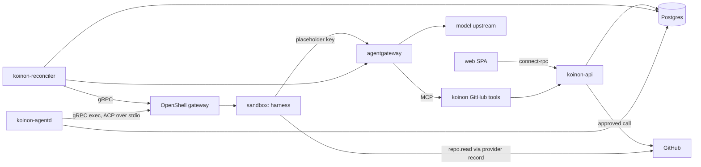

# v0.1 milestone plan

Status: draft for review (2026-10-22). Decisions behind it: ADRs [0024](../adr/0024-roadmap.md),
[0035](../adr/0035-v01-flavors.md), [0036](../adr/0036-v01-demo.md),
[0048](../adr/0048-openshell-spike-results.md) (Proposed, #15) and
[0049](../adr/0049-v01-scope-decisions.md), amended on 2026-10-23 by
[0053](../adr/0053-hermes-context-file-patch.md) to [0058](../adr/0058-gateway-modes.md), and on
2026-10-26 by [0059](../adr/0059-v01-opencode-only.md) (OpenCode only; F2 and F3 dropped). After review, each item below becomes a GitHub issue in
milestone `v0.1`, labelled with its component and added to the Koinon project.

## Goal

The 15-minute quickstart from ADR 0036, on a cluster that already has Agent Sandbox, OpenShell,
Kata and the CNPG operator:

1. `helm install` Koinon.
2. Create a repo-helper agent from a template, pick a flavor, connect GitHub, and activate it.
3. Message it: create a ticket on the board.
4. Watch the run live in the ticket view.
5. Approve its pull request on the approval card; Koinon opens the PR and the run resumes.

**Done** when this passes on the home lab with Kata and a real model (recorded run, at most 15
minutes from `helm install`), and the same steps pass as a kind e2e test in CI with `runc` and the
fake model server.

## Shape of the system

`koinon-github-tools` is the MCP server behind agentgateway for the ask-tier GitHub tools; it can
ship inside `koinon-api` if a separate process adds nothing (decided in C3).

## Components and labels

| Label | Covers |
| --- | --- |
| `api` | `koinon-api`: data model, auth, connect-rpc services, run state machine, approvals, ledger |
| `reconciler` | `koinon-reconciler`: `ExecutionBackend`, OpenShell objects, sandbox lifecycle |
| `agentd` | `koinon-agentd`: ACP client over exec, run driving, resume |
| `gateway` | `ModelGateway` drivers (standalone, kubernetes), keys, budgets, MCP routes |
| `connectors/github` | connector type, GitHub App connection, tools, tokens |
| `flavors` | OpenCode image and contract (Hermes and pi dropped, ADR 0059) |
| `templates` | template schema and the repo-helper template |
| `web` | SPA screens |
| `charts` | Helm chart, preflight |
| `test` | fake model server, e2e, escape suite, contract and isolation suites |
| `ci` | workflows, release |
| `docs` | quickstart and reference docs |

## Milestones inside v0.1

| Phase | Outcome |
| --- | --- |
| **M0 Spikes** | the two unknowns from ADR 0049 answered |
| **M1 Walking skeleton** | ticket → run on OpenCode → streamed reply, on kind and on the home lab |
| **M2 GitHub and approvals** | repo helper opens a PR through park, approve, execute, resume |
| **M3 Breadth** | spend ledger, Kubernetes-mode gateway, preflight, quickstart docs |
| **M4 Release** | e2e, escape suite, release workflow, recorded home-lab run |

Each item lists its dependencies; items without one can start at once.

### Order of work (decided 2026-10-23)

1. Housekeeping: rename the Go module to `github.com/stateracloud/koinon` and the registry to
   `ghcr.io/stateracloud` in one PR; the DCO check exempts `dependabot[bot]` only; add the
   `flavors` check to the required checks after a week with no flakes.
2. The ADR batch (0053 to 0058) with this plan and the UI-doc updates.
3. Demo blockers: the flavor refactor (one flavor descriptor plus `flavors/common`), X1, E2 and the
   browser e2e.
4. DOC1, then REL1, then REL2 run A.

Auto-merge after green checks is allowed for housekeeping and CI, docs, ADRs and plan, and
implementation PRs; implementation PRs also need an opus review first.

---

## M0 Spikes

### S1. OpenShell on kind in GitHub's runners (`test`)

- A workflow job creates a kind cluster, installs Agent Sandbox v1.0.7 and OpenShell 0.1.5 with a
  `runc` RuntimeClass as default, creates one sandbox and runs `exec --no-tty -- echo ok`.
- Recorded: wall-clock time, runner size, memory headroom, and any change OpenShell needs on kind.
- Result written to `docs/spikes/kind.md` with a go/no-go for running E1 and E2 on free runners;
  on no-go, a proposal (self-hosted runner on the home lab, or a smaller CI e2e).

### S2. agentgateway Kubernetes mode: budgets through `rawConfig` (`gateway`)

- On the home lab (cluster change, so through Rivet and procoduck): `agentgateway-crds` and the
  controller v1.6.0 in a spike namespace; a Koinon-owned `Gateway` with Gateway-level
  `AgentgatewayParameters`.
- `rawConfig` carries the standalone budget configuration (keys with `metadata.name`, a budget,
  the database). Pass: a key over budget gets `429 budget_exceeded` with at most one response of
  overshoot, as in spike 5.4. Fail: the setting is rejected or ignored.
- The model cost catalog through `modelCatalog` produces USD in the access log.
- Result appended to ADR 0049; on fail, G2 uses key revocation with a token rate limit.
- **Done 2026-10-22: pass.** Budgets work through `rawConfig` with under one response of overshoot;
  the bind needs a port in the Parameters' Service overlay (ADR 0049, `hack/spike/s2/`).

---

## M1 Walking skeleton

### D1. Core schema (`api`)

- goose migrations after `00001_initial.sql` for `templates`, `agents` (draft, active, archived),
  `agent_versions`, `tickets` (To do, In progress, Waiting on you, Done), `ticket_events`, `runs`
  with the ADR 0030 state machine and ownership epoch, `run_events`.
- Every org-owned table keys on `(org_id, id)` with composite foreign keys; migrations are
  append-only and zero-padded (the `migrations` CI job enforces both).
- sqlc queries with `org_id` as a required parameter; a test fails if a query on an org-owned table
  lacks an `org_id` predicate.
- testcontainers Postgres tests cover each state transition and reject stale-epoch updates.

### D2. Org isolation suite (`api`, `test`) — depends on D1, A2

- Two orgs with the same fixtures; every connect-rpc method is called with the other org's IDs and
  must return `not_found` or `permission_denied`, never data.
- New RPCs fail CI until they are listed in the suite (a registry check over the service
  descriptors).

### A1. Bootstrap admin and default org (`api`, `charts`)

- On first start the API creates the default org and a platform admin whose one-time password is
  in a Kubernetes Secret named in the install notes; the first login forces a password change.
- The bootstrap login can be disabled by a chart value once OIDC works.

### A2. OIDC login and sessions (`api`, `web`)

- Generic OIDC (authorization code + PKCE) configured from chart values; roles come from Postgres
  (ADR 0004), and group mappings use `org_group_mappings`.
- Session cookies are HTTP-only, `SameSite=Lax`, with a server-side session table; logout revokes.
- Tested against a test OIDC issuer in integration tests (no external IdP in CI).

### A3. connect-rpc API surface (`api`) — depends on D1

- Services: `AgentService` (create from template, get, list, activate, archive), `TicketService`
  (create, list by column, append message, get), `RunService` (get, cancel, `WatchRun` server
  stream), `TemplateService` (list).
- `buf lint` and `buf breaking` pass; generated Go and TypeScript are checked in by
  `make generate`.
- Authorisation per RPC: members create tickets; admins and owners activate agents.

### A4. Run scheduling (`api`) — depends on D1

- One active run per agent; further tickets for that agent queue in FIFO order.
- Run caps from the template (default 30 minutes wall-clock and a token cap); hitting one cancels
  the run with a ticket event saying why.
- Moving a ticket to Done cancels its queued runs.

### T1. Template schema and repo-helper template (`templates`)

- `templates/repo-helper.yaml`: flavor choices, instructions, suggested grants (GitHub
  `repo.read`, `pull_request.create`, `issue.comment`), preset Standard, run caps, model.
- A JSON Schema in `templates/schema/` validates every template in CI; templates are embedded in
  the API binary and synced to `templates` on start (versioned by content hash).
- Creating an agent from a template yields a draft; activation by an admin or owner approves its
  grants (ADR 0020).

### R1. `ExecutionBackend` over the OpenShell gateway (`reconciler`)

- A Go client generated from OpenShell's 0.1.5 protos, pinned and wrapped behind
  `internal/execution` (ADR 0048: generated client, not `sdk/go`).
- Operations: ensure workspace (one per org, ADR 0002), ensure provider records, ensure policy,
  create, start, stop and delete sandbox, exec with non-TTY stdin/stdout streams.
- Unit tests against a fake gateway server; an integration test on the home lab creates a Kata
  sandbox and runs `exec --no-tty`.

### R2. Agent reconciliation (`reconciler`) — depends on R1, D1, G1

- An active agent becomes: a sandbox on its flavor image, a PVC home, the agentgateway provider
  record (placeholder key, `stable_placeholder: true`), and its policy with
  `enforcement: enforce` (ADR 0045).
- Idle sandboxes stop after 10 minutes, parked runs included, and start again on demand
  (`session/load` on the PVC state).
- Archiving an agent deletes its sandbox and records; the PVC follows a retention value
  (default: delete).
- Every rendered object carries owner labels; drift from hand edits is reverted on the next
  reconcile.
- Sandbox names fit OpenShell 0.1.5's 19-character limit, found by the R1 integration test
  (#21). One naming function in `internal/execution` builds them.

### AG1. `koinon-agentd` (`agentd`) — depends on R1, A4, F1

- Picks up runs, takes ownership with the epoch, opens the exec stream, and speaks ACP through
  `coder/acp-go-sdk` pinned behind `internal/acp`.
- Session per ticket: `session/new` on the first run, `session/load` afterwards and after a stream
  drop; the session ID is stored on the ticket.
- Instructions (ADR 0052): before every harness start, agentd writes `/sandbox/.koinon/AGENTS.md`
  from the run's agent version (a short Koinon preamble plus the version's instructions), through
  a temporary file and a rename with umask 077, and records its hash with the session; a failed
  write fails the run. Before every prompt it checks the file's hash and the flavor's instruction
  link (OpenCode `AGENTS.md`, a link to the file) and
  restores a changed or missing file or link (`run.instructions_restored`); a link that cannot be
  restored fails the run. A version bump applies at the next run, without recreating the sandbox.
- The agent version's config is read with `agentconfig.Parse`, the single parser for
  `agent_versions.config` (agentd, the ledger, the reconciler and the API all use it). A config
  agentd cannot read leaves the run without a model, harness settings or instructions of its own.
- Sessions resume by default; activating a version with "Apply to open tickets now" (default off,
  audited) makes the next run of each open ticket start a new session with a handoff: the title,
  the agent's latest end-of-turn note, its last three replies, the people's messages and open
  approval outcomes, capped at about 8,000 tokens (bytes / 3), oldest replies dropped first. After
  every turn agentd sends one more prompt asking the agent for that note (at most 2,000 tokens,
  instructed and truncated, charged to the budget as any model call). The prompt is not a timeline
  reply; the run is marked `summarizing`, so Koinon's tool servers record nothing, permission
  requests are rejected, and a note from an agent that called a tool is discarded. The ticket shows
  the latest note, collapsed, as "Agent's notes" (ADR 0051 amendment).
- A stuck sandbox (ADR 0054 amendment): after the sweep's last SIGKILL round agentd re-reads
  `/proc` every few seconds; a survivor after 60 s, whatever its state, is stuck, and pid, comm,
  state and wchan are recorded. Within 30 s agentd seals the workspace's uncommitted work (at most
  50 MB; the working tree against the newest commit GitHub has, untracked files included) in
  Postgres for 14 days (agentd posts the bundle to koinon-api, which seals it; agentd holds no KEK), and offers "Push saved work to a branch" as a system-made ask-tier
  approval; on approval the API pushes `koinon/wip/<ticket>-<time>` through the GitHub connector,
  never the default branch. A failed or timed-out save is reported on the timeline. The sandbox is
  marked unhealthy and the reconciler recreates it at once (parked runs stay parked and resume
  through the reset path); audited, with "Sandbox recreated: <reason>" on the ticket. At most three
  recreations per agent per 24 hours; then the agent is unhealthy: new runs are refused, owners and
  admins get an in-app notice, and an admin's "Resume agent" clears it (audited); an unhealthy
  agent's queued and resolved-parked runs wait, they are not failed. Tests use a fake `/proc` and a sandbox stub that
  cannot end a process; a real D state cannot be made on kind.
- Process sweep: before the harness starts, agentd ends every process the sandbox user runs except
  the sandbox's main process (`internal/agentd/sweep.sh`), so a run starts with nothing left of an
  earlier one; it records `run.sandbox_swept` when it ended any, and a sweep that cannot end
  everything fails the run. It sweeps again once the harness has ended, except when another worker
  may own the run or the run is parked; the next run's sweep catches what is left.
- After `session/new` or `session/load`, agentd waits (bounded) until the flavor announces
  Koinon's MCP tools (OpenCode: the command `koinon:github_koinon-ready`, from the `koinon-ready` prompt
  Koinon's MCP server publishes through agentgateway) and fails the run with a clear reason on
  timeout. It then selects the agent's model explicitly (`session/set_config_option`, model
  `koinon/<model>`) and never trusts or records the model the session reports.
- Session updates are written as `run_events` and fanned out to `WatchRun` streams within 1 s.
- Permission requests for in-sandbox actions follow ADR 0049's fixed mapping: read and
  sandbox-write (edit, delete, move, execute) are allowed in every preset, because the sandbox is
  the boundary; anything else is denied. Requests for paths outside the workspace (the session
  directory) are refused in every preset, whatever their kind: OpenCode v2 reports such reads
  with kind `read`. The mapping is the same for every flavor. Outside effects go through grants and approval tiers.
- Killing the agentd pod mid-run: the run resumes on another replica, with no duplicate events
  (test on kind).

### G1. `ModelGateway` interface and standalone driver (`gateway`) — depends on D1

- Interface: issue and revoke per-agent keys, set per-agent limits, render model routes and MCP
  routes. Usage is not read through the interface: agentgateway exports it to the ledger over
  OTLP (L1, ADR 0050).
- Standalone driver writes agentgateway's config (keys by hash, budgets, one OpenAI-compatible
  upstream with optional request overrides, MCP routes with CEL tool allowlists, access-log
  attributes `koinon.key`/`koinon.agent`) and waits for the hot reload.
- Key material lives only in Kubernetes Secrets and the OpenShell provider record; the config
  holds hashes.
- Test: render-and-load against a real agentgateway v1.6.0 container (testcontainers).

### F1. OpenCode flavor (`flavors`)

- `flavors/opencode/`: OpenCode **2.0.24** (`@opencode/cli-linux-{x64,arm64}`, pinned by sha256;
  ADR 0052), image built with buildx, entry script that sets `PATH` and the environment and execs
  `opencode acp` by absolute path (ADR 0048 finding), read-only global config at
  `/etc/koinon/opencode` (`OPENCODE_CONFIG_DIR`), model and MCP endpoints passed by agentd (the
  gateway URL the provider record is bound to), phone-home off.
- Instructions: agentd writes `/sandbox/.koinon/AGENTS.md` per run and checks its hash before
  every prompt (AG1); the image links the global `AGENTS.md` to it (2.0.24 ignores the
  `instructions` key). The entry script refuses to start without the file (exit 64).
- Repository harness config is ignored (`OPENCODE_DISABLE_PROJECT_CONFIG`): a repository cannot
  change the agent's tools, permissions or instructions. Koinon's instructions tell the agent to
  read the repository's `AGENTS.md`, `CONTRIBUTING.md` and README as content. Configuration seeded
  in the agent's home has no effect either (#84).
- Plugins are a template option (`spec.harness.pluginInstalls`), off by default (repo-helper keeps
  it off). Off, no plugins load from the home or a repository. On, the entry script lists each
  directory under `~/.config/opencode/plugins/` in `OPENCODE_CONFIG_CONTENT`; those plugins run
  inside OpenCode with its privileges (#84), and the sandbox policy adds read-only egress to the
  npm registry, with no credentials.
- Re-pinning to a later 2.0.x (2.0.30 reads the `instructions` key) is #85.
- Flavor contract test (`test/flavors`): initialize, session/new, prompt, permission, cancel,
  session/load after restart, against the fake model server.

### FM1. Fake model server (`test`)

- OpenAI-compatible `/v1/chat/completions` (streaming and not) and Anthropic-compatible
  `/v1/messages`, with scripted responses including tool calls and SSE usage events.
- Scripts are selected per test by model name; unknown models return 404.
- Registered as an agentgateway upstream in e2e (ADR 0025).

### W1. App shell, board and ticket view (`web`) — depends on A3

- Login (bootstrap and OIDC), board with the four columns, create ticket for an agent.
- Ticket view: conversation and run timeline in one stream (ADR 0017), live through `WatchRun`
  (connect-web server streaming), with reconnect and no duplicated events.
- Vitest for components; Playwright for create-ticket-and-watch against the fake model.

### H1. Chart skeleton (`charts`)

- Deploys `koinon-api`, `koinon-reconciler`, `koinon-agentd`, a migration Job, and the bundled
  standalone agentgateway (SQLite on a PVC, one replica).
- `postgres.mode: cnpg | external`; model upstream from values plus a key Secret; bootstrap admin
  Secret; optional ingress (off).
- RBAC least privilege per component; standard NetworkPolicy only (no CNI-specific resources);
  the sandbox-namespace ValidatingAdmissionPolicy from ADR 0048.
- `helm lint`, `helm template` with each mode, and a kubeconform check in CI.

### X1. Dev loop on the home lab (`ci`, `docs`)

- `tilt up` builds with ko and deploys the chart into `koinon` on the home lab against the
  existing OpenShell; a kind profile for laptops without the home lab.
- M1 exit check: a ticket to the OpenCode agent gets a streamed reply in the ticket view, on both.

---

## M2 GitHub connector and approvals

### C1. GitHub connector type and connection (`connectors/github`, `api`)

- Connector type as data: auth `app-credential`, hosts, scopes with tiers (ADR 0049), setup guide
  (ADR 0021).
- Connection: GitHub App ID, installation ID and private key through secure inputs; the key is
  stored as a Kubernetes Secret and never returned by the API.
- Installation tokens minted per use, narrowed to the granted repositories and permissions,
  cached under their 1-hour lifetime.

### C2. Read grant in the sandbox (`connectors/github`, `reconciler`) — depends on C1, R2

- `repo.read` renders an OpenShell provider record with a read-only installation token
  (`stable_placeholder: true`, refreshed before expiry without a sandbox restart, spike 2.7) and
  policy for `git` over HTTPS and REST `GET` on the granted repositories.
- Escape-suite cases: push, `POST` and other repositories are denied by policy.

### C3. GitHub tools behind agentgateway (`connectors/github`, `gateway`) — depends on G1, C1

- MCP server exposing `create_pull_request` (branch, title, body, files), `comment_on_issue` and
  `get_approval_status`; agentgateway routes it with a CEL allowlist built from the agent's grants.
- `create_pull_request` refuses changes under `.github/workflows/` and above the size cap (100
  files or 1 MiB) with a tool error saying why.
- Decide here whether the server runs inside `koinon-api` or as its own Deployment; record it in
  the PR.

### P1. Park, approve, execute, resume (`api`, `agentd`) — depends on C3, AG1

- An ask-tier call records the request (tool, canonical arguments, `args_sha256`, target) and
  returns "approval requested" at once; the run parks and the ticket moves to Waiting on you.
- Approval binds to `args_sha256`; a different hash returns `409`. Execution uses an idempotency
  key and a pre-create lookup, so replays return the same PR (spike 6.3, 6.4).
- After execution agentd resumes the session (`session/load` if the sandbox stopped) and sends the
  result; the agent's next turn sees the PR URL.
- Denial resumes with a denial result; expiry after 7 days cancels with a ticket event.
- Approvers: org admins and owners; others see the card read-only.

### W2. Approval card and Waiting on you (`web`) — depends on P1

- The card leads with push-and-run risk: workflow and CI files, scripts, dependency manifests,
  binaries, change size; the full diff is collapsed below.
- Approve and deny with an optional note; the result appears in the ticket timeline.
- Waiting on you lists the viewer's pending approvals.

### W3. Agent from template and GitHub connection pages (`web`) — depends on T1, C1

- Template picker, flavor choice, repository grant, draft summary, Activate (admins and owners).
- GitHub connection page walks the setup guide with secure inputs.

### M2 exit check

On the home lab, the repo-helper agent on OpenCode opens a real PR on a test repository after one
approval, and the token never appears in the sandbox (escape-suite secrets-on-disk and env checks).

---

## M3 Breadth

### F2. Hermes flavor (`flavors`) — dropped

Dropped on 2026-10-26: v0.1 ships OpenCode only ([0059](../adr/0059-v01-opencode-only.md)). The
Hermes image, entry script, context-file patch and contract tests are deleted; issue #36 is closed
as not planned. A later release can add the flavor again as a descriptor-table entry.

### F3. pi flavor (`flavors`) — dropped

Dropped on 2026-10-26 with F2 ([0059](../adr/0059-v01-opencode-only.md)); issue #37 is closed as
not planned.

### L1. Minimal spend ledger (`api`, `gateway`) — depends on G1, AG1

- agentgateway exports its access log over OTLP to `koinon-api`; entries map to runs by
  `koinon.key`/`koinon.agent` and the run's time window.
- `spend_entries` (tokens in and out, USD) per request; run and ticket totals in the ticket view.
- One per-agent limit from the template, per calendar day in UTC (ADR 0050), pushed to
  agentgateway; hitting it cancels the run (reason `spend_limit`) with a clear ticket event, the
  same control-plane path as the run caps.

### PV1. Per-org providers and models (`api`, `gateway`) — depends on D1, A2, G1

- Done, backend (2026-10-23; ADR 0056 amendment). Providers and models are org-scoped rows; a provider
  key is envelope-encrypted in Postgres (a fresh DEK per value, AES-256-GCM, AAD bound to org, table,
  row and column), wrapped by a KEK from a Secret the chart generates and keeps, or an existing one,
  mounted into `koinon-api` and `koinon-reconciler` only. `koinon-api keys status|add|activate|rewrap|
  retire|reencrypt` rotate it; runbook in `docs/ops/secret-keys.md`, research in
  `docs/research/kek-rotation.md`.
- Done: the append-only `audit_events` table, written by the shared service layer.
- Done: the admin API under `/admin/v1` (OpenAPI 3.1, `api/admin/v1/openapi.yaml`, oapi-codegen):
  providers, models and API tokens (org-scoped, admin or owner, 30 days by default and 90 at most,
  shown once, hashed, revocable, every call audited). Tokens are also created through the UI's
  connect-rpc `TokenService`.
- Done: declarative Secrets (`koinon.dev/secret-type: model-provider` or `connection`) imported by
  `koinon-api`, read-only, declared wins, audited as `secret <name>`.
- Done: GitHub connections moved into the store; existing rows move at startup.
- Done: the reconciler writes the opened provider keys into one Secret for the gateway and renders
  each org's providers and models as `<org>/<model>`; the G1 suite covers multi-org rendering, the
  guard and org isolation. The Helm `model.*` values are gone (no migration path: nobody had installed).
- Not done: the UI pages (next PR, W4) and the price schema (PV2). Rates stay on the model until PV2.

### PV2. Price schema and default price list (`api`) — depends on PV1, L1

- Done (2026-10-24; ADR 0056 amendment). `internal/money` is the one money type (pico-USD integers,
  issue #48); prices are rates per usage type for disjoint buckets (input, cache read, cache write,
  output, reasoning) with context tiers, glob or regex match, dated versions; org prices are
  append-only versions that win over the default list, and every ledger entry records its price ref.
- Done: `pricing/default.yaml`, embedded, 14 entries read from the providers' own pricing pages with
  URL and access date, validated by a CI test; versions recorded per installation with a diff
  endpoint; flagged entries (> 1% from the gateway's cost) listed by an admin endpoint. Process in
  `docs/ops/prices.md`.
- Done: the ledger stores raw usage next to the gateway's cost and recomputes cost from the dated
  price (that cost counts for limits and reports). Missing usage is estimated (reported counts first,
  bytes over a per-model ratio, `max_tokens` for aborted thinking models, offline tiktoken for OpenAI
  text, calibration that only raises), flagged and counted toward limits.
- Done: prices, tiers included, are rendered into agentgateway's `modelCatalog` per org.
- Done (W4): PV1's per-model rates are folded into dated org price entries (migration 00014) and the
  Prices page exists.
- Not done: the live access log carries request bytes but not response bytes, and Koinon never logs text, so
  aborted output settles at `max_tokens` (or the entry's `max_output`).

### BG1. Org and agent budgets (`api`, `gateway`) — depends on PV2, L1

- Done (2026-10-24; ADR 0056 amendment). An org monthly cap (calendar month, UTC), per-agent daily
  limits (UTC day) and a per-org platform ceiling (platform admin, off by default), set through the
  service layer, `/admin/v1` and `BudgetService`; the template's `spendUSD` is only the default a new
  agent starts with.
- Done: each key's gateway budget is the smallest remaining amount; the ledger cancels at the first
  limit reached (every open run of the org for an org-wide one) with the reason `spend_limit` and the
  limit named.
- Done: 80% and 100% alerts as stored in-app notifications (platform admins for the ceiling), the
  cancel event as the ticket note; `budget.Notifier` is the seam for email later.
- Done (W4): the Budgets page, the notice banner, the notifications list and the platform ceiling page.

### MC1. Remote MCP servers and allowlists (`api`, `gateway`, `connectors/github`) — depends on G1, C3

- Remote MCP servers registered per org with org secrets injected; a per-agent allowlist of servers,
  optionally narrowed to tools, rendered as `mcpAuthorization` rules (ADR 0057).
- `failClosed` is false and servers are health-checked.
- Done (decided 2026-10-24, ADR 0057 amendment): v0.1 is **remote servers only** (Streamable HTTP or
  SSE, one optional static credential: a header and a secret, sealed in the secret store). Servers are
  created in the UI, with `/admin/v1/mcp-servers` or with Secrets labelled
  `koinon.dev/secret-type: mcp-server` (read-only in the UI, the declared one wins, removal disables).
  A server that needs per-user OAuth is refused when added (a 401 whose `WWW-Authenticate` names
  `resource_metadata`); OAuth is v0.2.
- Done: the URL policy is the providers' one, now `egress.allowedInternalHosts` (the old
  `providers.allowedInternalHosts` is a deprecated alias for one release).
- Done: gateway targets `<org slug>-<server>` with an org condition, `failureMode: failOpen`, the
  credential injected from a hash-named file in the gateway-only Secret (the provider key settle logic),
  the client's copy of the credential header removed, per-agent `mcpAuthorization` rules by tier. Checked
  against agentgateway v1.6.0 in the gateway spec suite and the kind e2e.
- Done: every tool starts in the ask tier (a call is recorded as an approval request by koinon-api's
  `/mcp-ask/<server>` proxy; after approval Koinon makes the call through the gateway with a per-org executor
  key, once, bound to the server, URL and tool version); an admin moves it to auto or never;
  `readOnlyHint` is only a suggestion; later tools enter the ask tier; a changed description or schema
  flags the tool for review and drops an auto tool to ask until reviewed. A tool can require two approvers
  (off by default). The gateway runs with `prefixMode: always`: tool names are `<target>_<tool>`.
- Done: the reconciler probes every server through the gateway every 60 s (initialize and tools/list),
  syncs the tool list, and three failures in a row withdraw the server's tools until one probe succeeds;
  agentd tells the agent at session start which allowed servers are down.
- Done: audit events for every change; the Servers page and the agent allowlist editor are W4.

### W4. Providers, models and budgets pages (`web`) — depends on PV1, BG1, MC1

- Owner and admin pages for providers, models, prices, budgets and MCP servers with allowlists;
  members do not see them.
- Done (2026-10-24): prices (default list with source links and change markers, org overrides, flagged
  requests), budgets (cap, agent limits, notifications, banner), the platform ceiling page, and estimated
  against reported requests on run and ticket costs.
- Done (MC1, 2026-10-24): the Servers page (health, source, tools with tier controls and review flags,
  add, edit and delete with a write-only credential) and the agent page's MCP allowlist editor; members do
  not see them.

### G2. agentgateway Kubernetes-mode driver (`gateway`) — depends on G1, S2

Decided by procoduck 2026-10-25 after [agentgateway-k8s-crds](../research/agentgateway-k8s-crds.md); the
decisions are in ADR [0049](../adr/0049-v01-scope-decisions.md) and [0058](../adr/0058-gateway-modes.md).

- `gateway.mode: kubernetes` is explicit, with `gateway.kubernetes.gatewayClassName` (default
  `agentgateway`). The install preflight fails with a clear message when the GatewayClass, the four
  `agentgateway.dev/v1alpha1` CRDs or the tested controller line (v1.6.x) are missing. No silent fallback.
- `internal/gateway/kubernetes` implements `ModelGateway` with native CRDs only (no `rawConfig`), in
  Koinon's namespace, never touching other gateways: Koinon's `Gateway`; per-agent key hashes in watched
  ConfigMaps (`apiKeyAuthentication.configMapSelector`), probe and executor keys likewise;
  per-org `AgentgatewayModel`s (provider override, base URL, provider key by `secretRef` to the reconciler's
  gateway-only Secret, `stream_options` and routing-guard transformations, authorization CEL on the key's
  org); `x-koinon-org` stamping at `PreRouting`; the access log with the ledger's attributes, exported over
  OTLP; model prices by the catalog ConfigMap; MCP targets with Secret-held credentials, `FailOpen`,
  `prefixMode: Always`, per-tool authorization and removal of client-supplied credential headers.
- One plain model name per org is routed natively by per-model authorization (verified on kind); no
  org-prefixed names.
- Budgets are the S2 fallback: no gateway budgets. The ledger cancels runs and the reconciler removes the
  agent's keys from the key ConfigMap (no restart), restoring them when the window resets or the limit
  rises; an org cap or the ceiling revokes all the org's keys. Overshoot is bounded by the ingest delay,
  measured on kind (ADR 0049).
- Live check: the controller's status per object, the Warning events `AgentGatewayNackError`, then a probe key
  against the running proxy. A rejected object is reported on its org and does not block the others.
- MCP isolation: per-tool deny is accepted; another org's `initialize` and list requests may reach a server
  with its owner's credential (ADR 0058, the gateway-modes guide).
- Tests: the G1 suite (`internal/gateway/gatewaytest`) runs against both drivers; the Kubernetes one on kind
  with controller v1.6.0 (`hack/g2-kind.sh`, workflow `g2-kind`, manual), with specs for fallback budgets, a
  proxy pod replacement and rejected objects. The Go e2e (E1) still runs standalone mode; a Kubernetes-mode
  e2e is not built (the driver suite on kind covers the gateway).
- Chart: `gateway.kubernetes.port`, `preflight.agentgateway`, RBAC for the reconciler on these kinds and
  ConfigMaps in the release namespace, a NetworkPolicy for the proxy; `make chart-check` covers it.
- **Done (G2, 2026-10-25):** built as above. Differences from standalone mode are in the gateway-modes guide.

### H2. Preflight (`charts`)

- A pre-install hook Job fails with a clear message when Agent Sandbox, the OpenShell gateway, the
  `kata` RuntimeClass (or the configured one) or the CNPG operator (in `cnpg` mode) is missing.
- Warns, without failing, when Kata guest seccomp is off (ADR 0048).

### DOC1. Quickstart and reference docs (`docs`)

- Starlight site under `docs/site`: prerequisites with pinned install steps, the 15-minute
  quickstart, model configuration (OpenRouter with the routing guard; Ollama), GitHub App setup,
  OIDC setup, agentgateway modes.
- Every command in the quickstart runs in the E1 e2e test, so the docs cannot drift.

---

## M4 Release

### E1. Quickstart e2e on kind (`test`, `ci`) — depends on S1, M2 exit, H2

- CI job: kind with `runc`, prerequisites, `helm install`, then Playwright drives steps 2–5
  against the fake model server and a fake GitHub API (or a throwaway repository, decided in the
  PR, without paid services).
- `workflow_dispatch` only while the repository is private (Actions minutes cost money). When it
  goes public: every PR to `main` if S1 says the free runners can carry it; nightly otherwise.

### E2. Sandbox escape suite (`test`) — depends on R2, C2

- ADR 0025 cases plus spike 8: no direct egress, no cloud metadata, no service-account token, no
  secrets on disk or in env, placeholders only, VAP blocks pod creation and Kata annotations.
- Per PR, the admission cases (the chart's ValidatingAdmissionPolicies) run on envtest in the
  `escape-admission` CI job, which is not a required check. The OpenShell cases need a gateway and
  run in the home lab, with Kata as a manual release gate.

### E3. Flavor contract tests in CI (`test`, `flavors`) — depends on F1

- Every flavor (OpenCode only, ADR 0059) passes the contract suite against the fake model server on every PR: the
  `flavors` CI job builds the images with `make flavors` (a tag per source tree,
  `hack/flavor-tag.sh`, so worktrees and branches never overwrite each other's image; layer cache
  kept between runs) and runs `go test ./test/flavors/...`. The suite uses the fake model server and
  a fake key only, so CI never calls a paid model. The job is not a required check yet.

### REL1. Release workflow (`ci`)

- A tag `vX.Y.Z` or `vX.Y.Z-rc.N` runs `.github/workflows/release.yml`. First a separate `gate` job
  (`hack/release-gate.sh`) checks that the tagged commit is on `main` and that the required CI
  checks succeeded on it; it does not rerun tests and can be swapped for a "local checks recorded"
  gate later.
- GoReleaser OSS (kos pipe) builds `koinon-api` (with the web UI), `koinon-reconciler` and
  `koinon-agentd` for linux/amd64 and linux/arm64 and pushes them to private
  `ghcr.io/stateracloud/<name>:<version>` (no leading `v`; `latest` only for final releases), with
  ko SPDX SBOMs. The Helm chart gets its version and appVersion from the tag, is packaged with
  Helm 4 and pushed to `oci://ghcr.io/stateracloud/charts`.
- **Flavor images are not released in v0.1.** The flavor design is being reopened as "bring your own
  harness"; until that is decided the release builds no flavor image.
- cosign keyless signing (image manifests and the chart) and SBOM attestations are present but run
  only when the repository variable `RELEASE_SIGNING` is `true` (ADR 0049; off while private).
- GoReleaser drafts release notes from the Conventional Commits (features, fixes, others), and the
  release is created as a draft. `-rc.N` is a prerelease.
- `hack/mirror-release.sh <version> <registry>` copies a version's images and chart to another
  registry (REL2 run A installs the rc from the home-lab Zot). Process: `docs/dev/releasing.md`.

### REL2. Recorded home-lab run (`docs`, `test`) — depends on everything above

Two runs. **Run A** is in v0.1, with a $5 spend cap. **Run B**, with the shared gateway driver
(ADR 0058), is in v0.2. The text below describes run A. REL2 produces release evidence and a README
demo.

- From a clean `koinon` namespace: `helm install` to an approved PR in at most 15 minutes, on Kata,
  with DeepSeek V4.1 Flash through OpenRouter; the OpenCode flavor runs the template once.
- Transcript, timings and spend recorded in `docs/releases/v0.1.md`. Run A stops at $5 of spend.

---

## Moved to v0.2

Decided 2026-10-23; the ADRs are written now.

- Chat as its own object (ADR 0055).
- Container MCP servers, the MCP catalog from the MCP Registry, discovery per gateway mode and
  platform-offered servers (ADR 0057).
- The shared gateway driver and REL2 run B (ADR 0058).

## Follow-ups from #12, placed

| Follow-up | Where |
| --- | --- |
| agentgateway deployment mode, per-key limits, `llm.cost` export | done in spike 5 (ADR 0048); S2, G1, G2, L1 |
| OpenCode, Hermes and pi through agentgateway | done in spike 7; F1 (F2, F3 dropped, ADR 0059) |
| Price-catalog misses (block vs fallback price) | L1: block requests to models without a price |
| Progressive search-and-call MCP endpoint | later (v0.5) |
| agentgateway A2A, depth and cycle key | later (v0.3) |
| Route ask-tier tools to approvals (CEL vs ExtMCP) | done in spike 6; C3 uses CEL, ExtMCP later |
| Two-person rule, cross-org approvers | later (v0.2) |
| Learned rule suggestions (RFC 0002) | later (v0.2) |
| Idempotency keys for writes outside MCP tools | P1 covers v0.1's only write path |
| Koinon OIDC issuer | later (v0.2, with cloud connectors) |
| Azure identity pooling, Azure DevOps licensing | later (v0.2) |
| SPIFFE trust domain and ID format | later (v0.4) |
| Commit and PR attribution trailers | P1: `Requested-by`, `Approved-by` in the commit message |
| Session lifetime, IdP group re-sync | A2 (session lifetime); re-sync later (v0.4) |
| Escape cases for in-sandbox credentials | later (v0.2, with ADR 0044) |
| VAP: runtime classes, ephemeral containers, bypass flags | H1 (from ADR 0048) |
| OpenShell Go SDK vs generated client | decided: generated (ADR 0048); R1 |
| Grant and exposure changes on running sandboxes | R2: policy updates in place, other changes recreate the sandbox |
| Personal org namespace timing | later (v0.4) |
| agentd process model (#8) | decided in ADR 0049; AG1; close #8 |
| Resume order per flavor, contract tests | AG1, F1, E3 |
| Parked-run idle timeout, one run per agent | decided in ADR 0049; A4, P1, R2 |
| Run transitions under the epoch; alarm polling vs NOTIFY | D1, AG1 (polling with `SKIP LOCKED` in v0.1) |
| pi-acp risk | dropped with F3 (ADR 0059) |
| Hermes ACP-only | dropped with F2 (ADR 0059) |
| Pin `coder/acp-go-sdk` behind `internal/acp` | AG1 |
| Per-flavor instruction file generator | AG1 writes `/sandbox/.koinon/AGENTS.md` per run; F1 reads it (ADR 0052) |
| Org isolation suite; RLS | D2; RLS later (v0.4) |
| Org creation flow | decided: default org only (A1) |
| Postgres packaging | decided (ADR 0049); H1 |
| Event subscription filter language | later (v0.2) |
| Cross-org A2A billing | later (v0.3) |
| Outbox retention and fan-out across replicas | AG1 (`WatchRun` fan-out across API replicas) |
| Audit hash chain | later (v0.2); v0.1 records approvals and executions in `ticket_events` |
| Artifacts | decided: out of v0.1 |
| restic vs kopia | later (with checkpoints) |
| Memory scope | decided: out of v0.1 |
| Pull-through cache | later (v0.5) |
| Secret store for v0.1 | decided: Kubernetes Secrets, ESO for external stores (ADR 0049) |
| Connector type and setup-guide schema | C1 |
| Template schema and versioning | T1 |
| Revocation latency, per-caller rate limit | later (v0.3) |
| Auto-close for conversational tickets | later (v0.2) |
| Slack/Teams mirroring | later (v0.2) |
| Waiting on you for group approvers | W2 for admins and owners; groups later |
| DCO enforcement | done in #13 (`dco.yml`) |
| Migration lint | done in #13 (`migrations` job); D1 |
| OpenShell on kind in runners | S1 |
| Nightly eval budget | later (v0.2) |
| Escape suite on Kata as release gate | E2 |
| Flavor image cadence; minimum Helm version | REL1: no flavor images in v0.1 (harness decision pending); chart built and tested with Helm 4 |
| Going-public checklist | later (going public) |
| `koinon` org move | decided: at going public |
| Home-lab registry, migration run mode | X1 (Zot for dev images), H1 (migration Job) |
| Quickstart prerequisites in the 15 minutes | decided: no (ADR 0049) |
| CI layout and blocking checks (#2) | done in #13 |
| v0.1 UI scope, template, GitHub scopes (#4) | this plan |

## Issue bookkeeping after approval

- Create milestone `v0.1` and the component labels above.
- One issue per item (S1 … REL2), with its acceptance criteria and dependencies as task-list links.
- Close #4 with a link to this plan, #8 per ADR 0049, and #5 as "build".
