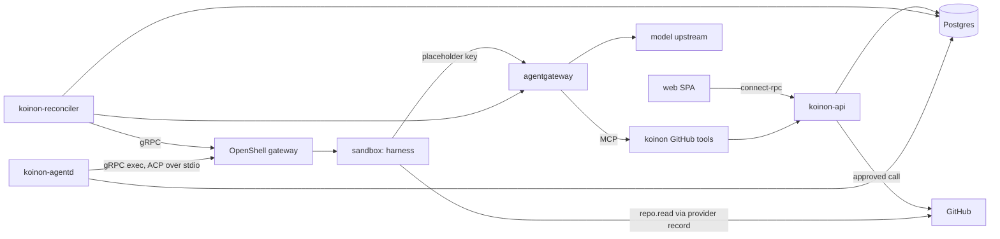

# v0.1 milestone plan

Status: draft for review (2026-10-22). Decisions behind it: ADRs [0024](../adr/0024-roadmap.md),
[0035](../adr/0035-v01-flavors.md), [0036](../adr/0036-v01-demo.md),
[0048](../adr/0048-openshell-spike-results.md) (Proposed, #15) and
[0049](../adr/0049-v01-scope-decisions.md). After review, each item below becomes a GitHub issue in
milestone `v0.1`, labelled with its component and added to the Koinon project.

## Goal

The 15-minute quickstart from ADR 0036, on a cluster that already has Agent Sandbox, OpenShell,
Kata and the CNPG operator:

1. `helm install` Koinon.
2. Create a repo-helper agent from a template, pick a flavor, connect GitHub, and activate it.
3. Message it: create a ticket on the board.
4. Watch the run live in the ticket view.
5. Approve its pull request on the approval card; Koinon opens the PR and the run resumes.

**Done** when this passes on the home lab with Kata and a real model (recorded run, at most 15
minutes from `helm install`), and the same steps pass as a kind e2e test in CI with `runc` and the
fake model server.

## Shape of the system

`koinon-github-tools` is the MCP server behind agentgateway for the ask-tier GitHub tools; it can
ship inside `koinon-api` if a separate process adds nothing (decided in C3).

## Components and labels

| Label | Covers |
| --- | --- |
| `api` | `koinon-api`: data model, auth, connect-rpc services, run state machine, approvals, ledger |
| `reconciler` | `koinon-reconciler`: `ExecutionBackend`, OpenShell objects, sandbox lifecycle |
| `agentd` | `koinon-agentd`: ACP client over exec, run driving, resume |
| `gateway` | `ModelGateway` drivers (standalone, kubernetes), keys, budgets, MCP routes |
| `connectors/github` | connector type, GitHub App connection, tools, tokens |
| `flavors` | OpenCode, Hermes and pi images and contracts |
| `templates` | template schema and the repo-helper template |
| `web` | SPA screens |
| `charts` | Helm chart, preflight |
| `test` | fake model server, e2e, escape suite, contract and isolation suites |
| `ci` | workflows, release |
| `docs` | quickstart and reference docs |

## Milestones inside v0.1

| Phase | Outcome |
| --- | --- |
| **M0 Spikes** | the two unknowns from ADR 0049 answered |
| **M1 Walking skeleton** | ticket → run on OpenCode → streamed reply, on kind and on the home lab |
| **M2 GitHub and approvals** | repo helper opens a PR through park, approve, execute, resume |
| **M3 Breadth** | Hermes and pi, spend ledger, Kubernetes-mode gateway, preflight, quickstart docs |
| **M4 Release** | e2e, escape suite, release workflow, recorded home-lab run |

Each item lists its dependencies; items without one can start at once.

---

## M0 Spikes

### S1. OpenShell on kind in GitHub's runners (`test`)

- A workflow job creates a kind cluster, installs Agent Sandbox v1.0.7 and OpenShell 0.1.5 with a
  `runc` RuntimeClass as default, creates one sandbox and runs `exec --no-tty -- echo ok`.
- Recorded: wall-clock time, runner size, memory headroom, and any change OpenShell needs on kind.
- Result written to `docs/spikes/kind.md` with a go/no-go for running E1 and E2 on free runners;
  on no-go, a proposal (self-hosted runner on the home lab, or a smaller CI e2e).

### S2. agentgateway Kubernetes mode: budgets through `rawConfig` (`gateway`)

- On the home lab (cluster change, so through Rivet and procoduck): `agentgateway-crds` and the
  controller v1.6.0 in a spike namespace; a Koinon-owned `Gateway` with Gateway-level
  `AgentgatewayParameters`.
- `rawConfig` carries the standalone budget configuration (keys with `metadata.name`, a budget,
  the database). Pass: a key over budget gets `429 budget_exceeded` with at most one response of
  overshoot, as in spike 5.4. Fail: the setting is rejected or ignored.
- The model cost catalog through `modelCatalog` produces USD in the access log.
- Result appended to ADR 0049; on fail, G2 uses key revocation with a token rate limit.
- **Done 2026-10-22: pass.** Budgets work through `rawConfig` with under one response of overshoot;
  the bind needs a port in the Parameters' Service overlay (ADR 0049, `hack/spike/s2/`).

---

## M1 Walking skeleton

### D1. Core schema (`api`)

- goose migrations after `00001_initial.sql` for `templates`, `agents` (draft, active, archived),
  `agent_versions`, `tickets` (To do, In progress, Waiting on you, Done), `ticket_events`, `runs`
  with the ADR 0030 state machine and ownership epoch, `run_events`.
- Every org-owned table keys on `(org_id, id)` with composite foreign keys; migrations are
  append-only and zero-padded (the `migrations` CI job enforces both).
- sqlc queries with `org_id` as a required parameter; a test fails if a query on an org-owned table
  lacks an `org_id` predicate.
- testcontainers Postgres tests cover each state transition and reject stale-epoch updates.

### D2. Org isolation suite (`api`, `test`) — depends on D1, A2

- Two orgs with the same fixtures; every connect-rpc method is called with the other org's IDs and
  must return `not_found` or `permission_denied`, never data.
- New RPCs fail CI until they are listed in the suite (a registry check over the service
  descriptors).

### A1. Bootstrap admin and default org (`api`, `charts`)

- On first start the API creates the default org and a platform admin whose one-time password is
  in a Kubernetes Secret named in the install notes; the first login forces a password change.
- The bootstrap login can be disabled by a chart value once OIDC works.

### A2. OIDC login and sessions (`api`, `web`)

- Generic OIDC (authorization code + PKCE) configured from chart values; roles come from Postgres
  (ADR 0004), and group mappings use `org_group_mappings`.
- Session cookies are HTTP-only, `SameSite=Lax`, with a server-side session table; logout revokes.
- Tested against a test OIDC issuer in integration tests (no external IdP in CI).

### A3. connect-rpc API surface (`api`) — depends on D1

- Services: `AgentService` (create from template, get, list, activate, archive), `TicketService`
  (create, list by column, append message, get), `RunService` (get, cancel, `WatchRun` server
  stream), `TemplateService` (list).
- `buf lint` and `buf breaking` pass; generated Go and TypeScript are checked in by
  `make generate`.
- Authorisation per RPC: members create tickets; admins and owners activate agents.

### A4. Run scheduling (`api`) — depends on D1

- One active run per agent; further tickets for that agent queue in FIFO order.
- Run caps from the template (default 30 minutes wall-clock and a token cap); hitting one cancels
  the run with a ticket event saying why.
- Moving a ticket to Done cancels its queued runs.

### T1. Template schema and repo-helper template (`templates`)

- `templates/repo-helper.yaml`: flavor choices, instructions, suggested grants (GitHub
  `repo.read`, `pull_request.create`, `issue.comment`), preset Standard, run caps, model.
- A JSON Schema in `templates/schema/` validates every template in CI; templates are embedded in
  the API binary and synced to `templates` on start (versioned by content hash).
- Creating an agent from a template yields a draft; activation by an admin or owner approves its
  grants (ADR 0020).

### R1. `ExecutionBackend` over the OpenShell gateway (`reconciler`)

- A Go client generated from OpenShell's 0.1.5 protos, pinned and wrapped behind
  `internal/execution` (ADR 0048: generated client, not `sdk/go`).
- Operations: ensure workspace (one per org, ADR 0002), ensure provider records, ensure policy,
  create, start, stop and delete sandbox, exec with non-TTY stdin/stdout streams.
- Unit tests against a fake gateway server; an integration test on the home lab creates a Kata
  sandbox and runs `exec --no-tty`.

### R2. Agent reconciliation (`reconciler`) — depends on R1, D1, G1

- An active agent becomes: a sandbox on its flavor image, a PVC home, the agentgateway provider
  record (placeholder key, `stable_placeholder: true`), and its policy with
  `enforcement: enforce` (ADR 0045).
- Idle sandboxes stop after 10 minutes, parked runs included, and start again on demand
  (`session/load` on the PVC state).
- Archiving an agent deletes its sandbox and records; the PVC follows a retention value
  (default: delete).
- Every rendered object carries owner labels; drift from hand edits is reverted on the next
  reconcile.
- Sandbox names fit OpenShell 0.1.5's 19-character limit, found by the R1 integration test
  (#21). One naming function in `internal/execution` builds them.

### AG1. `koinon-agentd` (`agentd`) — depends on R1, A4, F1

- Picks up runs, takes ownership with the epoch, opens the exec stream, and speaks ACP through
  `coder/acp-go-sdk` pinned behind `internal/acp`.
- Session per ticket: `session/new` on the first run, `session/load` afterwards and after a stream
  drop; the session ID is stored on the ticket.
- Session updates are written as `run_events` and fanned out to `WatchRun` streams within 1 s.
- Permission requests for in-sandbox actions follow ADR 0049's fixed mapping: read and
  sandbox-write (edit, delete, move, execute) are allowed in every preset, because the sandbox is
  the boundary; anything else is denied. Outside effects go through grants and approval tiers.
- Killing the agentd pod mid-run: the run resumes on another replica, with no duplicate events
  (test on kind).

### G1. `ModelGateway` interface and standalone driver (`gateway`) — depends on D1

- Interface: issue and revoke per-agent keys, set per-agent limits, render model routes and MCP
  routes. Usage is not read through the interface: agentgateway exports it to the ledger over
  OTLP (L1, ADR 0050).
- Standalone driver writes agentgateway's config (keys by hash, budgets, one OpenAI-compatible
  upstream with optional request overrides, MCP routes with CEL tool allowlists, access-log
  attributes `koinon.key`/`koinon.agent`) and waits for the hot reload.
- Key material lives only in Kubernetes Secrets and the OpenShell provider record; the config
  holds hashes.
- Test: render-and-load against a real agentgateway v1.6.0 container (testcontainers).

### F1. OpenCode flavor (`flavors`)

- `flavors/opencode/`: image built with buildx, entry script that sets `PATH` and the environment
  and execs `opencode acp` by absolute path (ADR 0048 finding), read-only config under
  `/etc/koinon/`, model and MCP endpoints passed by agentd (the gateway URL the provider record
  is bound to), phone-home and plugin installs off.
- Flavor contract test (`test/flavors`): initialize, session/new, prompt, permission, cancel,
  session/load after restart, against the fake model server.

### FM1. Fake model server (`test`)

- OpenAI-compatible `/v1/chat/completions` (streaming and not) and Anthropic-compatible
  `/v1/messages`, with scripted responses including tool calls and SSE usage events.
- Scripts are selected per test by model name; unknown models return 404.
- Registered as an agentgateway upstream in e2e (ADR 0025).

### W1. App shell, board and ticket view (`web`) — depends on A3

- Login (bootstrap and OIDC), board with the four columns, create ticket for an agent.
- Ticket view: conversation and run timeline in one stream (ADR 0017), live through `WatchRun`
  (connect-web server streaming), with reconnect and no duplicated events.
- Vitest for components; Playwright for create-ticket-and-watch against the fake model.

### H1. Chart skeleton (`charts`)

- Deploys `koinon-api`, `koinon-reconciler`, `koinon-agentd`, a migration Job, and the bundled
  standalone agentgateway (SQLite on a PVC, one replica).
- `postgres.mode: cnpg | external`; model upstream from values plus a key Secret; bootstrap admin
  Secret; optional ingress (off).
- RBAC least privilege per component; standard NetworkPolicy only (no CNI-specific resources);
  the sandbox-namespace ValidatingAdmissionPolicy from ADR 0048.
- `helm lint`, `helm template` with each mode, and a kubeconform check in CI.

### X1. Dev loop on the home lab (`ci`, `docs`)

- `tilt up` builds with ko and deploys the chart into `koinon` on the home lab against the
  existing OpenShell; a kind profile for laptops without the home lab.
- M1 exit check: a ticket to the OpenCode agent gets a streamed reply in the ticket view, on both.

---

## M2 GitHub connector and approvals

### C1. GitHub connector type and connection (`connectors/github`, `api`)

- Connector type as data: auth `app-credential`, hosts, scopes with tiers (ADR 0049), setup guide
  (ADR 0021).
- Connection: GitHub App ID, installation ID and private key through secure inputs; the key is
  stored as a Kubernetes Secret and never returned by the API.
- Installation tokens minted per use, narrowed to the granted repositories and permissions,
  cached under their 1-hour lifetime.

### C2. Read grant in the sandbox (`connectors/github`, `reconciler`) — depends on C1, R2

- `repo.read` renders an OpenShell provider record with a read-only installation token
  (`stable_placeholder: true`, refreshed before expiry without a sandbox restart, spike 2.7) and
  policy for `git` over HTTPS and REST `GET` on the granted repositories.
- Escape-suite cases: push, `POST` and other repositories are denied by policy.

### C3. GitHub tools behind agentgateway (`connectors/github`, `gateway`) — depends on G1, C1

- MCP server exposing `create_pull_request` (branch, title, body, files), `comment_on_issue` and
  `get_approval_status`; agentgateway routes it with a CEL allowlist built from the agent's grants.
- `create_pull_request` refuses changes under `.github/workflows/` and above the size cap (100
  files or 1 MiB) with a tool error saying why.
- Decide here whether the server runs inside `koinon-api` or as its own Deployment; record it in
  the PR.

### P1. Park, approve, execute, resume (`api`, `agentd`) — depends on C3, AG1

- An ask-tier call records the request (tool, canonical arguments, `args_sha256`, target) and
  returns "approval requested" at once; the run parks and the ticket moves to Waiting on you.
- Approval binds to `args_sha256`; a different hash returns `409`. Execution uses an idempotency
  key and a pre-create lookup, so replays return the same PR (spike 6.3, 6.4).
- After execution agentd resumes the session (`session/load` if the sandbox stopped) and sends the
  result; the agent's next turn sees the PR URL.
- Denial resumes with a denial result; expiry after 7 days cancels with a ticket event.
- Approvers: org admins and owners; others see the card read-only.

### W2. Approval card and Waiting on you (`web`) — depends on P1

- The card leads with push-and-run risk: workflow and CI files, scripts, dependency manifests,
  binaries, change size; the full diff is collapsed below.
- Approve and deny with an optional note; the result appears in the ticket timeline.
- Waiting on you lists the viewer's pending approvals.

### W3. Agent from template and GitHub connection pages (`web`) — depends on T1, C1

- Template picker, flavor choice, repository grant, draft summary, Activate (admins and owners).
- GitHub connection page walks the setup guide with secure inputs.

### M2 exit check

On the home lab, the repo-helper agent on OpenCode opens a real PR on a test repository after one
approval, and the token never appears in the sandbox (escape-suite secrets-on-disk and env checks).

---

## M3 Breadth

### F2. Hermes flavor (`flavors`) — depends on F1

- ACP mode only: messaging gateway and self-improvement off; MCP from Hermes's own config with
  `${OPENAI_API_KEY}` header substitution (spike 7.6).
- Passes the flavor contract test, including an unknown session ID returning an error.

### F3. pi flavor (`flavors`) — depends on F1

- `pi-acp` pinned; MCP from pi's `mcp.json` with `exposure: direct` for the Koinon tools.
- No `session/resume`: agentd uses `session/load` for pi. Passes the contract test.
- Risk note in the PR: pi-acp is pre-1.0; vendor or fork policy if upstream stalls.

### L1. Minimal spend ledger (`api`, `gateway`) — depends on G1, AG1

- agentgateway exports its access log over OTLP to `koinon-api`; entries map to runs by
  `koinon.key`/`koinon.agent` and the run's time window.
- `spend_entries` (tokens in and out, USD) per request; run and ticket totals in the ticket view.
- One per-agent limit from the template, per calendar day in UTC (ADR 0050), pushed to
  agentgateway; hitting it cancels the run (reason `spend_limit`) with a clear ticket event, the
  same control-plane path as the run caps.

### G2. agentgateway Kubernetes-mode driver (`gateway`) — depends on G1, S2

- Detects an existing controller (`GatewayClass` `agentgateway`) and, when `gateway.mode: kubernetes`,
  creates Koinon's own `Gateway`, `AgentgatewayBackend`, `AgentgatewayPolicy` and
  `AgentgatewayParameters` in Koinon's namespace; the user's other gateways are never touched.
- Budgets as in standalone mode: the same LLM configuration rendered into the Gateway-level
  `AgentgatewayParameters.rawConfig` (S2), with its bind exposed through the Parameters' Service
  overlay.
- Budget state survives proxy pod replacement (a volume or external database through the
  Parameters' deployment overlay), or Koinon re-pushes limits net of recorded spend; a test
  replaces the proxy pod mid-window.
- The same G1 test suite passes against both drivers.

### H2. Preflight (`charts`)

- A pre-install hook Job fails with a clear message when Agent Sandbox, the OpenShell gateway, the
  `kata` RuntimeClass (or the configured one) or the CNPG operator (in `cnpg` mode) is missing.
- Warns, without failing, when Kata guest seccomp is off (ADR 0048).

### DOC1. Quickstart and reference docs (`docs`)

- Starlight site under `docs/site`: prerequisites with pinned install steps, the 15-minute
  quickstart, model configuration (OpenRouter with the routing guard; Ollama), GitHub App setup,
  OIDC setup, agentgateway modes.
- Every command in the quickstart runs in the E1 e2e test, so the docs cannot drift.

---

## M4 Release

### E1. Quickstart e2e on kind (`test`, `ci`) — depends on S1, M2 exit, H2

- CI job: kind with `runc`, prerequisites, `helm install`, then Playwright drives steps 2–5
  against the fake model server and a fake GitHub API (or a throwaway repository, decided in the
  PR, without paid services).
- `workflow_dispatch` only while the repository is private (Actions minutes cost money). When it
  goes public: every PR to `main` if S1 says the free runners can carry it; nightly otherwise.

### E2. Sandbox escape suite (`test`) — depends on R2, C2

- ADR 0025 cases plus spike 8: no direct egress, no cloud metadata, no service-account token, no
  secrets on disk or in env, placeholders only, VAP blocks pod creation and Kata annotations.
- On kind with `runc` per PR; on the home lab with Kata as a manual release gate.

### E3. Flavor contract tests in CI (`test`, `flavors`) — depends on F1, F2, F3

- All three flavors pass the contract suite against the fake model server on every PR that touches
  `flavors/` or `internal/acp`.

### REL1. Release workflow (`ci`)

- On tag: ko images for the three binaries, buildx images for the three flavors, the OCI chart,
  all to private `ghcr.io/procoduck`.
- cosign signing and SBOM attestations present but disabled behind one switch until the
  repository goes public (ADR 0049).
- GoReleaser drafts release notes from conventional commits.

### REL2. Recorded home-lab run (`docs`, `test`) — depends on everything above

- From a clean `koinon` namespace: `helm install` to an approved PR in at most 15 minutes, on Kata,
  with DeepSeek V4.1 Flash through OpenRouter; all three flavors run the template once.
- Transcript, timings and spend recorded in `docs/releases/v0.1.md`.

---

## Follow-ups from #12, placed

| Follow-up | Where |
| --- | --- |
| agentgateway deployment mode, per-key limits, `llm.cost` export | done in spike 5 (ADR 0048); S2, G1, G2, L1 |
| OpenCode, Hermes and pi through agentgateway | done in spike 7; F1–F3 |
| Price-catalog misses (block vs fallback price) | L1: block requests to models without a price |
| Progressive search-and-call MCP endpoint | later (v0.5) |
| agentgateway A2A, depth and cycle key | later (v0.3) |
| Route ask-tier tools to approvals (CEL vs ExtMCP) | done in spike 6; C3 uses CEL, ExtMCP later |
| Two-person rule, cross-org approvers | later (v0.2) |
| Learned rule suggestions (RFC 0002) | later (v0.2) |
| Idempotency keys for writes outside MCP tools | P1 covers v0.1's only write path |
| Koinon OIDC issuer | later (v0.2, with cloud connectors) |
| Azure identity pooling, Azure DevOps licensing | later (v0.2) |
| SPIFFE trust domain and ID format | later (v0.4) |
| Commit and PR attribution trailers | P1: `Requested-by`, `Approved-by` in the commit message |
| Session lifetime, IdP group re-sync | A2 (session lifetime); re-sync later (v0.4) |
| Escape cases for in-sandbox credentials | later (v0.2, with ADR 0044) |
| VAP: runtime classes, ephemeral containers, bypass flags | H1 (from ADR 0048) |
| OpenShell Go SDK vs generated client | decided: generated (ADR 0048); R1 |
| Grant and exposure changes on running sandboxes | R2: policy updates in place, other changes recreate the sandbox |
| Personal org namespace timing | later (v0.4) |
| agentd process model (#8) | decided in ADR 0049; AG1; close #8 |
| Resume order per flavor, contract tests | AG1, F1–F3, E3 |
| Parked-run idle timeout, one run per agent | decided in ADR 0049; A4, P1, R2 |
| Run transitions under the epoch; alarm polling vs NOTIFY | D1, AG1 (polling with `SKIP LOCKED` in v0.1) |
| pi-acp risk | F3 |
| Hermes ACP-only | F2 |
| Pin `coder/acp-go-sdk` behind `internal/acp` | AG1 |
| Per-flavor instruction file generator | F1–F3 (each flavor renders the template's instructions) |
| Org isolation suite; RLS | D2; RLS later (v0.4) |
| Org creation flow | decided: default org only (A1) |
| Postgres packaging | decided (ADR 0049); H1 |
| Event subscription filter language | later (v0.2) |
| Cross-org A2A billing | later (v0.3) |
| Outbox retention and fan-out across replicas | AG1 (`WatchRun` fan-out across API replicas) |
| Audit hash chain | later (v0.2); v0.1 records approvals and executions in `ticket_events` |
| Artifacts | decided: out of v0.1 |
| restic vs kopia | later (with checkpoints) |
| Memory scope | decided: out of v0.1 |
| Pull-through cache | later (v0.5) |
| Secret store for v0.1 | decided: Kubernetes Secrets, ESO for external stores (ADR 0049) |
| Connector type and setup-guide schema | C1 |
| Template schema and versioning | T1 |
| Revocation latency, per-caller rate limit | later (v0.3) |
| Auto-close for conversational tickets | later (v0.2) |
| Slack/Teams mirroring | later (v0.2) |
| Waiting on you for group approvers | W2 for admins and owners; groups later |
| DCO enforcement | done in #13 (`dco.yml`) |
| Migration lint | done in #13 (`migrations` job); D1 |
| OpenShell on kind in runners | S1 |
| Nightly eval budget | later (v0.2) |
| Escape suite on Kata as release gate | E2 |
| Flavor image cadence; minimum Helm version | REL1 (flavors released with Koinon; Helm 4) |
| Going-public checklist | later (going public) |
| `koinon` org move | decided: at going public |
| Home-lab registry, migration run mode | X1 (Zot for dev images), H1 (migration Job) |
| Quickstart prerequisites in the 15 minutes | decided: no (ADR 0049) |
| CI layout and blocking checks (#2) | done in #13 |
| v0.1 UI scope, template, GitHub scopes (#4) | this plan |

## Issue bookkeeping after approval

- Create milestone `v0.1` and the component labels above.
- One issue per item (S1 … REL2), with its acceptance criteria and dependencies as task-list links.
- Close #4 with a link to this plan, #8 per ADR 0049, and #5 as "build".
